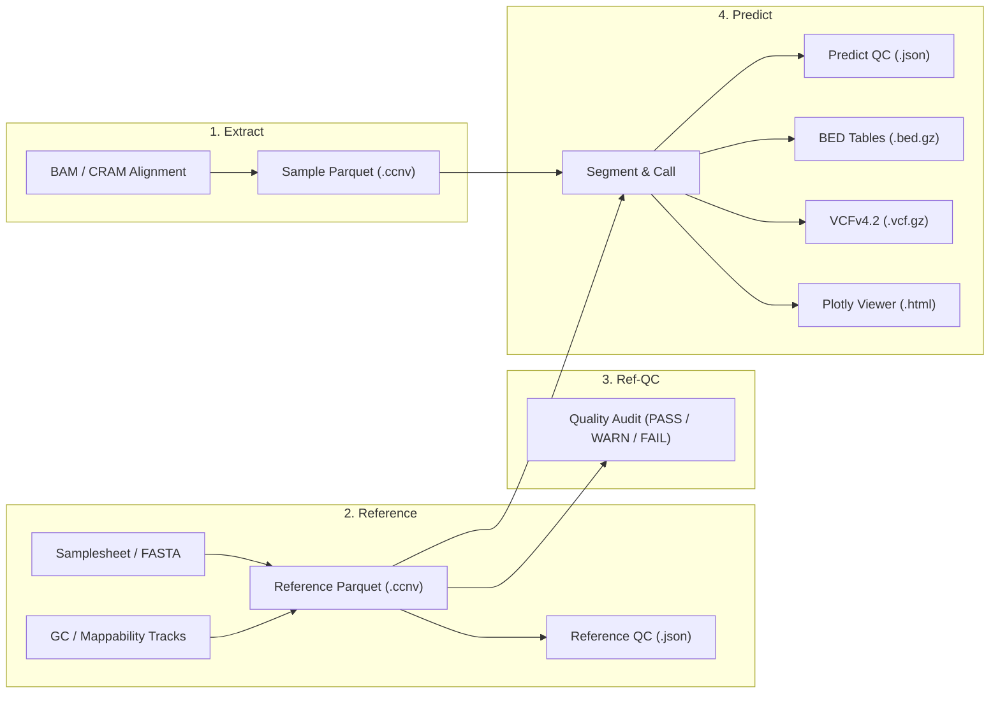

# Copynumber-CNV (`ccnv`) Blueprint

`ccnv` is an independent Python 3.12+ bioinformatics toolkit for copy-number variation (CNV) detection in shallow whole-genome sequencing (sWGS) data, inspired by the published statistical methodology of WISECONDOR (Straver et al., *Nucleic Acids Research*, 2014) and WisecondorX (Raman et al., *Nucleic Acids Research*, 2019).

- **Versioned Parquet Storage (`2.0.0`)**: Sample bin counts and reference models are stored as Zstandard-compressed Apache Arrow/Parquet `.ccnv` files with embedded QC, provenance, and optional prenatal model metadata.
- **Constitutional & Prenatal Analysis Modes**: Supports standard germline CNV profiling (`--mode germline`) as well as cell-free DNA (cfDNA) non-invasive prenatal screening (`--mode prenatal`) with pure NumPy/SciPy/scikit-learn fetal fraction estimation (`FFY`, `FFX`, `FFA`), 2D stoichiometric Bayesian sex chromosome aneuploidy calling, and discordance filtering.
- **Organism-Agnostic & 0-Based Half-Open Coordinates**: Contig names, order, and lengths are read directly from alignment or FASTA headers without assuming a fixed 24-chromosome layout. All intervals are 0-based half-open `[start, end)`.
- **Pure-Python & DataFrame-Native Execution**: Uses `polars`, `pysam`, `pyBigWig`, `numpy`, `scipy`, `pyarrow`, `scikit-learn`, and weighted `ruptures` segmentation without heavy ML container dependencies.

## System Overview

The pipeline formalizes CNV identification across shallow whole-genome sequencing datasets into four discrete functional stages: read ingestion and binning (`extract`), cohort reference synthesis with covariate correction (`reference`), reference audit and quality verification (`ref-qc`), and single-sample projection and change-point segmentation (`predict`).



### Mathematical & Algorithmic Architecture

#### 1. Alignment Ingestion & Proportional Rebinning
Alignments are streamed contig-by-contig with `pysam.AlignmentFile`, filtering reads failing QC (unmapped, secondary, supplementary, duplicate, vendor-failed, or mapping quality below threshold). Genomic intervals are partitioned into 0-based half-open bins $[s_i, e_i)$ of fixed width $B$ (default $5\,000\text{ bp}$), where terminal bins truncate at the contig boundary. When coarsening across integer-multiple resolutions (e.g. $5\text{ kb} \to 100\text{ kb}$), a Rust-parallelized Polars integer fast-path aggregates nested intervals in $O(B)$ time. For non-nested coordinate reconciliation, counts are projected via piece-wise linear cumulative count interpolation ($F(x) = \sum_{j: e_j \le x} c_j + c_k \frac{x - s_k}{e_k - s_k}$), strictly conserving continuous read totals across bin grids.

#### 2. DESeq2 Median-of-Ratios Scaling & Joint B-Spline Covariate Bias Correction
Sequencing depth non-linearly covaries with regional base composition and mappability. Low-mappability bins ($< \tau_{\text{map}}$, default $0.5$) and bins with high ambiguous base fractions ($N > 0.5$) are masked. Samples are scaled using DESeq2 median-of-ratios size factors (Anders & Huber, 2010), achieving a $50\%$ breakdown point that prevents large aneuploidies from shifting diploid baselines. A joint design matrix $\mathbf{X}_{\text{cov}}$ is constructed combining natural cubic B-splines with quantile knots for GC content, quadratic B-splines for mappability, and an explicit $\text{GC} \times \text{mappability}$ interaction term. Multiplicative biases are estimated per sample via robust Huber M-estimation (`HuberRegressor`, $\epsilon = 1.35$), clamped to $[0.20, 5.0]$, and divided out while preserving total depth over usable bins.

#### 3. Gavish-Donoho SVHT PCA & Signal-Subspace KDTree Reference Modeling
Following depth normalization and low-coverage masking ($\le 5\%$ of median bin depth), centered unscaled Principal Component Analysis decomposes the cohort matrix. The optimal subspace rank $P$ is determined dynamically via Gavish-Donoho Optimal Singular Value Hard Thresholding (SVHT), separating systemic technical batch effects from Marchenko-Pastur bulk noise. Each bin is embedded into a $(P+2)$-dimensional signal subspace $\mathbf{f}_i \in \mathbb{R}^{P+2}$. Off-contig reference partners are queried per contig via multi-threaded C-compiled `scipy.spatial.KDTree` in $O(U \log U)$ time, eliminating high-dimensional distance concentration and distance matrix memory bottlenecks. Residual degrees of freedom are adjusted for PCA rank ($d = \max(1, S_{\text{null}} - 1 - P)$), and per-bin null variances are moderated using Smyth (2004) Empirical Bayes shrinkage (`squeeze_var`).

#### 4. Robust Huber Projection, Empirical Bayes Weights & Pre-Split Euchromatic Segmentation
During prediction, test sample counts are projected onto reference PCA loadings via robust Huber M-estimation (`HuberRegressor`, $\epsilon = 1.35$), bounding the influence of copy-number aberrations and preventing ghost baseline shifts on euploid contigs. Within-sample references are refined through vectorized 2D neighbor-matrix median evaluations across $M$ iterations (default 3), masking outlier bins with $|Z_i| \ge 2.326347874$. Usable bins receive Empirical Bayes inverse moderated variance weights $w_i = \operatorname{clip}(s_0^2 / \tilde{\sigma}_{\text{null}, i}^2, 0.05, 20.0)$. Chromosomes are pre-split at masked gaps $>2\text{ Mb}$ into contiguous euchromatic arm blocks before change-point optimization with C-compiled `ruptures.KernelCPD` (or exact `Pelt`/`Binseg` with `WeightedL2Cost`). Events are called using Polars-native Stouffer precision Z-scores with Newey-West AR(1) spatial autocorrelation correction, scaling sensitivity by $\sqrt{N}$ while preventing false-positive inflation from local genomic waves.

#### 5. Prenatal Fetal Fraction Estimation & Sex Chromosome Analysis
In `--mode prenatal`, `ccnv` integrates non-invasive prenatal analysis directly into reference building and prediction. During `reference`, a 5 kb `chrY` non-negative `ElasticNetCV` regression (`FFY`) is calibrated to retain co-varying single-copy MSY bins alongside a 20x coarsened 100 kb autosomal PCA, convex logit-link `RidgeCV` + `ElasticNetCV` ensemble (`FFA`), and robust Huber M-estimation on `chrX` (`FFX`). During `predict`, `chrX` is normalized against the diploid `XX` (`female_sex`) reference branch, fetal sex and sex chromosome aneuploidies (`XX`, `XY`, `XO`, `XXX`, `XXY`, `XYY`, `DISCORDANT_MIXED`) are classified via a 2D stoichiometric Gaussian Bayes model with Mahalanobis $\chi^2$ gating, and independent estimators are combined via Bates-Granger precision fusion for `active_ff`. Predicted CNV segments are evaluated against expected prenatal copy ratios and scored via fetal-fraction-parameterized log-likelihood ratios ($\operatorname{LLR}_{\text{fetal}}$), flagging sub-fetal noise, super-fetal maternal changes, or gonosome shifts with dedicated discordance highlighting and structured `<prefix>_qc.json` reporting.

## Subdirectories & System Boundaries

- `src`: [src/README.md](./src/README.md) - Top-level Python source namespace and subsystem boundary.
- `src/ccnv`: [src/ccnv/README.md](./src/ccnv/README.md) - Core bioinformatics pipeline implementation and CLI orchestrators (`extract`, `reference`, `ref-qc`, `predict`).
- `src/ccnv/models`: [src/ccnv/models/README.md](./src/ccnv/models/README.md) - Layer 0 domain objects, configurations, results, versioned Arrow schemas (`2.0.0`), and exceptions.
- `src/ccnv/stats`: [src/ccnv/stats/README.md](./src/ccnv/stats/README.md) - Layer 1 pure numerical, signal-subspace nearest-neighbor, SVHT PCA, B-spline regression, Empirical Bayes variance shrinkage, and prenatal mathematical kernels.
- `src/ccnv/io`: [src/ccnv/io/README.md](./src/ccnv/io/README.md) - Layer 2 file format readers (BAM/CRAM, BigWig, FASTA, cytoband BED/TSV), samplesheet parsing, and Parquet storage.
- `src/ccnv/features`: [src/ccnv/features/README.md](./src/ccnv/features/README.md) - Layer 3 feature transformations, dynamic rebinning, DESeq2 depth normalization, joint B-spline covariate bias correction, and prenatal inference models.
- `src/ccnv/qc`: [src/ccnv/qc/README.md](./src/ccnv/qc/README.md) - Layer 4 quality control auditors and structured JSON report builders.
- `src/ccnv/report`: [src/ccnv/report/README.md](./src/ccnv/report/README.md) - Layer 5 deliverable writers for bgzipped/tabix BED, VCFv4.2, and interactive Plotly HTML viewer.

## Global Invariants

- Schema Version: All serialized `.ccnv` Parquet files strictly conform to Arrow schema version `2.0.0` and validate against `ccnv.models.schemas:validate_table`.
- Coordinate System: All intervals across memory representations, Parquet tables, and output BED/VCF files are 0-based half-open `[start, end)`.
- Contig Authority: Contig names, order, and lengths from alignment headers or reference FASTA files are authoritative; arbitrary 24-chromosome layouts are forbidden.
- Off-Contig Neighbor Separation: Reference bin neighbors must never be drawn from the same contig as the target bin ($d_{\text{intra-contig}} = \infty$).
- Masked Bin Propagation: Bins flagged as masked during covariate or coverage filtering are propagated consistently through PCA projection and excluded from segmentation cost evaluation.
- Diploid XX Gonosome Baseline: In prenatal mode, `chrX` normalization is always evaluated against the diploid `XX` (`female_sex`) reference branch to accurately capture fetal sex-chromosome dosage changes.

## Global Side Effects

- Filesystem Persistence: Writes zstd-compressed Parquet tables (`.ccnv`), bgzipped and tabix-indexed BED tables (`.bed.gz`, `.tbi`), bgzipped VCF files (`.vcf.gz`, `.tbi`), quality metrics JSON (`<prefix>_qc.json` for both `reference` and `predict`), and standalone HTML visualization files (`.html`).
- Alignment Indexing: Automatically generates missing BAM (`.bai`), CRAM (`.crai`), or FASTA (`.fai`) index files in place on the filesystem.
- Process Concurrency: Spawns worker process pools (`ProcessPoolExecutor`) for parallel contig read binning and cohort rebinning, and utilizes multi-threaded C++ `KDTree` queries for off-contig nearest-neighbor selection.

## Installation

```console
python -m pip install .
ccnv --help
```

For development with [Pixi](https://pixi.sh):

```console
pixi install
pixi run ccnv --help
```

Multi-platform container images (`linux/amd64` and `linux/arm64`) are published to `ghcr.io/matthdsm/copynumber-cnv`:

```console
docker pull ghcr.io/matthdsm/copynumber-cnv:latest
docker run --rm ghcr.io/matthdsm/copynumber-cnv:latest --help
```

## Quickstart

```console
# 1. Extract BAM or CRAM alignments into binned sample Parquet (.ccnv)
ccnv extract sample.bam --prefix sample --bin-size 5000

# 2a. Build a germline reference model from a cohort samplesheet (with optional GC & mappability tracks)
ccnv reference -s cohort.yaml --prefix reference --bin-size 5000 --gc genome.fa --mappability mappability.bw

# 2b. Or build a flat uniform-depth germline reference from a FASTA when no controls are available
ccnv reference --fasta genome.fa --prefix reference --bin-size 5000 --mappability mappability.bw

# 2c. Or build a unified prenatal reference from a maternal cfDNA cohort samplesheet
ccnv reference -s cohort.yaml --mode prenatal --prefix prenatal_ref --bin-size 5000

# 3. Inspect reference quality control metrics
ccnv ref-qc reference.ccnv

# 4a. Predict copy-number gains and losses in constitutional/germline mode
ccnv predict sample.ccnv reference.ccnv --prefix results/sample

# 4b. Or run prenatal prediction with fetal fraction estimation and sex chromosome analysis
ccnv predict sample.ccnv prenatal_ref.ccnv --mode prenatal --prefix results/sample_prenatal
```

- `extract` writes `<prefix>.ccnv` (automatically indexing BAM/CRAM files when needed; CRAM inputs also require `--fasta`). Metadata records effective read counts and filter drops on target contigs.
- `reference` writes `<prefix>.ccnv` and `<prefix>_qc.json` from a cohort samplesheet (`-s/--samplesheet`) or flat FASTA (`--fasta`). In `--mode prenatal`, it fits multi-resolution `FFY`, `FFA`, and `FFX` models alongside 5 kb CNV branches.
- `ref-qc` audits `<prefix>.ccnv` and outputs `<prefix>_qc.json` with a usability verdict (`PASS`, `WARN`, `FAIL`).
- `predict` writes bgzipped and tabix-indexed BED and VCFv4.2 tables (`_bins`, `_segments`, `_calls`), an interactive genome viewer (`<prefix>_plot.html`), and a run quality metrics report (`<prefix>_qc.json`). In `--mode prenatal`, segments include prenatal scaling and discordance tags, the viewer highlights discordant calls in high contrast, and `_qc.json` details fetal fraction and aneuploidy calls.

## Documentation

- [CLI Reference](docs/cli.md): Complete command-line flags, defaults, and I/O specifications.
- [Pipeline Architecture](docs/pipeline.md): Data flow, coordinate contracts, and algorithmic stages.
- [Mathematical & ML Methodology](docs/methodology.md): Equations, statistical assumptions, model selection rationale, and constant provenance.
- [Benchmarks](docs/benchmark.md): Concordance, storage efficiency, and segmentation benchmarks.

## System Verification

- Run: `pytest`

## Development

```console
pixi run format
pixi run lint
pixi run test
pixi run hooks
```

All changes must be submitted via pull request and recorded in [CHANGELOG.md](CHANGELOG.md).

## License

Licensed under the MIT License. See [LICENSE.md](LICENSE.md).
