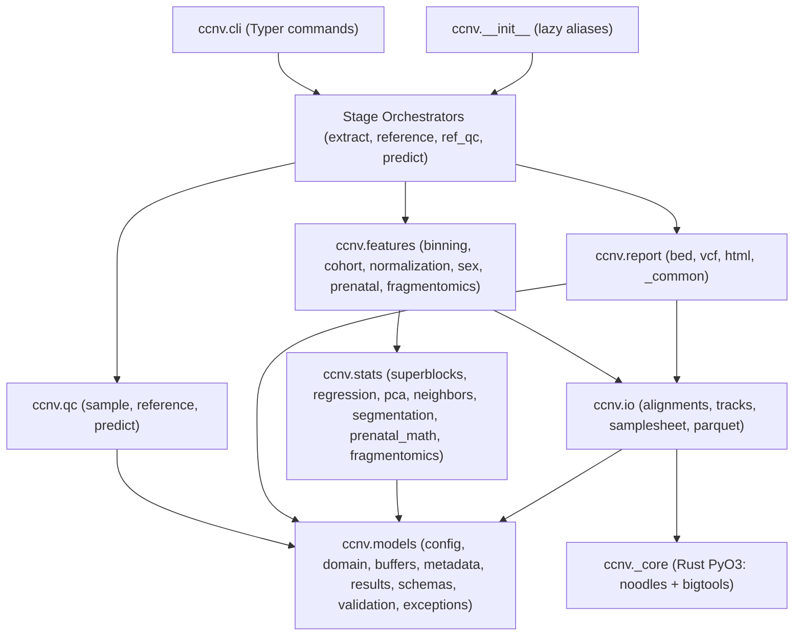
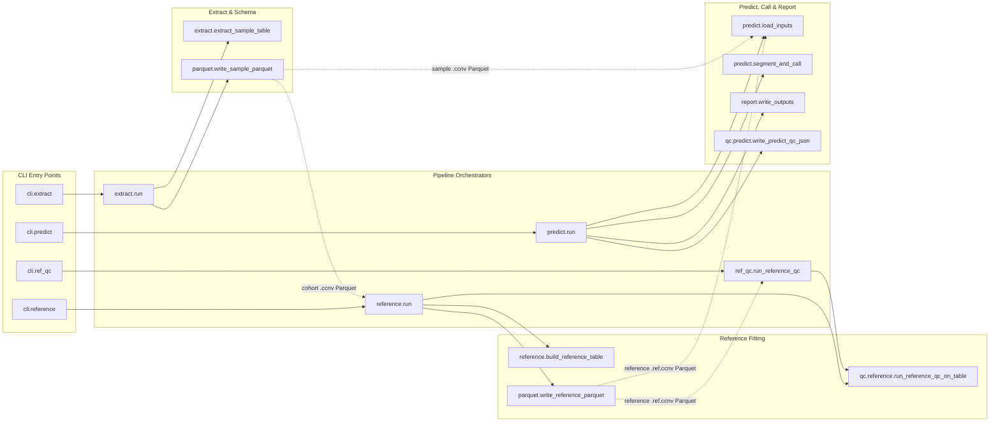
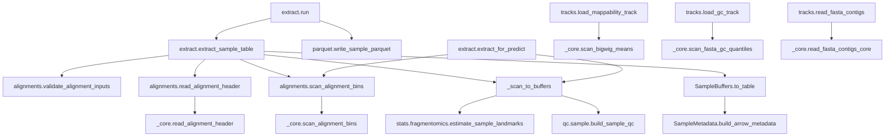

# API Reference

This document maps the Python and compiled Rust (`ccnv._core`) API of `ccnv`, covering package entry points, typed domain models, I/O readers and writers, statistical kernels, feature-engineering pipelines, QC evaluators, report generators, and module-level call-graph DAGs. For architectural overviews, CLI flags, and statistical equations, see [Pipeline Architecture](pipeline.md), [CLI Reference](cli.md), and [Mathematical Methodology](methodology.md).

!!! note
    Top-level aliases (`ccnv.run_extract`, `ccnv.run_reference`, `ccnv.run_reference_qc`, `ccnv.run_predict`) are loaded lazily via `__getattr__` so CLI startup and lightweight metadata checks avoid importing NumPy, SciPy, scikit-learn, and PyArrow until an execution stage begins. This page is contract-tested against the live `src/ccnv` AST (`tests/test_docs_markdown.py`): any relevant code change adding, removing, moving, or renaming modules, symbols, parameter signatures, or call-graph edges must update the corresponding section and DAGs in lockstep.

## 1. Architecture & Call-Graph DAGs

The `ccnv` codebase forms a strict directed acyclic graph (DAG) with zero circular imports across architectural layers and pipeline stages. The five diagrams below trace dependencies from package tiers down to stage-specific function call graphs.

### 1.1 Package & Module Tier DAG

### 1.2 End-to-End Pipeline Call DAG

### 1.3 Extraction, Track Ingestion & Parquet I/O Call DAG

### 1.4 Reference Construction, Prenatal Fitting & Ref-QC Call DAG

```mermaid
flowchart TB
    R_REF["reference.run"] --> SS["samplesheet.load_samplesheet"]
    R_REF --> LC["_load_cohort"]
    LC --> CH_ASM["cohort.load_and_assemble_cohort"]
    LC --> CH_FA["cohort.cohort_from_fasta"]
    CH_ASM --> REB_BUF["rebinning.rebin_sample_buffers"]
    R_REF --> B_REF["reference.build_reference_table"]
    B_REF --> TR_LOAD["tracks.load_gc_track / tracks.load_mappability_track"]
    B_REF --> R_CR["_resolve_contig_roles"]
    B_REF --> R_SEX["_resolve_sexes"]
    R_SEX --> SEX_INF["sex.infer_sample_sexes / sex.infer_germline_sex_2d"]
    B_REF --> PR_FIT["prenatal.fit_prenatal_models"]
    PR_FIT --> PR_MSY["prenatal_math.fit_msy_sex_mixture"]
    PR_FIT --> FG_FIT["features.fragmentomics.fit_cohort_fragmentomics_model"]
    PR_FIT --> PG_100["prenatal_grid.compute_100k_profiles"]
    PR_FIT --> PM_FFY["prenatal_math.fit_poisson_msy_ffy / prenatal_math.fit_forward_ffx_model"]
    PR_FIT --> REG_LOG["regression.fit_logit_linear_ensemble"]
    B_REF --> FIT_BR["_fit_cnv_branches"]
    FIT_BR --> BR_FIT["_fit_branch"]
    BR_FIT --> SB_EST["superblocks.estimate_superblock_scales"]
    BR_FIT --> REG_POI["regression.fit_poisson_covariate_trends"]
    BR_FIT --> PCA_FIT["pca.fit_whitened_pca"]
    BR_FIT --> NBR_FIT["neighbors.fit_prototype_graph / neighbors.calibrate_prototype_dispersion"]
    B_REF --> BF_ASM["buffers.assemble_reference_table"]
    R_REF --> PQ_WR["parquet.write_reference_parquet"]
    R_REF --> QC_R["qc.reference.run_reference_qc_on_table"]
    R_RQC["ref_qc.run_reference_qc"] --> PQ_RR["parquet.read_reference_parquet"]
    R_RQC --> QC_R
```

### 1.5 Single-Sample Prediction, Segmentation, Prenatal Origin & Reporting Call DAG

```mermaid
flowchart TB
    R_PRD["predict.run"] --> L_IN["predict.load_inputs"]
    L_IN --> PQ_RR["parquet.read_reference_parquet"]
    L_IN --> PQ_RS["parquet.read_sample_buffers"]
    L_IN --> EX_FP["extract.extract_for_predict"]
    L_IN --> REB_SB["rebinning.rebin_sample_buffers"]
    R_PRD --> PR_INF["prenatal.predict_prenatal"]
    PR_INF --> PM_SCA["prenatal_math.classify_sca_ray_4d / prenatal_math.fuse_active_fetal_fraction_student_t4"]
    PR_INF --> FG_KL["stats.fragmentomics.predict_ff_kl_deconvolution / stats.fragmentomics.predict_ff_fragmentomics"]
    R_PRD --> N_ONCE["_normalize_branches_once"]
    N_ONCE --> B_BM["predict.build_branch_model"]
    B_BM --> N_BM["normalization.build_branch_model_from_tables"]
    N_ONCE --> N_BR["normalization.normalize_branch"]
    N_BR --> N_SBR["normalization.normalize_sample_branch"]
    N_SBR --> SB_EST["superblocks.estimate_superblock_scales"]
    N_SBR --> REG_POI["regression.fit_poisson_covariate_trends"]
    N_SBR --> PCA_HUB["pca.project_huber_pca_wave"]
    R_PRD --> S_C["predict.segment_and_call"]
    S_C --> SEG_GEN["segmentation.segment_and_score_genome"]
    SEG_GEN --> SEG_PRE["_segment_and_prescore_contig"]
    SEG_PRE --> SEG_BP["_find_breakpoints"]
    SEG_CTG["segmentation.segment_contig"] --> SEG_BP
    R_PRD --> PO_ANN["prenatal_origin.annotate_sample_prenatal_segments"]
    PO_ANN --> PO_LOD["prenatal_origin.annotate_prenatal_origin_and_lod"]
    PO_LOD --> PO_5S["prenatal_origin.classify_segment_origin_5state"]
    R_PRD --> R_OUT["report.write_outputs"]
    R_OUT --> R_BED["bed.write_bins_bed_streaming / bed.write_segments_bed_streaming"]
    R_OUT --> R_VCF["vcf.write_bins_vcf / vcf.write_segments_vcf"]
    R_OUT --> R_HTML["html.render_genome_plot"]
    R_BED --> C_BGZF["_core.write_bgzf_indexed"]
    R_VCF --> C_BGZF
    R_PRD --> QC_P["qc.predict.build_predict_qc_payload / qc.predict.write_predict_qc_json"]
```

## 2. Package Root, CLI, Stage Orchestrators & Compiled Core

### `ccnv` (`src/ccnv/__init__.py`)

Top-level package entry point exposing package metadata and lazy stage runners.

- **`__getattr__(name: str)`** — Lazily resolves `run_extract`, `run_reference`, `run_reference_qc`, and `run_predict` on first access to keep module import overhead minimal.
- **`run_extract`** — Lazy alias for `ccnv.extract.run`.
- **`run_reference`** — Lazy alias for `ccnv.reference.run`.
- **`run_reference_qc`** — Lazy alias for `ccnv.ref_qc.run_reference_qc`.
- **`run_predict`** — Lazy alias for `ccnv.predict.run`.

### `ccnv._core` (`src/ccnv/_core.pyi`, `crates/ccnv-core/src/lib.rs`)

Compiled Rust PyO3 (`abi3-py314`) extension wrapping `noodles` and `bigtools` for streaming genomic I/O, FASTA scanning, BigWig aggregation, and BGZF index writing.

- **`FRAG_BAND_EDGES`** — Module constant tuple of 25 integer fragment-length boundaries defining the 24 bands covering `[30, 601)`.
- **`GC_QUANTILE_EDGES`** — Module constant tuple of 9 breakpoints `(0.0, 0.30, 0.35, 0.40, 0.45, 0.50, 0.55, 0.65, 1.0)` defining the 8 sub-bin GC quantile bands.
- **`read_alignment_header(path: str, fasta_path: str | None = None) -> list[tuple[str, int]]`** — Reads ordered `(contig_name, contig_length)` pairs from a BAM or CRAM alignment header (supplying `fasta_path` when needed for CRAM headers).
- **`scan_alignment_bins(path: str, contigs: Sequence[tuple[str, int]], bin_size: int, min_mapq: int = 1, require_proper_pair: bool = True, threads: int = 1, fasta_path: str | None = None, collect_bands: bool = True, se_fragment_length: int = 0, *, exclude_duplicates: bool = True, exclude_secondary: bool = True, exclude_supplementary: bool = True, exclude_unmapped: bool = True) -> _ScanAlignmentResult`** — Streams BAM/CRAM reads sequentially or in parallel 50 Mb indexed tiles, returning per-bin counts, fragmentomics histograms, 4-mer end-motif counts, and QC tally counts.
- **`read_fasta_contigs_core(fasta_path: str) -> list[tuple[str, int]]`** — Reads ordered `(contig_name, length)` records from a FASTA index (`.fai`) or raw FASTA sequence file.
- **`scan_fasta_gc_quantiles(fasta_path: str, contigs: Sequence[tuple[str, int]], bin_size: int) -> tuple[NDArray[np.float32], NDArray[np.float32], NDArray[np.float32]]`** — Scans a FASTA file across target contigs and computes per-bin GC fraction, valid base fraction, and 8-quantile GC compositions using 200 bp sub-windows.
- **`scan_bigwig_means(bw_path: str, contigs: Sequence[tuple[str, int]], bin_size: int, full_bin_denominator: bool = False) -> NDArray[np.float32]`** — Computes per-bin mean track values from a BigWig file across target contigs, resolving UCSC/plain contig aliases automatically.
- **`write_bgzf_indexed(gz_path: str, preset: Literal["bed", "vcf"], contig_names: Sequence[str], max_contig_len: int, chunks: Iterable[bytes], threads: int = 1) -> str`** — Writes uncompressed byte chunks through a multi-threaded BGZF encoder while simultaneously building a `.tbi` or `.csi` index and returning the written index path.

### `ccnv.cli` (`src/ccnv/cli.py`)

Typer CLI application defining the four `ccnv` subcommands and runtime logging setup.

- **`LogLevel`** — String enum (`DEBUG`, `INFO`, `WARNING`, `ERROR`, `CRITICAL`) constraining `--loglevel` CLI options.
- **`configure_logging(level: LogLevel) -> None`** — Configures stderr logging with timestamps and severity formatting at the requested level.
- **`extract(alignment, prefix, bin_size, fasta, min_mapq, keep_duplicates, keep_secondary, keep_supplementary, allow_improper_pairs, all_contigs, threads, loglevel)`** — Typer command that builds an `ExtractConfig`, validates inputs, and invokes `ccnv.extract.run`.
- **`reference(prefix, samplesheet, fasta, mode, prenatal_binsize, bin_size, all_contigs, autosomal_contig, sex_contig, sex_signal_contig, sex_cutoff, pca_components, max_batch_memory_mb, min_cohort_size, min_sex_group_size, qc_report, mappability, gc, min_mappability, threads, loglevel)`** — Typer command that validates CLI options, constructs a `ReferenceConfig`, and invokes `ccnv.reference.run`.
- **`ref_qc(reference, prefix, loglevel)`** — Typer command that builds a `ReferenceQCConfig`, invokes `ccnv.ref_qc.run_reference_qc`, and exits with code 2 if any branch reports `FAIL`.
- **`predict(sample, reference, prefix, sex, penalty, z_threshold, ratio_threshold, min_reference_bins, mask_repeats, max_blacklist_gap, plot, cytobands, vcf, bins_vcf, threads, fasta, mappability, gc, min_mappability, mode, loglevel)`** — Typer command that validates CLI options, constructs a `PredictConfig`, and invokes `ccnv.predict.run`.
- **`_require_positive_float(value: float | None) -> float | None`** — Internal validator enforcing finite strictly positive numeric CLI options.
- **`_require_finite_unit_float(value: float | None) -> float | None`** — Internal validator enforcing finite values within `[0.0, 1.0]`.
- **`_fail(error: BaseException, code: int) -> NoReturn`** — Internal helper printing an error message to stderr and exiting with the requested CLI code.

### `ccnv.extract` (`src/ccnv/extract.py`)

Stage 1 orchestrator for extracting per-bin read counts and fragmentomics from alignments.

- **`run(config: ExtractConfig) -> None`** — Orchestrates alignment scanning, Schema v2.0.0 table construction with embedded `ccnv.qc` metadata, and atomic `.ccnv` Parquet writing (re-exported as `run_extract`).
- **`extract_sample_table(config: ExtractConfig) -> pa.Table`** — Validates alignment inputs, scans bins, constructs canonical `SampleBuffers` via `_scan_to_buffers`, attaches `SampleMetadata` and `FragmentomicsMetadata`, and materializes the output PyArrow table.
- **`extract_for_predict(alignment, ref_meta, *, threads, fasta, collect_bands)`** — Streams BAM/CRAM bins directly into reference-aligned `SampleBuffers` for single-sample prediction without serializing an intermediate `.ccnv` Parquet file.
- **`_scan_to_buffers`** — Internal helper converting raw `ScanAlignmentResult` outputs, fragmentomics landmarks, and QC counts into typed `SampleBuffers`.

### `ccnv.reference` (`src/ccnv/reference.py`)

Stage 2 orchestrator for building germline and prenatal CNV reference models.

- **`run(config: ReferenceConfig) -> Path`** — Validates inputs, builds the reference PyArrow table, writes the `.ref.ccnv` Parquet file, and runs reference QC (re-exported as `run_reference`).
- **`build_reference_table(cohort: Cohort, config: ReferenceConfig) -> pa.Table`** — Coordinates track loading, contig-role and sex resolution, CNV branch fitting, optional prenatal calibration, and Schema v2.0.0 table assembly.
- **Internal reference helpers** — `_load_cohort`, `_fit_cnv_branches`, `_validate_config`, `_resolve_contig_roles`, `_resolve_sexes`, `_resolve_sex_signal`, and `_fit_branch` load cohort/FASTA layouts, classify sex groups, and fit super-block scales, Poisson exogenous regressions, whitened SVHT PCA, Prototype Graph models, and moderated overdispersions.

### `ccnv.ref_qc` (`src/ccnv/ref_qc.py`)

Stage 3 orchestrator for auditing existing reference Parquet files.

- **`run_reference_qc(config: ReferenceQCConfig) -> ReferenceQCOutputs`** — Loads a reference Parquet file, delegates evaluation to `ccnv.qc.reference.run_reference_qc_on_table`, writes `_qc.json`, and returns structured branch QC outcomes.

### `ccnv.predict` (`src/ccnv/predict.py`)

Stage 4 orchestrator for single-sample normalization, segmentation, CNV calling, prenatal inference, and deliverable export.

- **`PredictionInput`** — Dataclass holding loaded sample buffers, metadata, authoritative contig lengths, and filtered reference branches ready for normalization.
- **`run(config: PredictConfig) -> PredictionOutputs`** — Executes input loading, track preloading, optional prenatal fetal fraction/SCA evaluation, branch normalization, segmentation/calling, report emission, and prediction QC export (re-exported as `run_predict`).
- **`load_inputs(sample_path, reference_path, *, sex, mode, fasta, threads) -> PredictionInput`** — Reads and validates reference Parquet branches and loads or extracts the sample table (rebinning in memory when sample bin size differs from the reference).
- **`build_branch_model(inputs, branch, ref_meta)`** — Compiles a reusable `BranchModel` from loaded prediction inputs and reference metadata.
- **`segment_and_call(bins, contig_lengths, *, penalty, z_threshold, ratio_threshold, max_blacklist_gap, threads, mode)`** — Segments normalized branches with calibrated Pelt and evaluates discrete copy-number Bayes factors and dyadic BLUE Z-scores.
- **Internal predict helpers** — `_preload_sample_track_overrides`, `_normalize_branches_once`, `_sample_usable_from_bin_results`, `_validate_branch_contigs`, and `_validate_config` validate parameters, preload optional `--gc`/`--mappability` overrides, normalize branches once per invocation, and summarize usable autosomal bins.

## 3. Domain Models & Schema Contracts (`ccnv.models`)

The `ccnv.models` package (`src/ccnv/models/__init__.py` re-exports all public classes, functions, and exceptions) defines schema version `2.0.0` containers, typed configurations, metadata serializers, and structural validators.

### `ccnv.models.buffers` (`src/ccnv/models/buffers.py`)

Compact typed NumPy column buffers matching Arrow table schemas without per-row Python object overhead.

- **`SampleBuffers`** — Dataclass storing the 7 coordinate-free per-bin arrays (`count`, `paired_count`, `frag_len_sum`, `short_frag_count`, `endpoint_count`, `frag_gc_sum`, `frag_bands`).
  - **`SampleBuffers.num_rows`** — Property returning the number of bins stored in `count`.
  - **`SampleBuffers.from_table(table, *, validate)`** — Classmethod extracting zero-copy or typed NumPy arrays from a validated sample PyArrow table.
  - **`SampleBuffers.coerce(sample, *, validate)`** — Classmethod returning `SampleBuffers` directly or converting an Arrow sample table once at boundaries.
  - **`SampleBuffers.to_table(*, base_metadata)`** — Serializes the 7 arrays and optional base Arrow metadata into a canonical Schema v2.0.0 PyArrow table.
- **`BranchFitArrays`** — Dataclass storing fitted arrays for one reference branch across bins, PCA components, and prototypes.
  - **`BranchFitArrays.num_rows`** — Property returning the number of bins in the branch.
  - **`BranchFitArrays.pca_rank`** — Property returning the retained whitened PCA rank $k$.
  - **`BranchFitArrays.to_table(*, target_pca_rank, branch_code, branch_vocab, contig_vocab, contig_to_code, metadata)`** — Converts branch fit arrays into a PyArrow table matching the 17-column reference schema.
- **`assemble_reference_table(branches, *, contig_order, metadata)`** — Concatenates fitted branch tables (CNV branches plus optional prenatal branches) and attaches Arrow `ReferenceMetadata`.
- **`_sentinel_f32(values, n_bins)`** — Internal helper converting nullable float vectors into `float32` arrays of length `n_bins` using `NaN` sentinels for masked/missing entries.

### `ccnv.models.config` (`src/ccnv/models/config.py`)

Immutable configuration dataclasses for read filters and the four CLI stages.

- **`AnalysisMode`** — `StrEnum` defining analysis execution modes (`"germline"`, `"prenatal"`).
- **`SexBranch`** — `StrEnum` identifying sex-specific reference branches (`"female_sex"`, `"male_sex"`).
- **`ReadFilters`** — Frozen dataclass specifying minimum MAPQ, proper-pair enforcement, duplicate/secondary/supplementary/unmapped read filtering, and synthetic single-end fragment length; validates bounds in `__post_init__()`.
  - **`ReadFilters.to_dict()`** — Serializes read filter parameters to a JSON-compatible dictionary.
  - **`ReadFilters.from_dict(data, *, strict)`** — Classmethod reconstructing a validated `ReadFilters` instance from serialized metadata.
- **`ExtractConfig`** — Dataclass holding input/output paths, bin size, thread budget, contig filtering, and `ReadFilters` for `extract`.
- **`ReferenceConfig`** — Dataclass holding cohort samplesheet or FASTA inputs, track options, bin sizes, `--mode`, and output prefix for `reference`.
- **`ReferenceQCConfig`** — Dataclass holding reference Parquet path, output prefix, and JSON flags for `ref-qc`.
- **`PredictConfig`** — Dataclass holding sample/reference inputs, track overrides, caller/ploidy parameters, prenatal mode flags, output formats, and cytoband path for `predict`.
- **`parquet_path(prefix: Path) -> Path`** — Resolves the canonical `<prefix>.ccnv` output Parquet path without duplicating suffixes.
- **`_require_pos_int(val: object, name: str) -> None`** — Internal helper enforcing strictly positive integers.
- **`_require_nonneg_int(val: object, name: str) -> None`** — Internal helper enforcing non-negative integers.

### `ccnv.models.domain` (`src/ccnv/models/domain.py`)

Core biological domain entities and organism-agnostic chromosome naming utilities.

- **`SamplesheetEntry`** — Dataclass representing a validated cohort samplesheet row (`filepath`, optional `fasta`, optional explicit `sex`, and optional `sample_id`).
- **`Cytoband`** — Dataclass representing a parsed cytogenetic band (`contig`, `start`, `end`, `name`, `stain`) in 0-based half-open coordinates.
- **`ContigLookup`** — Case- and prefix-insensitive contig name resolver handling UCSC `chr` vs plain naming across heterogeneous references.
  - **`ContigLookup.from_names(available)`** — Classmethod indexing an ordered iterable of available contig names in $O(1)$.
  - **`ContigLookup.resolve(contig: str) -> str | None`** — Resolves a candidate contig name to the authoritative reference contig name or returns `None`.
- **`normalize_chr(name: str) -> str`** — Returns a canonical lowercase contig key stripped of any leading `'chr'` prefix (`MT`/`chrM` normalized uniformly).
- **`is_autosome_name(name: str) -> bool`** — Returns `True` when a contig name matches canonical numbered autosomes ($\ge 1$, with or without `chr`).
- **`is_canonical_contig(name: str) -> bool`** — Returns `True` for canonical primary chromosomes (`1`–`22`, `X`, `Y`, excluding MT, ALT, decoy, random, unplaced, and EBV).
- **`natural_sort_key(name: str)`** — Computes a natural chromosome sort key placing autosomes numerically before `X`, `Y`, `MT`, and auxiliary contigs.
- **`select_layout(entries, *, all_contigs)`** — Filters `(name, length)` header pairs to canonical chromosomes unless `all_contigs` is set.

### `ccnv.models.exceptions` (`src/ccnv/models/exceptions.py`)

Typed exception hierarchy rooted at `CcnvError`.

- **`CcnvError`** — Base exception class for all domain and pipeline failures in `ccnv`.
- **`ReferenceError`** — Raised for invalid reference inputs, missing branches, or failed model fitting.
- **`InvalidInputError`** — Raised for malformed CLI/API arguments, conflicting flags, or invalid filesheets.
- **`CovariateError`** — Raised when exogenous GC, mappability, or FASTA tracks fail validation or alignment.
- **`PredictError`** — Raised when single-sample prediction preconditions or prenatal/branch compatibility checks fail.
- **`BinCompatibilityError`** — Subclass raised when sample and reference bin sizes, contig layouts, or rebinning rules are incompatible without upsampling.
- **`SchemaError`** — Raised when Arrow Parquet schemas or metadata fields violate contract specifications.
- **`SchemaVersionError`** — Subclass raised when reading artifacts written with an unsupported or legacy schema version.
- **`ExtractError`** — Raised when read extraction fails on inputs or target contigs.
- **`AlignmentError`** — Subclass raised for missing indexes, unreadable BAM/CRAM headers, or CRAM FASTA mismatches.
- **`ReferenceQCError`** — Raised when auditing a corrupted or unreadable reference file.

### `ccnv.models.metadata` (`src/ccnv/models/metadata.py`)

JSON-backed Arrow schema metadata envelopes (`ccnv.fragmentomics`, `ccnv.prenatal`, `ccnv.qc`, and top-level `SampleMetadata` / `ReferenceMetadata`).

- **`ArtifactKind`** — `StrEnum` identifying Arrow Parquet artifact types (`"sample"`, `"reference"`).
- **`encode_metadata(values)`** — Serializes namespaced metadata payloads to deterministic RFC-8259 UTF-8 JSON bytes.
- **`decode_metadata(metadata)`** — Decodes Arrow byte metadata mappings while rejecting malformed or non-finite (`NaN`/`Infinity`) constants.
- **`FragmentomicsMetadata`** — Dataclass carrying sample-level fragment size landmarks (`q05`–`q95`, `mean`), short-fragment ratio, MDS, 10 bp helical periodicity, 571-bin length histogram, and 256-element 5' 4-mer motif counts.
  - **`FragmentomicsMetadata.to_dict()`** — Serializes fragmentomics metadata fields to a plain JSON-ready dictionary.
  - **`FragmentomicsMetadata.from_dict(data)`** — Classmethod constructing a validated `FragmentomicsMetadata` from a decoded dictionary.
- **`PrenatalModelMetadata`** — Dataclass storing fitted prenatal hyperparameters (`prenatal_binsize`, `ffy_*`, `ffx_*`, `ffa_model`, `ff_size_model`, deconvolution priors, Fisher band weights, SCA covariance/means, and origin priors).
  - **`PrenatalModelMetadata.to_dict()`** — Serializes prenatal hyperparameters to a JSON-compatible dictionary.
  - **`PrenatalModelMetadata.from_dict(data)`** — Classmethod constructing a validated `PrenatalModelMetadata` from a decoded dictionary.
  - **`PrenatalModelMetadata.encode()`** — Serializes the container directly to canonical RFC-8259 UTF-8 JSON bytes.
  - **`PrenatalModelMetadata.decode(raw)`** — Classmethod parsing `PrenatalModelMetadata` from JSON bytes, strings, or mappings.
  - **`PrenatalModelMetadata.from_metadata(metadata)`** — Classmethod extracting `ccnv.prenatal` from Arrow schema metadata mappings.
  - **`PrenatalModelMetadata.from_table(table)`** — Classmethod extracting and decoding `ccnv.prenatal` from an Arrow table.
- **`SampleMetadata`** — Dataclass storing `schema_version`, `coordinate_system`, `bin_size`, `contig_order`, `contig_lengths`, `read_filters`, `qc`, and optional `fragmentomics`.
  - **`SampleMetadata.paired_end`** — Property indicating whether paired-end proper-pair mode was used during extraction.
  - **`SampleMetadata.expected_num_bins`** — Property computing total expected bins across all header contigs including trailing partial bins.
  - **`SampleMetadata.to_metadata()`** — Converts sample metadata to an unprefixed dictionary for serialization.
  - **`SampleMetadata.build_arrow_metadata()`** — Builds canonical Arrow byte metadata mappings containing `ccnv.*` keys.
  - **`SampleMetadata.from_dict(data)`** — Classmethod constructing `SampleMetadata` from a decoded metadata dictionary.
  - **`SampleMetadata.from_schema(schema)`** — Classmethod validating and extracting `SampleMetadata` from an Arrow schema.
  - **`SampleMetadata.from_table(table)`** — Classmethod validating and extracting `SampleMetadata` from an Arrow table.
- **`ReferenceMetadata`** — Dataclass storing reference `schema_version`, `coordinate_system`, `bin_size`, `contig_order`, `contig_lengths`, `mode`, `branches`, covariate metadata, and optional `prenatal`.
  - **`ReferenceMetadata.to_metadata()`** — Converts reference metadata to a plain dictionary for persistence.
  - **`ReferenceMetadata.build_arrow_metadata()`** — Builds canonical Arrow byte metadata mappings containing `ccnv.*` keys.
  - **`ReferenceMetadata.from_dict(data)`** — Classmethod constructing `ReferenceMetadata` from a decoded metadata dictionary.
  - **`ReferenceMetadata.from_schema(schema)`** — Classmethod validating and extracting `ReferenceMetadata` from an Arrow schema.
  - **`ReferenceMetadata.from_table(table)`** — Classmethod validating and extracting `ReferenceMetadata` from an Arrow table.
- **Internal coercion and invariant helpers** — `_as_bool`, `_as_int`, `_as_float`, `_req_bool`, `_req_int`, `_opt_int`, `_req_float`, `_opt_float`, `_opt_str`, `_req_float_list`, `_opt_float_list`, `_req_int_list`, `_opt_int_list`, `_as_str_tuple`, `_opt_str_tuple`, `_opt_nullable_str_tuple`, `_opt_obj_dict`, `_opt_nullable_obj_dict`, `_is_pos_int`, `_schema_pos_int`, `_schema_nonneg_int`, `_validate_contig_lengths`, `_reject_json_constant`, `_check_envelope_invariants`, `_parse_schema_version`, `_parse_coordinate_system`, and `_parse_contig_lengths` enforce strict type contracts when parsing untrusted Parquet metadata.

### `ccnv.models.results` (`src/ccnv/models/results.py`)

Structured output containers shared between statistical kernels, QC modules, and report writers.

- **`ScanQcCounts`** — Dataclass summarizing reads examined, kept, and per-filter exclusion counts across target contigs.
- **`ScanAlignmentResult`** — Dataclass encapsulating raw NumPy bin arrays, histograms, motif counts, and `ScanQcCounts` returned by alignment scanning.
- **`BinResult`** — Dataclass holding per-bin prediction results (`contig`, `start`, `end`, log2 ratios, Z-scores, prototype distances, masked flags, and weights).
- **`SegmentResult`** — Dataclass holding called genome segments with breakpoints, BLUE Z-scores, copy-number state (`cn`), Bayes factors, and optional prenatal origin annotations.
- **`PrenatalLoDMetrics`** — Dataclass reporting prenatal limit-of-detection metrics (minimum detectable fetal fraction and achieved statistical power).
- **`SCAResult`** — Dataclass holding 4D ray-marginalized sex-chromosome aneuploidy classification (`karyotype`, posteriors, log-likelihoods, and confidence margin).
- **`FetalFractionResult`** — Dataclass combining `FFY`, `FFX`, `FFA`, `FF_size`, Student-$t_4$ fused `active_ff`, and per-estimator diagnostic statuses.
- **`PredictionOutputs`** — Dataclass bundling paths of all generated BED, VCF, HTML, and QC JSON artifacts alongside summary statistics.
- **`BranchQCStatus`** — Dataclass storing per-branch QC metrics, status (`PASS`, `WARN`, `FAIL`), and diagnostic reasons.
  - **`BranchQCStatus.status`** — Property returning the branch quality verdict (`PASS`, `WARN`, or `FAIL`).
  - **`BranchQCStatus.__getitem__(key)`** — Dictionary-style lookup into the underlying metrics mapping.
  - **`BranchQCStatus.get(key, default)`** — Returns the metric value for `key` or `default` if absent.
- **`ReferenceQCOutputs`** — Dataclass holding overall verdict, serialized JSON payload, and branch status map.
  - **`ReferenceQCOutputs.branches`** — Property returning the typed map of branch QC results keyed by branch name.

### `ccnv.models.schemas` (`src/ccnv/models/schemas.py`)

PyArrow schema constructors and coordinate-reconstruction utilities.

- **`build_reference_schema(pca_rank)`** — Constructs the canonical 17-column Arrow schema for `.ref.ccnv` Parquet tables parameterized by retained PCA rank.
- **`reconstruct_sample_grid(meta)`** — Reconstructs authoritative 0-based half-open `(contig_codes, contig_names, starts, ends)` coordinate arrays deterministically from `SampleMetadata`.
- **`canonical_dictionary_array(col, col_name, *, index_type)`** — Encodes, unifies, and deduplicates categorical contig or branch labels into one PyArrow `DictionaryArray`.
- **`decode_dictionary_contigs(contig_col)`** — Decodes an Arrow dictionary-encoded or string contig column into an ordered tuple of names.
- **`unique_dictionary_contigs(contig_col)`** — Extracts distinct contig names preserving encounter order without full array materialization.
- **`fixed_size_list_to_numpy(col, list_size, dtype)`** — Converts a PyArrow `FixedSizeListArray` or `ChunkedArray` directly into a contiguous 2D `(N, list_size)` NumPy matrix.

### `ccnv.models.validation` (`src/ccnv/models/validation.py`)

Strict contract validators enforcing schema version `2.0.0`, non-null invariants, and coordinate monotonicity.

- **`validate_metadata(metadata, kind)`** — Validates required envelope keys, coordinate invariants, and typed `SampleMetadata` or `ReferenceMetadata` contracts.
- **`validate_schema(schema, kind)`** — Validates Arrow column field types and embedded file metadata against the requested `ArtifactKind`.
- **`validate_sample_table(table)`** — Validates a compact Schema v2.0.0 sample PyArrow table, metadata, 7 non-null columns, and implicit grid row count.
- **`validate_reference_table(table, *, check_rows)`** — Validates a reference PyArrow table's metadata, 17 columns, branch invariants, and optional row coordinate monotonicity.
- **Internal validation helpers** — `_check_version_header`, `_expected_reference_schema`, `_validate_arrow_fields`, `_validate_non_null_columns`, `_explicit_bin_size`, and `_validate_reference_rows` implement individual structural checks.

## 4. I/O Layer (`ccnv.io`)

The `ccnv.io` package (`src/ccnv/io/__init__.py` re-exports public readers/writers) handles alignment validation, streaming Parquet storage, samplesheet parsing, and FASTA/BigWig/BED track loading.

### `ccnv.io.alignments` (`src/ccnv/io/alignments.py`)

Python wrappers around `ccnv._core` alignment readers with format detection and precondition checks.

- **`alignment_format(path: Path) -> Literal["bam", "cram"]`** — Infers alignment format from file suffix and rejects unsupported extensions.
- **`validate_alignment_inputs(path, fasta)`** — Verifies alignment file existence, CRAM `--fasta` availability, and index presence when needed.
- **`read_alignment_header(path: Path, fasta: Path | None = None)`** — Validates inputs and delegates header parsing to `ccnv._core.read_alignment_header`.
- **`scan_alignment_bins(path, contigs, bin_size, filters, *, threads, fasta, collect_bands, se_fragment_length)`** — Calls `ccnv._core.scan_alignment_bins` and translates raw tuples/arrays into a typed `ScanAlignmentResult`.

### `ccnv.io.parquet` (`src/ccnv/io/parquet.py`)

Version-checked Parquet persistence with atomic temporary staging and row-group predicate pushdown.

- **`read_sample_buffers(path: Path)`** — Reads a `.ccnv` Parquet file, validates schema/metadata, and returns `SampleBuffers`.
- **`write_sample_parquet(table, path, *, compression_level)`** — Atomically writes a validated ZSTD-compressed sample PyArrow table via a sibling temporary file and replace.
- **`filter_reference_branches(table, branches)`** — Filters an in-memory reference PyArrow table to selected branch names while preserving schema metadata.
- **`read_reference_parquet(path, *, branches, check_rows)`** — Reads a `.ref.ccnv` Parquet file (optionally pruning row groups to `branches` via column statistics), validates the contract, and returns `(table, ReferenceMetadata)`.
- **`write_reference_parquet(table, path, *, compression_level)`** — Atomically writes a validated multi-branch reference PyArrow table partitioned by branch row group for predicate pushdown.
- **Internal Parquet helpers** — `_sibling_tmp_path`, `_decode_stat_str`, `_select_matching_row_groups`, and `_is_string_or_string_dict` manage safe staging paths and Parquet row-group statistics filtering.

### `ccnv.io.samplesheet` (`src/ccnv/io/samplesheet.py`)

YAML/JSON root-list samplesheet ingestion and JSON Schema validation.

- **`load_samplesheet(path: Path) -> list[SamplesheetEntry]`** — Parses a YAML or JSON cohort samplesheet, validates it against the bundled JSON Schema, resolves relative paths, and checks duplicate sample IDs.
- **`_get_samplesheet_schema()`** — Internal cached loader returning the bundled samplesheet JSON Schema definition.

### `ccnv.io.tracks` (`src/ccnv/io/tracks.py`)

Ingestion of reference FASTA GC quantiles, BigWig mappability tracks, BED GC tracks, and UCSC cytobands.

- **`load_mappability_track(path, contigs, starts, ends)`** — Loads per-bin mean mappability from a BigWig file (via `_core.scan_bigwig_means`) or interval track onto target reference bin coordinates.
- **`load_gc_track(path, contigs, starts, ends)`** — Loads per-bin GC and valid-base fractions from a FASTA reference (computing 8-quantile GC bins via `_core.scan_fasta_gc_quantiles`), BigWig, or BED track.
- **`load_cytobands_track(path, contig_lengths)`** — Parses standard UCSC cytoband BED/TSV files into ordered `Cytoband` records mapped to reference contigs.
- **`read_fasta_contigs(fasta_path, *, all_contigs)`** — Returns ordered `(contig, length)` tuples from `ccnv._core.read_fasta_contigs_core` filtered by canonical layout rules unless `all_contigs` is set.
- **Internal track helpers** — `_bin_weighted_mean`, `_extract_contig_grid`, `_load_bigwig_intervals`, `_compute_fasta_gc`, `_load_bed_gc`, and `_classify_gc_source` handle interval weighting and track format dispatch.

## 5. Statistical Kernels (`ccnv.stats`)

The `ccnv.stats` package (`src/ccnv/stats/__init__.py` re-exports all public kernels and models) implements pure stateless mathematical estimators free of file I/O.

### `ccnv.stats.superblocks` (`src/ccnv/stats/superblocks.py`)

Within-sample 1 Mb super-block aggregation for robust DESeq2 median-of-ratios depth scaling.

- **`partition_contiguous_superblocks(contig_ids, *, bin_size, block_bp, block_bins, min_blocks)`** — Groups contiguous bins along each contig into fixed-span (~1 Mb) super-block `[start, end)` offsets without crossing contig boundaries.
- **`estimate_superblock_scales(counts, contig_ids, *, usable, bin_size, block_bp, reference, min_blocks)`** — Computes robust median-of-ratios library size factors across usable super-blocks relative to a reference expectation vector.
- **Internal super-block helpers** — `_partition_contig_runs`, `_sum_superblocks`, and `_align_usable_1d` partition contiguous contig spans, aggregate bin counts per super-block, and align validity masks.

### `ccnv.stats.regression` (`src/ccnv/stats/regression.py`)

Exogenous bias correction and convex regularized logit-link regression ensembles.

- **`LogitEnsembleFit`** — Dataclass storing standardized design parameters and fitted linear weights for `RidgeCV`/`ElasticNetCV` logit-link predictors.
- **`standardize_column(arr)`** — Computes robust mean/scale standardization parameters avoiding zero-variance division.
- **`mad_scale(values)`** — Computes normalized Median Absolute Deviation ($1.4826 \times \mathrm{MAD}$) for outlier-resistant scale estimation.
- **`half_sample_mode(values)`** — Estimates sample central tendency via the Robertson-Cryer $O(N \log N)$ iterative half-sample mode.
- **`hsm_biweight_mode(values, weights)`** — Refines half-sample mode estimates with two-step precision-weighted Tukey biweight iterations.
- **`fit_logit_linear_ensemble(X, y, *, standardize, l1_ratios, ridge_alphas, enet_alphas, seed, max_iter)`** — Fits a $K$-fold out-of-fold cross-validated convex `RidgeCV` + `ElasticNetCV` logit-link ensemble (`FFA` / `FF_size`).
- **`build_exogenous_covariate_basis(usable, *, bin_size, gc, gc_quantiles, mappability, ref_frag_len, ref_ep_rate)`** — Constructs clamped natural spline / quantile design matrices over GC content, 8-quantile GC profile, mappability, and fragmentomics covariates.
- **`fit_poisson_covariate_trends(counts, size_factors, exposure, usable, design_usable, *, fit_mask, max_fit_bins, threads)`** — Fits zero-inclusive Poisson GLM bias curves on winsorized sample counts against the exogenous basis and returns multiplicative normalization trends.
- **Internal regression helpers** — `_count_distinct_up_to`, `_fit_convex_logit_pair`, `_clamped_quantile_splines`, `_append_standardized_columns`, `_validate_optional_1d_track`, `_usable_spline_covariate`, `_poisson_deviance_residuals`, `_winsorize_poisson_counts`, and `_fit_single_sample_poisson` construct basis features and stabilize GLM optimization.

### `ccnv.stats.pca` (`src/ccnv/stats/pca.py`)

Gavish-Donoho optimal singular-value hard-thresholding (SVHT) PCA and Huber-robust projection.

- **`WhitenedPCAResult`** — Dataclass storing the feature mean, orthonormal principal loadings, retained rank, and noise threshold.
- **`fit_whitened_pca(counts, expected, usable, *, max_components)`** — Runs chunked SVD/IRLBA on variance-whitened cohort residuals and selects latent rank via the Gavish-Donoho SVHT cutoff.
- **`reconstruct_whitened_pca_expected(expected, usable, pca_result)`** — Reconstructs positive per-sample expected counts across masked and unmasked bins.
- **`project_huber_pca_wave(log_signal, loadings, *, whitening_scale, eval_loadings, eval_whitening_scale, epsilon, alpha, clip)`** — Projects a single test sample onto fixed reference loadings via rank-safe `HuberRegressor` (de-weighting somatic CNV outliers) to estimate expected technical wave counts.
- **`pca_irlba_numpy(X, n_components, seed)`** — Pure-NumPy truncated Lanczos/IRLBA solver with sign canonicalization for memory-bounded SVD on large matrices.
- **Internal PCA helpers** — `_pca_chunk_rows`, `_fit_chunk_mean_and_whitened`, `_whitened_centered_from_mu`, and `_svht_noise_cutoff` stream matrix blocks and compute the SVHT threshold.

### `ccnv.stats.neighbors` (`src/ccnv/stats/neighbors.py`)

Off-contig Prototype Graph construction, Kish LOCO calibration, and Smyth Empirical Bayes variance moderation.

- **`exact_poisson_log2_jensen_bias(lam)`** — Analytical Jensen expectation correction for low-coverage discrete Poisson counts in $\log_2$ units.
- **`exact_poisson_log_variance(lam)`** — Exact discrete Poisson shot variance of $\ln(C + 0.5)$ in natural-$\log^2$ units.
- **`build_whitened_subspace_features(pca_loadings, singular_values, mp_sigma, *, covariate_mat, fallback_rate)`** — Builds signal-weighted whitened PC plus standardized covariate coordinates used to embed bins in prototype space.
- **`fit_prototype_graph(features, *, max_prototypes, top_r)`** — Clusters signal-space features via `MiniBatchKMeans` into $M \le \text{max\_prototypes}$ representative prototypes and assigns `top_r` nearest prototypes with inverse-distance weights.
- **`compute_loco_prototype_support(contig_ids, proto_ids, proto_weights, *, eligible)`** — Precomputes $O(U)$ leave-one-chromosome-out donor support counts and inverse effective sample sizes.
- **`evaluate_loco_prototype_baseline(values, contig_ids, proto_ids, proto_weights)`** — Evaluates $O(U)$ within-sample leave-one-chromosome-out weighted prototype median baselines and bin support counts.
- **`compute_kish_loco_inflation(contig_ids, proto_ids, proto_weights, support, *, eligible)`** — Computes Kish LOCO prototype median variance inflation factor $1 + \pi / (2 K_{\mathrm{eff}})$.
- **`calibrate_prototype_dispersion(counts, recon_expected, contigs, usable, proto_ids, proto_weights, *, pca_rank, kappa_frag)`** — Evaluates leave-one-chromosome-out reference residuals across cohort samples to estimate cohort `null_mean` and depth-decomposed Empirical Bayes `bio_dispersion`.
- **`squeeze_var(var, df)`** — Implements Smyth (2004) Empirical Bayes inverse-$\chi^2$ variance shrinkage moderating bin-wise overdispersion toward the cohort prior.
- **Internal neighbor helpers** — `_build_poisson_log_table`, `_resolve_prototype_weights`, and `_winsorized_anscombe_mean_and_var` cache discrete Poisson log moments and stabilize residual variance estimates.

### `ccnv.stats.segmentation` (`src/ccnv/stats/segmentation.py`)

Gap-aware Pelt segmentation, multi-scale dyadic BLUE Z-scoring, and discrete integer copy-number Bayes factors.

- **`ContigSegmentationInput`** — Dataclass bundling bin coordinates, normalized ratios, precision weights, depths, and dispersions for one contig.
- **`WeightedL2Cost`** — Custom `ruptures.base.BaseCost` subclass implementing weighted $O(1)$ prefix-sum quadratic segmentation cost.
  - **`WeightedL2Cost.fit(signal)`** — Precomputes contiguous weighted prefix sums from an `(N, 2)` matrix of `(values, weights)`.
  - **`WeightedL2Cost.error(start, end)`** — Returns the weighted residual sum of squares for segment slice `[start, end)`.
- **`estimate_dyadic_inflation(zscores, usable, *, scales)`** — Estimates scale-dependent autocorrelation inflation $\kappa(L)$ across dyadic window lengths on unmasked autosomal residuals.
- **`interpolate_dyadic_inflation(n_bins, inflation_values, *, scales)`** — Interpolates $\kappa(N)$ monotonically in $\log_2$ scale space across arbitrary segment bin spans.
- **`segment_contig(*, contig, starts, ends, ratios, weights, contig_length, penalty, sensitivity, kappa_local, min_size, jump, max_blacklist_gap)`** — Splits euchromatic arms at masked gaps $\gt 2\text{ Mb}$, runs calibrated Pelt segmentation (`KernelCPD` when weights are uniform and `WeightedL2Cost` otherwise), and returns segmented intervals.
- **`segment_and_score_genome(contigs, *, penalty, sensitivity, mode, z_threshold, ratio_threshold, min_size, jump, max_blacklist_gap, threads)`** — Estimates genome-wide dyadic autocorrelation inflation and segments all canonical and sex contigs with Gauss-Markov BLUE Z-scores and discrete `CN in {0, 1, 2, 3, 4+}` Bayes factors.
- **Internal segmentation helpers** — `_segment_bin_spans`, `_reduce_segment_means`, `_evaluate_integer_cn_bf`, `_as_optional_1d_f64`, `_segment_and_prescore_contig`, `_cumulative`, `_find_breakpoints`, `_validate_inputs`, and `_split_blacklist_gaps` manage prefix sums, gap splitting, Pelt pruning, and Bayes-factor calculation.

### `ccnv.stats.prenatal_math` (`src/ccnv/stats/prenatal_math.py`)

Low-level mathematical models for prenatal Y-chromosome estimation, forward FFX calibration, Student-$t_4$ fusion, and 4D SCA ray classification.

- **`MSYSexModel`** — Dataclass storing bimodal Poisson-Gamma mixture parameters (`mu_female`, `mu_male`, priors) over `chrY` MSY counts.
- **`PoissonFFYModel`** — Dataclass holding background maternal false-positive rate and male slope for `chrY` fetal-fraction MLE.
- **`SCARayClassification`** — Dataclass storing 4D Gaussian mixture ray parameters across diploid and aneuploid karyotype classes (`XX`, `XY`, `XO`, `XXX`, `XXY`, `XYY`).
- **`compute_autosomal_density(counts, contigs, exposure, mappability, gc_trend, autosomal_mask)`** — Computes chromosome-median ratio-of-sums autosomal read density used to scale sex-contig relative expectations.
- **`fit_msy_sex_mixture(msy_counts, msy_exposure, *, bic_delta_min)`** — Fits the two-component `MSYSexModel` expectation-maximization classifier for reference sex labeling.
- **`fit_poisson_msy_ffy(msy_bin_counts, msy_bin_exposure, mappability, female_mask, male_mask, labeled_ff)`** — Identifies clean single-copy MSY bins and fits exact closed-form Poisson MLE models of Y-based fetal fraction (`FFY`).
- **`evaluate_poisson_msy_ffy(sample_msy_counts, sample_msy_exposure, model)`** — Evaluates closed-form Poisson MLE `FFY` and depth-propagated standard error on a single sample.
- **`fit_forward_ffx_model(chrx_ratios, f_targets, valid_mask)`** — Fits forward-calibrated regression $R_X = \alpha_0 + \alpha_1 f$ mapping fetal fraction onto diploid `chrX` ratio shifts relative to `XX` baseline.
- **`fuse_active_fetal_fraction_student_t4(estimates, standard_errors, *, df, max_iter, tol)`** — Combines available `FFY`, `FFX`, `FFA`, and `FF_size` estimators via heavy-tailed Student-$t_4$ IRLS precision fusion.
- **`classify_sca_ray_4d(delta_x, sigma_x, ffy, sigma_ffy, ffa, sigma_ffa, ff_size, sigma_size, *, chrx_llr_fetal, clinical_priors)`** — Classifies fetal sex-chromosome aneuploidies via analytical 4D `erfc` ray marginalization across $(R_X, R_Y, \mathrm{FFA}, \mathrm{FF}_{\mathrm{size}})$ space, flagging `DISCORDANT_MIXED` when posteriors conflict.
- **Internal prenatal math helpers** — `_poisson_logpmf` and `_log_normal_interval_prob` provide underflow-safe numerical probability primitives.

### `ccnv.stats.fragmentomics` (`src/ccnv/stats/fragmentomics.py`)

Cell-free DNA fragment-size deconvolution, Fisher band weighting, end-motif diversity, and size-based fetal fraction estimation.

- **`FragmentomicLandmarks`** — Dataclass holding per-sample fragment length quantiles (`q05`, `q10`, `q25`, `q50`, `q75`, `q90`, `q95`), `mean`, `short_ratio`, `mds`, and `periodicity`.
- **`encode_kmer_4(seq)`** — Encodes 4-mer 5' DNA sequences into canonical `[0, 255]` motif indices.
- **`compute_motif_diversity_score(motif_counts)`** — Computes normalized Shannon entropy (`MDS`) across the 256 4-mer end motifs.
- **`compute_helical_periodicity(hist)`** — Extracts the ~10 bp nucleosomal helical power ratio from fragment length spectra.
- **`align_histogram(hist, shift_bp)`** — Aligns and normalizes a 571-bin fragment length histogram covering `30–600 bp` with optional mode shift correction.
- **`estimate_sample_landmarks(hist_autosomal, end_motif_counts, *, paired_end)`** — Computes `FragmentomicLandmarks` from aligned histograms and end-motif arrays.
- **`deconvolve_fetal_maternal_densities(hist_autosomal_matrix, hist_chry_matrix, ff, is_male, *, smooth_sigma, em_steps)`** — Deconvolves reference cohort fragment length histograms into pure fetal ($\hat{p}_F(L)$) and maternal ($\hat{p}_M(L)$) densities.
- **`predict_ff_kl_deconvolution(hist_sample, p_fetal, p_maternal)`** — Estimates sample fetal fraction by minimizing KL divergence against convex mixtures of $\hat{p}_F(L)$ and $\hat{p}_M(L)$.
- **`compute_fragment_length_llr(hist, p_fetal, p_maternal, *, sizing_shift_bp, baseline_ff, is_gain)`** — Computes per-segment fragment-length log-likelihood ratios contrasting fetal-enriched vs maternal-enriched size profiles.
- **`compute_band_fisher_weights(p_fetal_571, p_maternal_571, *, f0)`** — Solves Fisher optimal 24-band read weights $w^{\ast}_{0.08}$ maximizing fetal-fraction Fisher information across fragment size bands.
- **`evaluate_band_weighted_counts(frag_bands, raw_counts, paired_counts, band_weights_24)`** — Applies a 24-band weight vector to per-bin fragment band matrices to synthesize Fisher-weighted coverage arrays and Kish design factors.
- **`build_fragmentomic_feature_vector(hist_autosomal, motif_counts, chromatosome_mode_bp, sizing_shift_bp, helical_10bp_amp, motif_mds, fetal_motif_ratio, reference_maternal_571)`** — Builds the 36-dimensional mode-aligned feature vector combining size ratios, KL deconvolution estimate, quantiles, MDS, and helical periodicity.
- **`fit_ff_fragmentomics_ensemble(features, ff_targets, *, seed)`** — Fits the standardized logit-link convex `RidgeCV` + `ElasticNetCV` 36-feature `FF_size` ensemble.
- **`predict_ff_fragmentomics(hist_autosomal, motif_counts, *, paired_end, chromatosome_mode_bp, sizing_shift_bp, helical_10bp_amp, motif_mds, fetal_motif_ratio, p_fetal_density, p_maternal_density, ff_frag_weights, ff_frag_bias, ff_frag_feature_mean, ff_frag_feature_scale)`** — Evaluates mode-aligned KL MLE and the `FF_size` logit ensemble from raw fragmentomic arrays.
- **`_compute_fetal_motif_ratio`** — Internal helper extracting fetal-associated 5' C-end/G-end motif enrichment ratios.

## 6. Feature Engineering & Inference (`ccnv.features`)

The `ccnv.features` package (`src/ccnv/features/__init__.py` re-exports all public transformers and models) implements binning, rebinning, cohort assembly, covariate masking, sex calling, within-sample normalization, and prenatal origin classification.

### `ccnv.features.binning` (`src/ccnv/features/binning.py`)

Vectorized coordinate alignment, bin exposure calculation, interval overlap aggregation, and matrix rebinning.

- **`align_grid_indices(src_contigs, src_starts, src_ends, dst_contigs, dst_starts, dst_ends, *, allow_alias, strict_branch)`** — Maps destination `(contig, start, end)` coordinates onto source row indices (`-1` when absent) in $O(B)$.
- **`align_sample_to_grid_indices(sample_meta, dst_contigs, dst_starts, dst_ends, *, allow_alias, strict_branch)`** — Maps destination coordinates directly onto `SampleBuffers` row indices reconstructed from `SampleMetadata`.
- **`compute_bin_exposure(starts, ends, bin_size)`** — Computes effective mappable geometric exposure $(end_i - start_i) / bin\_size$ for each bin, handling trailing partial bins accurately.
- **`bin_intervals(length, bin_size)`** — Returns 0-based half-open `(starts, ends)` bin edges for a contig of given length, preserving a partial trailing bin.
- **`build_coordinate_grid(contigs_dict, bin_size)`** — Generates 0-based half-open `(contig, start, end)` coordinate arrays from ordered contig lengths and bin size.
- **`rebin_counts(source_starts, source_ends, source_counts, target_starts, target_ends)`** — Redistributes 1D binned counts from source intervals onto target intervals via overlap/cumulative interpolation.
- **`rebin_counts_matrix(counts, contigs, starts, ends, contig_lengths, source_bin_size, target_bin_size)`** — Coarsens a 2D cohort count matrix onto `target_bin_size` via fast-path `np.add.reduceat` for nested integer grids or cumulative knot interpolation for non-nested grids.
- **Internal binning helpers** — `_contig_run_slices` and `_align_contig_runs` locate and align contiguous contig spans inside flat bin arrays.

### `ccnv.features.rebinning` (`src/ccnv/features/rebinning.py`)

In-memory sample buffer rebinning across matching contig layouts.

- **`rebin_sample_buffers(bufs, target_bin_size)`** — Rebins `SampleBuffers` and updates `SampleMetadata`; preserves all 7 fragmentomic channels on integer-multiple coarsening and zeros fragmentomic channels plus drops `ccnv.fragmentomics` metadata on non-nested grids.
- **`_validate_target_bin_size`** — Internal guard requiring strictly positive target bin sizes.

### `ccnv.features.cohort` (`src/ccnv/features/cohort.py`)

Cohort loading, rebinning harmonization, DESeq2 depth normalization, low-coverage contig masking, and Fisher-weighted cohort synthesis.

- **`Cohort`** — Dataclass holding stacked `(N_samples, N_bins)` count and fragmentomics matrices, sample IDs, layout, and optional explicit sex annotations.
- **`estimate_size_factors(counts, mask, *, contigs, starts, ends, block_bp)`** — Computes DESeq2 median-of-ratios size factors across usable genomic 1 Mb super-blocks.
- **`mask_low_coverage_per_contig(counts, contigs, exposure, *, min_fraction)`** — Flags per-sample/per-contig dropout bins with exposure-adjusted depth below `min_fraction` of positive contig medians.
- **`alloc_cohort_counts(n_bins, n_samples, max_batch_memory_mb)`** — Allocates a Fortran-contiguous `float32` cohort matrix matching sample counts and memory budgets (spilling to disk memmap above budget).
- **`load_and_assemble_cohort(entries, target_bin_size, *, threads, max_batch_memory_mb)`** — Reads or streams cohort samples (rebinning mismatched bin sizes on the fly when contig lengths agree) into a harmonized `Cohort`.
- **`build_fisher_weighted_cohort(cohort, band_weights_24, *, max_batch_memory_mb, threads)`** — Re-weights per-bin cohort matrices across 24 fragment bands using prenatal Fisher weights $w^{\ast}_{0.08}$.
- **`validate_cohort(tables, paths, target_bin_size)`** — Enforces homogeneous paired-end vs single-end layouts and target bin compatibility across in-memory cohort tables.
- **`rebin_cohort(cohort, target_bin_size)`** — Coarsens an entire cohort in memory to a larger `target_bin_size` (e.g., 5 kb to 100 kb).
- **`cohort_from_fasta(contigs_dict, bin_size, *, fasta_path)`** — Builds a uniform flat-depth synthetic 0-sample `Cohort` directly from FASTA contig dimensions.
- **Internal cohort helpers** — `_encode_contig_ids`, `_finalize_frag_covariates`, `_extract_streamed_sample`, `_read_cohort_sample`, `_read_and_extract_sample`, and `_weighted_sample_summary` handle streaming extraction, sample alignment, and per-sample summary moments.

### `ccnv.features.covariates` (`src/ccnv/features/covariates.py`)

Covariate track validation, bin masking, and feature-matrix preparation.

- **`validate_min_mappability(min_mappability)`** — Enforces finite `min_mappability` bounds within `[0.0, 1.0]`.
- **`mask_covariates(usable, *, gc, mappability, n_mask, min_mappability)`** — Computes composite boolean bin mask combining low mappability (`< min_mappability`), high FASTA N-content, and zero exposure bins.
- **`covariate_features(usable, gc, mappability, ref_frag_len, ref_ep_rate)`** — Assembles normalized GC, mappability, and reference fragmentomic covariate matrices for Poisson trend estimation.

### `ccnv.features.sex` (`src/ccnv/features/sex.py`)

Automated reference cohort sex inference and single-sample karyotype assignment.

- **`SexInference`** — Dataclass storing inferred `XX`/`XY` cohort labels, confidence scores, and quarantine masks for ambiguous/aneuploid outliers.
- **`par_xtr_mask(on_contig, starts, ends, contig_length, *, contig_name)`** — Identifies pseudoautosomal (PAR1/PAR2) and X-transposed (XTR) regions on `chrX`/`chrY` to exclude cross-mapping homology while preserving short contigs.
- **`infer_sample_sexes(fractions, min_group_size, cutoff)`** — Splits Y-like chromosome dosage fractions into female and male groups when bimodal separation is clear.
- **`infer_germline_sex_2d(cohort, usable, *, min_group_size, signal_contig, cutoff, explicit_labels)`** — Fits 2D `(d_X, d_Y)` ploidy clusters with 4.5-sigma elliptical quarantine detection for sex chromosome aneuploidies while respecting explicit samplesheet labels.
- **`infer_single_sample_sex(sample, ref_meta, sex, unmasked_sample_bins)`** — Classifies an individual test sample from non-PAR/XTR sex-contig coverage over unmasked reference-aligned bins.
- **Internal sex helpers** — `_sum_counts_by_sample`, `_ellipse_quarantine_2d`, `_quarantine_for_labels`, `_merge_explicit_sexes`, and `_calibrate_labeled_cutoff` aggregate sex-contig depths and isolate outlier clusters.

### `ccnv.features.normalization` (`src/ccnv/features/normalization.py`)

Compiled branch models and single-sample within-sample prototype normalization.

- **`BranchModel`** — Dataclass holding aligned reference tracks, whitened PCA matrices, off-contig Prototype Graph indices/weights, biological dispersions, and usable masks for one branch.
- **`BranchNormalizationResult`** — Dataclass returning bin-level log2 ratios, precision weights, residuals, scale factors, and per-sample covariate predictions.
- **`align_reference_unmasked_bins(sample, reference)`** — Aligns unmasked reference branch intervals onto target sample bin coordinates.
- **`build_branch_model_from_tables(ref_table, branch, *, sample, ref_meta)`** — Compiles a `BranchModel` from filtered reference Parquet rows and optional `SampleBuffers`.
- **`normalize_sample_branch(counts, exposure, model, *, mask_repeats, kappa_frag, min_reference_bins, gc_override, gc_quantiles_override, mappability_override, n_mask_override, min_mappability)`** — Executes super-block depth scaling, per-sample Poisson exogenous bias removal, Huber PCA projection, weighted prototype baseline reconstruction, and Empirical Bayes precision weight synthesis.
- **`normalize_branch(model, config, *, gc_override, gc_quantiles_override, n_mask_override, mappability_override)`** — Normalizes one `BranchModel` using `PredictConfig` settings and optional track overrides, returning a typed `BinResult`.
- **Internal normalization helpers** — `_col_np`, `_opt_sentinel_track`, `_infer_bin_size`, `_project_expected_counts`, `_calibrated_loco_baseline`, `_evaluate_loco_scores`, and `_empty_norm_result` handle sentinel decoding and LOCO prototype median scoring.

### `ccnv.features.fragmentomics` (`src/ccnv/features/fragmentomics.py`)

Cohort-level fragmentomics compatibility checks and Fisher band weighting orchestration.

- **`CohortFragmentomicsFit`** — Dataclass bundling deconvolved fetal/maternal densities, optimal Fisher weights $w^{\ast}_{0.08}$, and fitted `FF_size` models.
- **`extract_sample_fragmentomics(metadata)`** — Parses validated `FragmentomicsMetadata` from decoded or Arrow schema metadata mappings.
- **`fit_cohort_fragmentomics_model(frag_metas, is_male_arr, ff_targets, *, quarantined, seed)`** — Fits cohort fetal/maternal density deconvolution, Fisher weights, and the 36-feature `FF_size` ensemble during prenatal reference training.
- **`apply_prenatal_fisher_weighting(sample, prenatal_meta)`** — Re-weights raw sample 24-band matrices with reference Fisher weights $w^{\ast}_{0.08}$ and attaches per-bin Kish design factors during prenatal inference.
- **`resolve_fisher_moment_weights(sample, prenatal_meta)`** — Resolves exact moment adjustments matching Fisher-weighted Poisson variance estimation.
- **`has_paired_fragmentomics(sample)`** — Returns whether a sample table or metadata payload carries paired-end fragmentomic observations.
- **`resolve_fragmentomics_compatibility(sample, reference)`** — Validates sample vs reference fragmentomic compatibility and handles fallback rules when evaluating single-end or legacy profiles.

### `ccnv.features.prenatal_grid` (`src/ccnv/features/prenatal_grid.py`)

Coarse 100 kb autosomal/sex grid construction and covariate coarsening for prenatal NIPT inference.

- **`col_f64(table, name)`** — Extracts a named PyArrow table column as a `float64` NumPy array.
- **`col_i64(table, name)`** — Extracts a named PyArrow table column as an `int64` NumPy array.
- **`sample_grid(meta)`** — Reconstructs ordered contig names and `int64` interval coordinates from `SampleMetadata` without allocating full tables.
- **`resolve_contig_masks(contigs, *, autosomes, sex_contigs, sex_signal_contig)`** — Returns boolean masks separating canonical autosomes, `chrX`, and `chrY` across a coordinate grid.
- **`prepare_covariate_multipliers(gc, mappability, n_mask, min_mappability, length)`** — Normalizes GC around median 1.0 and thresholds mappability and N-base masks into multiplicative bias adjustments.
- **`rebin_track_1d(values, src_meta, dst_meta)`** — Projects a 1D covariate or mask array from a source sample grid onto a rebinned sample grid.
- **`compute_100k_profiles(counts_matrix, contigs, starts, ends, bin_size, auto_mask, chrx_mask)`** — Computes 100 kb normalized log2 ratio profiles and `chrX` dosage ratios used by `FFA` regression and `FFX` baseline calibration.
- **`extract_ref_contig_roles(reference_table, ffy_ref)`** — Reads optional custom contig roles from reference metadata or the `prenatal_ffy` branch.
- **`resolve_5k_covariates(bufs, bufs_5k, auto_5k, ffy_ref, ffy_align, gc_override, map_override, n_mask_override, min_mappability)`** — Resolves 5 kb autosomal and MSY exogenous tracks honoring user prediction overrides.

### `ccnv.features.prenatal` (`src/ccnv/features/prenatal.py`)

High-level prenatal reference training and single-sample inference orchestration.

- **`fit_prenatal_models(sample_tables, entries, *, prenatal_bin_size, cohort_gc, cohort_mappability, cohort_n_mask, min_mappability, autosomes, sex_contigs, sex_signal_contig, seed)`** — Trains `FFY` (5 kb `chrY` MSY MLE), `FFA` (100 kb autosomal PCA + logit ensemble), forward `FFX`, fragmentomic deconvolution + Fisher weighting + `FF_size`, 4D SCA classifier, and `PrenatalModelMetadata`.
- **`predict_prenatal(sample, reference_table, prenatal_meta, *, min_ff_warning, sample_gc_override, sample_mappability_override, sample_n_mask_override, min_mappability)`** — Evaluates `FFY`, `FFX`, `FFA`, and `FF_size`, classifies karyotype via `classify_sca_ray_4d`, fuses `active_ff` via Student-$t_4$ IRLS, and synthesizes normalized prenatal diagnostic metrics.
- **Internal prenatal helpers** — `_evaluate_sca_and_active_ff` and `_compute_effective_ff` coordinate 4D SCA ray evaluation and active fetal fraction fallback logic.

### `ccnv.features.prenatal_origin` (`src/ccnv/features/prenatal_origin.py`)

Five-state biological origin classifier for called prenatal CNV segments and LoD power profiling.

- **`BandPrefixSums`** — Prefix-sum index enabling $O(\log U)$ per-segment aggregation of the 24 fragment-length bands across any `(contig, start, end)` span.
  - **`BandPrefixSums.from_sample_table(sample, bin_usable)`** — Classmethod building contig-aligned prefix-sum arrays directly from `SampleBuffers` or Arrow tables.
  - **`BandPrefixSums.query(contig, start, end)`** — Sums fragment counts across the 24 size bands overlapping `[start, end)` on `contig`.
- **`classify_segment_origin_5state(r_obs, k_band_counts, p_fetal_24, p_maternal_24, p_plasma_0, active_ff, active_ff_se, is_gain, *, depth_ff, alpha_dm, sigma_r)`** — Evaluates the coupled depth + Dirichlet-Multinomial 24-band likelihood across `FETAL_CONSTITUTIONAL`, `PLACENTAL_MOSAIC`, `MATERNAL_UNINHERITED`, `MATERNAL_AND_FETAL_INHERITED`, and `MATERNAL_MOSAIC` states (assigning `INDETERMINATE` when max posterior $\lt 0.80$).
- **`annotate_prenatal_origin_and_lod(segments, *, prefix_sums, sample_bands, bin_usable, p_fetal_density, p_maternal_density, mu_fetal_w, mu_maternal_w, active_ff, active_ff_se, sca_call, sample_depth_per_mb, sys_var_per_mb, z_threshold)`** — Computes expected ratios, implied fetal fraction, discordance flags (`SCA_DISCORDANT`, `SUB_FETAL_RATIO`, `SUPER_FETAL_RATIO`), `frag_short_ratio`, `frag_llr_size`, origin posteriors, and theoretical `PrenatalLoDMetrics`.
- **`annotate_sample_prenatal_segments(segments, sample, *, bin_usable, prenatal_meta, prenatal_result, z_threshold)`** — Builds `BandPrefixSums` for the sample and annotates all called `SegmentResult` entries with origin calls and fragmentomic statistics.
- **Internal origin helpers** — `_dirichlet_multinomial_logpmf`, `_gaussian_depth_loglik`, `_to_24_band_density`, and `_integrate_mosaic_state` evaluate marginal log-likelihoods over discrete/continuous mosaic grids.

## 7. Quality Control (`ccnv.qc`)

The `ccnv.qc` package (`src/ccnv/qc/__init__.py` re-exports all QC builders, evaluators, and JSON writers) generates `_qc.json` audit reports across `extract`, `reference`, `ref-qc`, and `predict`.

### `ccnv.qc.sample` (`src/ccnv/qc/sample.py`)

Stage 1 extraction QC construction and strict JSON serialization.

- **`sanitize_qc_payload(value)`** — Recursively coerces NumPy scalars/arrays and `NaN` values into standards-compliant JSON primitives.
- **`write_qc_json(path, payload)`** — Atomically writes sanitized QC dictionaries to `_qc.json`.
- **`empty_qc()`** — Returns a zeroed default QC metric dictionary matching expected schema keys.
- **`build_sample_qc(counters, *, reads_seen, reads_kept, effective_reads_examined, effective_reads_kept)`** — Compiles effective read counts, filter drop rates, pairing summaries, and fragmentomic landmarks into `ccnv.qc`.

### `ccnv.qc.reference` (`src/ccnv/qc/reference.py`)

Stage 2/3 reference branch quality auditing and `PASS`/`WARN`/`FAIL` verdict escalation.

- **`compute_signal_contig_metrics(contigs, signal_contig, mean_d, n_refs, cutoff_outlier, min_ref_bins, *, total_bins)`** — Computes masked fraction, residual dispersion, null bias, and effective prototype distance per contig group.
- **`evaluate_autosomal_or_female_verdict(m, min_ref_bins, dist_scale)`** — Evaluates quality thresholds for `autosomal`, `female_sex`, `prenatal_autosomal`, and `prenatal_ffy` branches.
- **`evaluate_male_verdict(m, min_ref_bins, dist_scale)`** — Evaluates `male_sex` branch quality with sex-specific contig coverage rules.
- **`compute_branch_qc(table, branch_name, signal_contig, min_ref_bins, dist_scale)`** — Computes a `BranchQCStatus` summary for a single reference branch table.
- **`write_reference_qc_json(path, data)`** — Writes formatted reference QC payloads atomically to disk.
- **`run_reference_qc_on_table(table, prefix, *, reference_path, write_json, emit_stderr)`** — Evaluates all branches present in a reference table (including prenatal metrics and warning summaries) and returns `ReferenceQCOutputs`.
- **Internal QC escalation helpers** — `_metric_int`, `_metric_float`, `_escalate`, `_escalate_threshold`, `_evaluate_base_support`, and `_escalate_outlier_pct` enforce monotonic `PASS -> WARN -> FAIL` state transitions.

### `ccnv.qc.predict` (`src/ccnv/qc/predict.py`)

Stage 4 single-sample prediction QC payload assembly.

- **`build_predict_qc_payload(mode, sample_table, segments, prenatal_result, bin_results, sex)`** — Aggregates predicted sample `sex` (`"female"`, `"male"`, or `None`), depth metrics, `lambda_gc`, call counts, prenatal `FetalFractionResult`, `SCAResult`, `PrenatalLoDMetrics`, fragmentomic metrics, and diagnostic warnings.
- **`write_predict_qc_json(path, payload)`** — Writes sanitized prediction QC JSON files atomically.
- **`_int_metric(mapping, key, *, fallback_key)`** — Internal helper safely casting nullable integer counts for JSON serialization.

## 8. Reporting & Visualization (`ccnv.report`)

The `ccnv.report` package converts prediction results into indexed BED, VCFv4.2, and self-contained interactive Plotly HTML reports.

### `ccnv.report` (`src/ccnv/report/__init__.py`)

- **`write_outputs(prefix, bins, segments, contig_lengths, plot, vcf, *, bins_vcf, threads, cytobands, z_threshold, ratio_threshold, prenatal_result, mode, qc_json_path)`** — Top-level report dispatcher orchestrating single-pass bgzipped/tabix BED export (`_bins.bed.gz`, `_segments.bed.gz`, `_calls.bed.gz`), optional VCFv4.2 output (`_calls.vcf.gz`, plus `_bins.vcf.gz` with `--bins-vcf`), and interactive HTML rendering (`_plot.html`).

### `ccnv.report._common` (`src/ccnv/report/_common.py`)

Shared chunking, natural contig sorting, DataFrame conversion, and atomic BGZF writing utilities.

- **`ContigBinChunk`** — Dataclass carrying sorted arrays for one contig slice ready for streaming BED/VCF serialization.
- **`validate_threads(threads)`** — Validates positive thread budgets for BGZF compression.
- **`write_bgzf_atomic(gz_path, preset, contig_names, max_contig_len, chunks, threads)`** — Streams encoded byte chunks into a sibling temporary file via `ccnv._core.write_bgzf_indexed`, builds `.tbi`/`.csi`, and atomically commits both `.gz` and index files.
- **`partition_contig_runs(contigs)`** — Splits ordered contig arrays into contiguous `(contig, start_idx, end_idx)` slices.
- **`ordered_contig_names(contigs, preferred_order)`** — Resolves natural chromosome ordering across available bin and segment tables.
- **`resolve_natural_contig_bounds(record_contigs, record_max_end, contig_lengths)`** — Derives authoritative contig upper bounds for VCF headers and tabix/CSI indexing.
- **`iter_contig_bin_chunks(bin_results, contig_order, *, chunk_rows)`** — Streams naturally ordered `ContigBinChunk` slices without copying entire genome DataFrames.
- **`bin_chunk_to_dataframe(chunk)`** — Converts a `ContigBinChunk` to a Polars DataFrame for vectorized BED/VCF formatting.
- **`sort_bin_result(result)`** — Sorts one `BinResult` object into natural contig and coordinate order.
- **`sort_bin_results(results)`** — Sorts a collection of `BinResult` objects into natural contig and coordinate order.
- **`sort_segments(segments)`** — Sorts a sequence of `SegmentResult` records into natural chromosome coordinate order.
- **`segments_to_dataframe(segments, *, is_prenatal)`** — Converts `SegmentResult` sequences to a Polars DataFrame for BED/VCF serialization.
- **`sort_segments_dataframe(df, contig_names)`** — Orders a Polars segment DataFrame according to `contig_names` and coordinates.
- **`resolve_segments_dataframe(segments, segments_df, *, calls_only, is_prenatal, sort_natural)`** — Selects or builds a filtered, sorted Polars segment DataFrame for BED and VCF writers.
- **`max_bin_end(results)`** — Computes the maximum coordinate end across `BinResult` records to determine `.tbi` vs `.csi` indexing requirements.
- **`max_df_end(df)`** — Computes the maximum coordinate end across a Polars segment DataFrame to select `.tbi` vs `.csi` indexing.

### `ccnv.report.bed` (`src/ccnv/report/bed.py`)

Streaming single-pass BGZF + tabix/CSI BED writers for bins, segments, and calls.

- **`write_bins_bed_streaming(gz_path, bin_results, *, contig_lengths, threads)`** — Formats and streams normalized bin metrics into `<prefix>_bins.bed.gz` with accompanying tabix/CSI index.
- **`write_segments_bed_streaming(gz_path, segments, *, calls_only, is_prenatal, contig_lengths, threads, segments_df)`** — Formats and streams called segments or filtered CNV events into `<prefix>_segments.bed.gz` and `<prefix>_calls.bed.gz` with accompanying indexes.

### `ccnv.report.vcf` (`src/ccnv/report/vcf.py`)

VCFv4.2 header generation and streaming variant record serialization (`<DEL>`, `<DUP>`, and bin records).

- **`build_vcf_header(contig_lengths, sample_name, record_type, extra_contigs, prenatal_result)`** — Constructs a VCFv4.2 header with `##contig` lengths, `INFO`/`FORMAT` tags, symbolic `ALT` alleles, and prenatal origin fields when applicable.
- **`write_vcf_streaming(gz_path, header_lines, body_chunks, contig_names, max_contig_len, *, threads)`** — Streams naturally ordered variant records through `write_bgzf_atomic` with `vcf` preset indexing.
- **`write_bins_vcf(gz_path, header, results, sample_name, *, contig_lengths, threads)`** — Emits opt-in bin-level VCFv4.2 output (`_bins.vcf.gz`) when `--bins-vcf` is set.
- **`write_segments_vcf(gz_path, header, results, sample_name, *, calls_only, is_prenatal, contig_lengths, threads, segments_df)`** — Emits called CNV events (and optional neutral segments) into `_calls.vcf.gz`.
- **Internal VCF helpers** — `_fmt_vcf_float_expr`, `_extract_header_contigs`, and `_merge_vcf_contig_bounds` format float expressions and merge VCF contig header lengths.

### `ccnv.report.html` (`src/ccnv/report/html.py`, `src/ccnv/report/templates/genome_plot.html.j2`)

Interactive Plotly genome browser generation with M4 viewport-faithful bin decimation and optional UCSC cytoband ideogram tracks.

- **`encode_b64(array)`** — Compacts typed numeric arrays as base64-encoded binary buffers for compact HTML embedding.
- **`decimate_bins_m4(x, y, z, *, max_points, z_preserve)`** — Applies M4 (min, max, first, last per pixel bucket) decimation per contig so full-genome interactive traces stay fast while preserving extreme peaks and troughs.
- **`render_genome_plot(path, bins, segments, contig_lengths, *, cytobands, z_threshold, ratio_threshold, sample_name, prenatal_result, max_plot_bins)`** — Prepares genome tracks, segment overlays, high-contrast prenatal discordant highlights, optional cytoband tracks, and prenatal/QC header cards, then renders `genome_plot.html.j2` atomically to `<prefix>_plot.html`.
- **Internal HTML helpers** — `_get_template`, `_first_per_bucket`, `_map_contigs_to_indices`, `_write_text_atomic`, `_finite_or_none`, and `_finite_or_zero` handle Jinja2 caching, M4 bucket indexing, and JSON-safe float sanitization.
