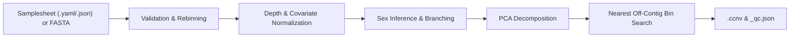

# CLI Reference

`ccnv` provides four subcommands: `convert`, `reference`, `ref-qc`, and `predict`. Commands accept `--prefix` and append canonical suffixes automatically; do not include file extensions in `--prefix`.

Every command accepts `-h`/`--help` and `--loglevel` (`DEBUG`, `INFO`, `WARNING`, `ERROR`, `CRITICAL`; default `WARNING`). See [Pipeline Architecture](pipeline.md) for algorithmic details.

## `convert`

Stream a BAM or CRAM alignment into binned counts (`<prefix>.ccnv`). Missing `.bai`/`.crai` indexes are created automatically with `pysam`.

```console
ccnv convert ALIGNMENT [--prefix PREFIX] [options]
```

| Flag / Argument | Default | Description |
| --- | --- | --- |
| `ALIGNMENT` | required | Input BAM or CRAM file. CRAM requires `--fasta`. |
| `--prefix` | alignment stem | Output prefix. Writes `<prefix>.ccnv`. |
| `--bin-size` | `5000` | Bin width in bases. Final contig bins may be shorter. |
| `--fasta` | unset | Reference FASTA (required for CRAM). |
| `--min-mapq` | `1` | Minimum mapping quality to retain. |
| `--keep-duplicates` | off | Retain SAM duplicate reads (`0x400`). |
| `--keep-secondary` | off | Retain secondary alignments (`0x100`). |
| `--keep-supplementary` | off | Retain supplementary alignments (`0x800`). |
| `--allow-improper-pairs` | off | Retain paired reads not flagged as proper pairs. |
| `--all-contigs` | off | Bin all header contigs instead of canonical chromosomes (`1-22`, `X`, `Y`) only. |
| `-t`, `--threads` | CPU count | Total CPU budget split across contig workers and per-handle HTSlib decode threads. |
| `--loglevel` | `WARNING` | Logging verbosity. |

By default, only canonical chromosomes (`1`–`22`, `X`, `Y`, with or without `chr` prefix, case-insensitive) are binned; mitochondrial, decoy, random, unplaced, and ALT contigs are skipped. Pass `--all-contigs` for non-human or custom assemblies.


## `reference`

Build a reference model from a cohort of control sample `.ccnv` files described by a root-list YAML/JSON samplesheet, or a flat uniform-depth model from a single FASTA file when no control cohort is available.

```console
ccnv reference --samplesheet SAMPLESHEET.yaml --prefix PREFIX [options]
ccnv reference --fasta GENOME.fa --prefix PREFIX [--bin-size N]
```

| Flag / Argument | Default | Description |
| --- | --- | --- |
| `-s`, `--samplesheet` | unset | Cohort samplesheet (`.yaml`, `.yml`, or `.json`) in root-list format listing sample Parquets with optional `sex` and `ff` overrides. Mutually exclusive with `--fasta`. |
| `--fasta` | unset | Reference FASTA for building a flat uniform-depth reference model without a cohort (germline mode only). Mutually exclusive with `--samplesheet`. |
| `--mode` | `germline` | Reference model mode: `germline` (standard CNV models) or `prenatal` (fits CNV branches plus 100 kb autosomal PREFACE/FFX and 5 kb chrY FFY models). |
| `--prenatal-binsize` | `100000` | Target bin size in bases for coarsening autosomal counts in memory for prenatal PREFACE models. |
| `--prefix` | required | Output prefix. Writes `<prefix>.ccnv` and `<prefix>_qc.json`. |
| `--bin-size` | `5000` | Target bin size in bases. Cohort samples with different bin sizes are rebinned in memory if contig lengths match. |
| `--all-contigs` | off | Include all FASTA contigs when building a flat reference. |
| `--autosomal-contig` | all non-sex contigs | Autosomal contig name (repeatable). |
| `--sex-contig` | `X,Y,chrX,chrY` | Sex contig name (repeatable). Intersected with sample contigs by default. |
| `--sex-signal-contig` | `chrY` | Contig coverage fraction used to infer male vs. female samples (falls back to `Y`). |
| `--sex-cutoff` | inferred | Coverage fraction threshold on `--sex-signal-contig` above which samples are classified as male. |
| `--pca-components` | `5` | Number of principal components per branch. |
| `--nearest-bins` | `300` | Number of nearest off-contig reference bins per target bin. |
| `--max-batch-memory-mb` | `256` | Memory cap (MiB) for batched pairwise distance calculation. |
| `--min-cohort-size` | `10` | Minimum control samples required for the autosomal branch. |
| `--min-sex-group-size` | `5` | Minimum samples per sex required to build a sex-specific branch. |
| `--mappability` | unset | Mappability BigWig track (`.bw`/`.bigWig`) for masking and per-sample bias normalization (k-mer length should roughly match average sequencing read length). |
| `--gc` | unset (or FASTA in flat mode) | GC content track (`.bw`, `.bed`/`.bed.gz`, or `.fa`/`.fasta`/`.fna`). Automatically derived from the input FASTA in flat reference mode when omitted. |
| `--min-mappability` | `0.5` | Minimum bin mappability in `[0, 1]` required to keep a bin unmasked when `--mappability` is provided. |
| `--qc-report / --no-qc-report` | `--qc-report` | Write `<prefix>_qc.json` and print a QC summary to `stderr`. |
| `-t`, `--threads` | CPU count | CPU budget for parallel sample loading and reference modeling. |
| `--loglevel` | `WARNING` | Logging verbosity. |



## `ref-qc`

Evaluate quality control metrics and branch usability verdicts (`PASS`, `WARN`, `FAIL`) on an existing reference `.ccnv` file.

```console
ccnv ref-qc REFERENCE [--prefix PREFIX] [options]
```

| Flag / Argument | Default | Description |
| --- | --- | --- |
| `REFERENCE` | required | Existing reference `.ccnv` file. |
| `--prefix` | reference stem | Output prefix. Writes `<prefix>_qc.json`. |
| `--loglevel` | `WARNING` | Logging verbosity. |

## `predict`

Normalize a sample against a reference model, segment with weighted Binary Segmentation, and call copy-number gains and losses.

```console
ccnv predict SAMPLE REFERENCE [--prefix PREFIX] [options]
```

| Flag / Argument | Default | Description |
| --- | --- | --- |
| `SAMPLE` | required | Sample `.ccnv` file from `convert`. |
| `REFERENCE` | required | Reference `.ccnv` file from `reference`. |
| `--mode` | `germline` | Prediction mode: `germline` (standard diploid CNV analysis) or `prenatal` (joint CNV, fetal fraction, SCA, and discordance analysis). |
| `--prefix` | sample stem | Output path prefix. |
| `--sex` | `autosomal` | Branch selection: `autosomal` (infers sex when sex branches exist), `female`, or `male`. (In `prenatal` mode, `chrX` is always normalized against the diploid `XX` female branch). |
| `--penalty` | `1.0` | Weighted sum-of-squared-errors segmentation penalty per breakpoint. |
| `--z-threshold` | `3.0` | Absolute segment z-score threshold for calling gains and losses. |
| `--ratio-threshold` | unset | Absolute $\log_2$ ratio call threshold (overrides `--z-threshold` when set). |
| `--min-reference-bins` | `3` | Minimum within-sample reference bins required to normalize a target bin. |
| `--mask-repeats` | `3` | Outlier-masking iterations during within-sample normalization. |
| `--max-blacklist-gap` | `2000000` | Maximum masked gap (bp) bridged within a single segment. |
| `--mappability` | reference track | Optional mappability BigWig override (`.bw`/`.bigWig`) for prediction normalization (k-mer length should roughly match average sequencing read length). |
| `--gc` | reference track | Optional GC content track override (`.bw`, `.bed`/`.bed.gz`, or `.fa`/`.fasta`/`.fna`). |
| `--min-mappability` | `0.5` | Minimum bin mappability in `[0, 1]` required to keep a bin unmasked. |
| `--plot / --no-plot` | `--plot` | Write interactive genome-wide `<prefix>_plot.html`. |
| `--cytobands` | unset | Cytoband BED/TSV file (`.txt`, `.bed`, or `.gz`) rendered above the genome plot (ignored with a warning when `--no-plot` is set). |
| `--vcf / --no-vcf` | `--vcf` | Write bgzipped and tabix-indexed VCFv4.2 files. |
| `--loglevel` | `WARNING` | Logging verbosity. |

Prediction outputs:

- `<prefix>_bins.bed.gz` (`.tbi`) and `<prefix>_bins.vcf.gz` (`.tbi`): Per-bin $\log_2$ ratio, z-score, precision weight, reference bin count, mask status, and branch.
- `<prefix>_segments.bed.gz` (`.tbi`) and `<prefix>_segments.vcf.gz` (`.tbi`): Segmented intervals with weighted mean $\log_2$ ratio, z-score, weight, bin count, and call (plus prenatal `expected_ratio`, `implied_ff`, `discordant`, and `discordance_reason` columns in `prenatal` mode).
- `<prefix>_calls.bed.gz` (`.tbi`) and `<prefix>_calls.vcf.gz` (`.tbi`): Called `GAIN` and `LOSS` segments only.
- `<prefix>_qc.json`: Comprehensive prediction quality metrics covering effective target contig reads, CNV summary, and, in `prenatal` mode, `fetal_sex`, `active_ff`, `active_method`, `sca`, `ffy`, `preface`, `ffx`, and warning flags.
- `<prefix>_plot.html`: Interactive Plotly genome-wide copy-number profile with pan/zoom, coordinate/cytoband search, configurable Z-score and $\log_2$ ratio threshold color-coding, optional cytoband ideogram track, and, in `prenatal` mode, prenatal status banner, fetal fraction reference lines, and high-contrast purple `#9333ea` discordant segment overlays.


