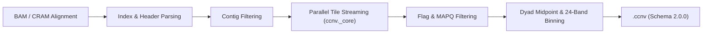
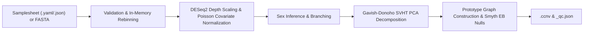

# CLI Reference

`ccnv` provides four subcommands: `extract`, `reference`, `ref-qc`, and `predict`. Commands accept `--prefix` and append canonical suffixes automatically; do not include file extensions in `--prefix`.

Every command accepts `-h`/`--help` and `--loglevel` (`DEBUG`, `INFO`, `WARNING`, `ERROR`, `CRITICAL`; default `WARNING`). See [Pipeline Architecture](pipeline.md) for algorithmic details.

## `extract`

Stream a BAM or CRAM alignment into binned sample Parquet sketches (`<prefix>.ccnv`) using the compiled Rust `ccnv._core` scanner, binning paired-end proper pairs by dyad midpoint (`TLEN > 0`) and single-end reads by 0-based `reference_start`. Populates per-bin `count`, `paired_count`, `frag_len_sum`, `short_frag_count`, `endpoint_count`, `frag_gc_sum`, and 24 fixed-width fragment length bands `frag_bands` along with `ccnv.qc` and `ccnv.fragmentomics` Parquet metadata. Single-threaded extraction streams sequentially without an index; multi-threaded tile extraction requires an existing `.bai`/`.csi`/`.crai` index.

```console
ccnv extract ALIGNMENT [--prefix PREFIX] [options]
```

| Flag / Argument | Default | Description |
| --- | --- | --- |
| `ALIGNMENT` | required | Input BAM or CRAM file. CRAM requires `--fasta`. |
| `--prefix` | alignment stem | Output prefix. Writes `<prefix>.ccnv`. |
| `--bin-size` | `5000` | Bin width in bases. Final contig bins may be shorter. |
| `--fasta` | unset | Reference FASTA (required for CRAM). |
| `--min-mapq` | `1` | Minimum mapping quality to retain. |
| `--keep-duplicates` | off | Retain SAM duplicate reads (`0x400`). |
| `--keep-secondary` | off | Retain secondary alignments (`0x100`). |
| `--keep-supplementary` | off | Retain supplementary alignments (`0x800`). |
| `--allow-improper-pairs` | off | Retain paired reads not flagged as proper pairs. |
| `--all-contigs` | off | Bin all header contigs instead of canonical chromosomes (`1-22`, `X`, `Y`) only. |
| `-t`, `--threads` | CPU count | Total CPU budget for parallel tile streaming and decompression. |
| `--loglevel` | `WARNING` | Logging verbosity. |

By default, only canonical chromosomes (`1` to `22`, `X`, `Y`, with or without `chr` prefix, case-insensitive) are binned; mitochondrial, decoy, random, unplaced, ALT, and EBV contigs are skipped. Pass `--all-contigs` for non-human or custom assemblies.



## `reference`

Build a reference model from a cohort of control sample `.ccnv` files described by a root-list YAML/JSON samplesheet, or a flat uniform-depth model from a single FASTA file when no control cohort is available.

```console
ccnv reference --samplesheet SAMPLESHEET.yaml --prefix PREFIX [options]
ccnv reference --fasta GENOME.fa --prefix PREFIX [--bin-size N]
```

| Flag / Argument | Default | Description |
| --- | --- | --- |
| `-s`, `--samplesheet` | unset | Cohort samplesheet (`.yaml`, `.yml`, or `.json`) in root-list format listing sample Parquets with optional `sex` and `ff` overrides. Mutually exclusive with `--fasta`. |
| `--fasta` | unset | Reference FASTA for building a flat uniform-depth reference model without a cohort (germline mode only). Mutually exclusive with `--samplesheet`. |
| `--mode` | `germline` | Reference model mode: `germline` (standard CNV models) or `prenatal` (fits CNV branches plus closed-form Poisson MSY `FFY`, 100 kb logit-ensemble `FFA`, forward $R_X$, fetal/maternal fragment length densities, reference-side 24-band Fisher weighting $w^{\ast}_{0.08}$, and 36-feature logit-ensemble `FF_size`). |
| `--prenatal-binsize` | `100000` | Target bin size in bases for coarsening autosomal and `chrX` counts in memory for prenatal `FFA` and `FFX` models. |
| `--prefix` | required | Output prefix. Writes `<prefix>.ccnv` and `<prefix>_qc.json`. |
| `--bin-size` | `5000` | Target bin size in bases. Cohort samples with different bin sizes are rebinned in memory if contig lengths match. |
| `--all-contigs` | off | Include all FASTA contigs when building a flat reference. |
| `--autosomal-contig` | all non-sex contigs | Autosomal contig name (repeatable). |
| `--sex-contig` | `X,Y,chrX,chrY` | Sex contig name (repeatable). Intersected with sample contigs in cohort mode; cleared into `autosomal` in flat `--fasta` mode unless explicitly passed. |
| `--sex-signal-contig` | `chrY` | Contig coverage fraction used to infer male vs. female samples (falls back to `Y`). |
| `--sex-cutoff` | inferred | Coverage fraction threshold on `--sex-signal-contig` above which samples are classified as male. |
| `--pca-components` | unset | Optional maximum number of principal components per branch (when omitted, optimal rank up to `60` is selected dynamically via Gavish-Donoho SVHT). |
| `--max-batch-memory-mb` | `256` | Memory cap (MiB) before cohort count matrices spill to temporary memory-mapped files. |
| `--min-cohort-size` | `10` | Minimum control samples required for the autosomal branch. |
| `--min-sex-group-size` | `5` | Minimum samples per sex required to build a sex-specific branch. |
| `--mappability` | unset | Mappability BigWig track (`.bw`/`.bigWig`) for masking and per-sample bias normalization. |
| `--gc` | unset (or FASTA in flat mode) | GC content track (`.bw`/`.bigWig`, `.bed`/`.bed.gz`, `.bedgraph`/`.bedgraph.gz`, `.wig`/`.wig.gz`, `.tsv`/`.txt`, or `.fa`/`.fasta`/`.fna`). Automatically derived from the input FASTA in flat reference mode when omitted. |
| `--min-mappability` | `0.5` | Minimum bin mappability in `[0, 1]` required to keep a bin unmasked when `--mappability` is provided. |
| `--qc-report / --no-qc-report` | `--qc-report` | Write `<prefix>_qc.json` and print a QC summary to `stderr`. |
| `-t`, `--threads` | CPU count | CPU budget for parallel sample loading and reference modeling. |
| `--loglevel` | `WARNING` | Logging verbosity. |



## `ref-qc`

Evaluate quality control metrics and branch usability verdicts (`PASS`, `WARN`, `FAIL`) on an existing reference `.ccnv` file, writing `<prefix>_qc.json` (including a `prenatal` summary block for prenatal references) and printing a summary verdict to `stderr`.

```console
ccnv ref-qc REFERENCE [--prefix PREFIX] [options]
```

| Flag / Argument | Default | Description |
| --- | --- | --- |
| `REFERENCE` | required | Existing reference `.ccnv` file. |
| `--prefix` | reference stem | Output prefix. Writes `<prefix>_qc.json`. |
| `--loglevel` | `WARNING` | Logging verbosity. |

## `predict`

Normalize a sample against a reference model, segment with calibrated Pelt change-point detection with mBIC penalty, score segments with dyadic BLUE precision Z-scores, and call discrete copy-number events via integer copy-number Bayes factors ($CN \in \{0, 1, 2, 3, 4+\}$).

```console
ccnv predict SAMPLE REFERENCE [--prefix PREFIX] [options]
```

| Flag / Argument | Default | Description |
| --- | --- | --- |
| `SAMPLE` | required | Input BAM, CRAM (requires `--fasta`), or sample `.ccnv` Parquet file. |
| `REFERENCE` | required | Reference `.ccnv` file from `reference`. |
| `--mode` | `germline` | Prediction mode: `germline` (standard diploid CNV analysis) or `prenatal` (joint CNV, Student-$t_4$ IRLS precision-fused fetal fraction, reference-side 24-band Fisher read weighting, 4D erfc ray-marginalized SCA, 2-fetus `FF`/`FM`/`MM` twin stoichiometry classification, male-fetus $5\text{ kb}$ `chrY` MSY normalization, ratio-based segment discordance, and 5-state self-referenced origin calling). |
| `--twins / --no-twins` | `--no-twins` | Treat sample as a known twin pregnancy in `prenatal` mode (when omitted, de novo twin stoichiometry `FF`/`FM`/`MM` is evaluated automatically alongside `sca`). |
| `-o`, `--prefix` | sample stem | Output path prefix. |
| `-t`, `--threads` | CPU count | Total CPU budget for alignment streaming, projection, and segmentation. |
| `--sex` | `autosomal` | Branch selection: `autosomal` (infers sex when sex branches exist), `female`, or `male`. (In `prenatal` mode, `chrX` is always normalized against the diploid `XX` female branch, and $5\text{ kb}$ `chrY` is normalized via `prenatal_ffy` when `fetal_sex == "M"` and omitted when `fetal_sex == "F"`). |
| `--penalty` | `1.0` | Breakpoint penalty multiplier $\gamma$ for mBIC segmentation over euchromatic arm blocks. |
| `--z-threshold` | `3.0` | Absolute dyadic BLUE Z-score threshold for calling gains and losses. |
| `--ratio-threshold` | unset | Absolute $\log_2$ ratio call threshold (overrides `--z-threshold` when set). |
| `--min-reference-bins` | `3` | Minimum within-sample reference prototypes required to normalize a target bin. |
| `--mask-repeats` | `3` | Outlier-masking iterations during within-sample normalization. |
| `--max-blacklist-gap` | `2000000` | Maximum masked gap (bp) bridged within a single segment. |
| `--mappability` | reference track | Optional mappability BigWig override (`.bw`/`.bigWig`) for prediction normalization. |
| `--gc` | reference track | Optional GC content track override (`.bw`/`.bigWig`, `.bed`/`.bed.gz`, `.bedgraph`/`.bedgraph.gz`, `.wig`/`.wig.gz`, `.tsv`/`.txt`, or `.fa`/`.fasta`/`.fna`). |
| `--min-mappability` | `0.5` | Minimum bin mappability in `[0, 1]` required to keep a bin unmasked. |
| `--fasta` | unset | Reference FASTA (required when `SAMPLE` is CRAM). |
| `--plot / --no-plot` | `--plot` | Write interactive genome-wide `<prefix>_plot.html`. |
| `--cytobands` | bundled GRCh38 when matched | Cytoband BED/TSV file (`.txt`, `.bed`, or `.gz`) rendered above the genome plot, overriding bundled GRCh38 cytobands auto-loaded when canonical contig lengths match `hg38` (ignored with a warning when `--no-plot` is set). |
| `--vcf / --no-vcf` | `--vcf` | Write bgzipped and tabix-indexed VCFv4.2 segment and call files. |
| `--bins-vcf / --no-bins-vcf` | `--no-bins-vcf` | Opt-in generation of large per-bin VCFv4.2 file (`<prefix>_bins.vcf.gz`). |
| `--loglevel` | `WARNING` | Logging verbosity. |

Prediction outputs:

- `<prefix>_bins.bed.gz` (`.tbi` or `.csi`) and optional `<prefix>_bins.vcf.gz` (`.tbi` or `.csi`): Per-bin $\log_2$ ratio, z-score, precision weight, reference bin count, mask status, and branch (`.csi` index emitted automatically when any contig exceeds $512\text{ Mb}$; includes `prenatal_ffy` $5\text{ kb}$ `chrY` bins in `prenatal` mode when `fetal_sex == "M"`, omitted when `fetal_sex == "F"`).
- `<prefix>_segments.bed.gz` (`.tbi` or `.csi`) and `<prefix>_segments.vcf.gz` (`.tbi` or `.csi`): Segmented intervals with weighted mean $\log_2$ ratio, BLUE z-score, weight, bin count, and call (including male-fetus `chrY` segments when `fetal_sex == "M"`). In `prenatal` mode, BED tables append `expected_ratio`, `implied_ff`, `discordant`, `discordance_reason`, `frag_short_ratio`, `frag_llr_size`, and `origin_call`, and VCF files add `INFO` tags (`DISCORDANT`, `DISC_REASON`, `FRAG_SHORT_R`, `FRAG_LLR`, `ORIGIN`, `MOSAIC_FRAC`), `FORMAT` fields (`EXP_LOG2R`, `IMPLIED_FF`), and header metadata (`##fetalSex`, `##fetalFraction`, `##scaCall`).
- `<prefix>_calls.bed.gz` (`.tbi` or `.csi`) and `<prefix>_calls.vcf.gz` (`.tbi` or `.csi`): Called `gain` and `loss` segments only (encoded as `<DUP>` and `<DEL>` in VCFv4.2, including prenatal columns and tags in `prenatal` mode).
- `<prefix>_qc.json`: Prediction quality metrics covering predicted sample `sex` (`"female"`, `"male"`, or `null`), effective target contig reads and `lambda_gc`, CNV summary, sample `fragmentomics` metrics (`paired_end`, `total_paired_fragments`, `chromatosome_mode_bp`, `core_shoulder_bp`, `sizing_shift_bp`, `self_referenced_peak_ratio`, `dinucleosome_fraction`, `high_mw_fraction`, `helical_10bp_amplitude`, `motif_diversity_score`, and warnings such as `WARN_HIGH_LEUKOCYTE_DNA`), and, in `prenatal` mode, `fetal_sex`, `gestation`, `fetal_sexes`, `male_ff`, `female_ff`, `twin_confidence`, `active_ff`, `effective_ff`, `active_ff_se`, `active_ff_source`, `sca`, `twin` (`call`, `fetal_sexes`, `is_twin`, `twin_probability`, `confidence`, `posteriors`, `male_ff`, `female_ff`), `ffy`, `ffa`, `ffx`, `ff_size`, `chrx_ratio`, `chry_score`, `yfrac_threshold`, `low_ff_warning`, `origin_summary`, `lod_ff_35mb`, `lod_ff_3mb`, and `warnings`.
- `<prefix>_plot.html`: Interactive Plotly WebGL genome-wide copy-number profile with pan/zoom, coordinate/cytoband search, configurable Z-score and $\log_2$ ratio threshold color-coding, cytoband ideogram track (auto-populated from bundled GRCh38 cytobands when canonical contig lengths match `hg38`, or overridden via `--cytobands`), and, in `prenatal` mode, prenatal status banner (`FF (Y/A/X/Size)`, displaying `Twins (F/M)` and per-sex fetal fractions when `gestation == "twin"`), male-fetus `chrY` profile when `fetal_sex == "M"` (omitted when `fetal_sex == "F"`), fetal fraction reference lines, fragmentomic origin hover fields, and high-contrast purple `#9333ea` discordant segment overlays. See [Visualization Overview](visualization.md) for track details and color legends.



```mermaid
flowchart LR
    A["Sample (.bam/.cram/.ccnv) & Reference .ccnv"] --> B["In-Memory Streaming & Prenatal Model Selection"]
    B --> C["Branch Selection & Poisson Covariate Correction"]
    C --> D["Robust HuberRegressor PCA Projection"]
    D --> E["Prototype Graph Within-Sample Normalization & EB Weights"]
    E --> F["Pre-Split Euchromatic Segmentation (Calibrated Pelt + mBIC)"]
    F --> G["Dyadic BLUE Scoring & Integer CN Bayes Factor Calling"]
    G --> H["BED.gz, VCF.gz, QC.json & HTML via ccnv._core"]
```

## Exit Codes

| Exit Code | Meaning |
| --- | --- |
| `0` | Command completed without error (including `ccnv ref-qc` when the reference usability verdict is `WARN` or `FAIL`). |
| `1` | Pipeline domain error (`ExtractError`, `ReferenceError`, `ReferenceQCError`, or `PredictError`), such as missing/incompatible inputs, schema validation failures, or mixed single-end/paired-end cohorts. |
| `2` | Command-line usage or argument validation error (such as missing required options or mutually exclusive `--samplesheet` and `--fasta` flags). |
