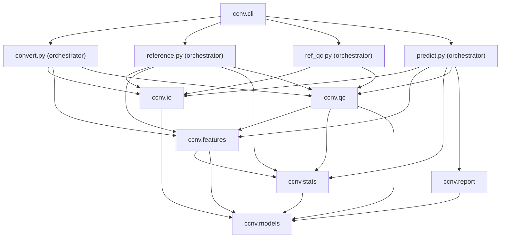

# Consolidating `ccnv` into Domain Subpackages with a Strict Unidirectional DAG

*   **Author:** Matthias De Smet
*   **Status:** Approved
*   **Date:** 2026-11-06

--------------------------------------------------------------------------------

## Overview

This design specifies the architectural refactoring of the `ccnv` codebase from 17 top-level root modules into 6 cohesive domain subpackages (`models`, `io`, `stats`, `features`, `qc`, `report`) under `src/ccnv/`. The primary pipeline entry points (`convert.py`, `reference.py`, `ref_qc.py`, `predict.py`, `cli.py`) remain at the package root as slim composition orchestrators forming a strict, unidirectional Directed Acyclic Graph (DAG) with zero circular dependencies.

This restructuring organizes code strictly by technical and functional responsibility—isolating external file format ingestion from downstream deliverable generation, making mathematical kernels purely stateless, and establishing domain dataclasses as leaf dependencies.

## The Problem

`ccnv` has evolved into a full-featured germline and prenatal shallow WGS copy-number analysis toolkit. However, code organization has developed several structural friction points:

1. **Responsibility Bleed in Pipeline Modules**: Root orchestrators mix low-level file format streaming, linear algebra, feature normalization, quality control metrics, and output formatting. For example:
   - `convert.py` (717 lines) combines BAM streaming, pysam read filtering, multiprocessing worker pooling, contig binning, effective read QC tracking, and Arrow Parquet serialization.
   - `reference.py` (886 lines) combines cohort table validation, BigWig track parsing, polynomial bias regression, PCA, batched nearest-neighbor search, sex chromosome aneuploidy heuristics, and reference Parquet serialization.
   - `predict.py` (826 lines) combines within-sample normalization, Ruptures segmentation, prenatal classification, and report assembly.
2. **Scattered Domain Models**: Domain definitions are split across `models.py` (configurations and contig layout), `results.py` (runtime output containers), and `schemas.py` (Arrow table definitions and serialization metadata).
3. **Coupled Ingestion and Export Deliverables**: Ingestion of external genomic files (BAM/CRAM, BigWig, FASTA, YAML samplesheets) is scattered across pipeline files, while downstream export generation (`report.py`, 776 lines) handles bedtools-like tabix BED compression, VCF formatting, and Plotly HTML generation.
4. **Cognitive Discoverability**: When bioinformaticians or developers inspect the repo, finding specific algorithms (e.g., where GC bias correction is calculated vs where BigWig intervals are loaded, or where PCA occurs vs where nearest bins are selected) requires scanning large multi-purpose files.

## Goals

*   **Cohesive Domain Subpackages**: Group code into 6 focused subpackages: `ccnv.models`, `ccnv.io`, `ccnv.stats`, `ccnv.features`, `ccnv.qc`, and `ccnv.report`.
*   **Slim Root Orchestrators**: Reduce `convert.py`, `reference.py`, `ref_qc.py`, and `predict.py` to composition workflows (150–250 lines) that orchestrate domain packages without implementing low-level mechanics.
*   **Strict Unidirectional DAG**: Enforce an unbreachable layering hierarchy with zero circular dependencies:
    - Layer 0: `ccnv.models` (pure data structures, leaf package)
    - Layer 1: `ccnv.stats` (pure stateless mathematical and ML kernels)
    - Layer 2: `ccnv.io` (untrusted format parsers and pipeline Parquet storage)
    - Layer 3: `ccnv.features` (in-memory feature transforms and normalization)
    - Layer 4: `ccnv.qc` (quality control metrics, diagnostics, and JSON reporting)
    - Layer 5: `ccnv.report` (deliverable generation: BED, VCF, HTML)
    - Layer 6: Root Orchestrators (`convert`, `reference`, `ref_qc`, `predict`, `cli`)
*   **Separation of Ingestion and Reporting**: Isolate raw file format reading (`ccnv.io`) from downstream report generation (`ccnv.report`).
*   **100% Bit-for-Bit Test Invariance**: Retain identical numerical outputs across all existing 288 unit and integration tests, including baseline germline invariance.
*   **Backward-Compatible Public Interface**: CLI subcommands, flags, exit codes, and output file schemas remain identical.

## Non-Goals

*   **No Statistical or ML Algorithm Changes**: Linear algebra kernels (PCA, Ruptures Binseg, 1D 2-GMM, Lasso FISTA, Huber RLM) remain mathematically identical.
*   **No Schema Format Changes**: Parquet storage schema remains v2.0.0. Column names, metadata structures, and compression codecs remain unchanged.
*   **No Catch-All Utility Modules**: Generic `utils.py` or `helpers.py` files are strictly forbidden; all routines must belong to a concrete domain module.
*   **No CLI Signature Changes**: Subcommands `convert`, `reference`, `ref-qc`, `predict` and their CLI options remain completely unchanged.

## Resolved Architectural Decisions

*   **Transitional Re-Exports & Phased Test Gating**: Root `__init__.py` and top-level root modules maintain backward-compatible re-exports across Phases 1–5 so the entire test suite remains 100% green at every phase gate. In Phase 6, all test suite imports are updated to canonical subpackage paths, after which deprecated root stubs are removed.
*   **HTML Template Discovery**: The Plotly Jinja2 template is packaged under `src/ccnv/report/templates/genome_plot.html.j2` and resolved using standard library `importlib.resources.files("ccnv.report.templates") / "genome_plot.html.j2"`.
*   **Worker Pool Orchestration in `convert.py`**: The multi-process `ProcessPoolExecutor` and worker task function (`_bin_contig`) live in `src/ccnv/convert.py` (Layer 6 Composition Root). The worker function streams reads via `ccnv.io.alignments.stream_contig_reads` and accumulates bin counts via `ccnv.features.binning.bin_counts`. `ccnv.io.alignments` remains pure I/O (handle management, BAM index verification, read filtering), eliminating the need for callback dependency injection while avoiding cross-process read IPC overhead.
*   **Cytoband Type Contract in `report`**: `ccnv.report.write_outputs` and `render_genome_plot` accept `cytobands: Sequence[Cytoband] | None`. External TSV parsing is performed exclusively by `ccnv.io.tracks.load_cytobands_track` and orchestrated by `predict.py`, preserving Layer 5's zero-dependency isolation.
*   **Persistence Taxonomy**: File I/O is segregated by role:
    - Layer 2 (`io`): External Format Ingestion & Pipeline Table Storage (BAM/CRAM, BigWig, FASTA, TSV cytobands, YAML samplesheet, and internal Parquet tables).
    - Layer 4 (`qc`): Diagnostic evaluations and operational metric JSON emission.
    - Layer 5 (`report`): User-facing genomic deliverables (bgzipped/tabix BED, VCF, Plotly HTML).

## Critical User Journeys (CUJs)

### CUJ 1: Developer Enhances Machine Learning / Statistical Kernels
*   **Given**: A developer wishes to modify or benchmark the nearest-bin selection algorithm or PCA rotation kernel.
*   **When**: The developer opens `src/ccnv/stats/`.
*   **Then**: All numerical routines (`neighbors.py`, `pca.py`, `regression.py`) are located in one place, accepting and returning pure NumPy arrays without touching BAM files, Parquet schemas, or CLI configs.

### CUJ 2: Bioinformatician Adds a New Genomic Deliverable
*   **Given**: A user requests a new tabular or bigWig track export format from `ccnv predict`.
*   **When**: The developer opens `src/ccnv/report/`.
*   **Then**: The developer works strictly inside `report/` (alongside `bed.py`, `vcf.py`, `html.py`), consuming domain result records (`BinResult`, `SegmentResult`, `FetalFractionResult`) to emit deliverable files and return typed `PredictionOutputs` with zero risk of breaking BAM reading or PCA calculations.

### CUJ 3: Routine CLI End-to-End Pipeline Execution
*   **Given**: A standard bioinformatics pipeline executing `ccnv convert -> ccnv reference -> ccnv predict`.
*   **When**: Commands are run with existing bash scripts or workflow runners.
*   **Then**: Output Parquet files, BED.gz, VCF.gz, HTML reports, and QC JSONs are generated with exact bit-for-bit equivalence and identical execution speed.

--------------------------------------------------------------------------------

## Technical Plan (Architecture)

### 1. Architectural Philosophy & Layering Contract

The architecture replaces the ad-hoc stage-and-helper file hierarchy with a strictly layered, unidirectional Directed Acyclic Graph (DAG). Dependencies may only flow downward; upward or circular imports are forbidden and statically checked.

#### Layering Rules:
*   **Layer 0: `ccnv.models`**: Pure data definitions. Imports only the Python standard library, NumPy, and PyArrow. Has zero imports from any other `ccnv` module.
*   **Layer 1: `ccnv.stats`**: Pure numerical, statistical, and optimization kernels. Imports Layer 0 and scientific computing libraries (SciPy, Scikit-learn, Ruptures). Must never import from `io`, `features`, `qc`, or `report`.
*   **Layer 2: `ccnv.io`**: External format parsing and pipeline table storage. Imports Layer 0, `pysam`, `pyBigWig`, and `pyarrow`. Must never import from `stats`, `features`, `qc`, or `report`.
*   **Layer 3: `ccnv.features`**: In-memory domain feature extraction and normalization. Imports Layer 0 and Layer 1 (`stats`). Does not perform file I/O; operates on loaded in-memory data structures.
*   **Layer 4: `ccnv.qc`**: Quality control metrics calculation, verification, and JSON reporting. Imports Layer 0, Layer 1, and Layer 3. Operates on in-memory Arrow tables and feature models passed by orchestrators.
*   **Layer 5: `ccnv.report`**: Deliverable presentation generators (BED, VCF, HTML). Imports Layer 0, `pysam` (strictly for bgzip and tabix indexing), and `jinja2`. Has zero imports from `io`, `stats`, `features`, or `qc`.
*   **Layer 6: Root Orchestrators & CLI**: `convert.py`, `reference.py`, `ref_qc.py`, `predict.py`, and `cli.py` act as pure composition roots that wire together Layers 0–5.

---

### 2. Concrete Subpackage Specifications

#### A. `ccnv.models` (Base Data & Contract Models)
*   `config.py`: `ConvertConfig`, `ReferenceConfig`, `PredictConfig`, `ReferenceQCConfig`, `ReadFilters`, `DEFAULT_BIN_SIZE`, `DEFAULT_MIN_MAPPABILITY`, `AnalysisMode`, `parquet_path`.
*   `domain.py`: `Contig`, `GenomeProfile`, `SamplesheetEntry`, `Cytoband`, `select_layout`, `is_canonical_contig`, `is_autosome_name`, `resolve_contig_name`, `normalize_chr`.
*   `results.py`: `BinResult`, `SegmentResult`, `SCAResult`, `FetalFractionResult`, `PredictionOutputs`, `ReferenceQCOutputs`, `CallType`, `SCACall`, `FetalSex`, `ActiveFFSource`.
*   `schemas.py`: Versioned Arrow Parquet schema definitions (`SAMPLE_SCHEMA`, `REFERENCE_SCHEMA`, `SCHEMA_VERSION = "2.0.0"`), canonical branch constants (`BRANCH_AUTOSOMAL`, `BRANCH_FEMALE_SEX`, `BRANCH_MALE_SEX`, `BRANCH_PRENATAL_AUTOSOMAL`, `BRANCH_PRENATAL_FFY`, `KNOWN_REFERENCE_BRANCHES`, `CNV_REFERENCE_BRANCHES`), metadata models (`ReferenceMetadata`, `PrenatalModelMetadata`, `PRENATAL_METADATA_KEY`, `ArtifactKind`, `COORDINATE_SYSTEM`), metadata encoders/decoders (`decode_metadata`, `metadata_for`, `encode_metadata`, `validate_metadata`), and structural table validation (`validate_table`, `validate_schema`, `validate_sample_table`, `validate_reference_table`, `bin_coordinates`).
*   `exceptions.py`: Layer 0 common exception hierarchy rooted in `CcnvError` (`ReferenceError`, `CovariateError`, `PredictError`, `SchemaError`, `ConvertError`, `ReferenceQCError`) eliminating cross-layer exception import cycles.

#### B. `ccnv.io` (External Format Ingestion & Table Storage)
*   `alignments.py`: High-throughput BAM/CRAM alignment streaming using `pysam.AlignmentFile`, index validation, read filtering, contig read iterator (`stream_contig_reads`), and read drop diagnosis (`rejection_reason`).
*   `tracks.py`: External genomic track readers (`load_mappability_track` from BigWig, `load_gc_track` from BigWig/FASTA/BED, `load_cytobands_track` from TSV returning `tuple[Cytoband, ...]`).
*   `samplesheet.py`: Cohort samplesheet loading, path resolution, and JSON schema validation (`load_samplesheet`).
*   `parquet.py`: Arrow Parquet table reading, writing, and validation (`read_sample_parquet`, `write_sample_parquet`, `read_reference_parquet`, `write_reference_parquet`, invoking `schemas.validate_table`).

#### C. `ccnv.stats` (Stateless Numerical & Machine Learning Kernels)
*   `pca.py`: Centered unscaled PCA, deterministic PCA fitting (`fit_pca`), and subspace projection.
*   `neighbors.py`: Batched off-contig nearest-bin search, Euclidean distance calculation, null distribution derivation (`_NearestContext`, `_NullContext`, `select_nearest_bins`, `compute_null_models`), and distance thresholding (`distance_cutoff`).
*   `segmentation.py`: Weighted L2 cost evaluation and Ruptures Binseg change-point detection (`segment_genome`).
*   `regression.py`: Robust Huber IRLS polynomial fitting (`correct_covariate_bias` regression kernel).
*   `prenatal_math.py`: 1D 2-component GMM, non-negative Lasso regression, L-BFGS-B Sigmoid MLP, OLM, Huber RLM, and OLS skew corrections.

#### D. `ccnv.features` (Feature Extraction & Normalization)
*   `binning.py`: Canonical contig filtering, read interval accumulation (`bin_counts`, `bin_intervals`), and 1D count array rebinning (`rebin_counts`).
*   `cohort.py`: Cohort sample discovery, validation, parallel rebinning, table rebinning (`rebin_sample_table`), depth normalization, `Cohort` container, and sex chromosome ratio inference (`infer_sample_sexes`).
*   `covariates.py`: Covariate masking (`mask_covariates`), multi-covariate feature matrix assembly (`covariate_features`), and residual depth normalization (`correct_covariate_bias`).
*   `prenatal.py`: Multi-resolution coarsening (5 kb to 100 kb), prenatal reference training (`fit_prenatal_models`), fetal fraction estimation (`FFY`, `FFX`, `PREFACE`), sex chromosome aneuploidy classification (`classify_sca`), segment discordance annotation (`annotate_prenatal_segments`), and single-sample inference (`predict_prenatal`).

#### E. `ccnv.qc` (Quality Control & Usability Diagnostics)
*   `sample.py`: Read count tracking, effective read calculations, filter counters (`QC_COUNTERS`, `empty_qc`).
*   `reference.py`: Reference Parquet audit, branch statistics, usability verdict evaluation, and JSON reporting (`run_reference_qc_on_table`, `write_reference_qc_json`).
*   `predict.py`: Prediction QC payload assembly and JSON emission (`build_predict_qc_payload`, `write_predict_qc_json`).

#### F. `ccnv.report` (Downstream Deliverables & Visualization)
*   `bed.py`: Formatted BED writer with bgzip compression and tabix indexing for bins, segments, calls, and prenatal discordance annotations (`#contig` headers, natural sort order).
*   `vcf.py`: Structural variant VCFv4.2 writer (`#CHROM`, `POS`, `ID`, `REF`, `ALT`, `QUAL`, `FILTER`, `INFO`).
*   `html.py`: Interactive Plotly HTML generator rendering ideograms (`cytobands: Sequence[Cytoband] | None`), ratio scatters, segment traces, and discordant call callouts.
*   `templates/`: Bundled Jinja2 template storage (`genome_plot.html.j2`). Template loading utilizes `importlib.resources.files("ccnv.report.templates")`.

---

### 3. Pipeline Orchestrators as Composition Roots

Each top-level stage module is refactored into a concise composition root (150–250 lines):

#### `convert.py` Orchestration Flow:
1. Validate CLI `ConvertConfig` and resolve contig layouts.
2. Initialize multi-process worker pool (`ProcessPoolExecutor`) in `convert.py`, executing worker function `_bin_contig`.
3. In each contig worker, stream reads via `ccnv.io.alignments.stream_contig_reads` and accumulate counts into numpy arrays via `ccnv.features.binning.bin_counts`.
4. Assemble effective read metrics via `ccnv.qc.sample`.
5. Serialize Arrow Parquet table via `ccnv.io.parquet.write_sample_parquet`.

#### `reference.py` Orchestration Flow:
1. Ingest cohort samples via `ccnv.io.samplesheet` or FASTA layout.
2. Rebin and depth-normalize counts via `ccnv.features.cohort`.
3. Load and apply GC/mappability tracks via `ccnv.io.tracks` and `ccnv.features.covariates`.
4. Compute PCA projection and batched nearest-bin null models via `ccnv.stats.pca` and `ccnv.stats.neighbors`.
5. In prenatal mode, fit prenatal models via `ccnv.features.prenatal`.
6. Audit reference quality via `ccnv.qc.reference`.
7. Write reference Parquet via `ccnv.io.parquet.write_reference_parquet`.

#### `ref_qc.py` Orchestration Flow:
1. Load reference Parquet table via `ccnv.io.parquet.read_reference_parquet`.
2. Execute quality audit and compute usability verdicts via `ccnv.qc.reference.run_reference_qc_on_table`.
3. Emit `<prefix>_qc.json` payload via `ccnv.qc.reference.write_reference_qc_json`.

#### `predict.py` Orchestration Flow:
1. Read and validate sample Parquet and reference model via `ccnv.io.parquet`.
2. If `--cytobands` is supplied, load cytoband records via `ccnv.io.tracks.load_cytobands_track`.
3. Apply GC/mappability normalization via `ccnv.features.covariates`.
4. Perform within-sample reference construction and ratio projection via `ccnv.stats.pca` and `ccnv.stats.neighbors`.
5. Execute weighted Ruptures Binseg segmentation via `ccnv.stats.segmentation`.
6. In prenatal mode, evaluate fetal fraction and annotate segment discordance via `ccnv.features.prenatal`.
7. Generate QC payload via `ccnv.qc.predict`.
8. Write bgzipped/indexed BED, VCF, and interactive HTML deliverables via `ccnv.report`.

--------------------------------------------------------------------------------

## Alternatives Considered

### Alternative 1: Monolithic Flat Layer Consolidation (5–6 Mega-Files at Root)

*   **Description**: Group all code into 6 large top-level files: `models.py`, `io.py`, `ml.py`, `features.py`, `pipeline.py`, and `cli.py`.
*   **Pros**:
    *   Fewer total files in `src/ccnv/`.
    *   No directory nesting.
*   **Cons**:
    *   Creates unwieldy 1,500–2,300 line mega-files. `io.py` alone would combine BAM alignment streaming, BigWig track parsing, Arrow Parquet serialization, YAML samplesheets, VCF formatting, and Plotly HTML generation.
    *   Merging unrelated file format libraries (`pysam`, `pyBigWig`, `pyarrow`, `jinja2`) into a single file impairs maintainability and code navigation.
*   **Reason for Rejection**: Violates the core objective of cognitive legibility. Navigating a 2,300-line `io.py` file is more difficult than finding specific format adapters in dedicated subpackages.

### Alternative 2: Pure Pipeline-Stage Subpackages (`ccnv/convert/`, `ccnv/reference/`, `ccnv/predict/`)

*   **Description**: Group code strictly by pipeline stages, placing all convert logic in `ccnv/convert/`, reference logic in `ccnv/reference/`, and predict logic in `ccnv/predict/`.
*   **Pros**:
    *   Mirrors the CLI command structure directly.
*   **Cons**:
    *   Fragments shared algorithms and formats. For example, PCA projection, Parquet table validation, and GC covariate normalization are shared between `reference` and `predict`.
    *   Either causes code duplication across stage folders or forces arbitrary cross-stage dependencies (e.g., `predict/` importing internals from `reference/`), creating architectural confusion.
*   **Reason for Rejection**: Cross-cutting capabilities (like statistical kernels, Arrow schemas, and file format I/O) are common to multiple stages and should not be owned by an individual pipeline stage.

### Alternative 3: Flat Curated Consolidation (10–11 Root Files Without Subpackages)

*   **Description**: Keep all files at `src/ccnv/*.py`, but merge related pairs (e.g. merge `models.py` + `results.py` into `models.py`, `prenatal_math.py` + `reference_compute.py` into `stats.py`, `reference_qc.py` + `predict_qc.py` into `qc.py`).
*   **Pros**:
    *   Keeps flat package root, avoiding subpackage directory depth.
    *   Requires minimal test import changes.
*   **Cons**:
    *   Still leaves 10–11 multi-purpose files in the root folder.
    *   Lacks the strict architectural encapsulation and import guardrails that subpackages naturally provide.
*   **Reason for Rejection**: Subpackages provide explicit architectural boundaries, preventing circular imports and making the codebase structure self-documenting.

--------------------------------------------------------------------------------

## Non-Functional Requirements

### 1. Performance & Latency Invariance
*   **Zero Execution Runtime Regression**: Splitting code into subpackages affects only module load time at process initialization. In-memory execution speed, vectorized NumPy/PyArrow performance, Ruptures segmentation, and multi-process contig pooling in `convert` and `reference` must exhibit zero throughput degradation.
*   **Startup Latency**: Python module discovery overhead across 6 subpackages must add less than 5 milliseconds to CLI invocation.

### 2. Packaging & Distribution Integrity
*   **Wheel & Container Compatibility**: Package metadata in `pyproject.toml` must discover all subpackages (`ccnv.models`, `ccnv.io`, `ccnv.stats`, `ccnv.features`, `ccnv.qc`, `ccnv.report`) and bundle `src/ccnv/report/templates/genome_plot.html.j2`. Verified via `pixi run docker-build`.
*   **Resource Access Safety**: The Plotly Jinja2 template must be resolved via standard library `importlib.resources.files("ccnv.report.templates") / "genome_plot.html.j2"`, eliminating fragile relative filesystem path references.

### 3. Verification & Bit-for-Bit Parity
*   **100% Test Suite Pass**: All 288 tests in `tests/` must pass unconditionally.
*   **Baseline Invariance**: `tests/test_baseline.py` must produce bit-for-bit identical Parquet and deliverable files against published CRAM test datasets.

--------------------------------------------------------------------------------

## Detailed Implementation Plan

The implementation proceeds in 6 sequential phases. Each phase is self-contained and gated by passing `pixi run lint && pixi run test`.

### Task 1: Phase 1 — Establish `ccnv.models` (Leaf Dependency)
Create the base models package. This package has zero internal dependencies on other `ccnv` modules. `src/ccnv/models.py` is deleted immediately upon creating `src/ccnv/models/`, with `src/ccnv/models/__init__.py` providing all backward-compatible exports to prevent Python directory/file module shadowing.

1. `src/ccnv/models/__init__.py` (Create) & `src/ccnv/models.py` (Delete):
   * Re-export core domain entities, configurations, result containers, schemas, and exceptions for backward compatibility.
2. `src/ccnv/models/config.py` (Create):
   * Relocate `ConvertConfig`, `ReferenceConfig`, `PredictConfig`, `ReferenceQCConfig`, `ReadFilters`, `DEFAULT_BIN_SIZE`, `DEFAULT_MIN_MAPPABILITY`, `AnalysisMode`, and `parquet_path` from `src/ccnv/models.py`.
3. `src/ccnv/models/domain.py` (Create):
   * Relocate `Contig`, `GenomeProfile`, `SamplesheetEntry`, `Cytoband`, `select_layout`, `is_canonical_contig`, `is_autosome_name`, `resolve_contig_name`, and `normalize_chr` from `src/ccnv/models.py` and `src/ccnv/convert.py`.
4. `src/ccnv/models/results.py` (Create):
   * Relocate `BinResult`, `SegmentResult`, `SCAResult`, `FetalFractionResult`, `PredictionOutputs`, `ReferenceQCOutputs`, and type aliases (`CallType`, `SCACall`, `FetalSex`, `ActiveFFSource`) from `src/ccnv/results.py`.
5. `src/ccnv/models/schemas.py` (Create):
   * Relocate `SAMPLE_SCHEMA`, `REFERENCE_SCHEMA`, `SCHEMA_VERSION`, branch constants (`BRANCH_AUTOSOMAL`, `BRANCH_FEMALE_SEX`, `BRANCH_MALE_SEX`, `BRANCH_PRENATAL_AUTOSOMAL`, `BRANCH_PRENATAL_FFY`, `KNOWN_REFERENCE_BRANCHES`, `CNV_REFERENCE_BRANCHES`), metadata models (`ReferenceMetadata`, `PrenatalModelMetadata`, `PRENATAL_METADATA_KEY`, `ArtifactKind`, `COORDINATE_SYSTEM`), metadata encoders/decoders (`decode_metadata`, `metadata_for`, `encode_metadata`, `validate_metadata`), and structural table validation (`validate_table`, `validate_schema`, `validate_sample_table`, `validate_reference_table`, `bin_coordinates`) from `src/ccnv/schemas.py`.
6. `src/ccnv/models/exceptions.py` (Create):
   * Establish Layer 0 common exception hierarchy rooted in `CcnvError` (`ReferenceError`, `CovariateError`, `PredictError`, `SchemaError`, `ConvertError`, `ReferenceQCError`) preventing cross-layer exception import cycles.

### Task 2: Phase 2 — Establish `ccnv.stats` (Stateless Numerical & ML Kernels)
Create pure numeric subpackage depending only on `ccnv.models`, NumPy, SciPy, Scikit-learn, and Ruptures. Zero I/O.

7. `src/ccnv/stats/__init__.py` (Create):
   * Re-export computational kernels.
8. `src/ccnv/stats/pca.py` (Create):
   * Extract centered unscaled PCA and deterministic PCA fitting (`fit_pca`) from `src/ccnv/reference.py` and `src/ccnv/prenatal_math.py`.
9. `src/ccnv/stats/neighbors.py` (Create):
   * Extract Euclidean distance calculation, batched off-contig nearest neighbor selection, null model derivation (`_NearestContext`, `_NullContext`, `select_nearest_bins`, `compute_null_models`), and distance thresholding (`distance_cutoff`) from `src/ccnv/reference_compute.py` and `src/ccnv/reference.py`.
10. `src/ccnv/stats/segmentation.py` (Create):
    * Relocate weighted L2 cost calculation and Ruptures Binseg change-point segmentation (`segment_genome`, `segment_contig`, `Segment`, `WeightedL2Cost`) from `src/ccnv/segment.py`.
11. `src/ccnv/stats/regression.py` (Create):
    * Extract robust Huber IRLS polynomial regression math from `src/ccnv/covariates.py`.
12. `src/ccnv/stats/prenatal_math.py` (Create):
    * Relocate 1D 2-component GMM, non-negative Lasso regression, L-BFGS-B Sigmoid MLP, OLM, Huber RLM, and OLS skew fitting from `src/ccnv/prenatal_math.py`.

### Task 3: Phase 3 — Establish `ccnv.io` & `ccnv.report` (Ingestion vs. Reporting Separation)
Isolate input format parsing and internal Parquet storage from output deliverable generation.

13. `src/ccnv/io/__init__.py` (Create):
    * Re-export file reader interfaces.
14. `src/ccnv/io/alignments.py` (Create):
    * Extract pysam BAM/CRAM streaming, read filtering, header parsing, contig read iterator (`stream_contig_reads`), and read drop diagnosis (`rejection_reason`) from `src/ccnv/convert.py`.
15. `src/ccnv/io/tracks.py` (Create):
    * Extract BigWig/FASTA interval loaders (`load_mappability_track`, `load_gc_track`, `_load_bigwig_intervals`) and TSV cytoband reader (`load_cytobands_track: (path, contig_lengths) -> tuple[Cytoband, ...]`) from `src/ccnv/covariates.py` and `src/ccnv/report.py`.
16. `src/ccnv/io/samplesheet.py` (Create) & `src/ccnv/io/samplesheet.schema.json` (Relocate):
    * Relocate YAML/JSON cohort samplesheet parsing, path resolution, and JSON schema validation from `src/ccnv/samplesheet.py`. Bundle `samplesheet.schema.json` into `src/ccnv/io/`.
17. `src/ccnv/io/parquet.py` (Create):
    * Decompose and centralize Parquet table operations: `read_sample_parquet(path) -> pa.Table`, `write_sample_parquet(table, path) -> Path`, `read_reference_parquet(path) -> pa.Table`, and `write_reference_parquet(table, path) -> Path` (enforcing zstd compression, dictionary encoding, and delta binary packing), invoking `schemas.validate_table`.
18. `src/ccnv/report/__init__.py` (Create):
    * Re-export deliverable writer functions (`write_outputs`).
19. `src/ccnv/report/bed.py` (Create):
    * Extract formatted BED generation with bgzip compression and tabix indexing from `src/ccnv/report.py`.
20. `src/ccnv/report/vcf.py` (Create):
    * Extract structural variant VCFv4.2 writer from `src/ccnv/report.py`.
21. `src/ccnv/report/html.py` (Create):
    * Extract interactive Plotly HTML generator, typed binary array encoders, and cytoband ideogram renderers from `src/ccnv/report.py`. Accept `cytobands: Path | Sequence[Cytoband] | None` during transitional Phases 3–5.
22. `src/ccnv/report/templates/genome_plot.html.j2` (Relocate):
    * Relocate `src/ccnv/templates/genome_plot.html.j2` to `src/ccnv/report/templates/genome_plot.html.j2`.

### Task 4: Phase 4 — Establish `ccnv.features` & `ccnv.qc`
Create feature transformation pipelines and quality control auditors.

23. `src/ccnv/features/__init__.py` (Create):
    * Re-export feature extraction and normalization interfaces.
24. `src/ccnv/features/binning.py` (Create):
    * Extract canonical contig filtering, read accumulation into intervals (`bin_counts`, `bin_intervals`), and 1D array rebinning (`rebin_counts`) from `src/ccnv/convert.py`. Pure numeric array routines.
25. `src/ccnv/features/cohort.py` (Create):
    * Extract cohort sample aggregation, parallel rebinning, table rebinning (`rebin_sample_table`), depth normalization, `Cohort` container, and sex chromosome ratio inference (`infer_sample_sexes`) from `src/ccnv/cohort.py` and `src/ccnv/reference.py`.
26. `src/ccnv/features/covariates.py` (Create):
    * Extract covariate masking (`mask_covariates`), multi-covariate feature matrix assembly (`covariate_features`), and bias correction orchestration (`correct_covariate_bias`) from `src/ccnv/covariates.py`.
27. `src/ccnv/features/prenatal.py` (Create):
    * Extract multi-resolution coarsening, prenatal reference training (`fit_prenatal_models`), fetal fraction inference (`FFY`, `FFX`, `PREFACE`), SCA classification, segment discordance annotation (`annotate_prenatal_segments`), and single-sample inference (`predict_prenatal`) from `src/ccnv/prenatal.py`.
28. `src/ccnv/qc/__init__.py` (Create):
    * Re-export quality control auditors.
29. `src/ccnv/qc/sample.py` (Create):
    * Extract effective read counters, filter tracking, and QC summary assembly (`QC_COUNTERS`, `empty_qc`, `build_sample_qc`) from `src/ccnv/convert.py`.
30. `src/ccnv/qc/reference.py` (Create):
    * Relocate reference Parquet audit, branch statistics, usability verdicts (`run_reference_qc_on_table`), and JSON report writer (`write_reference_qc_json`) from `src/ccnv/reference_qc.py`.
31. `src/ccnv/qc/predict.py` (Create):
    * Relocate prediction QC payload assembly and JSON emission (`build_predict_qc_payload`, `write_predict_qc_json`) from `src/ccnv/predict_qc.py`.

### Task 5: Phase 5 — Refactor Root Orchestrators as Composition Roots with Transitional Stubs
Refactor top-level entrypoints while maintaining backward-compatible root stubs so test suites continue passing seamlessly.

32. `src/ccnv/convert.py` (Modify):
    * Refactor into a slim orchestrator (<200 lines) composing `ccnv.io.alignments`, `ccnv.features.binning`, `ccnv.qc.sample`, and `ccnv.io.parquet`. Retains `split_thread_budget` and coordinates worker tasks.
33. `src/ccnv/reference.py` (Modify):
    * Refactor into a slim orchestrator (<250 lines) composing `ccnv.io.samplesheet`, `ccnv.features.cohort`, `ccnv.features.covariates`, `ccnv.stats`, `ccnv.qc.reference`, and `ccnv.io.parquet`.
34. `src/ccnv/ref_qc.py` (Create):
    * Create a slim orchestrator (<100 lines) composing `ccnv.io.parquet.read_reference_parquet`, `ccnv.qc.reference.run_reference_qc_on_table`, and `ccnv.qc.reference.write_reference_qc_json`.
35. `src/ccnv/predict.py` (Modify):
    * Refactor into a slim orchestrator (<250 lines) composing `ccnv.io.parquet`, `ccnv.io.tracks`, `ccnv.features.covariates`, `ccnv.stats`, `ccnv.features.prenatal`, `ccnv.qc.predict`, and `ccnv.report`. Internal models (`PredictionInput`, `BranchModel`, `ProjectedCoverage`) defined internally.
36. `src/ccnv/cli.py` (Modify):
    * Update imports to canonical subpackages.
37. `src/ccnv/__init__.py` (Modify):
    * Maintain clean public API exports and temporary backward-compatible aliases for all relocated symbols.
38. `pyproject.toml` (Modify):
    * Update package data paths to include `"ccnv.io" = ["*.schema.json"]` and `"ccnv.report.templates" = ["*.html.j2"]` (replacing `"ccnv.templates"`).
39. Retain transitional root re-export stubs in existing module paths (`cohort.py`, `covariates.py`, `schemas.py`, etc.) pointing to subpackages, ensuring zero test regressions at Phase 5 gate. The transitional stub for `write_sample_parquet` accepts either argument ordering `(table, path)` or `(path, table)`.

### Task 6: Phase 6 — Test Suite Alignment, Deprecation Cleanup & Documentation
Update test suite imports, remove transitional root stubs, and update documentation.

40. `tests/` (Modify):
    * Update import statements across `tests/test_*.py` to reference new canonical subpackage locations (including `segment_contig` from `ccnv.stats.segmentation` in `tests/test_baseline.py`).
    * Update `tests/test_report.py` to pass typed `Sequence[Cytoband]` records to `write_genome_plot`, narrowing `ccnv.report.write_outputs` strictly to `Sequence[Cytoband] | None`.
41. Remove deprecated root modules and transitional stubs (Delete):
    * `src/ccnv/cohort.py`
    * `src/ccnv/covariates.py`
    * `src/ccnv/predict_qc.py`
    * `src/ccnv/prenatal.py`
    * `src/ccnv/prenatal_math.py`
    * `src/ccnv/reference_compute.py`
    * `src/ccnv/reference_qc.py`
    * `src/ccnv/report.py`
    * `src/ccnv/results.py`
    * `src/ccnv/samplesheet.py`
    * `src/ccnv/schemas.py`
    * `src/ccnv/segment.py`
    * `src/ccnv/templates/`
42. `AGENTS.md` & `README.md` (Modify):
    * Update module overview, architectural guidelines, and file structure diagrams.
43. Final Verification:
    * Execute `pixi run lint`, `pixi run hooks`, and `pixi run test`.
    * Verify baseline bit-for-bit invariance via `pytest tests/test_baseline.py`.
