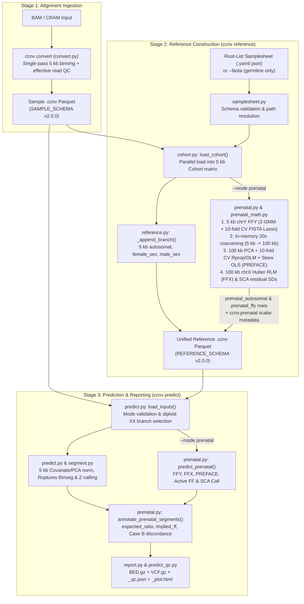

# Integrating PREFACE Prenatal cfDNA Analysis into `ccnv`

*   **Author:** Matthias De Smet (`@matthdsm`)
*   **Status:** Draft
*   **Date:** 2026-11-05

--------------------------------------------------------------------------------

## Overview

Copynumber-CNV (`ccnv`) is a Python toolkit for copy number variation (CNV) detection in shallow whole-genome sequencing (sWGS) data, built on the statistical principles of WISECONDOR and WisecondorX. Currently, `ccnv` targets constitutional genomic DNA (`germline`), assuming that copy number changes originate from a homogeneous diploid sample.

In non-invasive prenatal screening (NIPS / NIPT), cell-free DNA (cfDNA) extracted from maternal plasma is a mixture of maternal DNA (~85–95%) and placental/fetal DNA (~5–15%). Accurate prenatal CNV interpretation requires estimating the fetal fraction (`FF`), inferring fetal sex, detecting sex chromosome aneuploidies (SCAs), and comparing observed segment log2 ratios against the amplitude expected for a given fetal fraction.

This design integrates [`cmgg-PREFACE`](file:///Users/matdsmet/Projects/cmgg-PREFACE/README.md) (`FFY`, `FFX`, and `PREFACE` fetal fraction prediction and sex chromosome analysis) directly into `ccnv`. The integration introduces an explicit `--mode germline | prenatal` option on `ccnv reference` and `ccnv predict` (defaulting to `germline`), replaces PREFACE's PyTorch and ONNX Runtime dependencies with deterministic NumPy and SciPy routines, unifies BAM/CRAM read ingestion around `ccnv convert`'s 5 kb `.ccnv` sample Parquet format, embeds both CNV reference branches and PREFACE models into a single `.ccnv` reference Parquet file (`SCHEMA_VERSION = "2.0.0"`), and adds sample-level QC reporting (`<prefix>_qc.json`), prenatal segment annotations, and high-visibility discordance highlighting in the interactive HTML genome viewer.

## The Problem

Running `ccnv` and `cmgg-PREFACE` as separate tools in a prenatal NIPS workflow creates four operational and analytical problems:

1.  **Duplicate BAM/CRAM Ingestion and Divergent Read Filters**: Both `ccnv convert` and `preface` stream multi-gigabyte BAM/CRAM alignment files from disk to bin read starts into genomic windows. Running both tools doubles I/O time and CPU decoding work, while using inconsistent read filters (`ccnv` requires proper pairs by default and uses 0-based half-open intervals; `preface` keeps improper pairs and formats 1-based locus strings).
2.  **Heavy Machine Learning Dependencies for Small Linear/MLP Operations**: `cmgg-PREFACE` depends on `pytorch`, `onnx`, `onnxscript`, `onnxruntime`, and `matplotlib-base` (>1.5 GB container footprint) solely to compute a truncated SVD on a ~2,000-sample Gram matrix and train a 105-parameter (`50 -> 2 -> 1`) Sigmoid neural network via full-batch Rprop. In practice, `cmgg-PREFACE` already falls back to CPU on Apple Silicon (`mps`) for both SVD and Rprop because kernel launch overhead exceeds L1-cache CPU execution time.
3.  **Disconnected Reference Artifacts**: Maintaining a `.ccnv` Parquet reference for CNV calling alongside a separate `.onnx` model file and `.npz` count cache for fetal fraction prediction introduces version skew and cohort mismatch risks in clinical pipelines.
4.  **Uncontextualized Prenatal CNV Calls**: Standard CNV calling flags any segment with $|Z| \ge 3.0$ as a gain or loss regardless of whether the segment's $\log_2$ ratio matches the sample's fetal fraction. Without joint `FFY`, `FFX`, and `PREFACE` context inside `ccnv predict`, clinicians and analysts cannot automatically distinguish true single-copy fetal CNVs from sub-fetal noise, maternal germline CNVs, or sex chromosome aneuploidies (`XO`, `XXX`, `XXY`, `XYY`).

**Proposed Solution**: Consolidate read ingestion on `ccnv convert` (5 kb `.ccnv` sample Parquet), standardize cohort definition on a root-list YAML/JSON `--samplesheet` in `ccnv reference`, reimplement the prenatal mathematical models (`FFY`, `FFX`, `PREFACE`) in pure NumPy/SciPy, store the multi-resolution prenatal branches (`prenatal_autosomal` at 100 kb and `prenatal_ffy` at 5 kb `chrY`) natively inside the `.ccnv` reference Parquet alongside the 5 kb CNV branches, and use the predicted fetal fraction and sex chromosome metrics during `ccnv predict --mode prenatal` to annotate segments, emit `<prefix>_qc.json`, and highlight discordant calls in the HTML plot.

## Goals

*   **Preserve Germline Behavior (`--mode germline`)**: Default to `--mode germline` on `ccnv reference` and `ccnv predict`, producing bit-for-bit identical numerical results and unchanged BED and VCF column schemas compared to the current `ccnv` baseline.
*   **Single-Pass Alignment Ingestion**: Bin each BAM/CRAM file once via `ccnv convert` into a 5 kb `.ccnv` sample Parquet file, and derive 100 kb autosomal/`chrX` bins for PREFACE in memory without re-reading alignments or maintaining `.npz` caches.
*   **Zero Heavy ML Dependencies**: Achieve numerical parity with `cmgg-PREFACE` (`r > 0.9999`, parameter tolerances $\le 10^{-6}$) for 1D 2-GMM sex classification, FISTA non-negative Lasso (`FFY`), centered unscaled SVD PCA, full-batch Rprop `50 -> 2 -> 1` Sigmoid neural network / OLM (`PREFACE`), OLS skew correction, and Huber M-estimation RLM (`FFX`) using only `numpy` and `scipy`.
*   **Unified Reference Artifact (`SCHEMA_VERSION = "2.0.0"`)**: Store both the 5 kb CNV reference branches (`autosomal`, `female_sex`, `male_sex`) and the prenatal branches (`prenatal_autosomal` at 100 kb, `prenatal_ffy` at 5 kb `chrY`) plus scalar MLP/FFX metadata (`ccnv.prenatal`) in a single `.ccnv` reference Parquet file when `ccnv reference --mode prenatal` is executed.
*   **Strict Mode Guardrails**: Fail fast with an actionable `PredictError` if `ccnv predict --mode prenatal` is given a `germline` reference; emit a warning and advise the user if `ccnv predict --mode germline` is given a `prenatal` reference; fail fast with a `ReferenceError` if `ccnv reference --mode prenatal` is invoked with `--fasta` instead of `--samplesheet`.
*   **Diploid `XX` Gonosome Normalization in Prenatal Mode**: Always normalize `chrX` bins against the diploid `XX` (`female_sex`) reference branch during `ccnv predict --mode prenatal` so both focal CNVs and whole-chromosome fetal shifts (`XY`, `XO`, `XXX`, `XXY`) are measured relative to a pure maternal `XX` baseline.
*   **Sample QC & SCA Calling (`<prefix>_qc.json`)**: Emit `<prefix>_qc.json` on every `ccnv predict` run containing effective sample read metrics (representing only reads examined and kept on target contigs) and, in `prenatal` mode, `FFY`, `FFX`, `PREFACE`, active fetal fraction, low-fetal-fraction warnings (`active_ff < 0.04`), and sex chromosome aneuploidy (`XX`, `XY`, `XO`, `XXX`, `XXY`, `XYY`, `DISCORDANT_MIXED`) calls with confidence scores.
*   **Prenatal Segment Scaling & Visual Discordance Flagging**: In `--mode prenatal`, preserve raw segment $\log_2$ ratios while appending `expected_ratio`, `implied_ff`, `discordant`, and `discordance_reason` to segment/call BED and VCF outputs, and render discordant segments in `<prefix>_plot.html` as a dedicated high-contrast trace (`width: 6.0`, vivid purple/amber color) alongside horizontal $\log_2(1 \pm \text{active\_ff}/2)$ reference lines.

## Non-Goals

*   **Oncology / Liquid Biopsy (ctDNA) Modeling**: Tumor fraction estimation and somatic clonal modeling are out of scope for this design.
*   **ONNX / PyTorch Support**: Exporting or importing `.onnx` model files or depending on `pytorch` / `onnxruntime` is out of scope.
*   **Hard Gating on Low Fetal Fraction**: `ccnv predict --mode prenatal` will never abort or suppress CNV calls when fetal fraction falls below 4%; it records structured warnings in `<prefix>_qc.json` and the HTML viewer.
*   **Direct BAM/CRAM Input in `reference` or `predict`**: `ccnv reference` and `ccnv predict` operate exclusively on pre-converted `.ccnv` sample Parquet files (or a FASTA file for flat germline references).
*   **Modifying Germline BED/VCF Schemas**: No prenatal columns or header fields will be added to BED or VCF outputs when running in `--mode germline`.

## Open Questions

All architectural and domain questions were resolved during the `/egm-brainstorm` phase. None remain open.

## Critical User Journeys (CUJs)

### CUJ 1: Building a Unified Prenatal Reference from a Cohort Samplesheet

*   **Given**: A cohort of pre-converted NIPT maternal plasma `.ccnv` sample Parquet files (`5 kb` bins), an optional set of 100% male control `.ccnv` files, and a root-list YAML samplesheet (`samplesheet.yaml`) listing each sample's `id`, `filepath`, and optional `sex` (`M`/`F`) and `ff` (`0..1`) overrides.
*   **When**: The user runs `ccnv reference --mode prenatal --samplesheet samplesheet.yaml --male-ref male_ctrl.ccnv --prefix nipt_ref`.
*   **Then**:
    1. `ccnv` validates the samplesheet against the bundled JSON schema and loads the 5 kb sample Parquets in parallel into memory.
    2. `ccnv` fits the `FFY` model on informative 5 kb `chrY` bins (inferring fetal sex via 1D 2-GMM where `sex` is omitted and calibrating baseline `FFY` via 10-fold CV FISTA non-negative Lasso).
    3. `ccnv` builds the 5 kb CNV branches (`autosomal`, plus `female_sex` from female-fetus samples representing the diploid `XX` baseline, and `male_sex` from male-fetus samples).
    4. `ccnv` coarsens the in-memory 5 kb counts 20x to 100 kb, fits the centered unscaled SVD PCA + 10-fold CV Rprop neural network (or `--olm`) + OLS skew correction (`PREFACE`) and Huber RLM (`FFX`), and writes the single `nipt_ref.ccnv` Parquet file (`SCHEMA_VERSION = "2.0.0"`) plus `nipt_ref_qc.json`.

### CUJ 2: Running Prenatal CNV & Fetal Fraction Prediction on a Clinical NIPT Sample

*   **Given**: A single sample `.ccnv` file (`sample01.ccnv`) produced by `ccnv convert` and a prenatal reference (`nipt_ref.ccnv`).
*   **When**: The user runs `ccnv predict sample01.ccnv nipt_ref.ccnv --mode prenatal --prefix out/sample01`.
*   **Then**:
    1. `ccnv` verifies that `nipt_ref.ccnv` contains prenatal models (`prenatal_autosomal`, `prenatal_ffy`, and `ccnv.prenatal` metadata).
    2. `ccnv` normalizes autosomal bins against `autosomal` and `chrX` bins against the diploid `XX` (`female_sex`) branch, segments the genome with Ruptures `Binseg`, and calls gains and losses.
    3. `ccnv` evaluates `FFY`, `FFX`, and `PREFACE`, classifies fetal sex and sex chromosome aneuploidy (`SCA`) status with confidence, selects `active_ff` (`FFY` for concordant male, `PREFACE` for female or discordant), and annotates every segment with `expected_ratio`, `implied_ff`, `discordant`, and `discordance_reason`.
    4. `ccnv` writes `out/sample01_bins.bed.gz`, `out/sample01_segments.bed.gz` (with prenatal columns), `out/sample01_calls.bed.gz` (with prenatal columns), `out/sample01_segments.vcf.gz`, `out/sample01_calls.vcf.gz`, `out/sample01_qc.json` (with effective read stats, FF estimates, SCA call, and any low-FF/discordance warnings), and `out/sample01_plot.html` (with high-contrast `width: 6.0` discordant segment traces and $\log_2(1 \pm \text{active\_ff}/2)$ reference lines).

### CUJ 3: Running Default Germline CNV Analysis Without Regression

*   **Given**: A cohort samplesheet of constitutional genomic DNA `.ccnv` files (or a reference FASTA) and a test `.ccnv` sample.
*   **When**: The user runs `ccnv reference --samplesheet germline.yaml --prefix germ_ref` and `ccnv predict sample.ccnv germ_ref.ccnv --prefix out/germ` (omitting `--mode`, which defaults to `germline`).
*   **Then**:
    1. `ccnv reference` builds only the 5 kb `autosomal`, `female_sex`, and `male_sex` branches without running prenatal fetal-fraction training.
    2. `ccnv predict` produces BED and VCF files with the exact existing germline column structure and bit-for-bit identical log2 ratios, Z-scores, and calls, plus `out/germ_qc.json` containing effective sample read metrics (`prenatal: null`).
    3. If the user accidentally passes `germ_ref.ccnv` to `ccnv predict --mode prenatal`, `ccnv` immediately exits with a clear `PredictError` explaining that `germ_ref.ccnv` lacks prenatal models.

## Technical Plan (Architecture)

### 1. System Architecture & Module Decomposition

To keep every module in `src/ccnv/` well under the 1,000-line boundary and preserve clear separation of concerns, all new prenatal and samplesheet capabilities are partitioned into four new modules while existing modules receive surgical updates:

*   **`src/ccnv/samplesheet.py` (New)**: Validates and loads root-list `.yaml`, `.yml`, and `.json` samplesheets against `src/ccnv/samplesheet.schema.json`. Resolves relative `.ccnv` file paths against the samplesheet's parent directory, verifies each file is a valid `ArtifactKind.SAMPLE` Parquet table, and returns typed `SamplesheetEntry` objects (`filepath`, optional `sex` in `{"M", "F"}`, optional `ff` in `[0.0, 1.0]`).
*   **`src/ccnv/prenatal_math.py` (New)**: Pure NumPy and SciPy mathematical kernels with zero external ML dependencies:
    *   `infer_sex_gmm_1d`: 1D 2-component Gaussian mixture model (EM algorithm) and explicit `yfrac` threshold sex classifier.
    *   `fit_lasso_fista`: Non-negative Lasso regression via Fast Iterative Shrinkage-Thresholding Algorithm (FISTA) with power-iteration Lipschitz step sizing on standardized 5 kb `chrY` bins.
    *   `pca_irlba_numpy`: Centered, unscaled truncated PCA using `scipy.linalg.eigh` on the Gram matrix $X_c X_c^T$ when $N_{\text{samples}} \le N_{\text{features}}$ and `scipy.linalg.svd(..., full_matrices=False)` otherwise, with deterministic column sign flipping (`argmax(abs(rotation), axis=0)`).
    *   `fit_rprop_mlp` & `train_olm`: Single-hidden-layer Sigmoid neural network (`n_feat -> hidden -> 1`, default `50 -> 2 -> 1`) trained via full-batch Resilient Backpropagation (`etas=(0.5, 1.2)`, `step_sizes=(1e-6, 50.0)`, `lr=0.01`, `threshold=1e-4`, `stepmax=100_000`) and Ordinary Linear Model fallback (`np.linalg.lstsq`).
    *   `ols_fit` & `rlm_huber`: Ordinary least squares for cross-validated `PREFACE` skew correction and Huber M-estimation iteratively reweighted least squares (`k = 1.345`) for `FFX` regression.
*   **`src/ccnv/prenatal.py` (New)**: Domain orchestration for prenatal reference construction, single-sample inference (`FFY`, `FFX`, `PREFACE`), sex chromosome aneuploidy (`SCA`) classification, active fetal fraction selection, and Case B segment discordance annotation.
*   **`src/ccnv/predict_qc.py` (New)**: Aggregates effective read statistics from sample Parquet metadata, segmentation call counts, and optional `PrenatalPrediction` results into `<prefix>_qc.json`.



### 2. Unified Storage Contract (`SCHEMA_VERSION = "2.0.0"`)

#### 2.1 Sample Parquet Contract (`SAMPLE_SCHEMA`)
*   Row columns remain `(contig: string, start: int64, end: int64, count: uint64)` in 0-based half-open coordinates.
*   In `ccnv.qc` metadata, counters report only the reads examined and effectively used across the binned target contigs:
    *   `reads_seen`: Total alignment records examined across selected target contigs.
    *   `reads_kept`: Total alignment records passing all filters and binned.
    *   `autosomal_reads_kept`: Kept reads mapped to autosomal contigs (excluding sex contigs).
    *   `sex_reads_kept`: Kept reads mapped to sex contigs (`X`, `Y`, `chrX`, `chrY`).
    *   `filter_unmapped`, `filter_no_start`, `filter_secondary`, `filter_supplementary`, `filter_duplicate`, `filter_improper_pair`, `filter_mapq`: Per-reason drop counts on target contigs.

#### 2.2 Reference Parquet Contract (`REFERENCE_SCHEMA`)
`REFERENCE_SCHEMA` retains its 13 columnar fields (`branch`, `contig`, `start`, `end`, `masked`, `gc`, `mappability`, `pca_mean`, `pca_loadings`, `nearest_ref_indices`, `mean_distance`, `null_mean`, `null_std`) keyed by `(branch, contig, start, end)`.

When `ccnv reference` runs with `--mode germline`, it writes the standard 5 kb CNV branches (`autosomal`, plus optional `female_sex` and `male_sex`) and sets `"mode": "germline"` in `ccnv.model`.

When `ccnv reference` runs with `--mode prenatal`, it sets `"mode": "prenatal"` in `ccnv.model` and appends two native prenatal branches to the Arrow table alongside a compact `ccnv.prenatal` scalar metadata dictionary:

| Branch Name | Resolution & Contigs | Column Mapping in `REFERENCE_SCHEMA` | Purpose |
| :--- | :--- | :--- | :--- |
| `autosomal` | `bin_size` (5 kb), autosomes | Standard `ccnv` CNV branch | 5 kb autosomal CNV normalization & segmentation |
| `female_sex` | `bin_size` (5 kb), `chrX` / `chrY` | Built from female-fetus samples (100% diploid `XX`) | Diploid `XX` reference used for `chrX` normalization in `prenatal` mode |
| `male_sex` | `bin_size` (5 kb), `chrX` / `chrY` | Built from male-fetus samples | Available when `predict --mode germline` is run against a prenatal reference |
| `prenatal_autosomal` | `prenatal_binsize` (100 kb), canonical autosomes excluding `13`, `18`, `21` | `masked`: excluded bin flag<br/>`null_mean`: `mean_features` (imputation mean)<br/>`pca_mean`: `pca_center`<br/>`pca_loadings`: `pca_rotation` (`list<float64>` of length `n_feat`)<br/>*(other numeric cols set to `0.0` / `[]`)* | Columnar zstd-compressed storage of the 100 kb `PREFACE` feature loci, imputation means, PCA center, and `N_bins x n_feat` PCA rotation matrix |
| `prenatal_ffy` | `ffy_binsize` (5 kb), `chrY` | `masked`: `~informative_mask` (`True` for PAR1 `< 2,781,479`, Yq12 `> 28,800,000`, or uninformative bins)<br/>`pca_mean`: non-negative FISTA Lasso weight `ffy_weights`<br/>*(other numeric cols set to `0.0` / `[]`)* | Columnar storage of 5 kb `chrY` informative mask and FISTA Lasso bin weights |

The scalar parameters (<1 KB JSON) are stored in `ccnv.prenatal` metadata (retaining `"preface"` for the autosomal fetal fraction predictor parameters and output value):
```json
{
  "ffy": {
    "binsize": 5000,
    "intercept": 0.00124,
    "female_baseline": 0.00082,
    "male_100_baseline": 0.50082,
    "yfrac_threshold": 0.0041,
    "no_female_gate": false,
    "n_males": 112,
    "n_females": 108,
    "cv_cor": 0.942,
    "cv_mae": 0.0081,
    "cv_sd": 0.0063
  },
  "preface": {
    "binsize": 100000,
    "n_feat": 50,
    "hidden": 2,
    "is_olm": false,
    "w1": [[...], [...]],
    "b1": [0.12, -0.34],
    "w2": [0.85, -0.61],
    "b2": 0.04,
    "skew_intercept": -0.0021,
    "skew_slope": 1.018,
    "cv_cor": 0.931,
    "cv_mae": 0.0094,
    "cv_sd": 0.0072,
    "mae_under_10": 0.0088,
    "sd_under_10": 0.0069
  },
  "ffx": {
    "intercept_x": 1.0004,
    "slope_x": -0.498,
    "r_weighted": 0.892,
    "ffx_female_mean": 0.0003,
    "ffx_female_sd": 0.0112,
    "ffx_male_diff_sd": 0.0128,
    "preface_male_diff_sd": 0.0141
  }
}
```

### 3. Single-Pass Multi-Resolution Ingestion & Coarsening

1.  **Cohort Loading (`ccnv reference`)**:
    *   `load_cohort` reads all sample `.ccnv` files listed in `--samplesheet` in parallel across `--threads` into the 5 kb `Cohort` matrix (`counts` of shape `n_bins_5kb x n_samples`).
    *   In `--mode prenatal`, `prenatal.py` extracts two views from `Cohort` without touching disk:
        *   **5 kb `FFY` View**: Slices `chrY` and canonical autosomes (excluding `13`, `18`, `21`, `X`, `Y` via `normalize_chr`). Computes per-sample mean mappable autosomal density $r_{\text{auto}} = \text{mean}(\text{counts}_{\text{auto}} > 0 / \text{widths}_{\text{auto}})$ and normalized `chrY` bin depths $Y_{\text{norm}} = \text{counts}_Y / (r_{\text{auto}} \cdot \text{widths}_Y)$.
        *   **100 kb `PREFACE` / `FFX` View**: Coarsens the 5 kb `Cohort.counts` matrix per contig to `prenatal_binsize = 100_000` using vectorized `np.add.reduceat` (when `prenatal_binsize % cohort.bin_size == 0`) or `rebin_counts`. Computes 100 kb autosomal density $r_{\text{auto}, 100\text{kb}}$, per-bin $\log_2$ ratios $\log_2(\text{counts} / (r_{\text{auto}, 100\text{kb}} \cdot \text{widths}))$, and whole-chromosome `chrX` ratio $R_X = 2^{\text{nanmean}(\log_2 R_{\text{chrX}})}$.
2.  **Sex Classification Cohesion in `ccnv reference --mode prenatal`**:
    *   In maternal cfDNA cohorts, fetal `chrY` read fractions (~0.01%–0.05%) are much smaller than constitutional male `chrY` fractions (~0.2%–0.5%). Therefore, in `--mode prenatal`, sample sex assignment for building the 5 kb `female_sex` and `male_sex` CNV branches uses the `FFY` sex classifications (`infer_sex_gmm_1d` + any explicit `sex` overrides from the samplesheet) rather than the germline MAD-gap heuristic.

### 4. Mathematical Equivalence of Pure NumPy/SciPy Prenatal Kernels

1.  **`FFY` Calibration (`fit_cohort_ffy`)**:
    *   Identifies informative 5 kb `chrY` bins: `coord_mask = (starts >= 2_781_479) & (ends <= 28_800_000)` refined by `(mean_male > median_female + 1e-4) & (median_female < 0.15)`.
    *   Computes `female_baseline = median(y_scores[female_mask])` and `male_100_baseline = median(mean(male_ref_y[:, info_mask], axis=1))` if `--male-ref` is provided, else `female_baseline + 0.5`.
    *   Computes prior fetal fraction `prior_ffy = clip((y_scores - female_baseline) / (male_100_baseline - female_baseline), 0.0, 1.0)` (gated to `0.0` for females unless `--no-female-gate`).
    *   Fits 10-fold CV and full-cohort non-negative FISTA Lasso (`fit_lasso_fista` with $\lambda = 10^{-4}$). Populates any missing `ff` labels in the cohort with `final_ffy` (respecting user-supplied `ff` overrides in the samplesheet).
2.  **`PREFACE` Training (`fit_cohort_preface`)**:
    *   Filters 100 kb autosomal bins to keep bins with finite $\log_2$ ratios in $>99\%$ of training samples (`possible_features`), imputing remaining `NaN` entries with the training bin mean (`mean_features`).
    *   Runs 10-fold cross-validation across labeled samples (male fetuses with `ff` from `FFY` or samplesheet, plus female fetuses if `--femprop` is enabled and female `ff` labels are present). In each fold, fits centered unscaled PCA (`pca_irlba_numpy`) on all non-test samples (`n_components = min(n_feat * 10, n_non_test - 1)`), projects labeled training fold samples onto the top `n_feat` PCs, fits `fit_rprop_mlp` (or `train_olm`), and predicts on the held-out fold.
    *   Fits OLS skew correction (`the_intercept, the_slope = ols_fit(cv_preds[sub_idx], labeled_ff[sub_idx])`) on a deterministic 25% subset (`rng.permutation`).
    *   Fits the final PCA and final Rprop/OLM predictor across all cohort samples.
3.  **`FFX` Training (`fit_cohort_ffx`)**:
    *   Fits Huber M-estimation (`rlm_huber` with $k = 1.345$) regressing male `chrX` ratio $R_X$ against male `ff`: $R_X = \beta_{0,X} + \beta_{1,X} \cdot \text{FF}$.
    *   Computes empirical cohort residual standard deviations for SCA Z-scoring:
        *   $\mu_{\text{FFX}, F} = \text{median}(\text{FFX}_{\text{female}})$, $\sigma_{\text{FFX}, F} = \max(1.4826 \cdot \text{MAD}(\text{FFX}_{\text{female}}), 0.005)$
        *   $\sigma_{XY} = \max(1.4826 \cdot \text{MAD}(\text{FFX}_{\text{male}} - \text{FFY}_{\text{male}}), 0.005)$
        *   $\sigma_{\text{PREF}} = \max(1.4826 \cdot \text{MAD}(\text{PREFACE}_{\text{male, CV}} - \text{FFY}_{\text{male}}), 0.005)$

### 5. Prenatal Inference, SCA Calling & Segment Annotation in `ccnv predict`

#### 5.1 Mode Validation & Branch Selection
*   In `load_inputs`:
    *   Read `ref_mode = reference_meta["model"].get("mode", "germline")`.
    *   If `config.mode == "prenatal"` and `ref_mode != "prenatal"`: raise `PredictError("reference was built in germline mode and lacks prenatal models; rebuild reference with --mode prenatal or run predict with --mode germline")`.
    *   If `config.mode == "germline"` and `ref_mode == "prenatal"`: log a `WARNING` advising that the reference contains prenatal models that are ignored in `--mode germline`, and filter out `prenatal_autosomal` and `prenatal_ffy` branches.
    *   In `config.mode == "prenatal"`, select `branches = ("autosomal", "female_sex")` (when `female_sex` is present in the reference) so `chrX` is always normalized against the diploid `XX` maternal baseline.

#### 5.2 Joint `FFY`, `FFX`, `PREFACE` & SCA Decision Logic
Given single-sample predictions $(\text{sex}, \text{FFY}, \text{FFX}, \text{PREFACE})$ and Z-scores $Z_{\text{FFX}} = (\text{FFX} - \mu_{\text{FFX}, F}) / \sigma_{\text{FFX}, F}$, $Z_{XY} = (\text{FFX} - \text{FFY}) / \sigma_{XY}$, and $Z_{Y,\text{PREF}} = (\text{FFY} - \text{PREFACE}) / \sigma_{\text{PREF}}$ with cutoff $Z_{\text{cut}} = 3.0$:

| `chrY` Sex Call | Z-Score Criteria | SCA Call | `is_aneuploid` | Selected `active_ff` | `active_ff_source` |
| :--- | :--- | :--- | :--- | :--- | :--- |
| `"F"` (`y_score < yfrac`) | $|Z_{\text{FFX}}| < 3.0$ | `"XX"` | `False` | `max(PREFACE, 0.0)` | `"PREFACE"` |
| `"F"` (`y_score < yfrac`) | $Z_{\text{FFX}} \ge 3.0$ | `"XO"` | `True` | `max(PREFACE, 0.0)` | `"PREFACE"` |
| `"F"` (`y_score < yfrac`) | $Z_{\text{FFX}} \le -3.0$ | `"XXX"` | `True` | `max(PREFACE, 0.0)` | `"PREFACE"` |
| `"M"` (`y_score >= yfrac`) | $|Z_{XY}| < 3.0$ and $|Z_{Y,\text{PREF}}| < 3.0$ | `"XY"` | `False` | `FFY` | `"FFY"` |
| `"M"` (`y_score >= yfrac`) | $Z_{XY} \le -3.0$ and $|Z_{\text{FFX}}| < 3.0$ | `"XXY"` | `True` | `FFY` | `"FFY"` |
| `"M"` (`y_score >= yfrac`) | $Z_{XY} \le -3.0$ and $Z_{Y,\text{PREF}} \ge 3.0$ and $\text{FFY} / \max(\text{FFX}, 0.01) > 1.5$ | `"XYY"` | `True` | `max(PREFACE, 0.0)` | `"PREFACE"` |
| `"M"` (`y_score >= yfrac`) | Otherwise ($|Z_{XY}| \ge 3.0$ or $|Z_{Y,\text{PREF}}| \ge 3.0$) | `"DISCORDANT_MIXED"` | `True` | `max(PREFACE, 0.0)` | `"PREFACE"` |

#### 5.3 Case B Segment Scaling & Discordance Rules
For each `SegmentResult` in `--mode prenatal`:
*   $\text{expected\_ratio} = \log_2(1.0 + 0.5 \cdot \text{active\_ff})$ if $\text{segment.ratio} \ge 0$ else $\log_2(1.0 - 0.5 \cdot \text{active\_ff})$.
*   $\text{implied\_ff} = 2.0 \cdot |2^{\text{segment.ratio}} - 1.0|$.
*   A segment is flagged `discordant = True` with `discordance_reason` when:
    1.  `SCA_DISCORDANT`: `normalize_chr(segment.contig) in {"X", "Y"}` and (`sca.is_aneuploid` is `True` or `segment.call is not None`).
    2.  `SUB_FETAL_RATIO`: `segment.call is not None` (`|Z| >= z_threshold`) and $|\text{segment.ratio}| < 0.5 \cdot |\text{expected\_ratio}|$.
    3.  `SUPER_FETAL_RATIO`: `segment.call is not None` and $\text{implied\_ff} > \max(2.5 \cdot \text{active\_ff}, \text{active\_ff} + 0.15)$.
    4.  Otherwise `discordant = False`, `discordance_reason = None`.

### 6. Output Contracts (`_qc.json`, BED, VCF, HTML)

1.  **`<prefix>_qc.json` (`src/ccnv/predict_qc.py`)**:
    *   Emitted on every `ccnv predict` invocation.
    *   Contains `schema_version`, `mode`, `sample`, `read_metrics` (effective reads examined/kept on target contigs, autosomal vs sex reads kept, filter drops on target contigs, usable/masked bin counts, mean/median bin count), `cnv_summary` (`total_segments`, `gain_calls`, `loss_calls`, `discordant_segments`), and `prenatal` (`null` in `germline` mode; populated with `fetal_sex`, `active_ff`, `active_ff_source`, `ffy`, `ffx`, `preface`, `chrx_ratio`, `chry_score`, `yfrac_threshold`, `sca`, and `warnings` in `prenatal` mode).
2.  **BED & VCF (`src/ccnv/report.py`)**:
    *   `--mode germline`: Zero changes to `_bins.bed.gz`, `_segments.bed.gz`, `_calls.bed.gz`, `_segments.vcf.gz`, or `_calls.vcf.gz`.
    *   `--mode prenatal`:
        *   `_segments.bed.gz` header: `#contig\tstart\tend\tratio\tzscore\tweight\tbin_count\tcall\texpected_ratio\timplied_ff\tdiscordant\tdiscordance_reason`
        *   `_calls.bed.gz` header: `#contig\tstart\tend\tratio\tzscore\ttype\texpected_ratio\timplied_ff\tdiscordant\tdiscordance_reason`
        *   `_segments.vcf.gz` & `_calls.vcf.gz`: Add header lines `##fetalSex=`, `##fetalFraction=`, `##scaCall=`, `##INFO=<ID=DISCORDANT,...>`, `##INFO=<ID=DISC_REASON,...>`, `##FORMAT=<ID=EXP_LOG2R,...>`, `##FORMAT=<ID=IMPLIED_FF,...>` (along with parser compatibility aliases `EXPRATIO`, `IMPFF`, `DISCREASON`), and append `EXP_LOG2R:IMPLIED_FF` to `FORMAT` plus `DISCORDANT;DISC_REASON=...` to `INFO` when `segment.discordant` is `True`.
3.  **Interactive HTML Viewer (`src/ccnv/templates/genome_plot.html.j2`)**:
    *   In `--mode prenatal`, `D.prenatal` is included in the JSON payload and `D.segments` tuples include `[contig_idx, start, end, ratio, zscore, bin_count, discordant_bool, implied_ff, expected_ratio, discordance_reason]`.
    *   The top `.bar` displays a prenatal status badge (`Fetal Sex`, `Active FF`, `FFY / PREFACE / FFX`, `SCA Call`) styled with warning/alert colors when `low_ff_warning` or `sca.is_aneuploid` is active.
    *   Discordant segments are rendered in a dedicated Plotly line trace (`Segments (Discordant)`) with **`width: 6.0`**, `#9333ea` (vivid purple) stroke, endpoint diamond markers (`size: 7`), and dashed horizontal reference lines at $\log_2(1 \pm \text{active\_ff}/2)$ on the log2 ratio panel.

## Alternatives Considered

### 1. PyTorch + ONNX Runtime vs. Pure NumPy/SciPy for Prenatal Model Training & Inference
*   **Alternative:** Retain `cmgg-PREFACE`'s dependency stack (`pytorch`, `onnx`, `onnxscript`, `onnxruntime`) to fit the non-negative Lasso (`FFY`) and `50 -> 2 -> 1` Sigmoid neural network (`PREFACE`) and export an ONNX computational graph.
*   **Pros:** Reuses `cmgg-PREFACE`'s existing PyTorch training code verbatim.
*   **Cons:** Adds ~1.5 GB+ of dependencies (`pytorch`, `onnx`, `onnxscript`, `onnxruntime`) to `ccnv`'s Pixi environment and multi-arch (`linux/amd64`, `linux/arm64`) Docker image for two miniature models (~2,700 parameters in `FFY` and 105 parameters in the `PREFACE` MLP). PyTorch gradient descent across CPU architectures can also introduce floating-point non-determinism across platforms.
*   **Decision:** Rejected. Implement FISTA with non-negative proximal projection for `FFY` (`fit_lasso_fista`) and deterministic full-batch Rprop (`fit_rprop_mlp`) with multi-seed initialization (`seed + init_idx`) in pure `numpy` and `scipy`. All existing `ccnv` dependencies (`numpy`, `scipy`, `scikit-learn`, `polars`, `pyarrow`, `ruptures`, `pysam`, `pyBigWig`, `jinja2`) plus `pyyaml` and `jsonschema` suffice without bloating the container image.

### 2. JSON Metadata Serialization vs. Native Arrow Branches for `100 kb` `PREFACE` & `5 kb` `FFY` Parameters
*   **Alternative:** Serialize the `100 kb` autosomal PCA rotation matrix (`~28,000 × 50` floats) and `5 kb` `chrY` FFY weights (`~11,400` floats) as JSON float arrays inside Parquet schema metadata (`ccnv.prenatal`).
*   **Pros:** Requires zero new rows in the reference Parquet table.
*   **Cons:** Encodes ~1.4 million floats as ASCII JSON strings inside the Parquet file footer (~25 MB of text metadata), bypassing Arrow's binary columnar compression, vectorization, and coordinate validation.
*   **Decision:** Rejected. Store the `100 kb` autosomal `PREFACE` bin parameters (`masked`, `null_mean` = `mean_features`, `pca_mean` = `pca_center`, `pca_loadings` = `pca_rotation`) and `5 kb` `chrY` `FFY` weights (`masked` = `~informative_mask`, `pca_mean` = `ffy_weights`) as native rows in `REFERENCE_SCHEMA` under `branch = "prenatal_autosomal"` and `branch = "prenatal_ffy"`, keeping `ccnv.prenatal` metadata purely for compact scalar MLP/OLM/FFX parameters (< 4 KB JSON).

### 3. Separate `.onnx` + `.ccnv` Reference Artifacts vs. Unified `.ccnv` Reference Parquet
*   **Alternative:** Emit two separate reference artifacts (`ref.ccnv` for CNV profiles and `ref.onnx` for fetal fraction inference) when building a prenatal reference.
*   **Pros:** Keeps `ccnv` reference Parquet strictly scoped to CNV normalization.
*   **Cons:** Forces clinical pipelines to track, version, and pass paired reference files across `ccnv reference`, `ccnv ref-qc`, and `ccnv predict`, creating risk of mismatched cohort references.
*   **Decision:** Rejected. Store both CNV branches (`autosomal`, `female_sex`, `male_sex`) and prenatal branches (`prenatal_autosomal`, `prenatal_ffy`) inside a single self-contained `.ccnv` Parquet file (`SCHEMA_VERSION = "2.0.0"`).

### 4. Three CLI Modes (`germline | prenatal | both`) vs. Two CLI Modes (`germline | prenatal`)
*   **Alternative:** Expose three modes (`germline`, `prenatal`, `both`) on `ccnv reference` and `ccnv predict`.
*   **Pros:** Allows running fetal fraction estimation without CNV segmentation if `prenatal` were defined as FF-only.
*   **Cons:** In NIPS clinical workflows, prenatal screening inherently requires both genome-wide/sex-chromosome CNV profiles and fetal fraction (`FFY`, `FFX`, `PREFACE`) to interpret maternal cfDNA copy-number ratios and sex chromosome aneuploidies. A separate `"both"` option adds redundant CLI surface area.
*   **Decision:** Rejected. Support two modes: `--mode germline` (default) and `--mode prenatal` (which builds and executes both CNV and fetal fraction models). Enforce mode guardrails so a `germline` reference raises a `PredictError` in `predict --mode prenatal`, while a `prenatal` reference in `predict --mode germline` logs a warning and runs standard germline CNV calling.

--------------------------------------------------------------------------------

## Non-Functional Requirements

### 1. Performance & Resource Bounds
*   **Single-Pass Alignment Conversion:** `ccnv convert` streams each BAM/CRAM once per contig at `5 kb` resolution (`--bin-size 5000`); `100 kb` autosomal and `chrX` bins for `PREFACE` are coarsened in memory via `rebin_sample_table(table, 100000)` (~2 ms per sample), avoiding any second alignment pass.
*   **Reference Build Latency:** Fitting `FFY` (FISTA non-negative Lasso), `PREFACE` (`100 kb` truncated SVD PCA + 5-seed full-batch Rprop `50 -> 2 -> 1` MLP + OLM), and `FFX` (Huber RLM) on a 100–200 sample cohort adds `< 3 seconds` of wall-clock time on CPU compared to a `--mode germline` reference build.
*   **Prediction Latency & Memory:** In `ccnv predict --mode prenatal`, evaluating `FFY`, `PREFACE`, `FFX`, SCA classification, and segment discordance annotation targets `< 50 ms` of wall-clock latency and `< 50 MB` of peak RSS overhead beyond standard germline prediction (soft target; accuracy and prediction quality take precedence over strict latency/memory bounds).

### 2. Numerical Determinism & Reproducibility
*   All stochastic or iterative algorithms (`infer_sex_gmm_1d`, `fit_lasso_fista`, `pca_irlba_numpy`, `fit_rprop_mlp`) are seeded deterministically from `--seed` (default `42`) with explicit sign canonicalization (`max(abs(col))` positive for SVD vectors) and stable lexicographic sorting of cohort sample paths.
*   Running `ccnv reference` or `ccnv predict` twice with the same inputs and `--seed` produces byte-identical numerical arrays in `.ccnv`, `_qc.json`, BED, VCF, and HTML outputs.

### 3. Backward Compatibility & Schema Versioning
*   `SCHEMA_VERSION` is bumped to `"2.0.0"`. Readers validate `schema_version` on both sample and reference `.ccnv` files and emit actionable error messages (`ReferenceError` / `PredictError`) when version or mode contracts are violated.
*   In `--mode germline` (the default), `ccnv predict` produces byte-identical `_bins.bed.gz`, `_segments.bed.gz`, `_calls.bed.gz`, `_segments.vcf.gz`, and `_calls.vcf.gz` files compared to the existing pipeline, while additionally emitting `<prefix>_qc.json`.

## Detailed Implementation Plan

### Task 1: Dependencies & Packaging (pyproject.toml)
*   **File:** [`pyproject.toml`](file:///Users/matdsmet/Projects/copynumber-cnv/pyproject.toml)
*   **Changes:**
    *   Add `"pyyaml>=6.0"` and `"jsonschema>=4.20.0"` to `[project.dependencies]` and `[tool.pixi.dependencies]` so both the `default` and `prod` Pixi environments include YAML/JSON samplesheet parsing and JSON Schema validation.
    *   Include `src/ccnv/*.json` in package data alongside `src/ccnv/templates/*.j2`.

### Task 2: Domain Models & Configurations (src/ccnv/models.py & src/ccnv/results.py)
*   **File:** [`src/ccnv/models.py`](file:///Users/matdsmet/Projects/copynumber-cnv/src/ccnv/models.py)
*   **Changes:**
    *   Add `AnalysisMode = Literal["germline", "prenatal"]`.
    *   Add `SamplesheetEntry` dataclass:
        *   `filepath: Path`
        *   `sex: Literal["M", "F"] | None = None`
        *   `ff: float | None = None`
    *   Update `ReferenceConfig`:
        *   Replace `input_paths: tuple[Path, ...]` with `samplesheet_path: Path | None = None` and `entries: tuple[SamplesheetEntry, ...] = ()` (retaining `input_paths` and `samples` as deprecated synchronization shims for backward compatibility with existing tests).
        *   Add `mode: AnalysisMode = "germline"`.
        *   Add `prenatal_bin_size: int = 100000`.
    *   Update `PredictConfig`:
        *   Add `mode: AnalysisMode = "germline"`.
        *   Add `min_fetal_fraction_warning: float = 0.04`.
*   **File:** [`src/ccnv/results.py`](file:///Users/matdsmet/Projects/copynumber-cnv/src/ccnv/results.py)
*   **Changes:**
    *   Extend `SegmentResult` with optional prenatal discordance fields (all defaulting to `None` / `False` so `--mode germline` callers are unaffected):
        *   `expected_ratio: float | None = None`
        *   `implied_ff: float | None = None`
        *   `discordant: bool = False`
        *   `discordance_reason: str | None = None`
    *   Add `SCAResult` frozen dataclass:
        *   `call: Literal["XX", "XY", "XO", "XXX", "XXY", "XYY", "DISCORDANT_MIXED"]`
        *   `is_aneuploid: bool`
        *   `confidence: float`
        *   `chrx_zscore: float`
        *   `ff_delta: float | None`
    *   Add `FetalFractionResult` frozen dataclass:
        *   `fetal_sex: Literal["M", "F"]`
        *   `active_ff: float`
        *   `active_ff_source: Literal["FFY", "PREFACE"]`
        *   `ffy: float | None`
        *   `ffx: float | None`
        *   `preface: float | None`
        *   `chrx_ratio: float`
        *   `chry_score: float`
        *   `yfrac_threshold: float`
        *   `sca: SCAResult`
        *   `low_ff_warning: bool`
        *   `warnings: tuple[str, ...]`
    *   Update `PredictResult` and `PredictOutputPaths` to include `qc_json_path: Path` and `prenatal_result: FetalFractionResult | None = None`.

### Task 3: Arrow Schema & Metadata Contracts (src/ccnv/schemas.py)
*   **File:** [`src/ccnv/schemas.py`](file:///Users/matdsmet/Projects/copynumber-cnv/src/ccnv/schemas.py)
*   **Changes:**
    *   Bump `SCHEMA_VERSION` from `"1.0.0"` to `"2.0.0"`.
    *   Add `PRENATAL_METADATA_KEY = b"ccnv.prenatal"`.
    *   Update `ReferenceMetadata` dataclass to include `mode: AnalysisMode = "germline"` and `prenatal_bin_size: int | None = None`.
    *   Add `PrenatalModelMetadata` dataclass for the scalar parameters serialized under `b"ccnv.prenatal"`:
        *   `prenatal_bin_size: int`
        *   `yfrac_threshold: float`
        *   `ffy_intercept: float`
        *   `ffy_slope: float`
        *   `mlp_w1: list[list[float]]` (`50 × 2`)
        *   `mlp_b1: list[float]` (`2`)
        *   `mlp_w2: list[list[float]]` (`2 × 1`)
        *   `mlp_b2: list[float]` (`1`)
        *   `mlp_skew_intercept: float`
        *   `mlp_skew_slope: float`
        *   `olm_weights: list[float]` (`50`)
        *   `olm_bias: float`
        *   `olm_skew_intercept: float`
        *   `olm_skew_slope: float`
        *   `ffx_intercept: float`
        *   `ffx_slope: float`
        *   `female_chrx_ratio_mean: float`
        *   `female_chrx_ratio_std: float`
    *   Update `validate_reference_table` to accept known branches `{"autosomal", "female_sex", "male_sex", "prenatal_autosomal", "prenatal_ffy"}` and validate per-branch bin spacing (`bin_size` for CNV and `prenatal_ffy` branches; `prenatal_bin_size` for `prenatal_autosomal`).

### Task 4: Samplesheet Validation (src/ccnv/samplesheet.schema.json & src/ccnv/samplesheet.py)
*   **File:** [`src/ccnv/samplesheet.schema.json`](file:///Users/matdsmet/Projects/copynumber-cnv/src/ccnv/samplesheet.schema.json) (new)
    *   JSON Schema Draft-07 validating a root `array` (`minItems: 1`) of objects with required `"filepath"` (`string`, `minLength: 1`), optional `"sex"` (`enum: ["M", "F", null]`), optional `"ff"` (`number` in `[0.0, 1.0]` or `null`), and `additionalProperties: false`.
*   **File:** [`src/ccnv/samplesheet.py`](file:///Users/matdsmet/Projects/copynumber-cnv/src/ccnv/samplesheet.py) (new)
    *   `load_samplesheet(path: Path) -> tuple[SamplesheetEntry, ...]`:
        *   Loads JSON or YAML via `yaml.safe_load`.
        *   Validates against `samplesheet.schema.json` using `jsonschema.validate`, raising `ReferenceError` with the failing entry index and field path on schema violation.
        *   Resolves relative `filepath` entries relative to `path.parent`, verifies file existence and `.ccnv` readability, checks for duplicate resolved paths, and returns entries in deterministic order.
    *   Write tests in `tests/test_samplesheet.py` validating valid YAML/JSON, schema errors, relative path resolution, and duplicate file paths.

### Task 5: Effective Read Metrics in Convert (src/ccnv/convert.py)
*   **File:** [`src/ccnv/convert.py`](file:///Users/matdsmet/Projects/copynumber-cnv/src/ccnv/convert.py)
*   **Changes:**
    *   Update `_count_contig_reads` and `ConvertQCMetrics` so `ccnv.qc` records only reads examined, kept, and filtered on target contigs included in the `.ccnv` output (`effective_reads_examined`, `effective_reads_kept`, `autosomal_reads_kept`, `sex_reads_kept`, and per-filter drop counts on target contigs), omitting unmapped/skipped/off-target contig reads from sample QC metrics.
    *   Ensure all tests in `tests/test_convert.py` pass and verify effective read counts.

### Task 6: Pure NumPy/SciPy Prenatal Math Kernels (src/ccnv/prenatal_math.py)
*   **File:** [`src/ccnv/prenatal_math.py`](file:///Users/matdsmet/Projects/copynumber-cnv/src/ccnv/prenatal_math.py) (new)
*   **Functions:**
    *   `infer_sex_gmm_1d(yfracs: np.ndarray, seed: int = 42) -> tuple[np.ndarray, float]`: Fits a 2-component 1D Gaussian Mixture Model on `chrY` read fractions using deterministic quantile initialization (`25th` and `75th` percentiles) and EM updates, returning boolean `is_male` labels and the posterior `P = 0.5` decision threshold `yfrac_threshold`.
    *   `fit_lasso_fista(X: np.ndarray, y: np.ndarray, alpha: float, max_iter: int = 2000, tol: float = 1e-6) -> np.ndarray`: Solves $\min_{w \ge 0} \frac{1}{2N}\|Xw - y\|_2^2 + \alpha \|w\|_1$ via FISTA with Lipschitz step size $L = \|X^T X\|_2 / N$ and non-negative soft-thresholding $\max(0, v - \alpha / L)$.
    *   `pca_irlba_numpy(X: np.ndarray, n_components: int, seed: int = 42) -> tuple[np.ndarray, np.ndarray, np.ndarray]`: Mean-centers `X` (unscaled), computes `scipy.sparse.linalg.svds(X_centered, k=n_components, random_state=seed)`, sorts singular values descending, canonicalizes column signs of `V^T` so the largest-magnitude element per component is positive, and returns `(scores, center, rotation)`.
    *   `fit_rprop_mlp(X: np.ndarray, y: np.ndarray, hidden_dim: int = 2, n_inits: int = 5, max_epochs: int = 1500, seed: int = 42) -> tuple[np.ndarray, np.ndarray, np.ndarray, np.ndarray]`: Fits a `D -> 2 -> 1` Sigmoid neural network with full-batch Resilient Backpropagation ($\eta^+ = 1.2$, $\eta^- = 0.5$, $\Delta_0 = 0.01$, $\Delta_{\min} = 10^{-6}$, $\Delta_{\max} = 50.0$) across `n_inits` deterministic seeds (`seed + i`), selecting the run with lowest training MSE.
    *   `ols_fit(x: np.ndarray, y: np.ndarray) -> tuple[float, float]`: Ordinary least squares `(intercept, slope)` with fallback `(0.0, 1.0)` when variance is zero.
    *   `rlm_huber(x: np.ndarray, y: np.ndarray, k: float = 1.345, max_iter: int = 50, tol: float = 1e-6) -> tuple[float, float]`: Iteratively reweighted least squares with Huber MAD scale estimation and tuning constant $k = 1.345$.
*   **Tests:** Write unit tests in `tests/test_prenatal_math.py` verifying convergence, deterministic seeding, sign canonicalization, and outlier robustness.

### Task 7: Prenatal Model Training, Inference & SCA Classification (src/ccnv/prenatal.py)
*   **File:** [`src/ccnv/prenatal.py`](file:///Users/matdsmet/Projects/copynumber-cnv/src/ccnv/prenatal.py) (new)
*   **Functions:**
    *   `fit_prenatal_models(sample_tables: Sequence[pa.Table], entries: Sequence[SamplesheetEntry], bin_size: int, prenatal_bin_size: int, seed: int) -> tuple[pa.Table, pa.Table, PrenatalModelMetadata, tuple[bool, ...]]`:
        1.  Computes `chrY` read fractions from `5 kb` sample tables, runs `infer_sex_gmm_1d`, applies any explicit `entry.sex` overrides from the samplesheet, and returns the resolved cohort sex mask `is_male` (used both for prenatal training and for splitting `female_sex` / `male_sex` CNV reference branches).
        2.  Constructs the `5 kb` `chrY` count matrix, masks hypervariable/zero bins, fits `FFY` via `fit_lasso_fista` + OLS calibration, and predicts `FFY` for all male-fetus cohort samples.
        3.  Rebins autosomal and `chrX` counts to `prenatal_bin_size` (`100 kb`) in memory via `rebin_sample_table`, computes normalized autosomal bin ratios, fits `pca_irlba_numpy(n_components=min(50, n_samples - 1))`, trains the `PREFACE` MLP (`fit_rprop_mlp`) and OLM fallback against target fetal fractions (`entry.ff` if provided, else `FFY` on male-fetus training samples), and fits `ols_fit` skew corrections.
        4.  Computes `100 kb` `chrX` normalized read ratios (`chrx_ratio`), records diploid `XX` `female_chrx_ratio_mean` and `female_chrx_ratio_std` on female-fetus samples, and fits `rlm_huber(chrx_ratio_male, ffy_male)` for `FFX`.
        5.  Builds and returns the `prenatal_autosomal` (`100 kb`) and `prenatal_ffy` (`5 kb` `chrY`) Arrow tables conforming to `REFERENCE_SCHEMA` plus `PrenatalModelMetadata`.
    *   `predict_prenatal(sample_table: pa.Table, reference_table: pa.Table, prenatal_meta: PrenatalModelMetadata, min_ff_warning: float = 0.04) -> FetalFractionResult`:
        1.  Extracts `prenatal_ffy` (`5 kb` `chrY`) and `prenatal_autosomal` (`100 kb` autosomes) rows from `reference_table`.
        2.  Evaluates `chry_score`, classifies fetal sex against `prenatal_meta.yfrac_threshold`, and computes `ffy` when fetal sex is `"M"`.
        3.  Rebins the sample's autosomal and `chrX` counts to `prenatal_meta.prenatal_bin_size` (`100 kb`) in memory, projects autosomal ratios onto the stored PCA basis (`pca_mean`, `pca_loadings`), evaluates the `50 -> 2 -> 1` Sigmoid MLP (falling back to OLM if raw MLP output is outside `[0.01, 0.50]`), and applies skew correction to obtain `preface`.
        4.  Computes `chrx_ratio` and `ffx = ffx_intercept + ffx_slope * chrx_ratio`.
        5.  Runs `classify_sca` (`XX`, `XY`, `XO`, `XXX`, `XXY`, `XYY`, `DISCORDANT_MIXED`) and selects `active_ff` (`FFY` for concordant `"M"`, `PREFACE` for `"F"` or discordant).
    *   `annotate_prenatal_segments(segments: Sequence[SegmentResult], prenatal_result: FetalFractionResult, z_threshold: float) -> list[SegmentResult]`:
        *   Computes `expected_ratio`, `implied_ff`, `discordant`, and `discordance_reason` (`SCA_DISCORDANT`, `SUB_FETAL_RATIO`, `SUPER_FETAL_RATIO`) for each segment while keeping `segment.ratio` unmodified.

### Task 8: Reference Building & Reference QC Integration (src/ccnv/reference.py & src/ccnv/reference_qc.py)
*   **File:** [`src/ccnv/reference.py`](file:///Users/matdsmet/Projects/copynumber-cnv/src/ccnv/reference.py)
*   **Changes:**
    *   Load cohort sample paths and optional `(sex, ff)` overrides via `load_samplesheet(config.samplesheet_path)`.
    *   In `config.mode == "prenatal"`:
        *   Reject `--fasta` flat mode with a `ReferenceError`.
        *   Call `fit_prenatal_models` to obtain `prenatal_autosomal` rows, `prenatal_ffy` rows, `PrenatalModelMetadata`, and the maternal-cfDNA-aware `is_male` cohort split.
        *   Use the `is_male` split from `fit_prenatal_models` (together with any `--male-ref` samples) to populate the `female_sex` (`XX`) and `male_sex` (`XY`) CNV branches.
        *   Concatenate `autosomal`, `female_sex`, `male_sex`, `prenatal_autosomal`, and `prenatal_ffy` tables and write `ccnv.prenatal` metadata.
*   **File:** [`src/ccnv/reference_qc.py`](file:///Users/matdsmet/Projects/copynumber-cnv/src/ccnv/reference_qc.py)
*   **Changes:**
    *   Filter `reference_table` to CNV branches (`autosomal`, `female_sex`, `male_sex`) when computing CNV reference QC metrics, and include a `"prenatal"` summary block in `<prefix>_qc.json` when `mode == "prenatal"` (reporting `prenatal_autosomal` usable bins, `prenatal_ffy` informative bins, `yfrac_threshold`, and `female_chrx_ratio_std`).
*   **Existing Test Updates:** Update tests that call `reference.py` directly to use `samplesheet_path` / `entries`.

### Task 9: Prediction Pipeline, Predict QC & Reporting (src/ccnv/predict.py, src/ccnv/predict_qc.py, src/ccnv/report.py, src/ccnv/templates/genome_plot.html.j2)
*   **File:** [`src/ccnv/predict.py`](file:///Users/matdsmet/Projects/copynumber-cnv/src/ccnv/predict.py)
*   **Changes:**
    *   Enforce mode guardrails between `config.mode` and `ref_metadata.mode`:
        *   `config.mode == "prenatal"` + `ref_metadata.mode == "germline"` -> raise `PredictError`.
        *   `config.mode == "germline"` + `ref_metadata.mode == "prenatal"` -> log warning and proceed with germline CNV calling (filtering out `prenatal_autosomal` and `prenatal_ffy` rows).
    *   In `config.mode == "prenatal"`:
        *   Normalize `chrX` bins against the `female_sex` (diploid `XX`) CNV reference branch so fetal sex-chromosome dosage shifts and maternal/fetal `chrX` CNVs are measured relative to the maternal `XX` baseline.
        *   Run `predict_prenatal` and `annotate_prenatal_segments`.
    *   Always write `<prefix>_qc.json` via `write_predict_qc_json`.
*   **File:** [`src/ccnv/predict_qc.py`](file:///Users/matdsmet/Projects/copynumber-cnv/src/ccnv/predict_qc.py) (new)
    *   `build_predict_qc_payload(...) -> dict[str, object]` and `write_predict_qc_json(path: Path, payload: Mapping[str, object]) -> Path`.
*   **File:** [`src/ccnv/report.py`](file:///Users/matdsmet/Projects/copynumber-cnv/src/ccnv/report.py) & [`src/ccnv/templates/genome_plot.html.j2`](file:///Users/matdsmet/Projects/copynumber-cnv/src/ccnv/templates/genome_plot.html.j2)
    *   Keep `--mode germline` BED and VCF writers completely unchanged.
    *   In `--mode prenatal`, append `expected_ratio`, `implied_ff`, `discordant`, and `discordance_reason` to `_segments.bed.gz` and `_calls.bed.gz`, add prenatal header lines and `INFO`/`FORMAT` tags to `_segments.vcf.gz` and `_calls.vcf.gz`, and pass `prenatal` metadata + discordant segment styling (`width: 6.0`, `#9333ea` stroke, diamond endpoint markers, and $\log_2(1 \pm \text{active\_ff}/2)$ dashed reference lines) to `genome_plot.html.j2`.

### Task 10: CLI Surface (src/ccnv/cli.py)
*   **File:** [`src/ccnv/cli.py`](file:///Users/matdsmet/Projects/copynumber-cnv/src/ccnv/cli.py)
*   **Changes:**
    *   `ccnv reference`: Replace positional `inputs` argument with `--samplesheet / -s` (`Path | None`), add `--mode` (`germline | prenatal`, default `germline`), and add `--prenatal-binsize` (`int`, default `100000`). Validate mutual exclusivity of `--samplesheet` and `--fasta`.
    *   `ccnv predict`: Add `--mode` (`germline | prenatal`, default `germline`).
*   **Tests:** Update `tests/test_cli.py` to test the new options and error handling.

### Task 11: Documentation (AGENTS.md, README.md, CHANGELOG.md)
*   **Files:** [`AGENTS.md`](file:///Users/matdsmet/Projects/copynumber-cnv/AGENTS.md), [`README.md`](file:///Users/matdsmet/Projects/copynumber-cnv/README.md), [`CHANGELOG.md`](file:///Users/matdsmet/Projects/copynumber-cnv/CHANGELOG.md)
*   **Changes:**
    *   Document `--samplesheet`, `--mode germline | prenatal`, `src/ccnv/samplesheet.py`, `src/ccnv/prenatal_math.py`, `src/ccnv/prenatal.py`, `src/ccnv/predict_qc.py`, schema version `2.0.0`, and `<prefix>_qc.json` in `AGENTS.md` and `README.md`, and record all changes under `[Unreleased]` in `CHANGELOG.md`.

### Task 12: Comprehensive Integration Tests & Full Suite Pass
*   **New Unit & Contract Tests:**
    1.  `tests/test_prenatal.py`: End-to-end synthetic prenatal cohort test covering `fit_prenatal_models`, `predict_prenatal` (`FFY`, `PREFACE`, `FFX`, `active_ff` selection), SCA classification across `XX`, `XY`, `XO`, `XXX`, `XXY`, `XYY`, and `DISCORDANT_MIXED`, segment discordance annotation (`SCA_DISCORDANT`, `SUB_FETAL_RATIO`, `SUPER_FETAL_RATIO`), mode guardrails (`germline` ref in `prenatal` mode error; `prenatal` ref in `germline` mode warning), and `<prefix>_qc.json` / BED / VCF / HTML output assertions.
*   **Verification:** Run `pixi run lint`, `pixi run test`, and `pixi run hooks` and ensure 100% clean passes.
