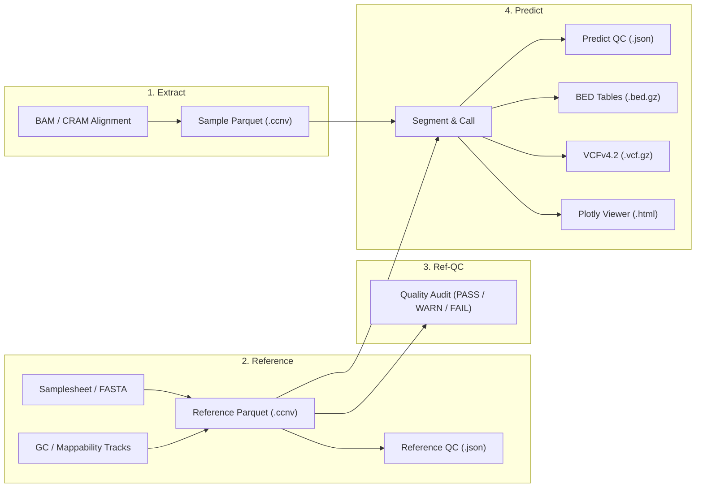

# Copynumber-CNV (`ccnv`)

Copynumber-CNV (`ccnv`) is an independent Python 3.14+ bioinformatics toolkit for copy-number variation (CNV) detection in shallow whole-genome sequencing (sWGS) data, inspired by the published statistical methodology of WISECONDOR (Straver et al., *Nucleic Acids Research*, 2014) and WisecondorX (Raman et al., *Nucleic Acids Research*, 2019).

> [!NOTE]
> Copynumber-CNV (`ccnv`) is in active pre-1.0 alpha development (`0.1.0dev`). CLI interfaces, data models, and schemas may evolve before the initial stable release.

---

## Key Features

- **Versioned Parquet Storage (`2.0.0`)**: Sample bin counts and reference models are stored as Zstandard-compressed Apache Arrow/Parquet `.ccnv` files with embedded QC, provenance, and optional prenatal model metadata.
- **Constitutional & Prenatal Analysis Modes**: Supports standard germline CNV profiling (`--mode germline`) as well as cell-free DNA (cfDNA) non-invasive prenatal screening (`--mode prenatal`) with pure NumPy/SciPy/scikit-learn fetal fraction estimation (`FFY`, `FFX`, `FFA`), 2D stoichiometric Bayesian sex chromosome aneuploidy calling, and discordance filtering.
- **Organism-Agnostic & 0-Based Half-Open Coordinates**: Contig names, order, and lengths are read directly from alignment or FASTA headers without assuming a fixed 24-chromosome layout. All intervals are 0-based half-open `[start, end)`.
- **Pure-Python & DataFrame-Native Execution**: Uses `polars`, `pysam`, `pyBigWig`, `numpy`, `scipy`, `pyarrow`, `scikit-learn`, and weighted `ruptures` segmentation without heavy ML container dependencies.

---

## Pipeline Overview

The pipeline formalizes CNV identification across shallow whole-genome sequencing datasets into four discrete functional stages: read ingestion and binning (`extract`), cohort reference synthesis with covariate correction (`reference`), reference audit and quality verification (`ref-qc`), and single-sample projection and change-point segmentation (`predict`).



---

## Documentation Sections

- [Pipeline Architecture](pipeline.md): Comprehensive data flow, coordinate contracts, and algorithmic stages.
- [CLI Reference](cli.md): Complete command-line options, defaults, input requirements, and exit codes.
- [Mathematical Methodology](methodology.md): Formal mathematical formulations, statistical assumptions, model selections, and constant provenance.
- [Benchmarks](benchmark.md): Performance, runtime, storage efficiency, and comparison against WisecondorX.

---

## Quickstart

```console
# 1. Extract BAM or CRAM alignments into binned sample Parquet (.ccnv)
ccnv extract sample.bam --prefix sample --bin-size 5000

# 2a. Build a germline reference model from a cohort samplesheet
ccnv reference -s cohort.yaml --prefix reference --bin-size 5000 --gc genome.fa --mappability mappability.bw

# 2b. Or build a flat uniform-depth germline reference from a FASTA
ccnv reference --fasta genome.fa --prefix reference --bin-size 5000 --mappability mappability.bw

# 2c. Or build a unified prenatal reference from a maternal cfDNA cohort samplesheet
ccnv reference -s cohort.yaml --mode prenatal --prefix prenatal_ref --bin-size 5000

# 3. Audit reference quality control metrics
ccnv ref-qc reference.ccnv

# 4a. Predict copy-number gains and losses in constitutional/germline mode
ccnv predict sample.ccnv reference.ccnv --prefix results/sample

# 4b. Or run prenatal prediction with fetal fraction estimation and sex chromosome analysis
ccnv predict sample.ccnv prenatal_ref.ccnv --mode prenatal --prefix results/sample_prenatal
```
