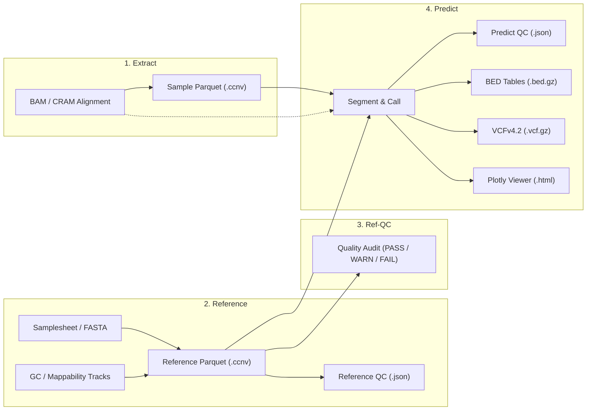

# `ccnv`

`ccnv` is an independent Python 3.14+ bioinformatics toolkit for copy-number variation (CNV) detection in whole-genome sequencing (WGS) data at any coverage, building on published within-sample reference normalization methodology (Straver et al., *Nucleic Acids Research*, 2014; Raman et al., *Nucleic Acids Research*, 2019).

!!! note

    `ccnv` is in active pre-1.0 alpha development (`0.1.0dev`). CLI interfaces, data models, and schemas may evolve before the initial stable release.

---

## Key Features

- **Versioned Parquet Storage (`2.0.0`)**: Sample sketches, per-bin cfDNA fragmentomic channels (`count`, `paired_count`, `frag_len_sum`, `short_frag_count`, `endpoint_count`, `frag_gc_sum`, `frag_bands`), and reference prototype models are stored as Zstandard-compressed Apache Arrow/Parquet `.ccnv` files with embedded QC, `ccnv.fragmentomics`, and `ccnv.prenatal` metadata.
- **Constitutional & Prenatal Analysis Modes**: Supports germline CNV profiling (`--mode germline`) and cell-free DNA (cfDNA) non-invasive prenatal screening (`--mode prenatal`) with closed-form Poisson MSY `FFY`, convex logit-link `FFA`, forward $R_X$, reference-side 24-band Fisher weighting, 4D erfc ray-marginalized SCA classification, Student-$t_4$ active FF fusion, and 5-state self-referenced origin and mosaicism calling.
- **Calibrated Pelt Segmentation & Integer CN Bayes Factors**: Calibrated `ruptures.Pelt` with mBIC penalty and dyadic multi-scale BLUE Z-scores, paired with discrete integer copy-number log-Bayes factors ($CN \in \{0, 1, 2, 3, 4+\}$) recovering homozygous deletions ($CN=0$) and focal deletions down to $0.1\times$ sequencing coverage.
- **Rust-Accelerated & Organism-Agnostic Execution**: Compiled Rust `ccnv._core` extension wrapping `noodles` and `bigtools` for high-performance multi-threaded BAM/CRAM and BigWig streaming and single-pass BGZF/tabix writing without runtime dependencies on `pysam` or `pybigwig`. Contig names, ordering, and lengths are read directly from alignment or FASTA headers without assuming a fixed 24-chromosome layout.

---

## Pipeline Overview

The pipeline structures CNV identification across whole-genome sequencing datasets of any coverage into four stages: alignment ingestion and binning (`extract`), cohort or FASTA reference construction with Prototype Graph modeling (`reference`), reference usability verification (`ref-qc`), and single-sample projection, calibrated Pelt segmentation, and copy-number calling (`predict`).



---

## Documentation Sections

- [Pipeline Architecture](pipeline.md): Data flow, coordinate contracts, and algorithmic stages.
- [CLI Reference](cli.md): Command-line options, defaults, input requirements, deliverables, and exit codes.
- [Visualization Overview](visualization.md): Interactive HTML genome viewer tracks, controls, icons, and color legends.
- [API Reference](api.md): Module-by-module function reference and architectural call-graph DAGs.
- [Mathematical Methodology](methodology.md): Mathematical formulations, statistical assumptions, model selections, and constant provenance.

---

## Quickstart

```console
# 1. Extract BAM or CRAM alignments into binned sample Parquet (.ccnv)
ccnv extract sample.bam --prefix sample --bin-size 5000

# 2a. Build a germline reference model from a cohort samplesheet
ccnv reference -s cohort.yaml --prefix reference --bin-size 5000 --gc genome.fa --mappability mappability.bw

# 2b. Or build a flat uniform-depth germline reference from a FASTA
ccnv reference --fasta genome.fa --prefix reference --bin-size 5000 --mappability mappability.bw

# 2c. Or build a unified prenatal reference from a maternal cfDNA cohort samplesheet
ccnv reference -s cohort.yaml --mode prenatal --prefix prenatal_ref --bin-size 5000

# 3. Audit reference quality control metrics
ccnv ref-qc reference.ccnv

# 4a. Predict copy-number gains and losses from .ccnv, .bam, or .cram (with --fasta)
ccnv predict sample.ccnv reference.ccnv --prefix results/sample

# 4b. Or run prenatal prediction with fetal fraction estimation and sex chromosome analysis
ccnv predict sample.ccnv prenatal_ref.ccnv --mode prenatal --prefix results/sample_prenatal
```
