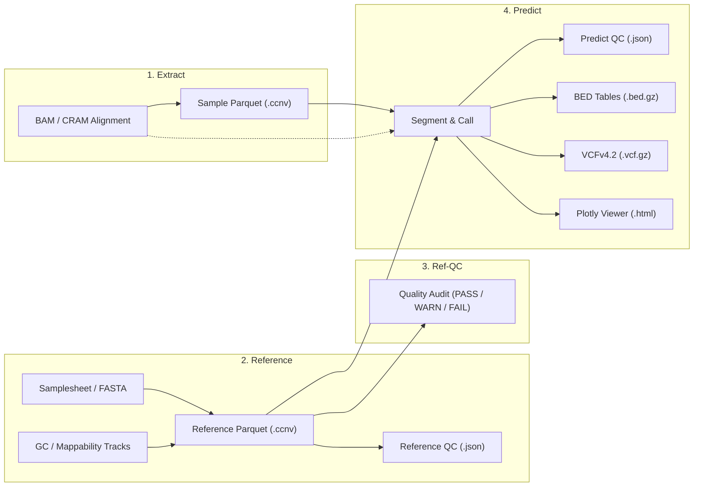

# `ccnv`

`ccnv` is an independent Python 3.14+ bioinformatics toolkit for copy-number variation (CNV) detection in whole-genome sequencing (WGS) data at any coverage, building on published within-sample reference normalization methodology (Straver et al., *Nucleic Acids Research*, 2014; Raman et al., *Nucleic Acids Research*, 2019).

!!! note

    `ccnv` is in active pre-1.0 alpha development (`0.1.0dev`). CLI interfaces, data models, and schemas may evolve before the initial stable release.

---

## How It Works

Whole-genome sequencing read depth fluctuates across chromosomes for reasons unrelated to true copy-number changes: GC-rich and AT-rich regions amplify unevenly, repetitive sequences lose uniquely mapped reads, and individual libraries differ in fragment length, DNA extraction, and flowcell batch effects. Comparing a test sample only against a static external cohort average leaves sample-specific "genomic waves" behind whenever a new library behaves slightly differently from the controls.

`ccnv` addresses this with two complementary layers of normalization. First, **between-sample modeling** removes systematic GC, mappability, fragment-size, and cohort-wide batch trends learned from normal controls. Second, **within-sample reference normalization** groups genomic windows that co-vary similarly across the control cohort into reference prototypes located on *other* chromosomes. When scoring a new sample, each window is compared against its matched off-chromosome prototypes inside that same sample—canceling out sample-specific technical quirks while ensuring a gain or loss on one chromosome never distorts its own baseline.



### Pipeline Stages

1. **`ccnv extract` — Alignment Streaming & Fragment Profiling**: Streams a `BAM` or `CRAM` alignment once (in parallel genomic tiles when indexed, or sequentially on a single thread without an index), filtering out unmapped, secondary, supplementary, duplicate, and low-MAPQ reads. Paired-end proper pairs are assigned by their fragment midpoint so reads spanning window boundaries are never double-counted, while single-end reads are binned by 5' start coordinate (`5 kb` windows by default). Alongside read counts, paired-end runs capture per-window fragment length bands, short-fragment counts, fragment GC, and sample-wide insert-size and end-motif summaries in a compact `.ccnv` Parquet file. Contig names and lengths come directly from the alignment header, so `ccnv` works with any reference assembly or organism and can coarsen finer `.ccnv` files automatically in memory if window sizes differ.
2. **`ccnv reference` — Cohort Modeling & Baseline Construction**: Builds a reusable reference `.ccnv` model from normal control `.ccnv` files listed in a YAML or JSON samplesheet. It scales library depths using genome-wide median ratios (preventing an unexpected trisomy in a control sample from skewing total depth), masks gap-heavy (`N`-rich) and low-mappability windows from optional `FASTA` and BigWig tracks, and regresses out sample-specific GC, mappability, and fragment-length biases. It then infers biological sex from X/Y dosage (quarantining sex-chromosome outliers) to fit separate `autosomal`, `female_sex`, and `male_sex` branches, captures recurring cohort batch patterns via PCA, links each window to matching off-chromosome prototypes, and separates random low-coverage counting noise from repeatable biological variability so the model generalizes across sequencing depths. When no control cohort is available, `--fasta` builds a simpler sequence-based germline baseline directly from a reference `FASTA`.
3. **`ccnv ref-qc` — Reference Usability Audit**: Evaluates an existing reference `.ccnv` file before routine use by checking unmasked window counts, prototype match quality across branches, and male Y-chromosome representation. Writes structured diagnostics to `<prefix>_qc.json` and emits a `PASS`, `WARN`, or `FAIL` verdict (`--fasta` references report `WARN` because empirical cohort noise estimates are absent).
4. **`ccnv predict` — Projection, Segmentation & Event Calling**: Projects a test sample (`.ccnv`, `BAM`, or `CRAM`) onto the reference model using outlier-resistant regression so large CNVs or whole-chromosome aneuploidies cannot pull the baseline toward the aberration, then computes per-window `log2` copy-number ratios and precision weights against off-chromosome prototypes while iteratively masking extreme regions. Chromosomes are split across large unmappable gaps such as centromeres (`> 2 Mb` by default) so segments do not bridge across chromosome arms, partitioned into contiguous segments via change-point detection, and scored using both multi-scale Z-scores and discrete integer copy-number likelihoods (`CN = 0, 1, 2, 3, 4+`)—resolving focal homozygous deletions (`CN = 0`) down to `0.1x` coverage as well as calls in standard `30x+` WGS. Deliverables include bgzipped/indexed bin, segment, and call `BED` and `VCF` files, `<prefix>_qc.json`, and an interactive WebGL genome viewer (`<prefix>_plot.html`; see [Visualization Overview](visualization.md)).

### Analysis Modes

- **Germline Mode (`--mode germline`, default)**: Profiles constitutional, clinical, or research WGS samples where copy-number changes affect the full sample. Automatically selects the matching female (`XX`) or male (`XY`) sex-chromosome branch (unless overridden with `--sex`) so both autosomes and sex chromosomes are normalized and called against their expected ploidy.
- **Prenatal cfDNA Mode (`--mode prenatal`)**: Built for non-invasive prenatal testing (NIPT) from maternal plasma cell-free DNA, where placental/fetal DNA typically makes up only ~4–20% of sequenced fragments in a maternal background—proportionally dampening the `log2` ratio shift of fetal gains and losses. `ccnv` combines four independent fetal fraction signals (male Y-chromosome coverage, genome-wide autosomal coverage patterns, X-chromosome dosage, and shorter fetal vs. longer maternal fragment-size distributions), up-weights fetal-enriched fragment sizes, screens for singleton sex-chromosome aneuploidies (`XX`, `XY`, `XO`, `XXX`, `XXY`, `XYY`) alongside 2-fetus twin pregnancy stoichiometry (`FF`, `FM`, `MM`, explicitly via `--twins` or de novo auto-detection), normalizes `chrX` against the diploid `XX` baseline and male-fetus (`fetal_sex == "M"`) `5 kb` `chrY` windows against an FF-calibrated 1-copy MSY baseline on `prenatal_ffy` (omitting `chrY` when `fetal_sex == "F"`), checks whether each segment's depth shift matches the sample's fetal fraction, and couples coverage depth with fragment lengths to distinguish fetal constitutional CNVs, confined placental mosaicism, inherited CNVs, and maternal CNVs.

---

## Documentation Sections

- [Pipeline Architecture](pipeline.md): Data flow, coordinate contracts, and algorithmic stages.
- [CLI Reference](cli.md): Command-line options, defaults, input requirements, deliverables, and exit codes.
- [Visualization Overview](visualization.md): Interactive HTML genome viewer tracks, controls, icons, and color legends.
- [API Reference](api.md): Module-by-module function reference and architectural call-graph DAGs.
- [Mathematical Methodology](methodology.md): Mathematical formulations, statistical assumptions, model selections, and constant provenance.

---

## Quickstart

```console
# 1. Extract BAM or CRAM alignments into binned sample Parquet (.ccnv)
ccnv extract sample.bam --prefix sample --bin-size 5000

# 2a. Build a germline reference model from a cohort samplesheet
ccnv reference -s cohort.yaml --prefix reference --bin-size 5000 --gc genome.fa --mappability mappability.bw

# 2b. Or build a flat uniform-depth germline reference from a FASTA
ccnv reference --fasta genome.fa --prefix reference --bin-size 5000 --mappability mappability.bw

# 2c. Or build a unified prenatal reference from a maternal cfDNA cohort samplesheet
ccnv reference -s cohort.yaml --mode prenatal --prefix prenatal_ref --bin-size 5000

# 3. Audit reference quality control metrics
ccnv ref-qc reference.ccnv

# 4a. Predict copy-number gains and losses from .ccnv, .bam, or .cram (with --fasta)
ccnv predict sample.ccnv reference.ccnv --prefix results/sample

# 4b. Or run prenatal prediction with fetal fraction estimation and sex chromosome analysis
ccnv predict sample.ccnv prenatal_ref.ccnv --mode prenatal --prefix results/sample_prenatal
```
