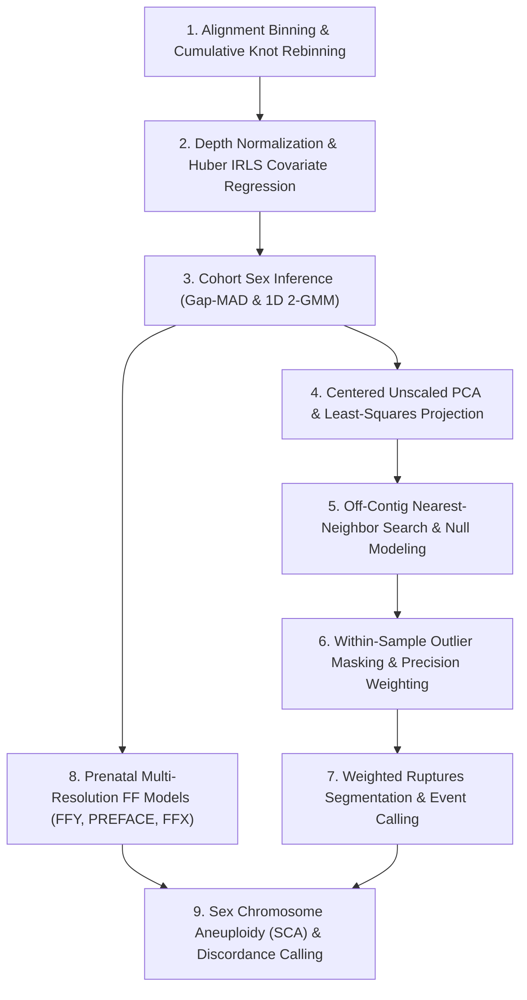

# Mathematical & Machine Learning Methodology

This document provides a complete specification of the mathematical formulations, statistical models, machine learning algorithms, numerical solvers, underlying assumptions, and constant provenance implemented across `ccnv`.

## Provenance Taxonomy

Every constant, threshold, and model hyperparameter in `ccnv` is classified into one of four provenance tiers:

- **Tier 1 — Statistical & Mathematical Theory**: Derived analytically from probability distributions, asymptotic statistical efficiency, or numerical analysis (e.g., Gaussian quantile functions, Bessel's correction, Glorot weight initialization).
- **Tier 2 — Published Literature & Reference Methodology**: Adopted from peer-reviewed bioinformatics algorithms, primarily WISECONDOR (Straver et al., 2014), WisecondorX (Raman et al., 2019a), SeqFF (Kim et al., 2015), PREFACE (Raman et al., 2019b), Huber M-estimation (Huber, 1964), and PELT/Binseg change-point detection (Killick et al., 2012).
- **Tier 3 — Genomic Biology & Assembly Coordinates**: Grounded in human cytogenetics, chromosome structure, or reference genome coordinates (e.g., pseudoautosomal boundaries, heterochromatic satellite blocks, centromeric gaps, and fetal-maternal cell-free DNA stoichiometry).
- **Tier 4 — Empirical Engineering & Numerical Guardrails**: Tuned for floating-point stability, solver convergence, memory bounding, or outlier clamping in shallow whole-genome sequencing ($0.1\times\text{–}1.0\times$ coverage).

---

## 1. Alignment Filtering, Coordinate Geometry, and Mass-Conserving Rebinning

### 1.1 Mathematical Formulation

For a contig of length $L \in \mathbb{Z}_{>0}$ and target bin size $B \in \mathbb{Z}_{>0}$ (`src/ccnv/features/binning.py:bin_intervals`), the contig is partitioned into $N = \lceil L / B \rceil = \lfloor (L + B - 1) / B \rfloor$ contiguous 0-based half-open intervals $[s_i, e_i)$ for $i \in \{0, \dots, N - 1\}$:

$$s_i = i \cdot B, \quad e_i = \min((i + 1) B, L)$$

Filtered alignments with 0-based 5' reference start coordinate $p \in [0, L)$ are assigned to bin index $i = \lfloor p / B \rfloor$ and aggregated in $O(R)$ time via vectorized histogram counting (`np.bincount`, `src/ccnv/features/binning.py:bin_counts`).

When reconciling a source partitioning $\{[s_i^{\text{src}}, e_i^{\text{src}})\}_{i=0}^{N-1}$ with counts $\mathbf{c}^{\text{src}} \in \mathbb{R}_{\ge 0}^N$ against a target partitioning $\{[s_j^{\text{tgt}}, e_j^{\text{tgt}})\}_{j=0}^{M-1}$ over the same contig length $L = e_{N-1}^{\text{src}} = e_{M-1}^{\text{tgt}}$, proportional interval overlap redistribution defines target counts as:

$$c_j^{\text{tgt}} = \sum_{i=0}^{N-1} w_{ij} c_i^{\text{src}}, \quad w_{ij} = \frac{\max\!\left(0, \min(e_i^{\text{src}}, e_j^{\text{tgt}}) - \max(s_i^{\text{src}}, s_j^{\text{tgt}})\right)}{e_i^{\text{src}} - s_i^{\text{src}}}$$

Rather than materializing the $O(N \times M)$ overlap matrix $\mathbf{W}$, `src/ccnv/features/binning.py:rebin_counts` evaluates the exact transformation in $O(N + M)$ time and memory by constructing the piecewise-linear cumulative count function $F^{\text{src}}(x)$ at knots $\mathbf{x}^{\text{src}} = (s_0^{\text{src}}, e_0^{\text{src}}, \dots, e_{N-1}^{\text{src}})$:

$$F^{\text{src}}(x_k^{\text{src}}) = \sum_{i=0}^{k-1} c_i^{\text{src}}, \quad F^{\text{src}}(0) = 0$$

interpolating $F^{\text{src}}$ at target knots $\mathbf{x}^{\text{tgt}} = (s_0^{\text{tgt}}, e_0^{\text{tgt}}, \dots, e_{M-1}^{\text{tgt}})$ via `np.interp`, and taking first differences clamped to non-negative reals:

$$c_j^{\text{tgt}} = \max\!\left(0, F^{\text{src}}(e_j^{\text{tgt}}) - F^{\text{src}}(s_j^{\text{tgt}})\right)$$

When persisting rebinned sample tables (`src/ccnv/features/cohort.py:rebin_sample_table`), continuous target counts are rounded to nearest integers via round-half-to-even (`np.rint`) and cast to `uint64`.

### 1.2 Statistical Assumptions & Failure Modes

- **Piecewise-Uniform Intra-Bin Density**: Linear interpolation of $F^{\text{src}}(x)$ assumes reads are distributed uniformly within each source bin $[s_i^{\text{src}}, e_i^{\text{src}})$. This holds exactly when coarsening nested integer multiples (e.g., $5\text{ kb} \to 100\text{ kb}$, where target knots coincide with source knots) and introduces smoothing only when refining from coarse to fine bins or across non-divisible bin widths.
- **5'-End Point Process**: Representing each alignment by its 5' start coordinate (`read.reference_start`) models sequencing fragments as a spatial point process, avoiding double-counting of read spans across bin boundaries.
- **Identical Reference Assembly**: Rebinning requires $e_{N-1}^{\text{src}} = e_{M-1}^{\text{tgt}} = L$; mismatched reference builds (e.g., GRCh37 vs. GRCh38) raise a `ValueError` or `ReferenceError`.

### 1.3 Model & Function Selection Rationale

- **Cumulative Knot Interpolation vs. Dense Overlap Matrix**: At $5\text{ kb}$ resolution on human `chr1` ($N \approx 50,000$ bins), a dense matrix $\mathbf{W}$ requires $2.5 \times 10^9$ floats ($\approx 20\text{ GB}$ RAM). Cumulative knot interpolation (`np.cumsum` + `np.interp` + `np.diff`) computes identical values in $< 1\text{ MB}$ and $O(N + M)$ operations while strictly conserving total read mass ($\sum_j c_j^{\text{tgt}} = \sum_i c_i^{\text{src}}$).
- **Round-Half-to-Even (`np.rint`)**: Prevents systematic upward or downward rounding drift across thousands of rebinned intervals compared to `np.floor` or standard half-up rounding.

### 1.4 Constants & Hyperparameters

- `DEFAULT_BIN_SIZE = 5000` (`src/ccnv/models/config.py`): Default $5\text{ kb}$ bin width (**Tier 2 / Tier 4**). Balances Poisson counting noise at $0.1\times\text{–}0.5\times$ sWGS coverage ($\sim 150\text{–}750$ reads/bin) against spatial breakpoint resolution; coarsened in memory to $100\text{ kb}$ (`prenatal_bin_size = 100000`) for prenatal models.
- `min_mapping_quality = 1` (`src/ccnv/models/config.py:ReadFilters`): Default minimum Phred-scaled MAPQ (**Tier 2**). Excludes multi-mapping reads ($\text{MAPQ} = 0$, which indicates $\ge 2$ equally likely alignments in BWA/Bowtie2) while retaining low-confidence unique alignments on repetitive contigs.

---

## 2. Depth Normalization, Low-Coverage Masking, and Covariate Bias Correction

### 2.1 Mathematical Formulation

#### Depth Normalization and Low-Coverage Masking

Given a raw counts matrix $\mathbf{C} \in \mathbb{R}_{\ge 0}^{B \times S}$ across $B$ bins and $S$ cohort samples (`src/ccnv/features/cohort.py:normalize_depth`), each sample $s$ is normalized to unit total coverage over the active mask $\mathcal{U} \subseteq \{0, \dots, B-1\}$:

$$y_{b, s} = \frac{C_{b, s}}{\sum_{i \in \mathcal{U}} C_{i, s}}$$

Cohort-level low-coverage masking (`src/ccnv/features/cohort.py:mask_low_coverage`) sums normalized coverage across samples $T_b = \sum_{s=1}^S y_{b, s}$ and retains bins exceeding a fraction $\alpha_{\text{cov}} = 0.05$ of the positive median bin sum:

$$\text{usable}_{\text{cov}}(b) \iff T_b > 0.05 \cdot \operatorname{median}_{i : T_i > 0}(T_i)$$

#### Covariate Masking

When GC content $\mathbf{g} \in [0, 1]^B$, ambiguous base indicator $\mathbf{n}_{\text{mask}} \in \{\text{true}, \text{false}\}^B$, and mappability $\mathbf{m} \in [0, 1]^B$ tracks are provided (`src/ccnv/io/tracks.py`, `src/ccnv/features/covariates.py:mask_covariates`), a bin $b$ is masked if:

1. From FASTA GC extraction (`src/ccnv/io/tracks.py:load_gc_track`), the bin contains zero A/C/G/T/U bases or an ambiguous (`N`) base fraction exceeding $\tau_N = 0.5$:
   $$\frac{n_{\text{total}}(b) - \left(n_{\text{GC}}(b) + n_{\text{AT}}(b)\right)}{n_{\text{total}}(b)} > 0.5$$
2. Its mappability score falls below $\tau_{\text{map}}$ (`min_mappability`, default $0.5$): $m_b < \tau_{\text{map}}$.
3. Its GC proportion is non-finite or outside $[0, 1]$.

#### Sequential 1D Huber IRLS Polynomial Bias Correction

For a covariate vector $\mathbf{x} \in \mathbb{R}^{B_{\text{usable}}}$ (either GC fraction with polynomial degree $d = 3$ or mappability with degree $d = 2$, `src/ccnv/features/covariates.py:correct_covariate_bias`), `src/ccnv/stats/regression.py:build_1d_basis` first checks that $\operatorname{std}(\mathbf{x}) > 10^{-6}$, standardizes $\mathbf{x}$ with population Z-scores ($\text{ddof} = 0$), and clamps extreme tails to $[-2.5, 2.5]$:

$$z_i = \operatorname{clip}\!\left(\frac{x_i - \bar{x}}{\sigma_x}, -2.5, 2.5\right)$$

A 1D Vandermonde design matrix $\mathbf{X} \in \mathbb{R}^{B_{\text{usable}} \times (d+1)}$ is formed with entries $X_{i, k} = z_i^k$ for $k \in \{0, \dots, d\}$.

For each sample column $\mathbf{y} \in \mathbb{R}^{B_{\text{usable}}}$ (`src/ccnv/stats/regression.py:fit_sample_trend`), positive finite values $\mathcal{V} = \{i : y_i > 0 \land \text{finite}(y_i)\}$ are scaled by their median $\tilde{y}_i = y_i / \operatorname{median}(\mathbf{y}_{\mathcal{V}})$. An Iteratively Reweighted Least Squares (IRLS) loop runs for $T_{\text{IRLS}} = 3$ iterations starting from uniform weights $w_i^{(0)} = 1$:

1. Solve weighted least squares via SVD (`np.linalg.lstsq`):
   $$\boldsymbol{\beta}^{(t)} = \arg\min_{\boldsymbol{\beta}} \sum_{i \in \mathcal{V}} w_i^{(t-1)} \left(\tilde{y}_i - \mathbf{x}_i^\top \boldsymbol{\beta}\right)^2$$
2. Compute residuals $r_i = \tilde{y}_i - \mathbf{x}_i^\top \boldsymbol{\beta}^{(t)}$, residual median $m_r = \operatorname{median}_{i \in \mathcal{V}}(r_i)$, and normal-consistent Median Absolute Deviation (MAD):
   $$\sigma_{\text{MAD}} = \frac{\operatorname{median}_{i \in \mathcal{V}}\!\left(|r_i - m_r|\right)}{\Phi^{-1}(0.75)} \approx 1.4826 \cdot \operatorname{median}_{i \in \mathcal{V}}\!\left(|r_i - m_r|\right)$$
3. Update Huber weights using tuning threshold $\delta = \max(2.5 \cdot \sigma_{\text{MAD}}, 0.08)$ and absolute centered deviations $a_i = |r_i - m_r|$:
   $$w_i^{(t)} = \begin{cases} 1.0 & \text{if } a_i \le \delta \\ \max\!\left(0.05, \dfrac{\delta}{\max(a_i, 10^{-12})}\right) & \text{if } a_i > \delta \end{cases}$$

After 3 iterations, the raw trend $\hat{\mathbf{y}} = \mathbf{X} \boldsymbol{\beta}^{(3)}$ is normalized by the median of its positive predictions and clamped to $[0.20, 5.0]$:

$$\hat{t}_i = \operatorname{clip}\!\left(\frac{\hat{y}_i}{\operatorname{median}_{j \in \mathcal{V}, \hat{y}_j > 0}(\hat{y}_j)}, 0.20, 5.0\right)$$

Sample coverage is divided by $\hat{\mathbf{t}}$ and rescaled to preserve the sample's original total coverage sum over usable bins (`src/ccnv/stats/regression.py:apply_1d_correction`):

$$y_i^{\text{corr}} = \frac{y_i}{\hat{t}_i} \cdot \frac{\sum_j y_j}{\sum_j (y_j / \hat{t}_j)}$$

GC correction ($d = 3$) and mappability correction ($d = 2$) are applied sequentially in a two-stage cascade.

### 2.2 Statistical Assumptions & Failure Modes

- **Multiplicative Separability**: Assumes sequencing depth bias decomposes multiplicatively into a smooth function of GC content and a smooth function of mappability: $E[y_i] \propto f_{\text{GC}}(g_i) \cdot f_{\text{map}}(m_i)$.
- **Majority Diploid / Copy-Neutral Genome**: Median scaling and MAD scale estimation have a $50\%$ breakdown point, assuming fewer than half of usable bins harbor extreme copy-number alterations.
- **Boundary Polynomial Divergence**: High-degree polynomials oscillate wildly (Runge's phenomenon) at extreme covariate values; clamping standardized covariates to $z_i \in [-2.5, 2.5]$ and clamping the multiplicative trend to $[0.20, 5.0]$ prevent division by near-zero or negative polynomial extrapolations in GC-extreme pericentromeric or telomeric bins.

### 2.3 Model & Function Selection Rationale

- **3-Iteration Huber IRLS vs. LOESS or OLS**: Standard Ordinary Least Squares (OLS) is pulled toward large chromosomal trisomies or amplifications, causing the trend curve to absorb real CNVs. Non-parametric LOESS (used in original WISECONDOR) requires $O(B^2)$ or $k$-d tree evaluations per sample. A low-degree Vandermonde polynomial fitted via 3-iteration Huber IRLS runs in $O(B \cdot d^2)$ time via LAPACK `dgelsd` while downweighting CNV outliers.
- **Cubic GC ($d=3$) and Quadratic Mappability ($d=2$)**: PCR amplification and Illumina cluster generation produce an asymmetric, unimodal or sigmoidal GC wave with inflection points requiring a cubic basis ($1, z, z^2, z^3$), whereas mappability bias is monotonic with mild saturation, well-captured by a quadratic basis ($1, z, z^2$).
- **Weight Floor of `0.05` (`huber_w >= 0.05`)**: Unlike hard Tukey bisquare redescending weights that set $w_i = 0$ in the tails, flooring Huber weights at $0.05$ guarantees that the weighted Vandermonde matrix $\mathbf{W}^{1/2}\mathbf{X}$ retains full column rank even when an entire GC regime coincides with an aneuploid chromosome.

### 2.4 Constants & Hyperparameters

- `_MAX_N_FRACTION = 0.5` (`src/ccnv/io/tracks.py`): Maximum ambiguous base fraction (**Tier 3 / Tier 4**). Masks assembly gap bins where $>50\%$ of bases are unsequenced `N`s.
- `DEFAULT_MIN_MAPPABILITY = 0.5` (`src/ccnv/models/config.py`): Default mappability threshold (**Tier 2 / Tier 3**). Requires at least $50\%$ of $k$-mers in a bin to map uniquely.
- `_MASK_FRACTION = 0.05` (`src/ccnv/features/cohort.py`): Low-coverage bin cutoff at $5\%$ of positive median cohort depth (**Tier 2 / Tier 4**). Eliminates dead regions and unmappable heterochromatin before PCA.
- `_MIN_VARIANCE_STD = 1e-6` (`src/ccnv/stats/regression.py`, `src/ccnv/features/covariates.py`): Minimum covariate standard deviation (**Tier 4**). Prevents division-by-zero when a track is constant (e.g., synthetic uniform tracks).
- `z` clamp `[-2.5, 2.5]` (`src/ccnv/stats/regression.py:build_1d_basis`): Covariate Z-score tail winsorization (**Tier 1 / Tier 4**). Bounds polynomial basis evaluation to the central $98.76\%$ of a standard normal distribution, preventing cubic/quadratic runaway at extreme tails.
- `degree = 3` (GC) and `degree = 2` (mappability) (`src/ccnv/features/covariates.py:correct_covariate_bias`): Polynomial degrees (**Tier 2 / Tier 3**). Matches physical curvature of PCR GC bias and aligner mappability saturation.
- `_IRLS_ITERATIONS = 3` (`src/ccnv/stats/regression.py`): Fixed IRLS Gauss-Newton steps (**Tier 4**). Empirically converges within $< 10^{-3}$ relative parameter change for smooth low-degree polynomials without iterative stopping overhead.
- `scale = "normal"` ($1/\Phi^{-1}(0.75) \approx 1.4826$, `src/ccnv/stats/regression.py`): Normal-consistent MAD scale factor (**Tier 1**). Makes $\operatorname{MAD}(r)$ an unbiased estimator of standard deviation $\sigma$ under Gaussian noise.
- `_OUTLIER_SIGMA_CUTOFF = 2.5` and floor `0.08` (`src/ccnv/stats/regression.py`): Huber IRLS tuning multiplier $\delta = \max(2.5\sigma_{\text{MAD}}, 0.08)$ (**Tier 1 / Tier 4**). Corresponds to the $98.76\%$ Gaussian interval, with a minimum floor of $8\%$ relative depth deviation so ultra-clean or synthetic flat cohorts do not downweight normal Poisson noise.
- Huber weight floor `0.05` and trend clamp `[0.20, 5.0]` (`src/ccnv/stats/regression.py`): Bounds maximum outlier downweighting to $20\times$ and maximum multiplicative coverage correction to $5\times$ (**Tier 4**).

---

## 3. Cohort Sex Inference: Gap-MAD Separation vs. 1D 2-GMM

`ccnv` provides two distinct unsupervised sex classification algorithms depending on analysis mode, because germline WGS and maternal cell-free DNA (cfDNA) exhibit fundamentally different `chrY` read fraction distributions.

### 3.1 Mathematical Formulation

For each sample $s \in \{1, \dots, S\}$, let $f_s = \left(\sum_{b \in \text{chrY}} C_{b, s}\right) / \max\!\left(\sum_b C_{b, s}, 1\right)$ denote the fraction of reads mapping to the sex-signal contig (`chrY` / `Y`).

#### Germline Mode: Order-Statistic Gap-MAD Classifier (`src/ccnv/features/cohort.py:infer_sample_sexes`)

Requires $S \ge 2 \cdot m_{\text{sex}}$ samples (`min_sex_group_size`, default $5$). Let $f_{(0)} \le f_{(1)} \le \dots \le f_{(S-1)}$ be the sorted fractions. The optimal partition index $s^* \in \{m_{\text{sex}}, \dots, S - m_{\text{sex}}\}$ maximizes the adjacent order-statistic gap:

$$s^* = \arg\max_{m_{\text{sex}} \le s \le S - m_{\text{sex}}} \left(f_{(s)} - f_{(s-1)}\right), \quad \Delta_{\max} = f_{(s^*)} - f_{(s^*-1)}$$

Let $\mathcal{L} = \{f_{(0)}, \dots, f_{(s^*-1)}\}$ (putative females) and $\mathcal{H} = \{f_{(s^*)}, \dots, f_{(S-1)}\}$ (putative males), with unscaled group MADs $\operatorname{MAD}(\mathcal{L})$ and $\operatorname{MAD}(\mathcal{H})$. The separation is accepted if and only if:

$$\Delta_{\max} > 0 \quad \text{and} \quad \Delta_{\max} \ge \max\!\left(\Delta_{\min}, 4.0 \cdot \max(\operatorname{MAD}(\mathcal{L}), \operatorname{MAD}(\mathcal{H}), 10^{-12})\right)$$

If accepted, the decision threshold is placed at the midpoint $\tau_{\text{sex}} = \frac{1}{2}\left(f_{(s^*-1)} + f_{(s^*)}\right)$.

#### Prenatal Mode: 1D Two-Component Gaussian Mixture Model with Brent's Root-Finding (`src/ccnv/stats/prenatal_math.py:infer_sex_gmm_1d`)

In maternal plasma cfDNA, `chrY` read fractions in male-bearing pregnancies scale continuously with fetal fraction ($\text{FF} \in [2\%, 30\%]$), creating an overlapping or skewed upper distribution rather than two tight clusters. A 1D 2-component Gaussian Mixture Model (GMM) with full (unconstrained) component variances $\sigma_0^2, \sigma_1^2$ is fitted via Expectation-Maximization (EM):

$$p(f) = \pi_0 \mathcal{N}(f \mid \mu_0, \sigma_0^2) + \pi_1 \mathcal{N}(f \mid \mu_1, \sigma_1^2)$$

initialized deterministically at the 25th and 75th sample percentiles ($\mu_0^{(0)} = P_{25}(\mathbf{f}), \mu_1^{(0)} = P_{75}(\mathbf{f})$) with equal prior weights $\pi_0^{(0)} = \pi_1^{(0)} = 0.5$. Let $k_{\text{M}} = \arg\max_{k \in \{0, 1\}} \mu_k$ and $k_{\text{F}} = 1 - k_{\text{M}}$. The Bayes-optimal decision boundary $\tau_Y \in [\mu_{k_{\text{F}}}, \mu_{k_{\text{M}}}]$ where the posterior probability of a male fetus equals $0.5$ is solved numerically by Brent's root-finding method (`scipy.optimize.brentq`):

$$P(Z = k_{\text{M}} \mid f = \tau_Y) - 0.5 = \frac{\pi_{k_{\text{M}}} \mathcal{N}(\tau_Y \mid \mu_{k_{\text{M}}}, \sigma_{k_{\text{M}}}^2)}{\sum_{k=0}^1 \pi_k \mathcal{N}(\tau_Y \mid \mu_k, \sigma_k^2)} - 0.5 = 0$$

with fallback to the midpoint $\tau_Y = \frac{1}{2}(\mu_{k_{\text{F}}} + \mu_{k_{\text{M}}})$ if the posterior difference does not change sign on $[\mu_{k_{\text{F}}}, \mu_{k_{\text{M}}}]$.

### 3.2 Statistical Assumptions & Failure Modes

- **Germline Bimodality**: Assumes constitutional `XX` and `XY` samples form two well-separated modes with at least `min_sex_group_size` samples per sex and inter-group gap $\ge 4 \times \text{MAD}$. If a cohort contains only one sex, `infer_sample_sexes` safely rejects sex partitioning (`passed = False`) and builds only the `autosomal` branch unless `--sex-cutoff` or samplesheet labels are provided.
- **Heteroscedastic Prenatal Mixture**: In cfDNA, female pregnancies ($\text{XX}$) have near-zero `chrY` background misalignment with tiny variance ($\sigma_{\text{F}}^2 \ll \sigma_{\text{M}}^2$), whereas male pregnancies ($\text{XY}$) span a wide range of fetal fractions ($\sigma_{\text{M}}^2 \gg \sigma_{\text{F}}^2$). Using `covariance_type="full"` (distinct variances $\sigma_{\text{F}}^2 \ne \sigma_{\text{M}}^2$) is essential; an equal-variance GMM or k-means midpoint places the boundary far too high, misclassifying low-fetal-fraction male fetuses as female.

### 3.3 Model & Function Selection Rationale

- **Quantile Initialization ($P_{25}, P_{75}$) vs. k-means++**: Standard randomized k-means++ initialization in EM can converge to degenerate local optima on small cohorts. Deterministic quartile initialization guarantees reproducible, seed-invariant component assignment.
- **Brent's Method (`brentq`) vs. Analytical Quadratic Formula**: Solving $P(Z = k_{\text{M}} \mid f) = 0.5$ via `brentq` on the bracketed interval $[\mu_{\text{F}}, \mu_{\text{M}}]$ directly queries `gmm.predict_proba` (which works in log-sum-exp space), avoiding numerical underflow or Selecting the wrong root of the two quadratic intersections when $\sigma_{\text{F}}^2 \ne \sigma_{\text{M}}^2$.

### 3.4 Constants & Hyperparameters

- `min_cohort_size = 10`, `min_sex_group_size = 5` (`src/ccnv/models/config.py:ReferenceConfig`): Minimum cohort and per-sex sample counts (**Tier 2 / Tier 4**). Ensures sufficient degrees of freedom for 5-component PCA and robust median/MAD estimation.
- `_SEPARATION_MAD_MULTIPLIER = 4.0` (`src/ccnv/features/cohort.py`): Minimum inter-sex gap-to-MAD ratio (**Tier 1 / Tier 4**). Under a normal distribution, $4 \times \text{MAD}_{\text{unscaled}} \approx 2.7\sigma$ per side ($\approx 5.4\sigma$ total separation), preventing false bimodal splits on single-sex cohorts.
- `percentiles = (25.0, 75.0)`, `weights_init = (0.5, 0.5)` (`src/ccnv/stats/prenatal_math.py:infer_sex_gmm_1d`): Deterministic GMM initialization at first and third quartiles (**Tier 1 / Tier 2**).
- `tol = 1e-6`, `reg_covar = 1e-8`, `max_iter = 100` (`src/ccnv/stats/prenatal_math.py:infer_sex_gmm_1d`): EM convergence tolerance and diagonal covariance regularization (**Tier 4**). Prevents singular covariance collapse ($\sigma_k^2 \to 0$) when all female samples have identical `chrY` fractions.

---

## 4. Between-Sample Systemic Bias Removal: Centered Unscaled PCA

### 4.1 Mathematical Formulation

#### Reference Fitting (`src/ccnv/stats/pca.py:fit_pca`)

Let $\mathbf{Y} \in \mathbb{R}^{U \times S}$ be the covariate-corrected, depth-normalized coverage matrix over $U$ unmasked bins and $S$ cohort samples, and let $\mathbf{X} = \mathbf{Y}^\top \in \mathbb{R}^{S \times U}$ be the samples-by-bins matrix. The empirical per-bin cohort mean vector is:

$$\boldsymbol{\mu} = \frac{1}{S} \sum_{s=1}^S \mathbf{X}_{s, :} \in \mathbb{R}^U$$

Centered (unscaled) Singular Value Decomposition (SVD) decomposes the centered matrix $\tilde{\mathbf{X}} = \mathbf{X} - \mathbf{1}_S \boldsymbol{\mu}^\top$:

$$\tilde{\mathbf{X}} = \mathbf{U} \boldsymbol{\Sigma} \mathbf{V}^\top$$

retaining the top $P = \min(n_{\text{components}}, S, U)$ right singular vectors (principal axes / loadings) $\mathbf{V}_P \in \mathbb{R}^{U \times P}$ (stored as `pca_loadings` of shape $P \times U$ in `fit_pca`). Sign ambiguity of singular vectors ($\mathbf{v}_p \leftrightarrow -\mathbf{v}_p$) is resolved deterministically via `sklearn.utils.extmath.svd_flip`.

The rank-$P$ reconstruction of cohort systemic technical profiles is:

$$\hat{\mathbf{X}} = (\tilde{\mathbf{X}} \mathbf{V}_P) \mathbf{V}_P^\top + \mathbf{1}_S \boldsymbol{\mu}^\top$$

Multiplicative systemic bias is divided out element-wise to produce the PCA-corrected reference matrix $\mathbf{Y}^{\text{corr}} \in \mathbb{R}^{U \times S}$:

$$Y_{b, s}^{\text{corr}} = \begin{cases} \dfrac{X_{s, b}}{\hat{X}_{s, b}} & \text{if } \text{finite}\!\left(\dfrac{X_{s, b}}{\hat{X}_{s, b}}\right) \\ 1.0 & \text{otherwise} \end{cases}$$

#### Single-Sample Projection (`src/ccnv/predict.py:project_coverage`)

During `predict`, a test sample's normalized, covariate-corrected coverage vector $\mathbf{y} \in \mathbb{R}^U$ may have additional bins masked by sample-specific overrides ($\mathcal{A} \subseteq \{0, \dots, U-1\}$). Because restricting $\mathbf{V}_P$ to the subset of active bins $\mathcal{A}$ breaks exact column orthogonality, `ccnv` projects the centered sample profile onto the restricted loading subspace $\mathbf{V}_{P, \mathcal{A}} \in \mathbb{R}^{|\mathcal{A}| \times P}$ via ordinary least squares (`np.linalg.lstsq`) whenever $|\mathcal{A}| > \operatorname{rank}(\mathbf{V}_{P, \mathcal{A}})$:

$$\hat{\mathbf{c}} = \arg\min_{\mathbf{c} \in \mathbb{R}^P} \left\| \left(\mathbf{y}_{\mathcal{A}} - \boldsymbol{\mu}_{\mathcal{A}}\right) - \mathbf{V}_{P, \mathcal{A}} \mathbf{c} \right\|_2^2$$

reconstructs the expected baseline across all unmasked bins $\hat{\mathbf{y}} = \mathbf{V}_P \hat{\mathbf{c}} + \boldsymbol{\mu}$, and divides out the systemic component:

$$y_b^{\text{corr}} = \frac{y_b}{\hat{y}_b} \quad \text{for } b \in \mathcal{A} \text{ with } \hat{y}_b > 0$$

### 4.2 Statistical Assumptions & Failure Modes

- **Low-Rank Technical Subspace**: Assumes cohort-wide technical artifacts (library preparation kit differences, flowcell effects, fragment-length distributions, and higher-order residual GC waves) lie in a low-dimensional linear subspace spanned by the top $P$ eigenvectors, whereas rare germline or somatic CNVs are sample-specific and orthogonal to the top cohort PCs.
- **Unscaled Covariance vs. Correlation PCA**: Because all bins are already normalized to comparable depth scales ($\sim 1/U$), centering without unit-variance scaling preserves natural Poisson variance weighting across bins; standardizing each bin to unit variance would amplify noisy low-mappability bins to carry equal weight to stable euchromatic bins.
- **Overfitting When $P \approx S$**: If `pca_components` is set close to cohort size $S$, the PCA basis spans individual sample profiles and absorbs true biological CNVs ($\hat{\mathbf{y}} \to \mathbf{y}$, forcing $y_b^{\text{corr}} \to 1$). Keeping $P = 5 \ll S$ prevents signal absorption.

### 4.3 Model & Function Selection Rationale

- **Least-Squares Subspace Projection (`np.linalg.lstsq`) vs. Direct Dot Product**: If every reference bin is usable in the test sample ($\mathcal{A} = \{0, \dots, U-1\}$), $\mathbf{V}_P^\top \mathbf{V}_P = \mathbf{I}_P$ and least squares reduces to the orthogonal dot product $\hat{\mathbf{c}} = \mathbf{V}_P^\top (\mathbf{y} - \boldsymbol{\mu})$. However, when sample-specific covariate masking drops bins ($\mathcal{A} \subsetneq \{0, \dots, U-1\}$), $\mathbf{V}_{P, \mathcal{A}}^\top \mathbf{V}_{P, \mathcal{A}} \ne \mathbf{I}_P$; solving `lstsq` prevents projection distortion from missing coordinates.
- **Multiplicative Division ($y_b / \hat{y}_b$) vs. Additive Subtraction ($y_b - \hat{y}_b$)**: Copy-number alterations scale read depth multiplicatively ($\text{CN}/2 \times \text{baseline}$). Dividing by the reconstructed baseline $\hat{y}_b$ directly yields a dimensionless relative copy ratio centered at $1.0$ across all bins regardless of each bin's baseline mappability $\mu_b$.

### 4.4 Constants & Hyperparameters

- `pca_components = 5` (`src/ccnv/models/config.py:ReferenceConfig`): Default number of principal components removed in `reference` (**Tier 2 / Tier 4**). Captures dominant batch and fragmentation modes in sWGS cohorts while leaving focal and chromosomal CNV signals intact.

---

## 5. Within-Sample Reference Modeling: Off-Contig Nearest-Neighbor Search & Null Distribution

After between-sample PCA normalization, residual bin-to-bin variation remains within a single sample. Following the core insight of WISECONDOR (Straver et al., 2014), `ccnv` constructs a within-sample reference for each target bin by pairing it with $k$ bins located on *other chromosomes* that behave identically across the control cohort.

### 5.1 Mathematical Formulation

#### Batched Off-Contig Squared Euclidean Search (`src/ccnv/stats/neighbors.py:select_nearest_bins`)

For each unmasked bin $i \in \{0, \dots, U-1\}$ on contig $c_i$, let $\mathbf{v}_i \in \mathbb{R}^D$ denote its feature profile:
- In **cohort mode**, $\mathbf{v}_i = \mathbf{Y}_{i, :}^{\text{corr}} \in \mathbb{R}^S$ is the bin's PCA-corrected coverage profile across all $S$ control samples.
- In **flat FASTA mode** with covariates (`src/ccnv/features/covariates.py:covariate_features`), $\mathbf{v}_i \in \mathbb{R}^2$ is the standardized `(GC, mappability)` Z-score vector.

Pairwise squared Euclidean distances are computed in memory-bounded row batches using BLAS matrix multiplication (`sklearn.metrics.pairwise.euclidean_distances(..., squared=True)`):

$$d_{ij}^2 = \|\mathbf{v}_i - \mathbf{v}_j\|_2^2 = \|\mathbf{v}_i\|_2^2 + \|\mathbf{v}_j\|_2^2 - 2 \mathbf{v}_i^\top \mathbf{v}_j$$

To strictly prevent a chromosome-wide aneuploidy or large segmental CNV from contaminating its own reference baseline, all candidate bins on the same contig are masked to infinity:

$$\tilde{d}_{ij}^2 = \begin{cases} \infty & \text{if } c_i = c_j \\ d_{ij}^2 & \text{if } c_i \ne c_j \end{cases}$$

For each query bin $i$, the $k = \min(k_{\text{req}}, |\mathcal{C}_{\ne c_i}|)$ smallest off-contig candidates are selected in $O(U)$ expected time via Introselect (`np.argpartition`) and sorted deterministically by stable mergesort (`np.argsort(..., kind="mergesort")`), yielding candidate index set $\mathcal{N}_i^{(0)}$ and squared distances $\{d_{ij}^2\}_{j \in \mathcal{N}_i^{(0)}}$.

#### Iterative $3\sigma$ Distance Outlier Pruning (`src/ccnv/stats/neighbors.py:distance_cutoff`)

Bins in unique genomic environments (e.g., extreme GC or repetitive boundaries) may have poor matches among their $k$ nearest neighbors. Across the flattened pool of all finite non-negative neighbor distances $\mathcal{D} = \{d_{ij}^2\}_{i, j \in \mathcal{N}_i^{(0)}}$, an iterative $3\sigma$ clipping loop runs for $R = 3$ passes starting from $\tau_{\text{dist}}^{(0)} = \infty$:

$$\mathcal{D}^{(r)} = \left\{ u \in \mathcal{D} : u < \tau_{\text{dist}}^{(r-1)} \right\}, \quad \tau_{\text{dist}}^{(r)} = \operatorname{mean}\!\left(\mathcal{D}^{(r)}\right) + 3.0 \cdot \operatorname{std}\!\left(\mathcal{D}^{(r)}\right) \quad (r = 1, 2, 3)$$

Candidate neighbors exceeding the final threshold ($d_{ij}^2 > \tau_{\text{dist}}^{(3)}$) are pruned (`src/ccnv/reference.py:_build_branch_table`), leaving the surviving neighbor set $\mathcal{N}_i = \{j \in \mathcal{N}_i^{(0)} : d_{ij}^2 \le \tau_{\text{dist}}^{(3)}\}$ and the bin's mean unsquared Euclidean distance:

$$\bar{d}_i = \frac{1}{|\mathcal{N}_i|} \sum_{j \in \mathcal{N}_i} \sqrt{\max(d_{ij}^2, 0)}$$

#### Empirical Null Distribution Parameterization (`src/ccnv/stats/neighbors.py:compute_null_models`)

Using the first $S_{\text{null}} = \min(S, 100)$ control samples, each bin's empirical log2 ratio relative to the median of its candidate neighbors is evaluated in every control sample $s \in \{1, \dots, S_{\text{null}}\}$:

$$R_{i, s} = \log_2\!\left(\frac{Y_{i, s}^{\text{corr}}}{\operatorname{median}_{j \in \mathcal{N}_i^{(0)}}\!\left(Y_{j, s}^{\text{corr}}\right)}\right)$$

Non-finite values are zeroed, and the per-bin null expectation $\mu_{\text{null}, i}$ and unbiased sample standard deviation $\sigma_{\text{null}, i}$ (with Bessel's correction, $\text{ddof} = 1$) are recorded:

$$\mu_{\text{null}, i} = \frac{1}{S_{\text{null}}} \sum_{s=1}^{S_{\text{null}}} R_{i, s}, \quad \sigma_{\text{null}, i} = \sqrt{\frac{1}{S_{\text{null}} - 1} \sum_{s=1}^{S_{\text{null}}} \left(R_{i, s} - \mu_{\text{null}, i}\right)^2}$$

### 5.2 Statistical Assumptions & Failure Modes

- **Off-Contig Independence Under Single-Chromosome Aneuploidy**: Assumes that copy-number aberrations do not simultaneously affect a target bin on contig $c_i$ and the majority ($>50\%$) of its $k = 300$ matched reference bins distributed across the remaining chromosomes.
- **Stationarity of Residual Co-Variation**: Assumes bins that co-vary across control samples in $\mathbf{Y}^{\text{corr}}$ share latent physical properties (local chromatin accessibility, fragment size distribution, mappability edge effects) that will also co-vary in future test samples.
- **Gaussian Log2 Ratio Null**: Assumes $R_{i, s} \sim \mathcal{N}(\mu_{\text{null}, i}, \sigma_{\text{null}, i}^2)$ across diploid controls so that Z-scores $Z_i = (r_i - \mu_{\text{null}, i}) / \sigma_{\text{null}, i}$ follow a standard normal $\mathcal{N}(0, 1)$ distribution under the copy-neutral null hypothesis.

### 5.3 Model & Function Selection Rationale

- **Squared Euclidean Distance (`squared=True`) + `argpartition`**: Because $x \mapsto x^2$ is strictly monotonically increasing on $\mathbb{R}_{\ge 0}$, ranking neighbors by $d_{ij}^2$ produces the exact same $k$-nearest neighbor sets as $d_{ij}$ while avoiding $U^2 \approx 3.6 \times 10^{11}$ square-root evaluations across the human genome ($U \approx 600,000$ at $5\text{ kb}$). Using `np.argpartition` reduces per-row selection complexity from $O(U \log U)$ to $O(U)$, and sorting only the top $k$ indices with `kind="mergesort"` guarantees deterministic tie-breaking.
- **Neighbor Median vs. Neighbor Mean**: Taking the median $\operatorname{median}_{j \in \mathcal{N}_i}(Y_{j, s}^{\text{corr}})$ rather than the mean provides a $50\%$ breakdown point against incidental CNVs occurring in off-contig reference bins within sample $s$.

### 5.4 Constants & Hyperparameters

- `nearest_bins = 300` (`src/ccnv/models/config.py:ReferenceConfig`): Default number of off-contig reference neighbors $k$ (**Tier 2**, WISECONDOR / WisecondorX). Large enough that the median variance $\pi / (2k) \sigma^2$ is negligible ($\approx 0.5\%$ of single-bin variance) while small enough that closely matched bins exist in feature space.
- `max_batch_memory_mb = 256` (`src/ccnv/models/config.py:ReferenceConfig`): Maximum memory allocation per distance matrix batch (**Tier 4**). Bounds row batch size $\lfloor 256\text{ MB} / (8 \cdot U) \rfloor$ so whole-genome $5\text{ kb}$ distance searches never trigger out-of-memory errors.
- `repeats = 3`, multiplier `3.0` (`src/ccnv/stats/neighbors.py:distance_cutoff`): 3-pass iterative $\mu + 3\sigma$ distance outlier clipping (**Tier 2**, WISECONDOR). Prevents heavy-tailed outlier distances from inflating $\sigma$ on the first pass.
- `_MAX_NULL_SAMPLES = 100` (`src/ccnv/stats/neighbors.py`): Maximum cohort samples used to estimate $\mu_{\text{null}, i}$ and $\sigma_{\text{null}, i}$ (**Tier 4**). Standard error of sample standard deviation $\sigma_{\text{null}, i}$ at $N = 100$ is $\sigma / \sqrt{2(N-1)} \approx 7.1\%$; capping at 100 bounds null-model runtime to $O(U \cdot k \cdot 100)$ on massive biobank cohorts.
- Parallelism thresholds `n_bins > 2000` (`select_nearest_bins`) and `n_bins > 5000` (`compute_null_models`, `src/ccnv/stats/neighbors.py`): Minimum problem sizes before spawning `ProcessPoolExecutor` workers (**Tier 4**), avoiding IPC serialization overhead on small contigs or tests.

---

## 6. Within-Sample Outlier Masking, Empirical MAD Fallback, and Precision Weighting

During single-sample prediction (`src/ccnv/predict.py:normalize_branch`), if the test sample itself carries a large CNV on chromosome $A$, bins on chromosome $A$ that serve as off-contig reference neighbors for chromosome $B$ would skew chromosome $B$'s baseline if not excluded.

### 6.1 Mathematical Formulation

Let $\mathbf{y}^{\text{corr}} \in \mathbb{R}^U$ be the test sample's PCA-projected coverage across unmasked bins, and let $\mathcal{N}_i \setminus \{i\}$ be bin $i$'s surviving off-contig reference indices. Initialize the eligible neighbor mask as $\mathcal{E}^{(0)} = \{i : \text{finite}(y_i^{\text{corr}}) \land y_i^{\text{corr}} > 0\}$.

For $t = 1, \dots, M$ iterations (`mask_repeats`, default $3$):

1. For each bin $i \in \{0, \dots, U-1\}$, restrict its neighbor pool to currently eligible bins $\mathcal{N}_i^{(t)} = (\mathcal{N}_i \setminus \{i\}) \cap \mathcal{E}^{(t-1)}$. If $|\mathcal{N}_i^{(t)}| < m_{\text{ref}}$ (`min_reference_bins`, default $3$) or $y_i^{\text{corr}} \le 0$, mark $r_i^{(t)} = \text{NaN}, Z_i^{(t)} = \text{NaN}$. Otherwise, compute the within-sample baseline, log2 ratio, and Z-score:
   $$b_i^{(t)} = \operatorname{median}_{j \in \mathcal{N}_i^{(t)}}\!\left(y_j^{\text{corr}}\right), \quad r_i^{(t)} = \log_2\!\left(\frac{y_i^{\text{corr}}}{b_i^{(t)}}\right), \quad Z_i^{(t)} = \begin{cases} \dfrac{r_i^{(t)} - \mu_{\text{null}, i}}{\sigma_{\text{null}, i}} & \text{if } \sigma_{\text{null}, i} > 0 \\ \text{NaN} & \text{if } \sigma_{\text{null}, i} = 0 \end{cases}$$
2. **Empirical MAD Fallback** (for flat FASTA references where $\sigma_{\text{null}, i} = 0$): For any bin with finite $r_i^{(t)}$ but missing $Z_i^{(t)}$, estimate the global sample median $m_r = \operatorname{median}(r^{(t)})$ and normal-consistent MAD scale $\hat{\sigma}_{\text{emp}} = 1.4826 \cdot \operatorname{median}(|r^{(t)} - m_r|)$ across all finite ratios, and set:
   $$Z_i^{(t)} = \begin{cases} \dfrac{r_i^{(t)} - m_r}{\hat{\sigma}_{\text{emp}}} & \text{if } \hat{\sigma}_{\text{emp}} > 10^{-12} \\ 0.0 & \text{otherwise} \end{cases}$$
3. Update the eligible neighbor mask by excluding extreme deviations exceeding the one-sided $99\text{th}$ percentile standard normal quantile $\tau_{\text{mask}} = \Phi^{-1}(0.99) = 2.326347874$:
   $$\mathcal{E}^{(t)} = \left\{ i : \text{finite}(y_i^{\text{corr}}) \land \text{finite}(Z_i^{(t)}) \land \left|Z_i^{(t)}\right| < 2.326347874 \right\}$$

After $M$ iterations, global median centering removes any residual genome-wide baseline shift:

$$\tilde{r}_i = r_i^{(M)} - \operatorname{median}_{j : \text{finite}(r_j^{(M)})}\!\left(r_j^{(M)}\right)$$

Each valid bin ($|\mathcal{N}_i^{(M)}| \ge m_{\text{ref}}$) is assigned a segmentation weight $w_i$ inversely proportional to its mean neighbor distance $\bar{d}_i$ stored in the reference (`src/ccnv/predict.py:normalize_branch`):

$$w_i = \begin{cases} \dfrac{1.0}{\bar{d}_i} & \text{if } \text{finite}(\bar{d}_i) \land \bar{d}_i > 0 \\ 1.0 & \text{otherwise} \end{cases}$$

Bins failing usability or neighbor count checks receive $r_i = \text{NaN}, Z_i = \text{NaN}, w_i = 0.0$.

### 6.2 Statistical Assumptions & Failure Modes

- **Sparsity of Extreme Z-Scores**: Under the null $Z_i \sim \mathcal{N}(0, 1)$, masking $|Z_i| \ge 2.326347874$ removes only $2 \times (1 - 0.99) = 2\%$ of copy-neutral bins in expectation while stripping almost all high-amplitude CNV bins from acting as reference neighbors on subsequent passes.
- **Inverse Distance Weighting**: Assumes a bin whose $k$ nearest off-contig neighbors are tightly clustered in feature space (small $\bar{d}_i$) has higher reference fidelity and should receive proportionally higher weight $w_i = 1/\bar{d}_i$ during segmentation.

### 6.3 Model & Function Selection Rationale

- **Iterative Z-Score Sieve ($M=3$ passes)**: In Pass 1, a massive trisomy may slightly elevate the median of neighbor sets for other chromosomes, partially masking smaller CNVs. Removing $|Z_i| \ge 2.3263$ after Pass 1 cleans the neighbor pools for Pass 2, and Pass 3 stabilizes the final ratios and Z-scores.
- **1.4826 MAD Fallback for Flat References**: In flat FASTA mode (`--fasta`), no control cohort exists to parameterize per-bin $\sigma_{\text{null}, i}$. Estimating genome-wide $\hat{\sigma}_{\text{emp}} = 1.4826 \cdot \text{MAD}(r)$ provides a robust, CNV-resistant scale estimator so Z-score outlier masking and calling remain functional without empirical controls.

### 6.4 Constants & Hyperparameters

- `_MASK_Z_THRESHOLD = 2.326347874` (`src/ccnv/predict.py`): Exact value of $\Phi^{-1}(0.99)$ (**Tier 1 / Tier 2**, WISECONDOR). Masks the top $1\%$ upper and $1\%$ lower tail of a standard normal distribution during iterative neighbor refinement.
- `mask_repeats = 3` (`src/ccnv/models/config.py:PredictConfig`): Default number of within-sample iterative neighbor-masking passes (**Tier 2**).
- `min_reference_bins = 3` (`src/ccnv/models/config.py:PredictConfig`): Minimum surviving eligible neighbors $|\mathcal{N}_i^{(M)}|$ required to emit a bin ratio in `predict` (**Tier 4**). Allows prediction on small test panels while requiring at least 3 points for a meaningful median.
- `1.4826` (`src/ccnv/predict.py:normalize_branch`): Normal-consistent MAD scale factor $1/\Phi^{-1}(0.75)$ (**Tier 1**).

---

## 7. Weighted Change-Point Segmentation and Event Calling

### 7.1 Mathematical Formulation

#### Custom Weighted L2 Cost (`src/ccnv/stats/segmentation.py:WeightedL2Cost`)

For an ordered sequence of $B_c$ bins on a contig with log2 ratios $\mathbf{y} \in \mathbb{R}^{B_c}$ and non-negative weights $\mathbf{w} \in \mathbb{R}_{\ge 0}^{B_c}$ (where unusable/masked bins have $w_i = 0$ and $y_i = 0$), the weighted residual sum of squares (SSE) on any half-open index slice $[s, e)$ ($0 \le s < e \le B_c$) is:

$$\operatorname{cost}(s, e) = \sum_{i=s}^{e-1} w_i \left(y_i - \bar{y}_{s:e}\right)^2, \quad \bar{y}_{s:e} = \frac{\sum_{i=s}^{e-1} w_i y_i}{\sum_{i=s}^{e-1} w_i}$$

Using the algebraic identity $\sum w_i (y_i - \bar{y})^2 = \sum w_i y_i^2 - \frac{(\sum w_i y_i)^2}{\sum w_i}$, `WeightedL2Cost.fit` precomputes three prefix-sum arrays of length $B_c + 1$ in $O(B_c)$ time:

$$W_k = \sum_{i=0}^{k-1} w_i, \quad V_k = \sum_{i=0}^{k-1} w_i y_i, \quad Q_k = \sum_{i=0}^{k-1} w_i y_i^2$$

allowing `WeightedL2Cost.error(s, e)` to evaluate any interval cost in $O(1)$ time:

$$\operatorname{cost}(s, e) = \begin{cases} 0.0 & \text{if } W_e - W_s = 0 \\ \max\!\left(0.0, (Q_e - Q_s) - \dfrac{(V_e - V_s)^2}{W_e - W_s}\right) & \text{if } W_e - W_s > 0 \end{cases}$$

#### Penalized Change-Point Optimization (`src/ccnv/stats/segmentation.py:segment_contig`)

Change-point detection seeks a partition $\mathcal{T} = (0 = t_0 < t_1 < \dots < t_K = B_c)$ with $K - 1$ internal breakpoints minimizing the penalized objective:

$$\mathcal{L}(\mathcal{T}; \beta) = \sum_{m=1}^{K} \operatorname{cost}(t_{m-1}, t_m) + \beta (K - 1)$$

where $\beta > 0$ is `--penalty` (default $1.0$), subject to minimum segment length $t_m - t_{m-1} \ge \text{min\_size} = 2$ and grid stride $\text{jump} = 1$. Two solvers from `ruptures` are supported:
- **Binary Segmentation (`binseg`, default)**: Greedily splits the interval $[t_{m-1}, t_m)$ at the index $t^*$ maximizing cost reduction $\Delta \operatorname{cost} = \operatorname{cost}(t_{m-1}, t_m) - [\operatorname{cost}(t_{m-1}, t^*) + \operatorname{cost}(t^*, t_m)]$ whenever $\Delta \operatorname{cost} > \beta$, running in $O(B_c \log B_c)$ time.
- **Pruned Exact Linear Time (`pelt`)**: Solves the global exact dynamic programming recurrence with pruning in $O(B_c)$ to $O(B_c^2)$ time (Killick et al., 2012).

#### Blacklist Gap Splitting (`src/ccnv/stats/segmentation.py:_split_blacklist_gaps`)

After change-point detection, any candidate segment $[t_{m-1}, t_m)$ containing a contiguous run of masked bins ($w_i = 0$) whose genomic span $e_{\text{gap\_end}-1} - s_{\text{gap\_start}} > \Delta_{\max}$ (`max_blacklist_gap`, default $2,000,000\text{ bp}$) is split at the gap boundaries. Each resulting sub-segment is trimmed to its first and last usable bins and summarized by its weighted mean ratio $\bar{r}_{\text{seg}}$, total weight $W_{\text{seg}} = \sum w_i$, usable bin count, and weighted mean Z-score (`src/ccnv/predict.py:segment_and_call`):

$$\bar{r}_{\text{seg}} = \frac{\sum_{i \in \mathcal{U}_{\text{seg}}} w_i r_i}{\sum_{i \in \mathcal{U}_{\text{seg}}} w_i}, \quad \bar{Z}_{\text{seg}} = \frac{\sum_{i \in \mathcal{U}_{\text{seg}}} w_i Z_i}{\sum_{i \in \mathcal{U}_{\text{seg}}} w_i}$$

#### Event Calling (`src/ccnv/predict.py:call_segment`)

Let $(v, \tau)$ be $(\bar{r}_{\text{seg}}, \tau_{\text{ratio}})$ if `--ratio-threshold` is explicitly supplied, or $(\bar{Z}_{\text{seg}}, \tau_Z)$ otherwise (default $\tau_Z = 3.0$). A segment is classified as:

$$\operatorname{call}(v, \tau) = \begin{cases} \texttt{"gain"} & \text{if } v > \tau \\ \texttt{"loss"} & \text{if } v < -\tau \\ \texttt{None} & \text{if } |v| \le \tau \text{ or } \neg\text{finite}(v) \end{cases}$$

### 7.2 Statistical Assumptions & Failure Modes

- **Piecewise-Constant Step Function**: Models copy-number ratios along a chromosome as a piecewise-constant signal corrupted by additive heteroscedastic noise with variance inversely proportional to $w_i$.
- **Catastrophic Cancellation in Prefix Sums**: Because $Q_k - Q_s - (V_k - V_s)^2 / (W_k - W_s)$ subtracts two large floating-point numbers on flat segments, rounding error can yield $-10^{-16}$; clamping with `max(0.0, ...)` prevents negative costs from destabilizing `ruptures`.

### 7.3 Model & Function Selection Rationale

- **`Binseg` Default vs. `PELT` vs. CBS**: Circular Binary Segmentation (CBS, Olshen et al., 2004) requires $O(B_c^2)$ permutation testing at every split and lacks native per-bin precision weighting. `WeightedL2Cost` inside `ruptures.Binseg` evaluates splits in $O(1)$ per candidate via prefix sums, running in $O(B_c \log B_c)$ time (milliseconds per chromosome at $5\text{ kb}$) while honoring per-bin weights $w_i$.
- **Post-Segmentation Blacklist Gap Splitting ($\Delta_{\max} = 2\text{ Mb}$)**: Running segmentation across the full contig index array allows short mappability dropouts ($< 2\text{ Mb}$, such as segmental duplications) to be bridged when flanking copy numbers agree, while splitting segments across centromeres and p-arm heterochromatin ($> 2\text{ Mb}$, e.g., acrocentric p-arms and `chr1`/`chr9`/`chr16` pericentromeric blocks) so calls never span across centromeres.

### 7.4 Constants & Hyperparameters

- `penalty = 1.0` (`src/ccnv/models/config.py:PredictConfig`): Default breakpoint penalty $\beta$ in weighted squared-error units (**Tier 2 / Tier 4**).
- `min_size = 2`, `jump = 1` (`src/ccnv/stats/segmentation.py:segment_contig`): Minimum 2 bins per segment evaluated at every bin boundary (**Tier 2 / Tier 4**). Prevents single-bin spike calls while maintaining single-bin breakpoint precision.
- `DEFAULT_MAX_BLACKLIST_GAP = 2_000_000` (`src/ccnv/stats/segmentation.py`): $2\text{ Mb}$ maximum bridged gap (**Tier 3**). Sized below human centromere lengths ($2\text{–}5\text{ Mb}$).
- `z_threshold = 3.0` (`src/ccnv/models/config.py:PredictConfig`): Default segment Z-score calling threshold (**Tier 1 / Tier 2**). Corresponds to two-sided $p = 0.0027$ ($\Phi(-3) \approx 0.00135$ per tail).

---

## 8. Prenatal Multi-Resolution Fetal Fraction Estimation (`FFY`, `PREFACE`, `FFX`)

In `--mode prenatal`, `ccnv` calibrates and evaluates three complementary fetal fraction estimators from shallow maternal cfDNA sequencing without external deep-learning frameworks.

### 8.1 Mathematical Formulation

#### Autosome Selection and Mappable Autosomal Density (`src/ccnv/features/prenatal.py:_autosomal_density`)

To prevent common viable fetal trisomies (T13, T18, T21) from biasing normalization baselines, prenatal autosomal calculations exclude chromosomes 13, 18, and 21 (`_EXCLUDED_PRENATAL_AUTOSOMES = {13, 18, 21}`), retaining canonical autosomes $\mathcal{A}_{\text{pre}} = \{1, \dots, 22\} \setminus \{13, 18, 21\}$. For any sample with bin counts $\mathbf{c}$ and bin widths $\mathbf{w} = \mathbf{e} - \mathbf{s}$, the mean mappable autosomal read density (reads per base pair) is:

$$\rho_{\text{auto}} = \operatorname{mean}_{b \in \mathcal{A}_{\text{pre}}, c_b > 0}\!\left(\frac{c_b}{w_b}\right)$$

#### 1. `FFY`: 5 kb `chrY` Informative Masking & Non-Negative Lasso (`src/ccnv/features/prenatal.py:fit_prenatal_models`)

At native $5\text{ kb}$ resolution, each sample's `chrY` bin counts are normalized by expected autosomal density:

$$Y_{s, b}^{\text{norm}} = \frac{c_{s, b}}{\rho_{\text{auto}, s} \cdot w_b} \quad (b \in \text{chrY})$$

An informative `chrY` bin mask $\mathcal{I}_Y$ selects bins satisfying both genomic coordinate bounds and empirical male-vs-female signal criteria:
1. **Coordinate Filter**: $[s_b, e_b) \subseteq [\text{PAR1}_{\text{end}}, \text{Yq12}_{\text{start}}] = [2,781,479,\; 28,800,000]$, excluding Pseudoautosomal Region 1 (PAR1, which recombines with `chrX`), PAR2, and the massive variable heterochromatic repeat block on `Yq12`.
2. **Empirical Signal Filter**: Across resolved male ($\mathcal{M}$) and female ($\mathcal{F}$) cohort samples, the bin's male mean must exceed the female median by $> 10^{-4}$ and the female median must be $< 0.15$ (filtering autosomal-homologous transposed regions on `chrY` that misalignment-map in females):
   $$\operatorname{mean}_{s \in \mathcal{M}}(Y_{s, b}^{\text{norm}}) > \operatorname{median}_{s \in \mathcal{F}}(Y_{s, b}^{\text{norm}}) + 10^{-4} \quad \land \quad \operatorname{median}_{s \in \mathcal{F}}(Y_{s, b}^{\text{norm}}) < 0.15$$

For cohort samples lacking ground-truth fetal fraction labels (`entry.ff`), a stoichiometric prior target $\tilde{f}_s^{\text{prior}}$ is derived from the mean normalized `chrY` depth $\bar{Y}_s = \operatorname{mean}_{b \in \mathcal{I}_Y}(Y_{s, b}^{\text{norm}})$. Because a single-copy fetal `chrY` in a $100\%$ male sample has half the copy number of a diploid autosome ($1\text{ copy} / 2\text{ copies} = 0.5$), the $100\%$ male baseline is $b_{100} = b_{\text{F}} + 0.5$, where $b_{\text{F}} = \operatorname{median}_{s \in \mathcal{F}}(\bar{Y}_s)$:

$$\tilde{f}_s^{\text{prior}} = \begin{cases} \operatorname{clip}\!\left(\dfrac{\bar{Y}_s - b_{\text{F}}}{0.5}, 0.0, 1.0\right) & \text{if } s \in \mathcal{M} \\ 0.0 & \text{if } s \in \mathcal{F} \end{cases}$$

Any sample with an explicit `entry.ff` overrides $\tilde{f}_s^{\text{prior}}$ to form the training target vector $\mathbf{y}_{\text{FFY}} \in \mathbb{R}^S$. Non-negative Lasso regression (`src/ccnv/stats/prenatal_math.py:fit_lasso_fista`, implemented via coordinate descent in `sklearn.linear_model.Lasso(positive=True, fit_intercept=False)`) solves for sparse non-negative bin weights $\mathbf{w}_Y \in \mathbb{R}_{\ge 0}^{|\mathcal{I}_Y|}$ with $\alpha = 10^{-4}$:

$$\mathbf{w}_Y = \arg\min_{\mathbf{w} \ge \mathbf{0}} \left\{ \frac{1}{2S} \left\| \mathbf{Y}_{:, \mathcal{I}_Y}^{\text{norm}} \mathbf{w} - \mathbf{y}_{\text{FFY}} \right\|_2^2 + \alpha \|\mathbf{w}\|_1 \right\}$$

Because $L_1$ shrinkage introduces a downward multiplicative bias on raw predictions $\hat{\mathbf{f}}_{\text{raw}} = \mathbf{Y}_{:, \mathcal{I}_Y}^{\text{norm}} \mathbf{w}_Y$, an Ordinary Least Squares (OLS) calibration line $(\beta_0^{\text{FFY}}, \beta_1^{\text{FFY}})$ is fitted across male cohort samples (`ols_fit`):

$$\hat{f}_{\text{FFY}, s} = \max\!\left(0.0, \beta_0^{\text{FFY}} + \beta_1^{\text{FFY}} \left(\mathbf{y}_{s, \mathcal{I}_Y}^{\text{norm}} \cdot \mathbf{w}_Y\right)\right)$$

#### 2. `PREFACE`: 100 kb Autosomal PCA + Sigmoid MLP / OLM with K-Fold Skew Correction

Cohort counts are coarsened in memory to $100\text{ kb}$ (`prenatal_bin_size = 100000`). For each autosomal bin $b \in \mathcal{A}_{\text{pre}}$, the log2 ratio against expected autosomal density is $L_{s, b} = \log_2\!\left(c_{s, b} / (\rho_{\text{auto}, s} w_b)\right)$. Bins with finite coverage in $< 99\%$ of cohort samples (`frac_valid < 0.99`) are flagged as masked, missing entries are mean-imputed per bin, and truncated unscaled PCA (`src/ccnv/stats/pca.py:pca_irlba_numpy`) extracts $D = \min(50, \max(1, S - 1))$ principal component score vectors $\mathbf{X}_{\text{PCA}} \in \mathbb{R}^{S \times D}$.

Training labels $\mathbf{y}_{\text{pref}}$ use `entry.ff` where provided and `final_ffy` for unlabeled male pregnancies. Two predictors are trained on the labeled subset $(\mathbf{X}_L, \mathbf{y}_L)$:
1. **Sigmoid Multi-Layer Perceptron (`fit_rprop_mlp`)**: A $D \to H \to 1$ architecture ($H = 2$ hidden units) with logistic sigmoid activations $\sigma(z) = (1 + e^{-z})^{-1}$ on both hidden and output layers:
   $$\mathbf{h} = \sigma(\mathbf{X}_L \mathbf{W}_1 + \mathbf{b}_1), \quad \hat{\mathbf{y}}_{\text{MLP}} = \sigma(\mathbf{h} \mathbf{W}_2 + \mathbf{b}_2)$$
   Minimizes half mean squared error $\mathcal{L}(\boldsymbol{\theta}) = \frac{1}{2 N_L} \|\hat{\mathbf{y}}_{\text{MLP}} - \mathbf{y}_L\|_2^2$ via quasi-Newton `L-BFGS-B` (`scipy.optimize.minimize`) using exact analytical backpropagation gradients across $n_{\text{inits}} = 5$ Glorot uniform initializations:
   $$W_{1, ij}^{(0)} \sim \mathcal{U}\!\left(-\sqrt{\frac{6}{D + H}}, \sqrt{\frac{6}{D + H}}\right), \quad W_{2, jk}^{(0)} \sim \mathcal{U}\!\left(-\sqrt{\frac{6}{H + 1}}, \sqrt{\frac{6}{H + 1}}\right)$$
2. **Ordinary Linear Model (`train_olm`)**: Standard multivariate linear regression $\hat{\mathbf{y}}_{\text{OLM}} = \mathbf{X}_L \mathbf{w}_{\text{OLM}} + b_{\text{OLM}}$.

To correct regression-to-the-mean shrinkage, $K$-fold cross-validation ($K = \min(10, N_L)$) generates out-of-fold predictions $\hat{\mathbf{y}}_{\text{MLP}}^{\text{CV}}$ and $\hat{\mathbf{y}}_{\text{OLM}}^{\text{CV}}$, and fits OLS calibration lines $(\gamma_0^{\text{MLP}}, \gamma_1^{\text{MLP}})$ and $(\gamma_0^{\text{OLM}}, \gamma_1^{\text{OLM}})$ mapping out-of-fold predictions to $\mathbf{y}_L$.

During inference (`src/ccnv/features/prenatal.py:predict_prenatal`), if the raw MLP output lies within the physiologically plausible operating interval $\hat{y}_{\text{MLP}} \in [0.01, 0.50]$, the skew-corrected MLP prediction is used; otherwise (e.g., if extreme PCA scores saturate the sigmoid into flat $0$ or $1$ tails), inference falls back to the skew-corrected OLM:

$$\hat{f}_{\text{PREFACE}} = \begin{cases} \gamma_0^{\text{MLP}} + \gamma_1^{\text{MLP}} \hat{y}_{\text{MLP}} & \text{if } 0.01 \le \hat{y}_{\text{MLP}} \le 0.50 \\ \gamma_0^{\text{OLM}} + \gamma_1^{\text{OLM}} \hat{y}_{\text{OLM}} & \text{otherwise} \end{cases}$$

#### 3. `FFX`: 100 kb `chrX` Robust Huber Regression

For each sample, the geometric mean `chrX` copy ratio relative to autosomal density at $100\text{ kb}$ is:

$$R_{X, s} = 2^{\operatorname{nanmean}_{b \in \text{chrX}} \log_2\left(\frac{c_{s, b}}{\rho_{\text{auto}, s} w_b}\right)}$$

In a normal male pregnancy ($\text{XY}$ fetus in an $\text{XX}$ mother), maternal cfDNA contributes 2 copies of `chrX` and fetal cfDNA contributes 1 copy, so theoretical `chrX` ratio decreases linearly with fetal fraction: $E[R_X] = 1 - 0.5 f \implies f = 2.0 - 2.0 R_X$. Across male cohort samples ($s \in \mathcal{M}$), `ccnv` calibrates the empirical relationship between $R_{X, s}$ and $\hat{f}_{\text{FFY}, s}$ via Huber M-estimation (`src/ccnv/stats/prenatal_math.py:rlm_huber`, using `sklearn.linear_model.HuberRegressor` with $\epsilon = 1.345$):

$$\hat{f}_{\text{FFX}} = \beta_0^{\text{FFX}} + \beta_1^{\text{FFX}} R_X$$

falling back to theoretical stoichiometric constants $(\beta_0^{\text{FFX}}, \beta_1^{\text{FFX}}) = (2.0, -2.0)$ when fewer than 2 male samples exist in the cohort.

### 8.2 Statistical Assumptions & Failure Modes

- **Nucleosome Positioning & Fragmentation Footprint in `PREFACE`**: Maternal and fetal cfDNA fragments differ in modal length ($\sim 166\text{ bp}$ maternal vs. $\sim 143\text{ bp}$ fetal) due to linker-DNA trimming around nucleosomes, creating consistent regional coverage differences across $100\text{ kb}$ autosomal bins that correlate linearly and non-linearly with fetal fraction (Kim et al., 2015; Raman et al., 2019b).
- **Semi-Supervised Bootstrapping from Male Fetuses**: When ground-truth fetal fractions are omitted from the samplesheet, `PREFACE` and `FFX` train using `FFY`-derived fetal fractions on male pregnancies as targets, assuming autosomal fragmentation signatures of fetal fraction are sex-invariant and generalize to female pregnancies.

### 8.3 Model & Function Selection Rationale

- **Non-Negative Lasso (`positive=True`) for `FFY`**: `chrY` contains mosaic repeats and variable-copy ampliconic regions. Non-negative $L_1$ regularization automatically selects the sparse subset of `chrY` bins that scale linearly with male fetal DNA while strictly forbidding negative bin weights that could cause non-monotonic or negative fetal fraction estimates.
- **L-BFGS-B with Analytical Gradients vs. Rprop for `PREFACE` MLP**: While the original R `PREFACE` package used `neuralnet` (Resilient Backpropagation), second-order quasi-Newton `L-BFGS-B` with exact vectorized matrix gradients and Glorot initialization converges in a fraction of the epochs with superior numerical precision and zero external R/C++ dependencies.
- **Sigmoid Output + `[0.01, 0.50]` OLM Fallback**: A sigmoid output layer naturally bounds predictions to $(0, 1)$, matching a physical proportion, while the `[0.01, 0.50]` guardrail switches to the unbounded linear model (`OLM`) if an out-of-distribution sample pushes the sigmoid into vanishing-gradient saturation.
- **Huber M-Estimation ($\epsilon = 1.345$) for `FFX`**: Maternal cohorts occasionally contain undiagnosed maternal `XXX`, mosaic Turner (`45,X/46,XX`), or fetal sex chromosome aneuploidies (`XXY`); Huber regression prevents these outliers from corrupting the `chrX`-to-FF calibration slope.

### 8.4 Constants & Hyperparameters

- `_PAR1_START = 2_781_479`, `_YQ12_END = 28_800_000` (`src/ccnv/features/prenatal.py`): Human `chrY` unique region coordinate bounds in bp (**Tier 3**). Excludes GRCh38 PAR1 ($1\text{–}2,781,479\text{ bp}$) and `Yq12` heterochromatin ($>28.8\text{ Mb}$).
- `_EXCLUDED_PRENATAL_AUTOSOMES = {13, 18, 21}` (`src/ccnv/features/prenatal.py`): Excluded chromosomes in prenatal autosomal density and `PREFACE` (**Tier 2 / Tier 3**). Prevents viable fetal trisomies (Down, Edwards, Patau syndromes) from corrupting autosomal baseline density or `PREFACE` PCA scores.
- `med_female < 0.15`, `mean_male > med_female + 1e-4` (`src/ccnv/features/prenatal.py`): Informative `chrY` bin selection cutoffs (**Tier 3 / Tier 4**). Rejects X-transposed/autosomal-homologous bins with $>15\%$ female misalignment background.
- `male_100_baseline = female_baseline + 0.5` (`src/ccnv/features/prenatal.py`): Haploid `chrY` vs. diploid autosome stoichiometric constant $1/2 = 0.5$ (**Tier 3**).
- `alpha = 1e-4`, `max_iter = 2000`, `tol = 1e-6` (`src/ccnv/features/prenatal.py`, `src/ccnv/stats/prenatal_math.py:fit_lasso_fista`): Lasso $L_1$ penalty and coordinate descent tolerances (**Tier 4**).
- `prenatal_bin_size = 100_000` (`src/ccnv/models/config.py:ReferenceConfig`): $100\text{ kb}$ coarsened bin width for `PREFACE` and `FFX` (**Tier 2**, SeqFF / PREFACE). Reduces Poisson noise by $\sqrt{20} \approx 4.47\times$ relative to $5\text{ kb}$ bins.
- `frac_valid < 0.99` (`src/ccnv/features/prenatal.py`): Masks $100\text{ kb}$ autosomal bins missing in $>1\%$ of cohort samples (**Tier 2 / Tier 4**).
- `n_feat = min(50, max(1, n_samples - 1))` (`src/ccnv/features/prenatal.py`): Maximum principal components passed to `PREFACE` (**Tier 2**, PREFACE).
- `hidden_dim = 2`, `n_inits = 5` (`n_inits = 2`, `max_epochs = 400` in CV; `max_epochs = 1500`, `gtol = 1e-4` in full fit, `src/ccnv/stats/prenatal_math.py:fit_rprop_mlp`): 2-neuron hidden layer architecture and L-BFGS-B optimization parameters (**Tier 2 / Tier 4**). Keeps total MLP parameters to $2D + 5 \le 105$ to prevent overfitting on cohort sizes $S \sim 100$.
- `limit = sqrt(6.0 / (n_in + n_out))` (`src/ccnv/stats/prenatal_math.py:fit_rprop_mlp`): Glorot / Xavier uniform initialization bound (**Tier 1**, Glorot & Bengio, 2010). Preserves activation variance across sigmoid layers at initialization.
- `k_folds = min(10, labeled_idx.size)` (`src/ccnv/features/prenatal.py`): 10-fold cross-validation for out-of-fold OLS skew calibration (**Tier 2**).
- `0.01 <= raw_mlp <= 0.50` (`src/ccnv/features/prenatal.py:predict_prenatal`): Plausible fetal fraction gate ($1\%\text{–}50\%$) before OLM fallback (**Tier 3 / Tier 4**).
- `k = 1.345` (`src/ccnv/stats/prenatal_math.py:rlm_huber`): Standard Huber tuning constant achieving $95\%$ asymptotic efficiency under normal errors (**Tier 1**, Huber, 1964).
- `ffx_int, ffx_slope = 2.0, -2.0` (`src/ccnv/features/prenatal.py`): Theoretical `chrX` stoichiometric fallback $f = 2 - 2 R_X$ (**Tier 3**).

---

## 9. Sex Chromosome Aneuploidy (SCA) Calling and Segment Discordance Stoichiometry

### 9.1 Mathematical Formulation

#### Sex Chromosome Aneuploidy Classification (`src/ccnv/features/prenatal.py:classify_sca`)

Let $\mu_{X, \text{F}}$ and $\sigma_{X, \text{F}} = \max(\text{std}_{X, \text{F}}, 10^{-4})$ be the reference cohort's diploid female `chrX` ratio mean and standard deviation. For a test sample with `chrX` ratio $R_X$, `FFX` estimate $\hat{f}_{\text{FFX}}$, `FFY` estimate $\hat{f}_{\text{FFY}}$, and `PREFACE` estimate $\hat{f}_{\text{pref}}$, the `chrX` Z-score and `FFX` Z-score relative to the diploid female (`XX`) expectation are:

$$Z_X = \frac{R_X - \mu_{X, \text{F}}}{\sigma_{X, \text{F}}}, \quad Z_{\text{FFX}} = \frac{\hat{f}_{\text{FFX}} - (\beta_0^{\text{FFX}} + \beta_1^{\text{FFX}} \mu_{X, \text{F}})}{\max(|\beta_1^{\text{FFX}}| \sigma_{X, \text{F}}, 0.005)}$$

(Note that because $\beta_1^{\text{FFX}} \approx -2.0 < 0$, a `chrX` loss $R_X < \mu_{X, \text{F}}$ produces a positive $Z_{\text{FFX}} > 0$, and a `chrX` gain $R_X > \mu_{X, \text{F}}$ produces a negative $Z_{\text{FFX}} < 0$.)

With critical threshold $z_{\text{cut}} = 3.0$:

- **If `fetal_sex == "F"` ($\text{chrY score} < \tau_Y$)**:
  - $Z_{\text{FFX}} \ge +3.0 \implies \texttt{"XO"}$ (Monosomy X / Turner syndrome; `chrX` significantly depleted without `chrY`).
  - $Z_{\text{FFX}} \le -3.0 \implies \texttt{"XXX"}$ (Trisomy X; `chrX` significantly elevated without `chrY`).
  - $|Z_{\text{FFX}}| < 3.0 \implies \texttt{"XX"}$ (Normal euploid female).

- **If `fetal_sex == "M"` ($\text{chrY score} \ge \tau_Y$)**:
  Compute the gonosome fetal-fraction discordance Z-score $Z_{XY}$ and the `chrY`-vs-autosomal Z-score $Z_{Y, \text{pref}}$ using minimum noise floors of $1.5\%$ fetal fraction ($\sigma_{XY} = \max(|\beta_1^{\text{FFX}}| \sigma_{X, \text{F}}, 0.015)$, $\sigma_{\text{pref}} = \max(\sigma_{X, \text{F}}, 0.015)$):
  $$Z_{XY} = \frac{\hat{f}_{\text{FFX}} - \hat{f}_{\text{FFY}}}{\sigma_{XY}}, \quad Z_{Y, \text{pref}} = \frac{\hat{f}_{\text{FFY}} - \hat{f}_{\text{pref}}}{\sigma_{\text{pref}}}$$
  1. $Z_{XY} \le -3.0 \;\land\; Z_{Y, \text{pref}} \ge +3.0 \;\land\; \dfrac{\hat{f}_{\text{FFY}}}{\max(\hat{f}_{\text{FFX}}, 0.01)} > 1.5 \implies \texttt{"XYY"}$ (Jacobs syndrome: two copies of fetal `chrY` double $\hat{f}_{\text{FFY}}$ relative to both $\hat{f}_{\text{FFX}}$ and autosomal $\hat{f}_{\text{pref}}$).
  2. $Z_{XY} \le -3.0 \;\land\; |Z_{\text{FFX}}| < 3.0 \implies \texttt{"XXY"}$ (Klinefelter syndrome: male `chrY` present, but `chrX` remains at the diploid `XX` maternal baseline so $\hat{f}_{\text{FFX}} \approx 0 \ll \hat{f}_{\text{FFY}}$).
  3. $|Z_{XY}| < 3.0 \;\land\; |Z_{Y, \text{pref}}| < 3.0 \implies \texttt{"XY"}$ (Normal concordant male: $\hat{f}_{\text{FFY}} \approx \hat{f}_{\text{FFX}} \approx \hat{f}_{\text{pref}}$).
  4. Otherwise $\implies \texttt{"DISCORDANT\_MIXED"}$ (Mosaicism, maternal SCA, or discordant gonosome ratios).

Confidence scores are mapped linearly to $[0.5, 1.0]$ from the Z-score margin relative to $z_{\text{cut}}$:

$$\text{confidence} = \begin{cases} \operatorname{clip}\!\left(0.5 + 0.5 \cdot \dfrac{|Z| - z_{\text{cut}}}{z_{\text{cut}}}, 0.5, 1.0\right) & \text{if aneuploid} \\[8pt] \operatorname{clip}\!\left(0.5 + 0.5 \cdot \dfrac{z_{\text{cut}} - |Z|}{z_{\text{cut}}}, 0.5, 1.0\right) & \text{if euploid} \end{cases}$$

#### Active Fetal Fraction Selection (`src/ccnv/features/prenatal.py:predict_prenatal`)

$$\hat{f}_{\text{active}} = \begin{cases} \max(0, \hat{f}_{\text{FFY}}) & \text{if } \text{fetal\_sex} = \texttt{"M"} \land \text{SCA} \in \{\texttt{"XY"}, \texttt{"XXY"}\} \\ \max(0, \hat{f}_{\text{pref}}) & \text{otherwise (female fetus, XYY, or DISCORDANT\_MIXED)} \end{cases}$$

#### Prenatal Segment Stoichiometry and Discordance Tagging (`src/ccnv/features/prenatal.py:annotate_prenatal_segments`)

In a mixture of $(1 - f_{\text{active}})$ diploid maternal DNA ($2$ copies) and $f_{\text{active}}$ fetal DNA suffering a heterozygous single-copy gain ($3$ copies) or loss ($1$ copy), the expected relative depth is $\frac{2(1 - f_{\text{active}}) + (2 \pm 1) f_{\text{active}}}{2} = 1 \pm 0.5 f_{\text{active}}$. Thus, for each segment with observed log2 ratio $r_{\text{seg}}$:

$$r_{\text{exp}} = \begin{cases} \log_2(1 + 0.5 f_{\text{active}}) & \text{if } r_{\text{seg}} \ge 0 \\ \log_2\!\left(\max(10^{-6}, 1 - 0.5 f_{\text{active}})\right) & \text{if } r_{\text{seg}} < 0 \end{cases}$$

Inverting this relationship yields the segment's implied single-copy fetal fraction:

$$f_{\text{implied}} = 2 \cdot \left|2^{r_{\text{seg}}} - 1\right|$$

A called segment ($\text{call} \ne \texttt{None}$ or $|Z_{\text{seg}}| \ge z_{\text{thresh}}$) is flagged as `discordant = True` under three mutually exclusive priority rules:
1. **`SCA_DISCORDANT`**: Segment is on `chrX` or `chrY` and either an SCA is called or the segment itself is called.
2. **`SUB_FETAL_RATIO`**: $|r_{\text{seg}}| < 0.5 \cdot |r_{\text{exp}}|$ (observed amplitude is less than half of a pure fetal single-copy change, indicating confined placental mosaicism or technical wave artifact).
3. **`SUPER_FETAL_RATIO`**: $f_{\text{implied}} > \max(2.5 \cdot f_{\text{active}}, f_{\text{active}} + 0.15)$ (observed amplitude vastly exceeds a single fetal copy change, indicating a maternal constitutional CNV or high-level amplification).

### 9.2 Statistical Assumptions & Failure Modes

- **Single-Copy Heterozygous Fetal Deviation**: Expected ratio $r_{\text{exp}} = \log_2(1 \pm 0.5 f_{\text{active}})$ assumes a 1-copy gain (trisomy/duplication, $\text{CN}=3$) or 1-copy loss (monosomy/deletion, $\text{CN}=1$) in a diploid background. A homozygous fetal deletion ($\text{CN}=0$) or 4-copy triplication ($\text{CN}=4$) produces $f_{\text{implied}} \approx 2 f_{\text{active}}$, which stays below the $2.5 f_{\text{active}}$ `SUPER_FETAL_RATIO` cutoff unless $2 f_{\text{active}} > f_{\text{active}} + 0.15$ (i.e., $f_{\text{active}} > 15\%$).
- **Euploid Maternal Background**: SCA classification assumes the mother is constitutionally `46,XX`; a maternal `47,XXX` or mosaic `45,X/46,XX` shifts $R_X$ by $\gg 0.5 f_{\text{active}}$, triggering `XXX`, `XO`, or `DISCORDANT_MIXED`.

### 9.3 Model & Function Selection Rationale

- **Active FF Routing (`XY`/`XXY` $\to$ `FFY`, `XYY`/`F` $\to$ `PREFACE`)**: In `XY` and `XXY` fetuses, the fetus carries exactly 1 copy of `chrY`, making `FFY` the lowest-variance direct estimator of fetal fraction. In `XYY` fetuses, `chrY` dosage is doubled ($\hat{f}_{\text{FFY}} \approx 2 f_{\text{true}}$), so routing `XYY` to autosomal `PREFACE` prevents doubling $r_{\text{exp}}$ across all autosomes.

### 9.4 Constants & Hyperparameters

- `z_cut = 3.0` (`src/ccnv/features/prenatal.py:classify_sca`): $3\sigma$ Z-score threshold for SCA classification (**Tier 1 / Tier 2**).
- `sigma_xy >= 0.015`, `sigma_pref >= 0.015`, `std_ffx_f >= 0.005`, `fem_chrx_std >= 0.005` (`src/ccnv/features/prenatal.py`): Minimum standard deviation floors ($0.5\%\text{–}1.5\%$ FF units, **Tier 4**). Prevents tiny empirical variances in small cohorts from inflating $Z_{XY}$ or $Z_{\text{FFX}}$ into false-positive SCA calls.
- `ffy / max(ffx, 0.01) > 1.5` (`src/ccnv/features/prenatal.py:classify_sca`): Minimum ratio of `FFY` to `FFX` for `XYY` calling (**Tier 3**). Halfway between normal `XY` stoichiometry ($1.0$) and ideal `XYY` stoichiometry ($2.0$).
- `min_fetal_fraction_warning = 0.04` (`src/ccnv/models/config.py:PredictConfig`): $4\%$ minimum fetal fraction QC warning threshold (**Tier 2 / Tier 3**). Standard clinical ACMG/ISPD lower limit of quantification for sWGS NIPT.
- `0.5 * abs(expected_ratio)` (`SUB_FETAL_RATIO`) and `max(2.5 * active_ff, active_ff + 0.15)` (`SUPER_FETAL_RATIO`, `src/ccnv/features/prenatal.py:annotate_prenatal_segments`): Stoichiometric discordance bounds (**Tier 3 / Tier 4**).

---

## 10. Reference Quality Control (`ref-qc`) Statistical Thresholds

`src/ccnv/qc/reference.py` audits each reference branch (`autosomal`, `female_sex`, `male_sex`) by analyzing its unmasked bin distribution of mean neighbor distances $\bar{d}_i$ and neighbor counts $|\mathcal{N}_i|$.

### 10.1 Mathematical Formulation

For a branch with unmasked valid bins $\mathcal{V}$, let:

$$\mu_{\bar{d}} = \operatorname{mean}_{i \in \mathcal{V}}(\bar{d}_i), \quad \sigma_{\bar{d}} = \operatorname{std}_{i \in \mathcal{V}}(\bar{d}_i), \quad \tau_{\text{out}} = \mu_{\bar{d}} + 3.0 \cdot \sigma_{\bar{d}}$$

The outlier bin percentage is $p_{\text{out}} = \frac{100}{|\mathcal{V}|} \sum_{i \in \mathcal{V}} \mathbb{I}(\bar{d}_i \ge \tau_{\text{out}})$, and the low-reference bin count is $n_{\text{low}} = \sum_{i \in \mathcal{V}} \mathbb{I}(|\mathcal{N}_i| < m_{\text{qc}})$, where $m_{\text{qc}} = \min(150, \max(1, \lfloor k / 2 \rfloor))$.

Verdict escalation follows strict severity ordering $\texttt{PASS} (0) < \texttt{WARN} (1) < \texttt{FAIL} (2)$:
- **Autosomal & Female Sex Branches (`evaluate_autosomal_or_female_verdict`)**:
  - `FAIL` if $|\mathcal{V}| = 0$ or $\sigma_{\bar{d}} > 10.0$.
  - `WARN` if $\sigma_{\bar{d}} > 2.0$, $p_{\text{out}} > 1.0\%$, or $n_{\text{low}} > 0$.
- **Male Sex Branch (`evaluate_male_verdict`)**:
  - `FAIL` if $|\mathcal{V}| = 0$, $\mu_{\bar{d}} > 10.0$, usable `chrY` bins $< 20.0\%$, or `chrY` $\mu_{\bar{d}} > 100.0$.
  - `WARN` if $\mu_{\bar{d}} > 2.0$, $p_{\text{out}} > 1.0\%$, $n_{\text{low}} > 0$, usable `chrY` bins $< 50.0\%$, or `chrY` $\mu_{\bar{d}} > 5.0$.

### 10.2 Constants & Hyperparameters

- `DEFAULT_MIN_REF_BINS = 150` (`src/ccnv/qc/reference.py`): Half of the default $k = 300$ neighbor pool (**Tier 2 / Tier 4**). Warns if distance pruning removed more than half of a bin's neighbors.
- `OUTLIER_N_SIGMA = 3.0`, `outlier_pct > 1.0` (`src/ccnv/qc/reference.py`): $3\sigma$ outlier threshold and $1\%$ tail fraction cutoff (**Tier 1**). Under a normal distribution, $\mathbb{P}(X \ge \mu + 3\sigma) = 0.135\%$; exceeding $1.0\%$ indicates heavy right-skewness in neighbor distances.
- `CHRY_MIN_USABLE_PCT_WARN = 50.0`, `CHRY_MIN_USABLE_PCT_FAIL = 20.0` (`src/ccnv/qc/reference.py`): Minimum usable `chrY` bin percentages (**Tier 3 / Tier 4**). Because $>50\%$ of human `chrY` (`Yq12`) is heterochromatic and unmappable, $\sim 35\text{–}45\%$ usable bins is typical on full `chrY` assemblies (triggering an informational `WARN`), whereas $<20\%$ indicates severe `chrY` dropout.
- `std_of_means` / `mean_of_means` thresholds `2.0` (`WARN`) and `10.0` (`FAIL`), `CHRY_MEAN_DIST_WARN = 5.0`, `CHRY_MEAN_DIST_FAIL = 100.0` (`src/ccnv/qc/reference.py`): Empirical distance dispersion cutoffs (**Tier 4**).

---

## 11. Master Registry of Constants & Hyperparameters

| Constant / Parameter | Value | Source Location | Tier | Mathematical / Biological Rationale |
| :--- | :--- | :--- | :--- | :--- |
| `DEFAULT_BIN_SIZE` | `5000` bp | `src/ccnv/models/config.py` | Tier 2 / 4 | Standard sWGS bin width balancing Poisson count noise vs. spatial resolution |
| `prenatal_bin_size` | `100000` bp | `src/ccnv/models/config.py` | Tier 2 | 20x coarsened resolution for `PREFACE` and `FFX` (SeqFF / PREFACE) |
| `min_mapping_quality` | `1` | `src/ccnv/models/config.py` | Tier 2 | Excludes multi-mapping reads ($\text{MAPQ}=0$) in BWA/Bowtie2 |
| `DEFAULT_MIN_MAPPABILITY` | `0.5` | `src/ccnv/models/config.py` | Tier 2 / 3 | Requires $\ge 50\%$ uniquely mappable $k$-mers per bin |
| `_MAX_N_FRACTION` | `0.5` | `src/ccnv/io/tracks.py` | Tier 3 / 4 | Masks bins with $>50\%$ ambiguous reference bases (`N`) |
| `_MASK_FRACTION` | `0.05` | `src/ccnv/features/cohort.py` | Tier 2 / 4 | Masks dead/heterochromatic bins with $\le 5\%$ of median cohort coverage |
| `_MIN_VARIANCE_STD` | `1e-6` | `src/ccnv/stats/regression.py` | Tier 4 | Minimum feature std to prevent division by zero during standardization |
| Covariate $z$-clamp | `[-2.5, 2.5]` | `src/ccnv/stats/regression.py` | Tier 1 / 4 | Central $98.76\%$ normal interval; prevents Vandermonde polynomial runaway at tails |
| GC / Map poly degree | `3` / `2` | `src/ccnv/features/covariates.py` | Tier 2 / 3 | Cubic basis for unimodal/inflected PCR GC wave; quadratic for mappability |
| `_IRLS_ITERATIONS` | `3` | `src/ccnv/stats/regression.py` | Tier 4 | Fixed Gauss-Newton IRLS steps for polynomial trend convergence |
| MAD normal scale | `1.4826` | `src/ccnv/stats/regression.py`, `predict.py` | Tier 1 | $1/\Phi^{-1}(0.75)$; unbiased normal standard deviation scale from MAD |
| `_OUTLIER_SIGMA_CUTOFF` | `2.5` (floor `0.08`) | `src/ccnv/stats/regression.py` | Tier 1 / 4 | Huber IRLS tuning cutoff $\delta = \max(2.5\sigma_{\text{MAD}}, 0.08)$ |
| Huber weight floor | `0.05` | `src/ccnv/stats/regression.py` | Tier 4 | Prevents Vandermonde rank deficiency when an entire GC regime is aneuploid |
| Trend clamp | `[0.20, 5.0]` | `src/ccnv/stats/regression.py` | Tier 4 | Bounds multiplicative covariate correction to at most $5\times$ |
| `min_cohort_size` | `10` | `src/ccnv/models/config.py` | Tier 2 / 4 | Minimum control samples required to fit reference PCA and null models |
| `min_sex_group_size` | `5` | `src/ccnv/models/config.py` | Tier 2 / 4 | Minimum samples per sex required to build `female_sex` / `male_sex` branches |
| `_SEPARATION_MAD_MULTIPLIER` | `4.0` | `src/ccnv/features/cohort.py` | Tier 1 / 4 | Requires inter-sex order-statistic gap $\ge 4 \times \text{MAD}$ ($\approx 5.4\sigma$ separation) |
| GMM init percentiles | `25.0`, `75.0` | `src/ccnv/stats/prenatal_math.py` | Tier 1 / 2 | Deterministic quartile initialization for 1D 2-GMM on `chrY` fractions |
| `pca_components` | `5` | `src/ccnv/models/config.py` | Tier 2 / 4 | Default principal components removed in between-sample normalization |
| `nearest_bins` ($k$) | `300` | `src/ccnv/models/config.py` | Tier 2 | Off-contig nearest reference neighbors per bin (WISECONDOR / WisecondorX) |
| `distance_cutoff` | `repeats=3`, `3.0`$\sigma$ | `src/ccnv/stats/neighbors.py` | Tier 2 | 3-pass iterative $\mu + 3\sigma$ neighbor distance outlier pruning |
| `_MAX_NULL_SAMPLES` | `100` | `src/ccnv/stats/neighbors.py` | Tier 4 | Caps control sample count for empirical null $\mu_{\text{null}}, \sigma_{\text{null}}$ estimation |
| `_MASK_Z_THRESHOLD` | `2.326347874` | `src/ccnv/predict.py` | Tier 1 / 2 | $\Phi^{-1}(0.99)$; masks outer $2\%$ of bins during within-sample neighbor refinement |
| `mask_repeats` | `3` | `src/ccnv/models/config.py` | Tier 2 | Number of iterative within-sample outlier-masking passes |
| `min_reference_bins` | `3` | `src/ccnv/models/config.py` | Tier 4 | Minimum surviving eligible neighbors required to compute bin log2 ratio |
| `penalty` ($\beta$) | `1.0` | `src/ccnv/models/config.py` | Tier 2 / 4 | Default `WeightedL2Cost` breakpoint penalty in `ruptures.Binseg` |
| `min_size` / `jump` | `2` / `1` | `src/ccnv/stats/segmentation.py` | Tier 2 / 4 | Minimum 2 bins per segment, evaluated at single-bin resolution |
| `DEFAULT_MAX_BLACKLIST_GAP` | `2,000,000` bp | `src/ccnv/stats/segmentation.py` | Tier 3 | Splits segments across unmapped centromeres and heterochromatic gaps $>2\text{ Mb}$ |
| `z_threshold` | `3.0` | `src/ccnv/models/config.py` | Tier 1 / 2 | Default segment calling threshold ($|Z| > 3.0$, two-sided $p \approx 0.0027$) |
| `_PAR1_START` / `_YQ12_END` | `2,781,479` / `28,800,000` | `src/ccnv/features/prenatal.py` | Tier 3 | Human GRCh38 unique euchromatic `chrY` bounds (excludes PAR1 and `Yq12`) |
| `_EXCLUDED_PRENATAL_AUTOSOMES` | `{13, 18, 21}` | `src/ccnv/features/prenatal.py` | Tier 2 / 3 | Excludes common trisomy chromosomes from prenatal baseline and `PREFACE` |
| `male_100_baseline` offset | `+0.5` | `src/ccnv/features/prenatal.py` | Tier 3 | Haploid `chrY` ($1$ copy) to diploid autosome ($2$ copies) stoichiometry ($1/2$) |
| `FFY` Lasso $\alpha$ | `1e-4` | `src/ccnv/features/prenatal.py` | Tier 4 | $L_1$ sparsity penalty for non-negative `chrY` bin weight selection |
| `PREFACE` max PCs / hidden | `50` / `2` | `src/ccnv/features/prenatal.py` | Tier 2 | Truncated PCA dimension ($D \le 50$) and $D \to 2 \to 1$ Sigmoid MLP architecture |
| Glorot init bound | $\sqrt{6/(n_{\text{in}} + n_{\text{out}})}$ | `src/ccnv/stats/prenatal_math.py` | Tier 1 | Variance-preserving uniform initialization for sigmoid networks (Glorot & Bengio, 2010) |
| `PREFACE` MLP gate | `[0.01, 0.50]` | `src/ccnv/features/prenatal.py` | Tier 3 / 4 | Physiological fetal fraction operating window ($1\%\text{–}50\%$) before OLM fallback |
| `rlm_huber` $k$ ($\epsilon$) | `1.345` | `src/ccnv/stats/prenatal_math.py` | Tier 1 | Huber M-estimator tuning constant for $95\%$ Gaussian asymptotic efficiency |
| `FFX` fallback `(int, slope)` | `(2.0, -2.0)` | `src/ccnv/features/prenatal.py` | Tier 3 | Theoretical `chrX` depletion line $f = 2 - 2 R_X$ in male pregnancies |
| `min_fetal_fraction_warning` | `0.04` | `src/ccnv/models/config.py` | Tier 2 / 3 | Clinical $4\%$ lower limit of fetal fraction warning threshold |
| `DEFAULT_MIN_REF_BINS` | `150` | `src/ccnv/qc/reference.py` | Tier 2 / 4 | Ref-QC warning threshold at $50\%$ of default $k=300$ neighbor pool |

---

## 12. References

1. **Glorot, X., & Bengio, Y. (2010).** Understanding the difficulty of training deep feedforward neural networks. *Proceedings of the Thirteenth International Conference on Artificial Intelligence and Statistics (AISTATS)*, PMLR 9:249–256.
2. **Huber, P. J. (1964).** Robust Estimation of a Location Parameter. *The Annals of Mathematical Statistics*, 35(1), 73–101.
3. **Killick, R., Fearnhead, P., & Eckley, I. A. (2012).** Optimal Detection of Changepoints With a Linear Computational Cost. *Journal of the American Statistical Association*, 107(500), 1590–1598.
4. **Kim, S. K., Hannum, G., Geis, J., et al. (2015).** Determination of fetal DNA fraction from the plasma of pregnant women using sequence read counts. *Prenatal Diagnosis*, 35(8), 810–815.
5. **Raman, L., Dheedene, A., De Smet, M., Van Dorpe, J., & Menten, B. (2019a).** WisecondorX: improved copy number detection for routine shallow whole-genome sequencing. *Nucleic Acids Research*, 47(4), 1605–1614.
6. **Raman, L., Baetens, M., De Smet, M., Dheedene, A., Van Dorpe, J., & Menten, B. (2019b).** PREFACE: in silico pipeline for accurate cell-free fetal DNA fraction prediction. *Genetics in Medicine*, 21(10), 2371–2379.
7. **Straver, R., Sistermans, E. A., Holstege, H., Visser, A., Oudejans, C. B. M., & Reinders, M. J. T. (2014).** WISECONDOR: detection of fetal aberrations from shallow sequencing maternal plasma based on a within-sample comparison scheme. *Nucleic Acids Research*, 42(5), e31.
