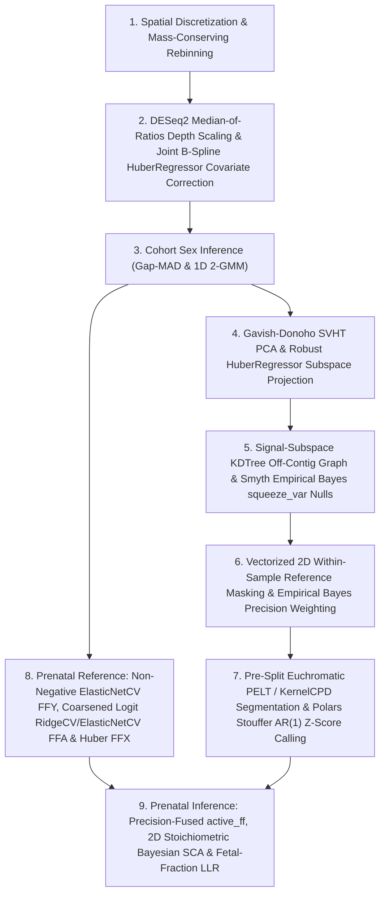

# Mathematical & Machine Learning Methodology

This document provides a complete specification of the mathematical formulations, statistical models, machine learning algorithms, numerical solvers, underlying assumptions, and constant provenance implemented across `ccnv`.

## Provenance Taxonomy

Every constant, threshold, and model hyperparameter in `ccnv` is classified into one of four provenance tiers:

- **Tier 1 — Statistical & Mathematical Theory**: Derived analytically from probability distributions, asymptotic statistical efficiency, or numerical analysis (e.g., Gaussian quantile functions, Bessel's correction, Huber M-estimation efficiency, Bates-Granger forecast combination).
- **Tier 2 — Published Literature & Reference Methodology**: Adopted from peer-reviewed bioinformatics algorithms, primarily WISECONDOR (Straver et al., 2014), WisecondorX (Raman et al., 2019a), DESeq2 median-of-ratios (Anders & Huber, 2010; Love et al., 2014), SeqFF (Kim et al., 2015), limma Empirical Bayes (Smyth, 2004; Phipson et al., 2016), Gavish-Donoho SVHT (Gavish & Donoho, 2014), Stouffer precision pooling (Stouffer et al., 1949; Whitlock, 2005), and PELT/Binseg change-point detection (Killick et al., 2012).
- **Tier 3 — Genomic Biology & Assembly Coordinates**: Grounded in human cytogenetics, chromosome structure, or reference genome coordinates (e.g., pseudoautosomal boundaries, heterochromatic satellite blocks, centromeric gaps, and fetal-maternal cell-free DNA stoichiometry).
- **Tier 4 — Empirical Engineering & Numerical Guardrails**: Tuned for floating-point stability, solver convergence, memory bounding, or outlier clamping in shallow whole-genome sequencing ($0.1\times\text{–}1.0\times$ coverage).

---

## 1. Alignment Filtering, Coordinate Geometry, and Mass-Conserving Rebinning

### 1.1 Mathematical Formulation

For a contig of length $`L \in \mathbb{Z}_{\gt 0}`$ and target bin size $`B \in \mathbb{Z}_{\gt 0}`$ (`src/ccnv/features/binning.py:bin_intervals`), the contig is partitioned into $`N = \lceil L / B \rceil = \lfloor (L + B - 1) / B \rfloor`$ contiguous 0-based half-open intervals $`[s_i, e_i)`$ for $`i \in \lbrace 0, \dots, N - 1 \rbrace`$:

$$
s_i = i \cdot B, \quad e_i = \min((i + 1) B, L)
$$

Filtered alignments with 0-based 5' reference start coordinate $`p \in [0, L)`$ are assigned to bin index $`i = \lfloor p / B \rfloor`$ and aggregated in $`O(R)`$ time via vectorized histogram counting (`np.bincount`, `src/ccnv/features/binning.py:bin_counts`).

When reconciling a source partitioning $`\lbrace [s_i^{\text{src}}, e_i^{\text{src}}) \rbrace_{i=0}^{N-1}`$ with counts $`\mathbf{c}^{\text{src}} \in \mathbb{R}_{\ge 0}^N`$ against a target partitioning $`\lbrace [s_j^{\text{tgt}}, e_j^{\text{tgt}}) \rbrace_{j=0}^{M-1}`$ over the same contig length $`L = e_{N-1}^{\text{src}} = e_{M-1}^{\text{tgt}}`$, proportional interval overlap redistribution defines target counts as:

$$
c_j^{\text{tgt}} = \sum_{i=0}^{N-1} w_{ij} c_i^{\text{src}}, \quad w_{ij} = \frac{\max\left(0, \min(e_i^{\text{src}}, e_j^{\text{tgt}}) - \max(s_i^{\text{src}}, s_j^{\text{tgt}})\right)}{e_i^{\text{src}} - s_i^{\text{src}}}
$$

`ccnv` implements a dual-path rebinning architecture in `src/ccnv/features/cohort.py:rebin_sample_table`:

1. **Exact Integer-Multiple Coarsening Fast Path ($`w_{\text{target}} \equiv 0 \pmod{w_{\text{source}}}`$, e.g., $`5\text{ kb} \to 100\text{ kb}`$)**: When target bin width is an exact integer multiple of source bin width and all interior source bins have uniform width $`w_{\text{source}}`$, rebinning executes directly via a Rust-parallelized Polars expression `pl.DataFrame.group_by(["contig", pl.col("start") // target_bin_size], maintain_order=True).agg(...)` summing counts across nested intervals in $`O(B)`$ time without intermediate Python allocations or array copies.
2. **General Non-Nested Interval Rebinning**: For arbitrary non-nested bin grids over the same contig length, `src/ccnv/features/binning.py:rebin_counts` evaluates the transformation in $`O(N + M)`$ time and memory by constructing the piecewise-linear cumulative count function $`F^{\text{src}}(x) = \sum_{j: e_j \le x} c_j + c_k \frac{x - s_k}{e_k - s_k}`$ at knots $`\mathbf{x}^{\text{src}} = (s_0^{\text{src}}, e_0^{\text{src}}, \dots, e_{N-1}^{\text{src}})`$, interpolating $`F^{\text{src}}`$ at target knots $`\mathbf{x}^{\text{tgt}}`$ via `np.interp`, and taking non-negative first differences $`c_j^{\text{tgt}} = \max(0, F^{\text{src}}(e_j^{\text{tgt}}) - F^{\text{src}}(s_j^{\text{tgt}}))`$, guaranteeing exact conservation of total read mass ($`\sum_m c_m^{\text{tgt}} = \sum_j c_j^{\text{src}}`$).

When persisting rebinned sample tables (`src/ccnv/features/cohort.py:rebin_sample_table`), target counts are preserved as `float64` to maintain fractional count conservation without integer rounding drift.

### 1.2 Statistical Assumptions & Failure Modes

- **Piecewise-Uniform Intra-Bin Density**: Linear interpolation of $F^{\text{src}}(x)$ assumes reads are distributed uniformly within each source bin $[s_i^{\text{src}}, e_i^{\text{src}})$. This holds exactly when coarsening nested integer multiples (e.g., $5\text{ kb} \to 100\text{ kb}$, where target knots coincide with source knots) and introduces smoothing only when refining from coarse to fine bins or across non-divisible bin widths.
- **5'-End Point Process**: Representing each alignment by its 5' start coordinate (`read.reference_start`) models sequencing fragments as a spatial point process, avoiding double-counting of read spans across bin boundaries.
- **Identical Reference Assembly**: Rebinning requires $e_{N-1}^{\text{src}} = e_{M-1}^{\text{tgt}} = L$; mismatched reference builds (e.g., GRCh37 vs. GRCh38) raise a `ValueError` or `ReferenceError`.

### 1.3 Model & Function Selection Rationale

- **Cumulative Knot Interpolation vs. Dense Overlap Matrix**: At $5\text{ kb}$ resolution on human `chr1` ($N \approx 50,000$ bins), a dense matrix $\mathbf{W}$ requires $2.5 \times 10^9$ floats ($\approx 20\text{ GB}$ RAM). Cumulative knot interpolation (`np.cumsum` + `np.interp` + `np.diff`) computes identical values in $\lt 1\text{ MB}$ and $O(N + M)$ operations while strictly conserving total read mass ($\sum_j c_j^{\text{tgt}} = \sum_i c_i^{\text{src}}$).
- **Float64 Conservation vs. Uint64 Truncation**: Persisting continuous `float64` counts preserves exact linear fractional totals across multiple rebinning stages, avoiding systematic truncation or bias across thousands of intervals.

### 1.4 Constants & Hyperparameters

- `DEFAULT_BIN_SIZE = 5000` (`src/ccnv/models/config.py`): Default $5\text{ kb}$ bin width (**Tier 2 — Published Literature & Reference Methodology** / **Tier 4 — Empirical Engineering & Numerical Guardrails**). Balances Poisson counting noise at $0.1\times\text{–}0.5\times$ sWGS coverage ($\sim 150\text{–}750$ reads/bin) against spatial breakpoint resolution; coarsened in memory to $100\text{ kb}$ (`prenatal_bin_size = 100000`) for prenatal models.
- `min_mapping_quality = 1` (`src/ccnv/models/config.py:ReadFilters`): Default minimum Phred-scaled MAPQ (**Tier 2 — Published Literature & Reference Methodology**). Excludes multi-mapping reads ($\text{MAPQ} = 0$, which indicates $\ge 2$ equally likely alignments in BWA/Bowtie2) while retaining low-confidence unique alignments on repetitive contigs.

---

## 2. Depth Normalization, Low-Coverage Masking, and Covariate Bias Correction

### 2.1 Mathematical Formulation

#### 2.1.1 DESeq2 Median-of-Ratios Compositional Depth Scaling

Given a raw counts matrix $\mathbf{C} \in \mathbb{R}_{\ge 0}^{B \times S}$ across $B$ bins and $S$ cohort samples (`src/ccnv/features/cohort.py:estimate_size_factors`, `src/ccnv/features/cohort.py:normalize_depth`), naive total-sum division projects sample depths onto the simplex $\Delta^{B-1}$, giving it a 0% breakdown point: any large whole-chromosome aneuploidy (such as Trisomy 21 or Monosomy X) or high-level focal amplification shifts the total sum denominator, distorting diploid bins before covariate and PCA correction (Aitchison, 1982; Robinson & Oshlack, 2010).

`ccnv` implements the DESeq2 Median-of-Ratios normalization (Anders & Huber, 2010; Love et al., 2014) in pure NumPy/Polars with a 50% outlier breakdown point. For the usable bin mask $`\mathcal{U} \subseteq \lbrace 0, \dots, B-1 \rbrace`$ and bins with positive counts in all samples $`\mathcal{I}_{+} = \lbrace i \in \mathcal{U} : \prod_{s=1}^S C_{i, s} \gt 0 \rbrace`$:

1. Compute the geometric mean pseudo-reference for each bin across all $S$ samples:

$$
g_i = \exp\left(\frac{1}{S}\sum_{s=1}^S \ln C_{i, s}\right) \quad \forall i \in \mathcal{I}_{+}
$$

2. For each sample $`s \in \lbrace 1, \dots, S \rbrace`$, calculate its raw size factor as the median ratio against the pseudo-reference:

$$
\hat{s}_s = \mathrm{median}_{i \in \mathcal{I}_{+}}\left(\frac{C_{i, s}}{g_i}\right)
$$

3. Scale raw factors so that the median sample's total depth is preserved, aligning counts with standard sequencing depth:

$$
s_s = \hat{s}_s \cdot \mathrm{median}_{j}\left(\frac{\sum_{i \in \mathcal{U}} C_{i, j}}{\hat{s}_{j}}\right), \qquad \tilde{c}_{i, s} = \frac{C_{i, s}}{s_s}
$$

When $`\vert \mathcal{I}_{+} \vert \lt 2`$ or $`S \lt 2`$ (e.g., in single-sample prediction without a cohort), the normalization smoothly falls back to positive-median scaling or total-sum division over usable bins $`\mathcal{U}`$.

Cohort-level low-coverage masking (`src/ccnv/features/cohort.py:mask_low_coverage`) sums normalized coverage across samples $`T_b = \sum_{s=1}^S \tilde{c}_{b, s}`$ and retains bins exceeding a fraction $`\alpha_{\text{cov}} = 0.05`$ of the positive median bin sum:

$$
\text{usable}_{\text{cov}}(b) \iff T_b \gt 0.05 \cdot \mathrm{median}_{i : T_i \gt 0}(T_i)
$$

#### 2.1.2 Covariate Masking

When GC content $`\mathbf{g} \in [0, 1]^B`$, ambiguous base indicator $`\mathbf{n}_{\text{mask}} \in \lbrace \text{true}, \text{false} \rbrace^B`$, and mappability $`\mathbf{m} \in [0, 1]^B`$ tracks are provided (`src/ccnv/io/tracks.py`, `src/ccnv/features/covariates.py:mask_covariates`), a bin $b$ is masked if:

1. From FASTA GC extraction (`src/ccnv/io/tracks.py:load_gc_track`), the bin contains zero A/C/G/T/U bases or an ambiguous (`N`) base fraction exceeding $`\tau_N = 0.5`$:

$$
\frac{n_{\text{total}}(b) - \left(n_{\text{GC}}(b) + n_{\text{AT}}(b)\right)}{n_{\text{total}}(b)} \gt 0.5
$$

2. Its mappability score falls below $`\tau_{\text{map}}`$ (`min_mappability`, default $0.5$): $`m_b \lt \tau_{\text{map}}`$.
3. Its GC proportion is non-finite or outside $[0, 1]$.

#### 2.1.3 Joint Natural Cubic B-Spline & Huber M-Estimation Covariate Bias Correction

`ccnv` models non-linear GC and mappability biases jointly (`src/ccnv/stats/regression.py:build_joint_covariate_basis`, `src/ccnv/stats/regression.py:fit_sample_trend`, `src/ccnv/features/covariates.py:correct_covariate_bias`). A joint basis matrix $`\mathbf{X}_{\text{cov}} \in \mathbb{R}^{B_{\text{usable}} \times K}`$ is constructed using quantile-placed natural cubic B-splines (`SplineTransformer(knots="quantile", extrapolation="linear")`) and an explicit interaction term:

$$
\mathbf{X}_{\text{cov}} = \left[\mathbf{1}, \quad \mathcal{B}_{\text{GC}}^{(k=5, d=3)}(\mathbf{g}), \quad \mathcal{B}_{\text{map}}^{(k=4, d=2)}(\mathbf{m}), \quad z(\mathbf{g}) \odot z(\mathbf{m})\right]
$$

where $`\mathcal{B}_{\text{GC}}`$ has 5 quantile knots with degree 3 cubic splines, $`\mathcal{B}_{\text{map}}`$ has 4 quantile knots with degree 2 quadratic splines, and $`z(\cdot)`$ denotes standardization.

For each sample $s$, the log2 relative depth $`\tilde{y}_{i, s} = \log_2(\tilde{c}_{i, s} / \mathrm{median}(\tilde{\mathbf{c}}_{\mathcal{V}_s, s}))`$ over positive bins $`\mathcal{V}_s`$ is fitted via robust Huber M-estimation (`sklearn.linear_model.HuberRegressor(epsilon=1.35, alpha=1e-4)`):

$$
\min_{\boldsymbol{\beta}, \sigma \gt 0} \sum_{i \in \mathcal{V}_s} \left(\sigma \cdot L_{\epsilon}\left(\frac{\tilde{y}_{i, s} - \mathbf{x}_i^{\top} \boldsymbol{\beta}}{\sigma}\right) + \sigma\right) + \alpha \Vert\boldsymbol{\beta}\Vert_2^2, \qquad \epsilon = 1.35, \quad \alpha = 10^{-4}
$$

where $`L_{\epsilon}(r) = \frac{1}{2}r^2`$ if $`\vert r \vert \le \epsilon`$, and $`\epsilon \vert r \vert - \frac{1}{2}\epsilon^2`$ otherwise. The evaluated multiplicative trend $`\hat{t}_i = 2^{\mathbf{x}_i^{\top} \boldsymbol{\beta}}`$ is clamped to $[0.20, 5.0]$ and divided out:

$$
y_i^{\text{corr}} = \frac{\tilde{c}_{i, s}}{\hat{t}_i} \cdot \frac{\sum_{j \in \mathcal{V}_s} \tilde{c}_{j, s}}{\sum_{j \in \mathcal{V}_s} (\tilde{c}_{j, s} / \hat{t}_j)}
$$

### 2.2 Statistical Assumptions & Failure Modes

- **50% Breakdown Bound**: DESeq2 median-of-ratios scaling and median relative depth assume that at least 50% of unmasked bins are copy-neutral (diploid), allowing robust size factor estimation even under full-arm aneuploidies or high-fraction deletions (Anders & Huber, 2010; Robinson & Oshlack, 2010).
- **Smoothness of Amplification Curves**: PCR GC bias curves are smooth, unimodal or sigmoidal functions of local GC composition (Benjamini & Speed, 2012). Natural cubic B-splines with linear boundary extrapolation eliminate Runge boundary oscillations at extreme GC tails ($\lt 0.30$ or $\gt 0.65$; de Boor, 1978; Wood, 2017).
- **Joint Orthogonal Decomposition**: Fitting GC content, mappability, and their cross-product interaction in a single design matrix avoids Gauss-Seidel order-dependent attenuation inherent in sequential 1D regression (Hastie & Tibshirani, 1990).

### 2.3 Model & Function Selection Rationale

- **DESeq2 Median-of-Ratios vs. Total Read Count Division**: Total-sum division introduces artificial baseline shifts when samples harbor whole-chromosome aneuploidies (e.g., Trisomy 21). Median-of-ratios provides exact invariance to copy-number alterations spanning up to 50% of the genome.
- **Natural Cubic B-Splines vs. Global Vandermonde Polynomials**: Monomial Vandermonde powers ($z, z^2, z^3$) suffer severe ill-conditioning and Runge oscillations at distribution extremes, requiring heuristic clamping. Quantile-knot B-splines with linear boundary extrapolation have local support, low condition number, and stable boundary behavior without ad-hoc tail truncation.
- **HuberRegressor vs. Bespoke 3-Step IRLS**: `sklearn.linear_model.HuberRegressor` jointly optimizes location $\boldsymbol{\beta}$ and scale $\sigma$ via second-order L-BFGS-B, achieving 95% asymptotic efficiency under Gaussian noise at $\epsilon = 1.35$ (Huber, 1964; Owen, 2007) while remaining robust against copy-number outliers.

### 2.4 Constants & Hyperparameters

- `_MAX_N_FRACTION = 0.5` (`src/ccnv/io/tracks.py`): Maximum ambiguous base fraction (**Tier 3 — Genomic Biology & Assembly Coordinates** / **Tier 4 — Empirical Engineering & Numerical Guardrails**). Masks assembly gap bins where $\gt 50$% of bases are unsequenced `N`s.
- `DEFAULT_MIN_MAPPABILITY = 0.5` (`src/ccnv/models/config.py`): Default mappability threshold (**Tier 2 — Published Literature & Reference Methodology** / **Tier 3 — Genomic Biology & Assembly Coordinates**). Requires at least 50% of $`k`$-mers in a bin to map uniquely.
- `_MASK_FRACTION = 0.05` (`src/ccnv/features/cohort.py`): Low-coverage bin cutoff at 5% of positive median cohort depth (**Tier 2 — Published Literature & Reference Methodology** / **Tier 4 — Empirical Engineering & Numerical Guardrails**). Eliminates dead regions and unmappable heterochromatin before PCA.
- `SplineTransformer` GC knots/degree `(n_knots=5, degree=3)` and mappability `(n_knots=4, degree=2)` (`src/ccnv/stats/regression.py`): Quantile B-spline specification (**Tier 2 — Published Literature & Reference Methodology**: Benjamini & Speed, 2012; Wood, 2017).
- `HuberRegressor` tuning constant `epsilon = 1.35`, penalty `alpha = 1e-4` (`src/ccnv/stats/regression.py`): Huber M-estimator tuning constant for 95% Gaussian asymptotic efficiency (**Tier 1 — Statistical & Mathematical Theory**: Huber, 1964).
- Multiplicative trend clamp `[0.20, 5.0]` (`src/ccnv/stats/regression.py`): Bounds multiplicative covariate correction to at most $5\times$ (**Tier 4 — Empirical Engineering & Numerical Guardrails**).

---

## 3. Cohort Sex Inference: Gap-MAD Separation vs. 1D 2-GMM

`ccnv` provides two distinct unsupervised sex classification algorithms depending on analysis mode, because germline WGS and maternal cell-free DNA (cfDNA) exhibit fundamentally different `chrY` read fraction distributions.

### 3.1 Mathematical Formulation

For each sample $`s \in \lbrace 1, \dots, S \rbrace`$, let $`f_s = \left(\sum_{b \in \text{chrY}} C_{b, s}\right) / \max\left(\sum_b C_{b, s}, 1\right)`$ denote the fraction of reads mapping to the sex-signal contig (`chrY` / `Y`).

#### Germline Mode: Order-Statistic Gap-MAD Classifier (`src/ccnv/features/cohort.py:infer_sample_sexes`)

Requires $`S \ge 2 \cdot m_{\text{sex}}`$ samples (`min_sex_group_size`, default $5$). Let $`f_{(0)} \le f_{(1)} \le \dots \le f_{(S-1)}`$ be the sorted fractions. The optimal partition index $`s^{\ast} \in \lbrace m_{\text{sex}}, \dots, S - m_{\text{sex}} \rbrace`$ maximizes the adjacent order-statistic gap:

$$
s^{\ast} = \underset{m_{\text{sex}} \le s \le S - m_{\text{sex}}}{\arg\max} \left(f_{(s)} - f_{(s-1)}\right), \quad \Delta_{\max} = f_{(s^{\ast})} - f_{(s^{\ast} - 1)}
$$

Let $`\mathcal{L} = \lbrace f_{(0)}, \dots, f_{(s^{\ast} - 1)} \rbrace`$ (putative females) and $`\mathcal{H} = \lbrace f_{(s^{\ast})}, \dots, f_{(S-1)} \rbrace`$ (putative males), with unscaled group MADs $`\mathrm{MAD}(\mathcal{L})`$ and $`\mathrm{MAD}(\mathcal{H})`$. The separation is accepted if and only if:

$$
\Delta_{\max} \gt 0 \quad \text{and} \quad \Delta_{\max} \ge \max\left(\Delta_{\min}, 4.0 \cdot \max(\mathrm{MAD}(\mathcal{L}), \mathrm{MAD}(\mathcal{H}), 10^{-12})\right)
$$

If accepted, the decision threshold is placed at the midpoint $`\tau_{\text{sex}} = \frac{1}{2}\left(f_{(s^{\ast} - 1)} + f_{(s^{\ast})}\right)`$.

#### Prenatal Mode: 1D Two-Component Gaussian Mixture Model with Brent's Root-Finding (`src/ccnv/stats/prenatal_math.py:infer_sex_gmm_1d`)

In maternal plasma cfDNA, `chrY` read fractions in male-bearing pregnancies scale continuously with fetal fraction ($`\text{FF} \in [0.02, 0.30]`$, 2% to 30%), creating an overlapping or skewed upper distribution rather than two tight clusters. A 1D 2-component Gaussian Mixture Model (GMM) with full (unconstrained) component variances $`\sigma_0^2, \sigma_1^2`$ is fitted via Expectation-Maximization (EM):

$$
p(f) = \pi_0 \mathcal{N}(f \mid \mu_0, \sigma_0^2) + \pi_1 \mathcal{N}(f \mid \mu_1, \sigma_1^2)
$$

initialized deterministically at the 25th and 75th sample percentiles ($`\mu_0^{(0)} = P_{25}(\mathbf{f}), \mu_1^{(0)} = P_{75}(\mathbf{f})`$ ) with equal prior weights $`\pi_0^{(0)} = \pi_1^{(0)} = 0.5`$. Let $`k_{\text{M}} = \underset{k \in \lbrace 0, 1 \rbrace}{\arg\max} \, \mu_k`$ and $`k_{\text{F}} = 1 - k_{\text{M}}`$. The Bayes-optimal decision boundary $`\tau_Y \in [\mu_{k_{\text{F}}}, \mu_{k_{\text{M}}}]`$ where the posterior probability of a male fetus equals $0.5$ is solved numerically by Brent's root-finding method (`scipy.optimize.brentq`):

$$
P(Z = k_{\text{M}} \mid f = \tau_Y) - 0.5 = \frac{\pi_{k_{\text{M}}} \mathcal{N}(\tau_Y \mid \mu_{k_{\text{M}}}, \sigma_{k_{\text{M}}}^2)}{\sum_{k=0}^1 \pi_k \mathcal{N}(\tau_Y \mid \mu_k, \sigma_k^2)} - 0.5 = 0
$$

with fallback to the midpoint $`\tau_Y = \frac{1}{2}(\mu_{k_{\text{F}}} + \mu_{k_{\text{M}}})`$ if the posterior difference does not change sign on $`[\mu_{k_{\text{F}}}, \mu_{k_{\text{M}}}]`$.

### 3.2 Statistical Assumptions & Failure Modes

- **Germline Bimodality**: Assumes constitutional `XX` and `XY` samples form two well-separated modes with at least `min_sex_group_size` samples per sex and inter-group gap $\ge 4 \times \text{MAD}$. If a cohort contains only one sex, `infer_sample_sexes` safely rejects sex partitioning (`passed = False`) and builds only the `autosomal` branch unless `--sex-cutoff` or samplesheet labels are provided.
- **Heteroscedastic Prenatal Mixture**: In cfDNA, female pregnancies ($\text{XX}$) have near-zero `chrY` background misalignment with tiny variance ($\sigma_{\text{F}}^2 \ll \sigma_{\text{M}}^2$), whereas male pregnancies ($\text{XY}$) span a wide range of fetal fractions ($\sigma_{\text{M}}^2 \gg \sigma_{\text{F}}^2$). Using `covariance_type="full"` (distinct variances $\sigma_{\text{F}}^2 \ne \sigma_{\text{M}}^2$) is essential; an equal-variance GMM or k-means midpoint places the boundary far too high, misclassifying low-fetal-fraction male fetuses as female.

### 3.3 Model & Function Selection Rationale

- **Quantile Initialization ($P_{25}, P_{75}$) vs. k-means++**: Standard randomized k-means++ initialization in EM can converge to degenerate local optima on small cohorts. Deterministic quartile initialization guarantees reproducible, seed-invariant component assignment.
- **Brent's Method (`brentq`) vs. Analytical Quadratic Formula**: Solving $P(Z = k_{\text{M}} \mid f) = 0.5$ via `brentq` on the bracketed interval $[\mu_{\text{F}}, \mu_{\text{M}}]$ directly queries `gmm.predict_proba` (which works in log-sum-exp space), avoiding numerical underflow or selecting the wrong root of the two quadratic intersections when $\sigma_{\text{F}}^2 \ne \sigma_{\text{M}}^2$.

### 3.4 Constants & Hyperparameters

- `min_cohort_size = 10`, `min_sex_group_size = 5` (`src/ccnv/models/config.py:ReferenceConfig`): Minimum cohort and per-sex sample counts (**Tier 2 — Published Literature & Reference Methodology** / **Tier 4 — Empirical Engineering & Numerical Guardrails**). Ensures sufficient degrees of freedom for PCA and robust median/MAD estimation.
- `_SEPARATION_MAD_MULTIPLIER = 4.0` (`src/ccnv/features/cohort.py`): Minimum inter-sex gap-to-MAD ratio (**Tier 1 — Statistical & Mathematical Theory** / **Tier 4 — Empirical Engineering & Numerical Guardrails**). Under a normal distribution, $4 \times \text{MAD}_{\text{unscaled}} \approx 2.7\sigma$ per side ($\approx 5.4\sigma$ total separation), preventing false bimodal splits on single-sex cohorts.
- `percentiles = (25.0, 75.0)`, `weights_init = (0.5, 0.5)` (`src/ccnv/stats/prenatal_math.py:infer_sex_gmm_1d`): Deterministic GMM initialization at first and third quartiles (**Tier 1 — Statistical & Mathematical Theory** / **Tier 2 — Published Literature & Reference Methodology**).
- `tol = 1e-6`, `reg_covar = 1e-8`, `max_iter = 100` (`src/ccnv/stats/prenatal_math.py:infer_sex_gmm_1d`): EM convergence tolerance and diagonal covariance regularization (**Tier 4 — Empirical Engineering & Numerical Guardrails**). Prevents singular covariance collapse ($\sigma_k^2 \to 0$) when all female samples have identical `chrY` fractions.

---

## 4. Between-Sample Latent Bias Removal: Gavish-Donoho SVHT PCA & Robust Subspace Projection

### 4.1 Mathematical Formulation

#### 4.1.1 Gavish-Donoho Optimal Singular Value Hard Thresholding (SVHT)

Let $\mathbf{Y} \in \mathbb{R}^{U \times S}$ be the covariate-corrected, depth-normalized coverage matrix over $U$ unmasked bins and $S$ cohort samples, and let $\mathbf{X} = \mathbf{Y}^{\top} \in \mathbb{R}^{S \times U}$ be the samples-by-bins matrix (`src/ccnv/stats/pca.py:fit_pca`, `src/ccnv/stats/pca.py:optimal_svht_rank`). The empirical cohort mean vector is:

$$
\boldsymbol{\mu} = \frac{1}{S} \sum_{s=1}^S \mathbf{X}_{s, :} \in \mathbb{R}^U
$$

Singular Value Decomposition (SVD) decomposes the centered matrix $`\tilde{\mathbf{X}} = \mathbf{X} - \mathbf{1}_S \boldsymbol{\mu}^{\top} = \mathbf{U} \boldsymbol{\Sigma} \mathbf{V}^{\top}`$, yielding singular values $`s_1 \ge s_2 \ge \dots \ge s_{\min(S, U)}`$.

Rather than fixing PCA rank to an arbitrary constant, `ccnv` determines the optimal subspace rank $P$ via Gavish-Donoho Optimal Singular Value Hard Thresholding (Gavish & Donoho, 2014) when noise variance $\sigma^2$ is unknown:

$$
\beta = \frac{\min(S, U)}{\max(S, U)}, \qquad \omega(\beta) = 0.56\beta^3 - 0.95\beta^2 + 1.82\beta + 1.43, \qquad \tau_{\text{SVHT}} = \omega(\beta)\mathrm{median}_{k}(s_k)
$$

$$
P = \mathrm{clip}\left(\vert \lbrace k : s_k \gt \tau_{\text{SVHT}} \rbrace \vert, \quad 1, \quad \min(P_{\max}, S, U)\right)
$$

Gavish & Donoho (2014) proved that $\tau_{\text{SVHT}}$ minimizes asymptotic Mean Squared Error by cleanly separating low-rank systemic signals from the Marchenko-Pastur bulk noise distribution (Marchenko & Pastur, 1967).

Sign ambiguity of singular vectors ($`\mathbf{v}_p \leftrightarrow -\mathbf{v}_p`$) is resolved deterministically via `sklearn.utils.extmath.svd_flip`. The rank-$`P`$ reconstruction is:

$$
\hat{\mathbf{X}} = (\tilde{\mathbf{X}} \mathbf{V}_P) \mathbf{V}_P^{\top} + \mathbf{1}_S \boldsymbol{\mu}^{\top}
$$

Multiplicative systemic bias is divided out element-wise to produce the PCA-corrected reference matrix $`\mathbf{Y}^{\text{corr}} \in \mathbb{R}^{U \times S}`$:

$$
Y_{b, s}^{\text{corr}} = \begin{cases} \dfrac{X_{s, b}}{\hat{X}_{s, b}} & \text{if } \text{finite}\left(\dfrac{X_{s, b}}{\hat{X}_{s, b}}\right) \\\\ 1.0 & \text{otherwise} \end{cases}
$$

#### 4.1.2 Single-Sample Robust PCA Projection via HuberRegressor

During single-sample prediction (`src/ccnv/predict.py:project_coverage`), a test sample's normalized coverage $`\mathbf{y} \in \mathbb{R}^U`$ is projected onto the reference PCA subspace over active bins $`\mathcal{A} \subseteq \lbrace 0, \dots, U-1 \rbrace`$.

Ordinary least squares (`lstsq`) projection minimizes $L_2$ error, causing large aneuploidies (e.g., Trisomy 21 or large focal duplications) to tilt the projection coefficients $\mathbf{c}$, absorbing the true CNV into the background and leaking compensating ghost waves onto euploid chromosomes (Candès et al., 2011). `ccnv` solves the projection via robust Huber M-estimation (`sklearn.linear_model.HuberRegressor(fit_intercept=False, epsilon=1.35)`):

$$
\hat{\mathbf{c}} = \underset{\mathbf{c} \in \mathbb{R}^P, \sigma \gt 0}{\arg\min} \sum_{i \in \mathcal{A}} \left(\sigma \cdot L_{1.35}\left(\frac{(y_i - \mu_i) - \mathbf{V}_{P, i}^{\top} \mathbf{c}}{\sigma}\right) + \sigma\right)
$$

reconstructing expected baseline $\hat{\mathbf{y}} = \mathbf{V}_P \hat{\mathbf{c}} + \boldsymbol{\mu}$ and dividing out the systemic component:

$$
y_b^{\text{corr}} = \frac{y_b}{\hat{y}_b} \quad \text{for } b \in \mathcal{A} \text{ with } \hat{y}_b \gt 0
$$

### 4.2 Statistical Assumptions & Failure Modes

- **Low-Rank Latent Structure**: Assumes systemic technical biases (library prep kits, flowcell tile effects, batch fragmentation signatures) lie in a low-dimensional subspace captured by Gavish-Donoho thresholding, while biological CNVs are sample-specific and orthogonal to the subspace.
- **Outlier Bounding**: Huber projection with $\epsilon = 1.35$ limits the influence of outlying bins exceeding $1.35\sigma$, ensuring that whole-chromosome trisomies cannot bias the reconstructed diploid baseline.

### 4.3 Model & Function Selection Rationale

- **Gavish-Donoho SVHT vs. Fixed PCA Rank**: A fixed rank (e.g., $P=5$) underfits large cohorts ($S \sim 500$) with complex batch structure and overfits small cohorts ($S \sim 10$). Gavish-Donoho thresholding adapts dynamically to sample size and noise level.
- **Huber M-Estimation vs. OLS Projection**: In samples carrying large copy-number aberrations, Huber M-estimation downweights altered bins automatically, preserving true CNV amplitude and eliminating artificial baseline depression on euploid contigs (Huber, 1981).

### 4.4 Constants & Hyperparameters

- SVHT cubic polynomial coefficients `(0.56, -0.95, 1.82, 1.43)` (`src/ccnv/stats/pca.py:optimal_svht_rank`): Closed-form optimal threshold for unknown noise variance (**Tier 2 — Published Literature & Reference Methodology**: Gavish & Donoho, 2014).
- `pca_components = 5` (`src/ccnv/models/config.py:ReferenceConfig`): Default maximum components $P_{\max}$ (**Tier 2 — Published Literature & Reference Methodology** / **Tier 4 — Empirical Engineering & Numerical Guardrails**).
- `HuberRegressor` tuning constant `epsilon = 1.35` (`src/ccnv/predict.py:project_coverage`): 95% asymptotic Gaussian efficiency (**Tier 1 — Statistical & Mathematical Theory**: Huber, 1964).

---

## 5. Within-Sample Reference Graph & Empirical Bayes Null Modeling

Following the foundational insight of WISECONDOR (Straver et al., 2014), `ccnv` constructs a within-sample reference for each target bin by pairing it with $k$ bins located on other chromosomes that exhibit identical behavior across the control cohort.

### 5.1 Mathematical Formulation

#### 5.1.1 Low-Dimensional Signal-Subspace $\mathbb{R}^{P+2}$ `KDTree` Neighbor Search

In high dimensions ($S \approx 50\text{–}500$), pairwise Euclidean distances over raw PCA residuals concentrate around their mean ($\mathrm{Var}(D)/\mathbb{E}[D] \to 0$), degrading neighbor selection quality (Beyer et al., 1999). Two genomic bins are optimal reference partners if and only if they share identical sensitivity to latent technical factors and identical sequence properties.

`ccnv` maps each bin $i$ into a $`(P+2)`$-dimensional signal subspace (`src/ccnv/stats/neighbors.py:build_signal_space_features`, `src/ccnv/stats/neighbors.py:select_nearest_bins`):

$$
\mathbf{f}_i = \left[s_1 V_{1, i}, \dots, s_P V_{P, i}, \quad z(\text{GC}_i), \quad z(\text{map}_i)\right] \in \mathbb{R}^{P+2}
$$

where $`s_p V_{p, i}`$ are singular-value-scaled PCA loadings and $`z(\cdot)`$ are standardized sequence covariates.

For each chromosome $c$, a C-compiled $`k`$-d tree (`scipy.spatial.KDTree`) is built over all off-contig bins $`\mathcal{C}_{\ne c} = \lbrace j : \text{contig}_j \ne c \rbrace`$. For each query bin on contig $c$, querying the tree with `tree.query(..., k=k, workers=threads)` finds the $k$ nearest off-contig neighbors in $`O(U \log U)`$ time and returns squared Euclidean distances $`d^2(\mathbf{f}_i, \mathbf{f}_j)`$ (Bentley, 1975; Maneewongvatana & Mount, 1999).

#### 5.1.2 Iterative $3\sigma$ Distance Outlier Pruning

Across all neighbor distances $`\mathcal{D} = \lbrace d^2(\mathbf{f}_i, \mathbf{f}_j) \rbrace`$, a 3-pass iterative clipping loop runs (`src/ccnv/stats/neighbors.py:distance_cutoff`):

$$
\mathcal{D}^{(r)} = \left\lbrace u \in \mathcal{D} : u \lt \tau_{\text{dist}}^{(r-1)} \right\rbrace, \quad \tau_{\text{dist}}^{(r)} = \mathrm{mean}\left(\mathcal{D}^{(r)}\right) + 3.0 \cdot \mathrm{std}\left(\mathcal{D}^{(r)}\right) \quad (r = 1, 2, 3)
$$

Neighbors exceeding $`\tau_{\text{dist}}^{(3)}`$ are pruned, recording each bin's surviving neighbor set $`\mathcal{N}_i`$ and mean unsquared distance $`\bar{d}_i`$.

#### 5.1.3 PCA Degrees-of-Freedom Correction & Smyth Empirical Bayes Variance Shrinkage

Using $`S_{\text{null}} = \min(S, 100)`$ control samples, per-bin log2 ratios are evaluated:

$$
R_{i, s} = \log_2\left(\frac{Y_{i, s}^{\text{corr}}}{\mathrm{median}_{j \in \mathcal{N}_i}\left(Y_{j, s}^{\text{corr}}\right)}\right)
$$

Because $P$ principal components were removed from $`Y_{i, s}^{\text{corr}}`$, the effective residual degrees of freedom are reduced from $`S_{\text{null}} - 1`$ to $`d = \max(1, S_{\text{null}} - 1 - P)`$. The sample variance is adjusted for degrees of freedom:

$$
s_{i, \text{DOF}}^2 = \frac{S_{\text{null}} - 1}{d} \cdot \mathrm{Var}_{s}(R_{i, s})
$$

To prevent noisy variance estimates from small cohorts from creating unstable inverse-variance weights, `ccnv` implements Smyth's Empirical Bayes variance shrinkage (`limma::squeezeVar`, Smyth, 2004; Phipson et al., 2016) in pure NumPy/SciPy (`src/ccnv/stats/neighbors.py:squeeze_var`). Under a scaled inverse-$`\chi^2`$ prior, log-variances $`z_i = \ln(s_{i, \text{DOF}}^2)`$ have theoretical expectation and variance involving digamma $`\psi`$ and trigamma $`\psi_1`$ functions:

$$
z_i = \ln(s_{i, \text{DOF}}^2) - \psi(d/2) + \ln(d/2)
$$

After Winsorizing $z_i$ at quantiles `winsor_tail_p = (0.05, 0.10)` to protect against hypervariable outliers, the prior degrees of freedom $d_0$ and prior scale $s_0^2$ are solved via `scipy.optimize.brentq`:

$$
\psi_1(d_0 / 2) = \mathrm{Var}_{\text{winsor}}(z_i) - \psi_1(d / 2)
$$

$$
s_0^2 = \exp\left(\bar{z}_{\text{winsor}} + \psi(d_0/2) - \ln(d_0/2)\right)
$$

The moderated null variance shrinks individual variances toward the empirical prior:

$$
\tilde{\sigma}_{\text{null}, i}^2 = \frac{d_0 s_0^2 + d \cdot s_{i, \text{DOF}}^2}{d_0 + d}
$$

### 5.2 Statistical Assumptions & Failure Modes

- **Signal Subspace Sufficiency**: Assumes that technical co-variation between bins across sequencing runs is captured by the low-dimensional signal subspace $\mathbf{f}_i \in \mathbb{R}^{P+2}$.
- **Conjugate Inverse-$`\chi^2`$ Prior**: Assumes true bin variances follow a scaled inverse-$`\chi^2`$ distribution with prior degrees of freedom $`d_0`$ and scale $`s_0^2`$, borrowing strength across hundreds of thousands of bins (Smyth, 2004).

### 5.3 Model & Function Selection Rationale

- **$`\mathbb{R}^{P+2}`$ `KDTree` vs. $`S`$-Dimensional Dense GEMM**: Evaluating distances in $`\mathbb{R}^7`$ via C-compiled `scipy.spatial.KDTree` reduces search complexity from $`O(U^2 S)`$ to $`O(U \log U)`$ and eliminates high-dimensional distance concentration (Beyer et al., 1999).
- **Smyth Empirical Bayes (`squeeze_var`) vs. Raw Sample Variance**: In small cohorts ($S = 10\text{–}30$), raw sample variance $s_i^2$ has high sampling variance. Empirical Bayes shrinkage shrinks noisy extreme estimates toward the consensus genomic variance $s_0^2$.

### 5.4 Constants & Hyperparameters

- `nearest_bins = 300` (`src/ccnv/models/config.py:ReferenceConfig`): Default number of off-contig reference neighbors $k$ (**Tier 2 — Published Literature & Reference Methodology**, WISECONDOR / WisecondorX).
- `winsor_tail_p = (0.05, 0.10)` (`src/ccnv/stats/neighbors.py:squeeze_var`): Winsorization quantiles for robust empirical Bayes moment estimation (**Tier 2 — Published Literature & Reference Methodology**: Phipson et al., 2016).
- `_MAX_NULL_SAMPLES = 100` (`src/ccnv/stats/neighbors.py`): Maximum cohort samples for null distribution estimation (**Tier 4 — Empirical Engineering & Numerical Guardrails**).
- Distance clipping `repeats = 3`, multiplier `3.0` (`src/ccnv/stats/neighbors.py:distance_cutoff`): 3-pass iterative $\mu + 3\sigma$ neighbor distance outlier pruning (**Tier 2 — Published Literature & Reference Methodology**).

---

## 6. Iterative Within-Sample Normalization & Empirical Bayes Precision Weighting

During single-sample prediction (`src/ccnv/predict.py:normalize_branch`), if the test sample itself carries a CNV, bins in the CNV region that serve as reference partners for other chromosomes would corrupt baselines if not removed.

### 6.1 Mathematical Formulation

Let $\mathbf{y}^{\text{corr}} \in \mathbb{R}^U$ be the test sample's PCA-projected coverage. `ccnv` evaluates within-sample normalization using a vectorized 2D neighbor matrix $\mathbf{N} \in \mathbb{Z}^{U \times K_{\max}}$ with `np.nanmedian` over $M$ iterations (`mask_repeats`, default $3$).

In each iteration $t$:
1. Eligible bins are filtered: $`\mathcal{E}^{(t-1)} = \lbrace i : \text{finite}(y_i^{\text{corr}}) \land \vert Z_i^{(t-1)} \vert \lt \tau_{\text{mask}} \rbrace`$, where $`\tau_{\text{mask}} = \Phi^{-1}(0.99) = 2.326347874`$.
2. For each bin, its within-sample baseline is computed across eligible surviving neighbors:

$$
b_i^{(t)} = \mathrm{nanmedian}_{j \in \mathcal{N}_i \cap \mathcal{E}^{(t-1)}}\left(y_j^{\text{corr}}\right), \quad r_i^{(t)} = \log_2\left(\frac{y_i^{\text{corr}}}{b_i^{(t)}}\right)
$$

$$
Z_i^{(t)} = \frac{r_i^{(t)} - \mu_{\text{null}, i}}{\tilde{\sigma}_{\text{null}, i}}
$$

After $M$ iterations, global median centering removes residual genome-wide baseline shift: $`\tilde{r}_i = r_i^{(M)} - \mathrm{median}(r^{(M)})`$.

#### Empirical Bayes Inverse-Variance Precision Weights

Each valid bin is assigned an Empirical Bayes inverse-variance precision weight:

$$
w_i = \begin{cases} \mathrm{clip}\left(\dfrac{s_0^2}{\tilde{\sigma}_{\text{null}, i}^2}, \quad 0.05, \quad 20.0\right) & \text{if } \tilde{\sigma}_{\text{null}, i} \gt 0 \text{ and } \vert \mathcal{N}_i^{(M)} \vert \ge m_{\text{ref}} \\\\ \dfrac{1}{\max(\bar{d}_i, 10^{-12})} & \text{if } \tilde{\sigma}_{\text{null}, i} = 0 \text{ (flat FASTA reference)} \\\\ 0.0 & \text{otherwise} \end{cases}
$$

Under weighted least squares, setting $`w_i \propto \tilde{\sigma}_{\text{null}, i}^{-2}`$ makes the weighted sum-of-squares cost function proportional to the negative log-likelihood of a Gaussian observation model (Aitken, 1935; Killick et al., 2012).

### 6.2 Statistical Assumptions & Failure Modes

- **Gauss-Markov Optimality**: Inverse-variance weighting guarantees that the weighted segment mean $\bar{r}_w = (\sum w_i r_i) / (\sum w_i)$ is the Best Linear Unbiased Estimator (BLUE) under heteroscedastic bin variances (Aitken, 1935).
- **Weight Clamping**: Clamping weights to $[0.05, 20.0]$ prevents ultra-low variance bins from dominating segmentation while bounding the influence of noisy bins.

### 6.3 Constants & Hyperparameters

- `_MASK_Z_THRESHOLD = 2.326347874` (`src/ccnv/predict.py`): $\Phi^{-1}(0.99)$ (**Tier 1 — Statistical & Mathematical Theory** / **Tier 2 — Published Literature & Reference Methodology**, WISECONDOR). Masks the outer 2% tails during iterative neighbor refinement.
- Weight clip bounds `[0.05, 20.0]` (`src/ccnv/predict.py:normalize_branch`): Bounded dynamic range for inverse-variance weights (**Tier 4 — Empirical Engineering & Numerical Guardrails**).
- `mask_repeats = 3`, `min_reference_bins = 3` (`src/ccnv/models/config.py:PredictConfig`): Iterations and minimum surviving neighbors (**Tier 2 — Published Literature & Reference Methodology** / **Tier 4 — Empirical Engineering & Numerical Guardrails**).

---

## 7. Pre-Split Euchromatic Change-Point Segmentation and Event Calling

### 7.1 Mathematical Formulation

#### 7.1.1 Pre-Split Euchromatic Arm Block Partitioning

Rather than segmenting across entire chromosomes and splitting post-hoc, `src/ccnv/stats/segmentation.py:segment_contig` partitions each contig into contiguous euchromatic blocks separated by unmapped/masked gaps exceeding $\Delta_{\max} = 2{,}000{,}000\text{ bp}$ (centromeres, acrocentric p-arms, heterochromatic stalks) **before** change-point optimization. This prevents p-arm and q-arm baselines from coupling across centromeres (Olshen et al., 2004; Nilsen et al., 2012).

#### 7.1.2 Change-Point Optimization and Solver Dispatch

For an euchromatic block with log2 ratios $\mathbf{y}$ and precision weights $\mathbf{w}$, the weighted sum-of-squared-errors cost is:

$$
\mathrm{cost}(s, e) = \sum_{i=s}^{e-1} w_i \left(y_i - \bar{y}_{s:e}\right)^2, \quad \bar{y}_{s:e} = \frac{\sum_{i=s}^{e-1} w_i y_i}{\sum_{i=s}^{e-1} w_i}
$$

`WeightedL2Cost` precomputes prefix sums of $w_i$, $w_i y_i$, and $w_i y_i^2$, allowing $O(1)$ interval cost evaluations. Solvers are dispatched based on algorithm and weight profile:
- **`algorithm == "pelt"` with uniform weights**: Dispatches to C-compiled `ruptures.KernelCPD(kernel="linear", min_size=min_size, jump=jump)` executing exact linear-time PELT in compiled C (Killick et al., 2012; Truong et al., 2020).
- **`algorithm == "pelt"` with variable weights**: Dispatches to exact `ruptures.Pelt(custom_cost=WeightedL2Cost())`.
- **`algorithm == "binseg"`**: Dispatches to `ruptures.Binseg(custom_cost=WeightedL2Cost())`.

#### 7.1.3 Autocorrelation-Corrected Stouffer Precision Z-Score Calling

In `src/ccnv/predict.py:segment_and_call`, segments are summarized via Polars expressions. Taking the simple average of Z-scores shrinks variance as $1/N$, requiring single-bin deviations $\vert Z_i \vert \ge 3.0$ regardless of segment length and missing multi-bin low-fetal-fraction CNVs.

`ccnv` implements the Stouffer precision-weighted combination (Stouffer et al., 1949; Lipták, 1958; Whitlock, 2005) with Newey-West / AR(1) spatial autocorrelation correction (Diskin et al., 2008; Newey & West, 1987):

1. Estimate per-contig lag-1 autocorrelation natively in Polars:

$$
\hat{\rho}_{1, c} = \mathrm{clip}\left(\mathrm{Corr}_{i \in \mathcal{U}_c}(Z_i, Z_{i-1}), \quad 0.0, \quad 0.95\right)
$$

2. For each segment $S_m$ with $N_m$ usable bins, evaluate the autocorrelation-adjusted Stouffer Z-score:

$$
Z_{\text{seg}}(S_m) = \frac{\sum_{i \in S_m \cap \mathcal{U}} w_i Z_i}{\sqrt{\left(\sum_{i \in S_m \cap \mathcal{U}} w_i^2\right)\left(1 + \frac{2(N_m - 1)}{N_m}\hat{\rho}_{1, c}\right)}}
$$

Stouffer weighting scales detection sensitivity with $`\sqrt{N_m}`$ while the AR(1) factor $`1 + \frac{2(N_m - 1)}{N_m}\hat{\rho}_{1, c}`$ prevents false-positive inflation from local genomic correlation waves.

### 7.2 Event Calling

A segment is classified as:

$$
\mathrm{call} = \begin{cases} \texttt{"gain"} & \text{if } Z_{\text{seg}} \gt \tau_Z \text{ (or } \bar{r}_{\text{seg}} \gt \tau_r \text{)} \\\\ \texttt{"loss"} & \text{if } Z_{\text{seg}} \lt -\tau_Z \text{ (or } \bar{r}_{\text{seg}} \lt -\tau_r \text{)} \\\\ \texttt{None} & \text{otherwise} \end{cases}
$$

### 7.3 Constants & Hyperparameters

- `penalty = 1.0` (`src/ccnv/models/config.py:PredictConfig`): Breakpoint penalty $\beta$ (**Tier 2 — Published Literature & Reference Methodology** / **Tier 4 — Empirical Engineering & Numerical Guardrails**).
- `DEFAULT_MAX_BLACKLIST_GAP = 2_000_000` bp (`src/ccnv/stats/segmentation.py`): Euchromatic block pre-split threshold (**Tier 3 — Genomic Biology & Assembly Coordinates**).
- `z_threshold = 3.0` (`src/ccnv/models/config.py:PredictConfig`): Segment calling threshold (**Tier 1 — Statistical & Mathematical Theory** / **Tier 2 — Published Literature & Reference Methodology**).
- Contig lag-1 autocorrelation clamp `[0.0, 0.95]` (`src/ccnv/predict.py:segment_and_call`): Prevents negative variance adjustments or singular inflation (**Tier 2 — Published Literature & Reference Methodology** / **Tier 4 — Empirical Engineering & Numerical Guardrails**: Diskin et al., 2008; Newey & West, 1987).

---

## 8. Prenatal Multi-Resolution Fetal Fraction Estimation (`FFY`, `FFA`, `FFX`)

In `--mode prenatal`, `ccnv` calibrates and evaluates three complementary fetal fraction estimators from shallow maternal cfDNA sequencing.

### 8.1 1D 2-GMM Fetal Sex Inference & Mappable Autosomal Density

Autosomal density excludes chromosomes 13, 18, and 21 (`_EXCLUDED_PRENATAL_AUTOSOMES = {13, 18, 21}`):

$$
\rho_{\text{auto}} = \mathrm{mean}_{b \in \mathcal{A}_{\text{pre}}, c_b \gt 0}\left(\frac{c_b}{w_b}\right)
$$

Prenatal fetal sex inference fits a 1D 2-GMM with Brent's root-finding (`infer_sex_gmm_1d`) on `chrY` read fractions, establishing the decision boundary $\tau_Y$ separating female and male fetuses.

### 8.2 Non-Negative `ElasticNetCV` on 5 kb `chrY` Bins (`FFY`)

At $5\text{ kb}$ resolution, normalized `chrY` depths are $Y_{s, b}^{\text{norm}} = c_{s, b} / (\rho_{\text{auto}, s} w_b)$. An informative bin mask $\mathcal{I}_Y$ selects non-PAR, non-`Yq12` bins ($[2,781,479, 28,800,000]$) with female median $\lt 0.15$ and male mean $\gt$ female median $+ 10^{-4}$.

In the $p \gg n$ regime ($B_Y \approx 2{,}000$ bins vs. $S \approx 20\text{--}100$ samples), pure $L_1$ Lasso saturates at $\le \min(S, B_Y)$ bins (Zou & Hastie, 2005; Rosset et al., 2004), discarding $\gt 95$% of informative single-copy male sequence (`SRY`, `USP9Y`, `DDX3Y`, `UTY`, `ZFY`; Skaletsky et al., 2003; Hudecova et al., 2014; Straver et al., 2016).

`ccnv` fits non-negative Elastic Net with cross-validation (`src/ccnv/stats/prenatal_math.py:fit_elasticnet_ffy`, `sklearn.linear_model.ElasticNetCV(positive=True)`):

$$
\min_{\mathbf{w} \ge \mathbf{0}} \frac{1}{2S}\left\Vert\mathbf{y}_{\text{FF}} - \mathbf{X}_Y \mathbf{w}\right\Vert_2^2 + \alpha \rho \Vert\mathbf{w}\Vert_1 + \frac{\alpha(1 - \rho)}{2}\Vert\mathbf{w}\Vert_2^2, \qquad \rho \in \lbrace 0.01, 0.05, 0.10 \rbrace
$$

The $`L_2`$ penalty enforces the grouping effect, retaining all co-varying euchromatic `chrY` bins and eliminating out-of-sample overfit bias.

### 8.3 Convex Logit-Link `RidgeCV` + `ElasticNetCV` Ensemble for `FFA` (Fetal Fraction Autosomal)

Autosomal counts are coarsened in memory to $100\text{ kb}$ (`prenatal_bin_size = 100000`). Truncated PCA extracts $D = \min(50, \max(1, S - 1))$ scores $\mathbf{X}_{\text{PCA}}$.

`ccnv` implements a convex logit-space `SeqFF`/`PREFACE`-style ensemble (`src/ccnv/stats/prenatal_math.py:fit_ffa_logit_ensemble`, Kim et al., 2015; Raman et al., 2019b; Golub, Heath, & Wahba, 1979):

$$
u_s = \mathrm{logit}\left(\mathrm{clip}(y_s, 0.005, 0.85)\right) = \ln\left(\frac{\tilde{y}_s}{1 - \tilde{y}_s}\right)
$$

$$
\mathbf{w}_{\text{ens}} = \frac{1}{2}\left(\hat{\mathbf{w}}_{\text{RidgeCV}} + \hat{\mathbf{w}}_{\text{ElasticNetCV}}\right), \quad b_{\text{ens}} = \frac{1}{2}\left(\hat{b}_{\text{RidgeCV}} + \hat{b}_{\text{ElasticNetCV}}\right)
$$

$$
\hat{f}_{\text{FFA}}(\mathbf{z}) = \mathrm{expit}\left(\mathbf{z}^{\top} \mathbf{w}_{\text{ens}} + b_{\text{ens}}\right)
$$

This convex formulation eliminates non-convex local minima and saturating tail artifacts of Sigmoid MLPs, guaranteeing monotonic predictions strictly within $(0, 1)$ with analytic LOOCV standard error $\sigma_{\text{ffa}}$.

### 8.4 `FFX`: 100 kb `chrX` Robust Huber Regression

For male pregnancies, `chrX` ratio $R_X$ decreases with fetal fraction: $E[R_X] = 1 - 0.5 f$. `ccnv` calibrates this relationship via Huber M-estimation (`src/ccnv/stats/prenatal_math.py:rlm_huber`, $\epsilon = 1.345$):

$$
\hat{f}_{\text{FFX}} = \beta_0^{\text{FFX}} + \beta_1^{\text{FFX}} R_X
$$

falling back to theoretical $(2.0, -2.0)$ when fewer than 2 male controls exist.

### 8.5 Constants & Hyperparameters

- `_PAR1_START = 2_781_479`, `_YQ12_END = 28_800_000` (`src/ccnv/features/prenatal.py`): Euchromatic `chrY` bounds (**Tier 3 — Genomic Biology & Assembly Coordinates**).
- `_EXCLUDED_PRENATAL_AUTOSOMES = {13, 18, 21}` (`src/ccnv/features/prenatal.py`): Autosomal exclusions (**Tier 2 — Published Literature & Reference Methodology** / **Tier 3 — Genomic Biology & Assembly Coordinates**).
- `ElasticNetCV` `l1_ratio = [0.01, 0.05, 0.1]` for `FFY` (**Tier 2 — Published Literature & Reference Methodology**: Zou & Hastie, 2005; Kim et al., 2015).
- `FFA` logit clip bounds `[0.005, 0.85]` and `RidgeCV` alpha grid $10^{-2} \dots 10^4$ (**Tier 2 — Published Literature & Reference Methodology** / **Tier 4 — Empirical Engineering & Numerical Guardrails**: Kim et al., 2015; Golub et al., 1979).

---

## 9. Prenatal Single-Sample Inference: 2D Stoichiometric Bayesian SCA, Precision Fusion, & Fetal-Fraction LLR

### 9.1 Mathematical Formulation

#### 9.1.1 2D Stoichiometric Gaussian Bayes SCA Classifier

In `src/ccnv/features/prenatal.py:classify_sca`, sex chromosome aneuploidy classification evaluates the joint observation vector $`\mathbf{x} = (\Delta_X, f_Y)^{\top} = (R_X - 1, \hat{f}_{\text{FFY}})^{\top}`$ against the 6 stoichiometric karyotypes $`k \in \lbrace \text{XX}, \text{XY}, \text{XO}, \text{XXX}, \text{XXY}, \text{XYY} \rbrace`$ anchored at reference fetal fraction $`\hat{f}_0`$:

$$
\boldsymbol{\mu}_{\text{XX}} = (0, 0)^{\top}, \quad \boldsymbol{\mu}_{\text{XY}} = \left(-\tfrac{1}{2}\hat{f}_0, \hat{f}_0\right)^{\top}, \quad \boldsymbol{\mu}_{\text{XO}} = \left(-\tfrac{1}{2}\hat{f}_0, 0\right)^{\top}
$$

$$
\boldsymbol{\mu}_{\text{XXX}} = \left(+\tfrac{1}{2}\hat{f}_0, 0\right)^{\top}, \quad \boldsymbol{\mu}_{\text{XXY}} = \left(0, \hat{f}_0\right)^{\top}, \quad \boldsymbol{\mu}_{\text{XYY}} = \left(-\tfrac{1}{2}\hat{f}_0, 2\hat{f}_0\right)^{\top}
$$

Using diagonal covariance $`\boldsymbol{\Sigma}_k = \mathrm{diag}(\sigma_X^2, \sigma_Y^2)`$, calibrated Bayesian posterior probabilities are evaluated:

$$
P(C = k \mid \mathbf{x}) = \frac{\pi_k \, \mathcal{N}(\mathbf{x} \mid \boldsymbol{\mu}_k, \boldsymbol{\Sigma}_k)}{\sum_{j} \pi_j \, \mathcal{N}(\mathbf{x} \mid \boldsymbol{\mu}_j, \boldsymbol{\Sigma}_j)}
$$

Samples exceeding the 2D Mahalanobis outlier gate $`d_M^2(\mathbf{x}, \boldsymbol{\mu}_{k^{\ast}}) \gt \chi^2_{2, 0.999} = 13.8155`$ are classified as `DISCORDANT_MIXED` (e.g., maternal mosaicism or vanishing twin; Mazloom et al., 2013; Bianchi et al., 2015).

#### 9.1.2 Inverse-Variance Precision Fusion for `active_ff`

In concordant `XY` pregnancies, independent estimators are combined via optimal Bates-Granger (1969) precision pooling (`src/ccnv/features/prenatal.py:predict_prenatal`):

$$
f_{\text{active}} = \frac{\sum_{m \in \lbrace \text{FFY}, \text{FFA}, \text{FFX} \rbrace} \sigma_m^{-2} \hat{f}_m}{\sum_{m \in \lbrace \text{FFY}, \text{FFA}, \text{FFX} \rbrace} \sigma_m^{-2}}, \qquad \sigma_{\text{active}}^2 = \left(\sum_{m} \sigma_m^{-2}\right)^{-1}
$$

yielding an estimator with strictly lower variance than any individual component. For female fetuses (`XX`), `active_ff` routes to $`\hat{f}_{\text{FFA}}`$.

#### 9.1.3 Fetal-Fraction-Parameterized Log-Likelihood Ratio ($`\mathrm{LLR}_{\text{fetal}}`$) Segment Discordance

In `src/ccnv/features/prenatal.py:annotate_prenatal_segments`, segments are evaluated using the Gaussian log-likelihood ratio (Adalsteinsson et al., 2017) comparing the fetal single-copy hypothesis $`\mu_1 = \mathrm{sign}(\bar{r}_m)\log_2(1 \pm 0.5 f_{\text{active}})`$ against maternal CNVs ($`\mu_{\text{mat}} = \pm 0.585`$) and diploid noise ($`\mu_0 = 0`$):

$$
\mathrm{LLR}_{\text{fetal}}(S_m) = \frac{1}{2}\sum_{i \in S_m} w_i \left[ r_i^2 - (r_i - \mu_1)^2 \right]
$$

Discordance rules flag calls as `SCA_DISCORDANT`, `SUB_FETAL_RATIO` ($`\vert r_{\text{seg}} \vert \lt 0.5 \vert r_{\text{exp}} \vert`$), or `SUPER_FETAL_RATIO` ($`f_{\text{implied}} \gt \max(2.5 f_{\text{active}}, f_{\text{active}} + 0.15)`$).

### 9.2 Constants & Hyperparameters

- `SCA` Mahalanobis outlier threshold $\chi^2_{2, 0.999} = 13.8155$ (**Tier 2 — Published Literature & Reference Methodology**: Mazloom et al., 2013; Bianchi et al., 2015).
- Default estimator standard errors `ffy_std = 0.01`, `ffa_std = 0.02`, `ffx_std = 0.025` in `PrenatalModelMetadata` (**Tier 4 — Empirical Engineering & Numerical Guardrails**).
- `min_fetal_fraction_warning = 0.04` (`src/ccnv/models/config.py:PredictConfig`): 4% clinical NIPT quantification lower limit (**Tier 2 — Published Literature & Reference Methodology** / **Tier 3 — Genomic Biology & Assembly Coordinates**).

---

## 10. Reference Quality Control (`ref-qc`) Statistical Thresholds

`src/ccnv/qc/reference.py` audits each reference branch (`autosomal`, `female_sex`, `male_sex`) by analyzing its unmasked bin distribution of mean neighbor distances $\bar{d}_i$ and neighbor counts $\vert\mathcal{N}_i\vert$.

### 10.1 Mathematical Formulation

For a branch with unmasked valid bins $\mathcal{V}$, let:

$$
\mu_{\bar{d}} = \mathrm{mean}_{i \in \mathcal{V}}(\bar{d}_i), \quad \sigma_{\bar{d}} = \mathrm{std}_{i \in \mathcal{V}}(\bar{d}_i), \quad \tau_{\text{out}} = \mu_{\bar{d}} + 3.0 \cdot \sigma_{\bar{d}}
$$

The outlier bin percentage is $`p_{\text{out}} = \frac{100}{\vert\mathcal{V}\vert} \sum_{i \in \mathcal{V}} \mathbb{I}(\bar{d}_i \ge \tau_{\text{out}})`$, and the low-reference bin count is $`n_{\text{low}} = \sum_{i \in \mathcal{V}} \mathbb{I}(\vert\mathcal{N}_i\vert \lt m_{\text{qc}})`$, where $`m_{\text{qc}} = \min(150, \max(1, \lfloor k / 2 \rfloor))`$.

Verdict escalation follows strict severity ordering $\texttt{PASS} (0) \lt \texttt{WARN} (1) \lt \texttt{FAIL} (2)$:
- **Autosomal & Female Sex Branches (`evaluate_autosomal_or_female_verdict`)**:
  - `FAIL` if $\vert\mathcal{V}\vert = 0$ or $\sigma_{\bar{d}} \gt 10.0$.
  - `WARN` if $\sigma_{\bar{d}} \gt 2.0$, $p_{\text{out}} \gt 1.0$%, or $n_{\text{low}} \gt 0$.
- **Male Sex Branch (`evaluate_male_verdict`)**:
  - `FAIL` if $\vert\mathcal{V}\vert = 0$, $\mu_{\bar{d}} \gt 10.0$, usable `chrY` bins $\lt 20.0$%, or `chrY` $\mu_{\bar{d}} \gt 100.0$.
  - `WARN` if $\mu_{\bar{d}} \gt 2.0$, $p_{\text{out}} \gt 1.0$%, $n_{\text{low}} \gt 0$, usable `chrY` bins $\lt 50.0$%, or `chrY` $\mu_{\bar{d}} \gt 5.0$.

### 10.2 Constants & Hyperparameters

- `DEFAULT_MIN_REF_BINS = 150` (`src/ccnv/qc/reference.py`): Half of default $k = 300$ neighbor pool (**Tier 2 — Published Literature & Reference Methodology** / **Tier 4 — Empirical Engineering & Numerical Guardrails**).
- `OUTLIER_N_SIGMA = 3.0`, `outlier_pct > 1.0` (`src/ccnv/qc/reference.py`): $3\sigma$ outlier threshold and 1% tail fraction cutoff (**Tier 1 — Statistical & Mathematical Theory**).
- `CHRY_MIN_USABLE_PCT_WARN = 50.0`, `CHRY_MIN_USABLE_PCT_FAIL = 20.0` (`src/ccnv/qc/reference.py`): Minimum usable `chrY` bin percentages (**Tier 3 — Genomic Biology & Assembly Coordinates** / **Tier 4 — Empirical Engineering & Numerical Guardrails**).
- `std_of_means` / `mean_of_means` thresholds `2.0` (`WARN`) and `10.0` (`FAIL`), `CHRY_MEAN_DIST_WARN = 5.0`, `CHRY_MEAN_DIST_FAIL = 100.0` (`src/ccnv/qc/reference.py`): Distance dispersion cutoffs (**Tier 4 — Empirical Engineering & Numerical Guardrails**).

---

## 11. Master Registry of Constants & Hyperparameters

| Constant / Parameter | Value | Source Location | Tier | Mathematical / Biological Rationale |
| :--- | :--- | :--- | :--- | :--- |
| `DEFAULT_BIN_SIZE` | `5000` bp | `src/ccnv/models/config.py` | Tier 2 — Published Literature & Reference Methodology / Tier 4 — Empirical Engineering & Numerical Guardrails | Standard sWGS bin width balancing Poisson count noise vs. spatial resolution |
| `prenatal_bin_size` | `100000` bp | `src/ccnv/models/config.py` | Tier 2 — Published Literature & Reference Methodology | 20x coarsened resolution for `FFA` and `FFX` (SeqFF / PREFACE) |
| `min_mapping_quality` | `1` | `src/ccnv/models/config.py` | Tier 2 — Published Literature & Reference Methodology | Excludes multi-mapping reads ($\text{MAPQ}=0$) in BWA/Bowtie2 |
| `DEFAULT_MIN_MAPPABILITY` | `0.5` | `src/ccnv/models/config.py` | Tier 2 — Published Literature & Reference Methodology / Tier 3 — Genomic Biology & Assembly Coordinates | Requires $\ge 50$% uniquely mappable $`k`$-mers per bin |
| `_MAX_N_FRACTION` | `0.5` | `src/ccnv/io/tracks.py` | Tier 3 — Genomic Biology & Assembly Coordinates / Tier 4 — Empirical Engineering & Numerical Guardrails | Masks bins with $\gt 50$% ambiguous reference bases (`N`) |
| `_MASK_FRACTION` | `0.05` | `src/ccnv/features/cohort.py` | Tier 2 — Published Literature & Reference Methodology / Tier 4 — Empirical Engineering & Numerical Guardrails | Masks dead/heterochromatic bins with $\le 5$% of median cohort coverage |
| `_MIN_VARIANCE_STD` | `1e-6` | `src/ccnv/stats/regression.py` | Tier 4 — Empirical Engineering & Numerical Guardrails | Minimum feature std to prevent division by zero during standardization |
| `SplineTransformer` knots/degrees | GC `(5, 3)`, Map `(4, 2)` | `src/ccnv/stats/regression.py` | Tier 2 — Published Literature & Reference Methodology | Natural cubic B-splines capturing non-linear GC wave and mappability saturation without Runge oscillations |
| `HuberRegressor` `epsilon` / `alpha` | `1.35` / `1e-4` | `src/ccnv/stats/regression.py`, `predict.py` | Tier 1 — Statistical & Mathematical Theory | 95% asymptotic efficiency under Gaussian noise with L2 regularization |
| Trend clamp | `[0.20, 5.0]` | `src/ccnv/stats/regression.py` | Tier 4 — Empirical Engineering & Numerical Guardrails | Bounds multiplicative covariate correction to at most $5\times$ |
| `min_cohort_size` | `10` | `src/ccnv/models/config.py` | Tier 2 — Published Literature & Reference Methodology / Tier 4 — Empirical Engineering & Numerical Guardrails | Minimum control samples required to fit reference PCA and null models |
| `min_sex_group_size` | `5` | `src/ccnv/models/config.py` | Tier 2 — Published Literature & Reference Methodology / Tier 4 — Empirical Engineering & Numerical Guardrails | Minimum samples per sex required to build `female_sex` / `male_sex` branches |
| `_SEPARATION_MAD_MULTIPLIER` | `4.0` | `src/ccnv/features/cohort.py` | Tier 1 — Statistical & Mathematical Theory / Tier 4 — Empirical Engineering & Numerical Guardrails | Requires inter-sex order-statistic gap $\ge 4 \times \text{MAD}$ ($\approx 5.4\sigma$ separation) |
| GMM init percentiles | `25.0`, `75.0` | `src/ccnv/stats/prenatal_math.py` | Tier 1 — Statistical & Mathematical Theory / Tier 2 — Published Literature & Reference Methodology | Deterministic quartile initialization for 1D 2-GMM on `chrY` fractions |
| SVHT coefficients | `(0.56, -0.95, 1.82, 1.43)` | `src/ccnv/stats/pca.py` | Tier 2 — Published Literature & Reference Methodology | Gavish-Donoho optimal singular value hard threshold polynomial for unknown noise variance |
| `pca_components` | `5` | `src/ccnv/models/config.py` | Tier 2 — Published Literature & Reference Methodology / Tier 4 — Empirical Engineering & Numerical Guardrails | Maximum principal components per branch |
| `nearest_bins` ($k$) | `300` | `src/ccnv/models/config.py` | Tier 2 — Published Literature & Reference Methodology | Off-contig nearest reference neighbors per bin (WISECONDOR / WisecondorX) |
| `distance_cutoff` | `repeats=3`, `3.0`$\sigma$ | `src/ccnv/stats/neighbors.py` | Tier 2 — Published Literature & Reference Methodology | 3-pass iterative $\mu + 3\sigma$ neighbor distance outlier pruning |
| `winsor_tail_p` | `(0.05, 0.10)` | `src/ccnv/stats/neighbors.py` | Tier 2 — Published Literature & Reference Methodology | Winsorized log-variance quantiles for Smyth Empirical Bayes shrinkage |
| `_MAX_NULL_SAMPLES` | `100` | `src/ccnv/stats/neighbors.py` | Tier 4 — Empirical Engineering & Numerical Guardrails | Caps control sample count for empirical null $\mu_{\text{null}}, \sigma_{\text{null}}$ estimation |
| `_MASK_Z_THRESHOLD` | `2.326347874` | `src/ccnv/predict.py` | Tier 1 — Statistical & Mathematical Theory / Tier 2 — Published Literature & Reference Methodology | $\Phi^{-1}(0.99)$; masks outer 2% of bins during within-sample neighbor refinement |
| `mask_repeats` | `3` | `src/ccnv/models/config.py` | Tier 2 — Published Literature & Reference Methodology | Number of iterative within-sample outlier-masking passes |
| `min_reference_bins` | `3` | `src/ccnv/models/config.py` | Tier 4 — Empirical Engineering & Numerical Guardrails | Minimum surviving eligible neighbors required to compute bin log2 ratio |
| EB weight clamp | `[0.05, 20.0]` | `src/ccnv/predict.py` | Tier 4 — Empirical Engineering & Numerical Guardrails | Clamps inverse moderated variance weights to maintain bounded dynamic range |
| `penalty` ($\beta$) | `1.0` | `src/ccnv/models/config.py` | Tier 2 — Published Literature & Reference Methodology / Tier 4 — Empirical Engineering & Numerical Guardrails | Default `WeightedL2Cost` breakpoint penalty in `ruptures` |
| `min_size` / `jump` | `2` / `1` | `src/ccnv/stats/segmentation.py` | Tier 2 — Published Literature & Reference Methodology / Tier 4 — Empirical Engineering & Numerical Guardrails | Minimum 2 bins per segment, evaluated at single-bin resolution |
| `DEFAULT_MAX_BLACKLIST_GAP` | `2,000,000` bp | `src/ccnv/stats/segmentation.py` | Tier 3 — Genomic Biology & Assembly Coordinates | Splits segments across unmapped centromeres and heterochromatic gaps $\gt 2\text{ Mb}$ |
| Contig AR(1) clamp | `[0.0, 0.95]` | `src/ccnv/predict.py` | Tier 2 — Published Literature & Reference Methodology / Tier 4 — Empirical Engineering & Numerical Guardrails | Clamps contig lag-1 autocorrelation in Stouffer precision Z-score |
| `z_threshold` | `3.0` | `src/ccnv/models/config.py` | Tier 1 — Statistical & Mathematical Theory / Tier 2 — Published Literature & Reference Methodology | Default segment calling threshold ($\vert Z \vert \gt 3.0$, two-sided $p \approx 0.0027$) |
| `_PAR1_START` / `_YQ12_END` | `2,781,479` / `28,800,000` | `src/ccnv/features/prenatal.py` | Tier 3 — Genomic Biology & Assembly Coordinates | Human GRCh38 unique euchromatic `chrY` bounds (excludes PAR1 and `Yq12`) |
| `_EXCLUDED_PRENATAL_AUTOSOMES` | `{13, 18, 21}` | `src/ccnv/features/prenatal.py` | Tier 2 — Published Literature & Reference Methodology / Tier 3 — Genomic Biology & Assembly Coordinates | Excludes common trisomy chromosomes from prenatal baseline and `FFA` |
| `ElasticNetCV` `l1_ratio` | `[0.01, 0.05, 0.1]` | `src/ccnv/stats/prenatal_math.py` | Tier 2 — Published Literature & Reference Methodology | Elastic Net grouping mixture for non-negative `FFY` estimation |
| `FFA` logit bounds | `[0.005, 0.85]` | `src/ccnv/stats/prenatal_math.py` | Tier 2 — Published Literature & Reference Methodology / Tier 4 — Empirical Engineering & Numerical Guardrails | Logit-link clipping bounds for convex `RidgeCV` + `ElasticNetCV` ensemble |
| `SCA` Mahalanobis $\chi^2$ gate | `13.8155` | `src/ccnv/features/prenatal.py` | Tier 2 — Published Literature & Reference Methodology | $\chi^2_{2, 0.999}$ boundary identifying discordant mixed gonosome karyotypes |
| Estimator SE defaults | `(0.01, 0.02, 0.025)` | `src/ccnv/models/results.py` | Tier 4 — Empirical Engineering & Numerical Guardrails | Default standard errors for `FFY`, `FFA`, and `FFX` in precision fusion |
| `min_fetal_fraction_warning` | `0.04` | `src/ccnv/models/config.py` | Tier 2 — Published Literature & Reference Methodology / Tier 3 — Genomic Biology & Assembly Coordinates | Clinical 4% lower limit of fetal fraction warning threshold |
| `DEFAULT_MIN_REF_BINS` | `150` | `src/ccnv/qc/reference.py` | Tier 2 — Published Literature & Reference Methodology / Tier 4 — Empirical Engineering & Numerical Guardrails | Ref-QC warning threshold at 50% of default $k=300$ neighbor pool |

---

## 12. Complete Academic & Library Reference Bibliography

### 12.1 Peer-Reviewed Scientific References

1. **Adalsteinsson, V. A., Ha, G., Freeman, S. S., Choudhury, A. D., Stover, D. G., Parsons, H. A., Gydush, G., Reed, S. C., Rotem, D., Rhoades, J., Loginov, D., Dunmire, C., Dukeman, C. A., Morrow, D. A., Van Allen, E. M., Waks, A. G., Gauthier, E. M., Barretina, J., Lin, N. U., ... Love, J. C. (2017).** Scalable whole-exome sequencing of cell-free DNA reveals high concordance with metastatic tumors. *Nature Communications*, 8(1), 1324. https://doi.org/10.1038/s41467-017-00965-y
2. **Aitchison, J. (1982).** The statistical analysis of compositional data. *Journal of the Royal Statistical Society: Series B (Methodological)*, 44(2), 139–160. https://doi.org/10.1111/j.2517-6161.1982.tb01195.x
3. **Aitken, A. C. (1935).** IV.—On Least Squares and Linear Combinations of Observations. *Proceedings of the Royal Society of Edinburgh*, 55, 42–48. https://doi.org/10.1017/S0370164600014346
4. **Anders, S., & Huber, W. (2010).** Differential expression analysis for sequence count data. *Genome Biology*, 11(10), R106. https://doi.org/10.1186/gb-2010-11-10-r106
5. **Anscombe, F. J. (1948).** The transformation of Poisson, binomial and negative-binomial data. *Biometrika*, 35(3/4), 246–254. https://doi.org/10.1093/biomet/35.3-4.246
6. **Bates, J. M., & Granger, C. W. J. (1969).** The combination of forecasts. *Operational Research Quarterly*, 20(4), 451–468. https://doi.org/10.1057/jors.1969.103
7. **Benjamini, Y., & Speed, T. P. (2012).** Summarizing and correcting the GC content bias in high-throughput sequencing. *Nucleic Acids Research*, 40(10), e72. https://doi.org/10.1093/nar/gks001
8. **Bentley, J. L. (1975).** Multidimensional binary search trees used for associative searching. *Communications of the ACM*, 18(9), 509–517. https://doi.org/10.1145/361002.361007
9. **Beyer, K., Goldstein, J., Ramakrishnan, R., & Shaft, U. (1999).** When is "nearest neighbor" meaningful? In *Database Theory — ICDT'99* (pp. 217–235). Springer. https://doi.org/10.1007/3-540-49257-7_15
10. **Bianchi, D. W., Parsa, S., Bhatt, S., Halks-Miller, M., Chung, K., Sehnert, A. J., & Trent, R. J. (2015).** Fetal sex chromosome testing by maternal plasma DNA sequencing: clinical laboratory experience and biology. *Obstetrics & Gynecology*, 125(2), 375–382. https://doi.org/10.1097/AOG.0000000000000637
11. **Candès, E. J., Li, X., Ma, Y., & Wright, J. (2011).** Robust principal component analysis? *Journal of the ACM*, 58(3), Article 11. https://doi.org/10.1145/1970392.1970395
12. **Colange, M., Appé, G., Meunier, L., et al. (2025).** InMoose: an open-source Python library for bulk transcriptomics data analysis. *Bioinformatics*, 41(2), btaf034. https://doi.org/10.1093/bioinformatics/btaf034
13. **de Boor, C. (1978).** *A Practical Guide to Splines*. Springer-Verlag. https://doi.org/10.1007/978-1-4612-6333-3
14. **Diskin, S. J., Li, M., Hou, C., Yang, S., Glessner, J., Hakonarson, H., Bucan, M., Maris, J. M., & Wang, K. (2008).** Adjustment of genomic waves in signal intensities from whole-genome SNP genotyping platforms. *Nucleic Acids Research*, 36(19), e126. https://doi.org/10.1093/nar/gkn556
15. **Donoho, D. L., Gavish, M., & Romanov, E. (2023).** ScreeNOT: Exact MSE-optimal singular value thresholding in correlated noise. *The Annals of Statistics*, 51(1), 122–148. https://doi.org/10.1214/22-AOS2232
16. **Fuller, W. A. (1987).** *Measurement Error Models*. John Wiley & Sons. https://doi.org/10.1002/9780470316665
17. **Gavish, M., & Donoho, D. L. (2014).** The optimal hard threshold for singular values is $4/\sqrt{3}$. *IEEE Transactions on Information Theory*, 60(8), 5040–5053. https://doi.org/10.1109/TIT.2014.2323359
18. **Glorot, X., & Bengio, Y. (2010).** Understanding the difficulty of training deep feedforward neural networks. *Proceedings of the Thirteenth International Conference on Artificial Intelligence and Statistics (AISTATS)*, PMLR 9:249–256.
19. **Golub, G. H., Heath, M., & Wahba, G. (1979).** Generalized cross-validation as a method for choosing a good ridge parameter. *Technometrics*, 21(2), 215–223. https://doi.org/10.1080/00401706.1979.10489751
20. **Hastie, T., & Tibshirani, R. (1990).** *Generalized Additive Models*. Chapman & Hall/CRC. https://doi.org/10.1201/9780203743829
21. **Huber, P. J. (1964).** Robust estimation of a location parameter. *The Annals of Mathematical Statistics*, 35(1), 73–101. https://doi.org/10.1214/aoms/1177703732
22. **Huber, P. J. (1981).** *Robust Statistics*. John Wiley & Sons. https://doi.org/10.1002/0471725250
23. **Hudecova, I., Sahota, D., Heung, M. M., Jin, Y., Lee, W. S., Leung, T. Y., Lo, Y. M. D., & Chiu, R. W. (2014).** Maternal plasma fetal DNA fractions in pregnancies with low and high risks for fetal chromosomal aneuploidies. *PLOS ONE*, 9(2), e88484. https://doi.org/10.1371/journal.pone.0088484
24. **Killick, R., Fearnhead, P., & Eckley, I. A. (2012).** Optimal detection of changepoints with a linear computational cost. *Journal of the American Statistical Association*, 107(500), 1590–1598. https://doi.org/10.1080/01621459.2012.737745
25. **Kim, S. K., Hannum, G., Geis, J., Tynan, J., Hogg, G., Zhao, C., Jensen, T. J., & Ehrich, M. (2015).** Determination of fetal DNA fraction from the plasma of pregnant women using sequence read counts. *Prenatal Diagnosis*, 35(8), 810–815. https://doi.org/10.1002/pd.4615
26. **Lipták, T. (1958).** On the combination of independent tests. *Magyar Tudományos Akadémia Matematikai Kutató Intézetének Közleményei*, 3, 171–197.
27. **Love, M. I., Huber, W., & Anders, S. (2014).** Moderated estimation of fold change and dispersion for RNA-seq data with DESeq2. *Genome Biology*, 15(12), 550. https://doi.org/10.1186/s13059-014-0550-8
28. **Maneewongvatana, S., & Mount, D. M. (1999).** Analysis of approximate nearest neighbor searching with clustered point sets. *Data Structures, Near Neighbor Searches, and Methodology: Fifth and Sixth DIMACS Implementation Challenges*, 59, 105–123.
29. **Marchenko, V. A., & Pastur, L. A. (1967).** Distribution of eigenvalues for some sets of random matrices. *Mathematics of the USSR-Sbornik*, 1(4), 457–483. https://doi.org/10.1070/SM1967v001n04ABEH001994
30. **Mazloom, A. R., Džakula, Ž., Oeth, P., Wang, H., Jensen, T., Tynan, J., McCullough, R., Saldivar, J. S., Ehrich, M., van den Boom, D., Bombard, A., & Deciu, C. (2013).** Noninvasive prenatal detection of sex chromosomal aneuploidies by sequencing circulating cell-free DNA from maternal plasma. *Prenatal Diagnosis*, 33(6), 591–597. https://doi.org/10.1002/pd.4127
31. **Minka, T. P. (2000).** Automatic choice of dimensionality for PCA. In *Advances in Neural Information Processing Systems (NeurIPS)*, 13, 598–604.
32. **Muzellec, B., Teleńczuk, M., Cabeli, V., & Andreux, M. (2023).** PyDESeq2: a python package for bulk RNA-seq differential expression analysis. *Bioinformatics*, 39(9), btad547. https://doi.org/10.1093/bioinformatics/btad547
33. **Newey, W. K., & West, K. D. (1987).** A simple, positive semi-definite, heteroskedasticity and autocorrelation consistent covariance matrix. *Econometrica*, 55(3), 703–708. https://doi.org/10.2307/1913610
34. **Nilsen, G., Liestøl, K., Van Loo, P., Vollan, H. K. M., Eide, M. B., Rueda, O. M., Chin, S. F., Russell, R., Baumbusch, L. O., Caldas, C., Børresen-Dale, A. L., & Lingjærde, O. C. (2012).** Copynumber: Efficient PCA and segmentation of copy number data. *BMC Genomics*, 13, 591. https://doi.org/10.1186/1471-2164-13-591
35. **Olshen, A. B., Venkatraman, E. S., Lucito, R., & Wigler, M. (2004).** Circular binary segmentation for the analysis of array-based DNA copy number data. *Biostatistics*, 5(4), 557–572. https://doi.org/10.1093/biostatistics/kxh008
36. **Owen, A. B. (2007).** A robust hybrid of lasso and ridge with the elastic net. *The Annals of Applied Statistics*, 1(1), 18–44. https://doi.org/10.1214/07-AOAS104
37. **Phipson, B., Lee, S., Majewski, I. J., Alexander, W. S., & Smyth, G. K. (2016).** Robust hyperparameter estimation protects against hypervariable genes and improves power to detect differential expression. *The Annals of Applied Statistics*, 10(2), 946–963. https://doi.org/10.1214/16-AOAS920
38. **Raman, L., Dheedene, A., De Smet, M., Van Dorpe, J., & Menten, B. (2019a).** WisecondorX: improved copy number detection for routine shallow whole-genome sequencing. *Nucleic Acids Research*, 47(4), 1605–1614. https://doi.org/10.1093/nar/gky1263
39. **Raman, L., Baetens, M., De Smet, M., Dheedene, A., Van Dorpe, J., & Menten, B. (2019b).** PREFACE: in silico pipeline for accurate cell-free fetal DNA fraction prediction. *Genetics in Medicine*, 21(10), 2371–2379. https://doi.org/10.1038/s41436-019-0497-5
40. **Robinson, M. D., & Oshlack, A. (2010).** A scaling normalization method for differential expression analysis of RNA-seq data. *Genome Biology*, 11(3), R25. https://doi.org/10.1186/gb-2010-11-3-r25
41. **Rosset, S., Zhu, J., & Hastie, T. (2004).** Boosting as a regularized path to a maximum margin classifier. *Journal of Machine Learning Research*, 5, 941–973.
42. **Skaletsky, H., Kuroda-Kawaguchi, T., Minx, P. J., Cordum, H. S., Hillier, L., Brown, L. G., Repping, S., Pyntikova, T., Ali, J., Bieri, T., Chinwalla, A., Delehaunty, A., Delehaunty, K., Du, H., Fewell, G., Fulton, L., Fulton, R., Graves, T., Kuo, D. E., ... Page, D. C. (2003).** The male-specific region of the human Y chromosome is a mosaic of discrete sequence classes. *Nature*, 423(6942), 825–837. https://doi.org/10.1038/nature01722
43. **Smyth, G. K. (2004).** Linear models and empirical Bayes methods for assessing differential expression in microarray experiments. *Statistical Applications in Genetics and Molecular Biology*, 3(1), Article 3. https://doi.org/10.2202/1544-6115.1027
44. **Stouffer, S. A., Suchman, E. A., DeVinney, L. C., Star, S. A., & Williams, R. M. Jr. (1949).** *The American Soldier: Adjustment During Army Life* (Vol. 1). Princeton University Press.
45. **Straver, R., Sistermans, E. A., Holstege, H., Visser, A., Oudejans, C. B. M., & Reinders, M. J. T. (2014).** WISECONDOR: detection of fetal aberrations from shallow sequencing maternal plasma based on a within-sample comparison scheme. *Nucleic Acids Research*, 42(5), e31. https://doi.org/10.1093/nar/gkt1253
46. **Straver, R., Oudejans, C. B., Sistermans, E. A., & Reinders, M. J. (2016).** Calculating the fetal fraction for noninvasive prenatal testing based on genome-wide nucleosome profiles. *Prenatal Diagnosis*, 36(7), 614–621. https://doi.org/10.1002/pd.4816
47. **Talevich, E., Shain, A. H., Botton, T., & Bastian, B. C. (2016).** CNVkit: Genome-wide copy number detection and visualization from targeted DNA sequencing. *PLOS Computational Biology*, 12(4), e1004873. https://doi.org/10.1371/journal.pcbi.1004873
48. **Truong, C., Oudre, L., & Vayatis, N. (2020).** Selective review of offline change point detection methods. *Signal Processing*, 167, 107299. https://doi.org/10.1016/j.sigpro.2019.107299
49. **Whitlock, M. C. (2005).** Combining probability from independent tests: the weighted Z-method is superior to Fisher's approach. *Journal of Evolutionary Biology*, 18(5), 1368–1373. https://doi.org/10.1111/j.1420-9101.2005.00917.x
50. **Wood, S. N. (2017).** *Generalized Additive Models: An Introduction with R* (2nd ed.). Chapman and Hall/CRC. https://doi.org/10.1201/9781315370279
51. **Zhang, N. R., & Siegmund, D. O. (2007).** A modified Bayes information criterion with applications to the analysis of comparative genomic hybridization data. *Biometrics*, 63(1), 22–32. https://doi.org/10.1111/j.1541-0420.2006.00662.x
52. **Zou, H., & Hastie, T. (2005).** Regularization and variable selection via the elastic net. *Journal of the Royal Statistical Society: Series B (Statistical Methodology)*, 67(2), 301–320. https://doi.org/10.1111/j.1467-9868.2005.00503.x

### 12.2 Python Library & Algorithmic Documentation

- **Polars DataFrames & Query Engine**: [Polars Official Documentation](https://docs.pola.rs/), covering [LazyFrame expressions](https://docs.pola.rs/api/python/stable/reference/lazyframe/index.html), [`group_by`](https://docs.pola.rs/api/python/stable/reference/dataframe/api/polars.DataFrame.group_by.html), [`join_asof`](https://docs.pola.rs/api/python/stable/reference/lazyframe/api/polars.LazyFrame.join_asof.html), [`corr`](https://docs.pola.rs/api/python/stable/reference/expressions/api/polars.corr.html), and [`from_arrow`](https://docs.pola.rs/api/python/stable/reference/api/polars.from_arrow.html).
- **SciPy Spatial KDTree**: [`scipy.spatial.KDTree`](https://docs.scipy.org/doc/scipy/reference/generated/scipy.spatial.KDTree.html) for exact C++ multi-threaded spatial nearest neighbor queries.
- **SciPy Special Functions**: [`scipy.special.digamma`](https://docs.scipy.org/doc/scipy/reference/generated/scipy.special.digamma.html) (psi function), [`scipy.special.polygamma`](https://docs.scipy.org/doc/scipy/reference/generated/scipy.special.polygamma.html) (trigamma $\psi_1$), [`scipy.special.logit`](https://docs.scipy.org/doc/scipy/reference/generated/scipy.special.logit.html), [`scipy.special.expit`](https://docs.scipy.org/doc/scipy/reference/generated/scipy.special.expit.html), and [`scipy.special.logsumexp`](https://docs.scipy.org/doc/scipy/reference/generated/scipy.special.logsumexp.html).
- **SciPy Optimization**: [`scipy.optimize.brentq`](https://docs.scipy.org/doc/scipy/reference/generated/scipy.optimize.brentq.html) for bracketed root finding.
- **SciPy Statistical Distributions**: [`scipy.stats.multivariate_normal`](https://docs.scipy.org/doc/scipy/reference/generated/scipy.stats.multivariate_normal.html) and [`scipy.stats.chi2`](https://docs.scipy.org/doc/scipy/reference/generated/scipy.stats.chi2.html).
- **Scikit-Learn Linear Models**: [`sklearn.linear_model.HuberRegressor`](https://scikit-learn.org/stable/modules/generated/sklearn.linear_model.HuberRegressor.html), [`sklearn.linear_model.ElasticNetCV`](https://scikit-learn.org/stable/modules/generated/sklearn.linear_model.ElasticNetCV.html), and [`sklearn.linear_model.RidgeCV`](https://scikit-learn.org/stable/modules/generated/sklearn.linear_model.RidgeCV.html).
- **Scikit-Learn Preprocessing & Composition**: [`sklearn.preprocessing.SplineTransformer`](https://scikit-learn.org/stable/modules/generated/sklearn.preprocessing.SplineTransformer.html), [`sklearn.preprocessing.PolynomialFeatures`](https://scikit-learn.org/stable/modules/generated/sklearn.preprocessing.PolynomialFeatures.html), and [`sklearn.decomposition.PCA`](https://scikit-learn.org/stable/modules/generated/sklearn.decomposition.PCA.html).
- **Ruptures Change-Point Solvers**: [`ruptures.KernelCPD`](https://centre-borelli.github.io/ruptures-docs/user-guide/detection/kernelcpd/) (compiled-C linear PELT), [`ruptures.Pelt`](https://centre-borelli.github.io/ruptures-docs/user-guide/detection/pelt/), and [`ruptures.Binseg`](https://centre-borelli.github.io/ruptures-docs/user-guide/detection/binseg/).
