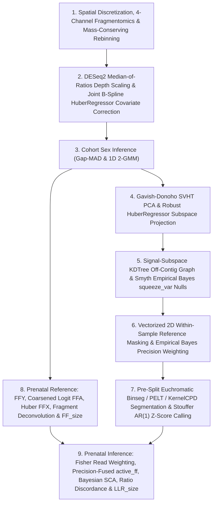

# Mathematical & Machine Learning Methodology

This document specifies the mathematical formulations, statistical models, machine learning algorithms, numerical solvers, statistical assumptions, and constant provenance implemented across `ccnv`.

## Provenance Taxonomy

Every constant, threshold, and model hyperparameter in `ccnv` is classified into one of four provenance tiers:

- **Tier 1 (Statistical & Mathematical Theory)**: Derived analytically from probability distributions, asymptotic statistical efficiency, or numerical analysis (e.g., Gaussian quantile functions, Bessel's correction, Huber M-estimation efficiency, Bates-Granger forecast combination).
- **Tier 2 (Published Literature & Reference Methodology)**: Adopted from peer-reviewed bioinformatics algorithms, primarily within-sample reference normalization (Straver et al., 2014; Raman et al., 2019a), DESeq2 median-of-ratios (Anders & Huber, 2010; Love et al., 2014), SeqFF (Kim et al., 2015), PREFACE (Raman et al., 2019b), limma Empirical Bayes (Smyth, 2004), Gavish-Donoho SVHT (Gavish & Donoho, 2014), Stouffer precision pooling (Stouffer et al., 1949; Whitlock, 2005), and PELT/Binseg change-point detection (Killick et al., 2012).
- **Tier 3 (Genomic Biology & Assembly Coordinates)**: Grounded in human cytogenetics, chromosome structure, or reference genome coordinates (e.g., pseudoautosomal boundaries, heterochromatic satellite blocks, centromeric gaps, and fetal-maternal cell-free DNA stoichiometry).
- **Tier 4 (Empirical Engineering & Numerical Guardrails)**: Tuned for floating-point stability, solver convergence, memory bounding, or outlier clamping in shallow whole-genome sequencing ($0.1\times\text{–}1.0\times$ coverage).

---

## 1. Alignment Filtering, Coordinate Geometry, and Mass-Conserving Rebinning

### 1.1 Mathematical Formulation

For a contig of length $L \in \mathbb{Z}_{\gt 0}$ and target bin size $B \in \mathbb{Z}_{\gt 0}$ (`src/ccnv/features/binning.py:bin_intervals`), the contig is partitioned into $N = \lceil L / B \rceil = \lfloor (L + B - 1) / B \rfloor$ contiguous 0-based half-open intervals $[s_i, e_i)$ for $i \in \lbrace 0, \dots, N - 1 \rbrace$:

$$
s_i = i \cdot B, \quad e_i = \min((i + 1) B, L)
$$

Alignment extraction (`src/ccnv/io/alignments.py:stream_contig_fragments`, `src/ccnv/features/binning.py:bin_contig_fragments`) streams records once per target contig and distinguishes paired-end from single-end templates:

- **Properly paired templates (`TLEN > 0`)**: Deduplicated to the upstream mate (`read.template_length > 0`) and assigned to the nucleosome dyad midpoint coordinate $p = \min(L - 1, \text{start} + \lfloor \text{TLEN} / 2 \rfloor)$ with bin index $i = \lfloor p / B \rfloor$. Four per-bin channels are accumulated in $O(R)$ time: fragment count (`count`), clamped insert lengths $L_{\text{frag}} \in [30, 600]\text{ bp}$ (`fragment_lengths`, `list<uint16>`), cleavage endpoint hits (`endpoint_count` at $\text{start}$ and $\min(L - 1, \text{start} + \text{TLEN} - 1)$), and fragment GC fraction sum (`frag_gc_sum`), alongside sample-level $5'$ 4-mer end motifs and 1-bp length histograms (`ccnv.fragmentomics`).
- **Single-end alignments**: Assigned by leftmost 0-based reference coordinate $p = \text{start} \in [0, L)$ (`src/ccnv/features/binning.py:bin_counts`), recording `count`, `endpoint_count`, `frag_gc_sum`, and $5'$ 4-mer motifs while leaving `fragment_lengths` empty (`paired_end = False`).

When reconciling a source partitioning $\lbrace [s_i^{\text{src}}, e_i^{\text{src}}) \rbrace_{i=0}^{N-1}$ with counts $\mathbf{c}^{\text{src}} \in \mathbb{R}_{\ge 0}^N$ against a target partitioning $\lbrace [s_j^{\text{tgt}}, e_j^{\text{tgt}}) \rbrace_{j=0}^{M-1}$ over the same contig length $L = e_{N-1}^{\text{src}} = e_{M-1}^{\text{tgt}}$, proportional interval overlap redistribution defines target counts as:

$$
c_j^{\text{tgt}} = \sum_{i=0}^{N-1} w_{ij} c_i^{\text{src}}, \quad w_{ij} = \frac{\max\left(0, \min(e_i^{\text{src}}, e_j^{\text{tgt}}) - \max(s_i^{\text{src}}, s_j^{\text{tgt}})\right)}{e_i^{\text{src}} - s_i^{\text{src}}}
$$

`ccnv` implements a dual-path rebinning architecture in `src/ccnv/features/cohort.py:rebin_sample_table`:

1. **Exact Contained-Interval Coarsening Fast Path (e.g., $5\text{ kb} \to 100\text{ kb}$)**: When $w_{\text{target}} \gt w_{\text{source}}$, $w_{\text{target}} \equiv 0 \pmod{w_{\text{source}}}$, and every source interval lies inside a single target interval ($\lfloor s_i^{\text{src}} / B_{\text{tgt}} \rfloor = \lfloor (e_i^{\text{src}} - 1) / B_{\text{tgt}} \rfloor$), rebinning executes via a Rust-parallelized Polars `group_by(["contig", (pl.col("start") // target_bin_size) * target_bin_size], maintain_order=True)` expression that aggregates all four channels (`count`, concatenated non-null `fragment_lengths`, summed `endpoint_count`, and summed `frag_gc_sum`).
2. **General Non-Nested Interval Rebinning**: For non-nested bin grids over contiguous source partitions, `src/ccnv/features/binning.py:rebin_counts` evaluates count redistribution in $O(N + M)$ time by constructing the piecewise-linear cumulative count function $F^{\text{src}}(x) = \sum_{j: e_j \le x} c_j + c_k \frac{x - s_k}{e_k - s_k}$ at knots $\mathbf{x}^{\text{src}} = (s_0^{\text{src}}, e_0^{\text{src}}, \dots, e_{N-1}^{\text{src}})$, interpolating $F^{\text{src}}$ at target knots $\mathbf{x}^{\text{tgt}}$ via `np.interp`, and taking non-negative first differences $c_j^{\text{tgt}} = \max(0, F^{\text{src}}(e_j^{\text{tgt}}) - F^{\text{src}}(s_j^{\text{tgt}}))$ (falling back to two-pointer interval overlap scanning `_redistribute_by_overlap` if source bins contain gaps). Because individual fragment coordinates cannot be recovered across split source intervals, non-nested rebinning resets `fragment_lengths` to empty lists, zeroes `endpoint_count` and `frag_gc_sum`, strips `ccnv.fragmentomics` schema metadata, and emits a warning when fragmentomic data was present.

In-memory rebinned sample tables store `count` as `float64` to preserve fractional mass conservation ($\sum_m c_m^{\text{tgt}} = \sum_j c_j^{\text{src}}$), whereas canonical extracted `.ccnv` Parquet files persist raw `count` as `uint64` (`SAMPLE_SCHEMA`).

### 1.2 Statistical Assumptions & Failure Modes

- **Piecewise-Uniform Intra-Bin Density**: Linear interpolation of $F^{\text{src}}(x)$ assumes reads are distributed uniformly within each source bin $[s_i^{\text{src}}, e_i^{\text{src}})$. This holds without approximation when coarsening nested integer multiples ($5\text{ kb} \to 100\text{ kb}$) and introduces smoothing only across non-nested grids.
- **Spatial Point Process**: Representing paired-end fragments by their dyad midpoint (and single-end reads by their $5'$ start) models templates as a spatial point process, preventing mate double-counting across bin boundaries.
- **Identical Reference Assembly**: Rebinning requires matching contig lengths ($e_{N-1}^{\text{src}} = e_{M-1}^{\text{tgt}} = L$); mismatched reference builds raise a `ValueError` or `ReferenceError`.

### 1.3 Model & Function Selection Rationale

- **Cumulative Knot Interpolation vs. Dense Overlap Matrix**: At $5\text{ kb}$ resolution on human `chr1` ($N \approx 50{,}000$ bins), a dense matrix $\mathbf{W}$ requires $2.5 \times 10^9$ floats ($\approx 20\text{ GB}$ RAM). Cumulative knot interpolation (`np.cumsum` + `np.interp` + `np.diff`) computes identical values in $\lt 1\text{ MB}$ and $O(N + M)$ operations while conserving total read mass.
- **Float64 In-Memory Conservation**: Preserving continuous `float64` counts during in-memory rebinning avoids systematic integer truncation drift before normalization.

### 1.4 Constants & Hyperparameters

- `DEFAULT_BIN_SIZE = 5000` (`src/ccnv/models/config.py`): Default $5\text{ kb}$ bin width (**Tier 2** / **Tier 4**). Balances Poisson counting noise at $0.1\times\text{–}0.5\times$ sWGS coverage ($\sim 150\text{–}750$ reads/bin) against spatial breakpoint resolution; coarsened in memory to $100\text{ kb}$ (`prenatal_bin_size = 100000`) for prenatal autosomal and `chrX` models.
- `min_mapping_quality = 1`, `require_proper_pair = True` (`src/ccnv/models/config.py:ReadFilters`): Default minimum Phred-scaled MAPQ and paired-end proper-pair requirement (**Tier 2**). Excludes multi-mapping reads ($\text{MAPQ} = 0$) and discordant chimeric pairs.

---

## 2. Depth Normalization, Low-Coverage Masking, and Covariate Bias Correction

### 2.1 Mathematical Formulation

#### 2.1.1 DESeq2 Median-of-Ratios Compositional Depth Scaling

Given a raw counts matrix $\mathbf{C} \in \mathbb{R}_{\ge 0}^{B \times S}$ across $B$ bins and $S$ cohort samples (`src/ccnv/features/cohort.py:estimate_size_factors`, `src/ccnv/features/cohort.py:normalize_depth`), naive total-sum division projects sample depths onto the simplex $\Delta^{B-1}$, giving it a 0% breakdown point: any whole-chromosome aneuploidy or focal amplification shifts the total sum denominator and distorts diploid bins (Aitchison, 1982; Robinson & Oshlack, 2010).

`ccnv` implements DESeq2 Median-of-Ratios normalization (Anders & Huber, 2010; Love et al., 2014) in log space with a 50% outlier breakdown point. For usable bins $\mathcal{U} \subseteq \lbrace 0, \dots, B-1 \rbrace$ and bins strictly positive across all samples $\mathcal{I}_{+} = \lbrace i \in \mathcal{U} : \min_{s} C_{i, s} \gt 0 \rbrace$:

1. When $\vert \mathcal{I}_{+} \vert \ge 1$ and $S \ge 2$, compute log-space deviations from the per-bin geometric mean and take the sample-wise median:

$$
\ln g_i = \frac{1}{S}\sum_{s=1}^S \ln C_{i, s} \quad \forall i \in \mathcal{I}_{+}, \qquad \hat{s}_s = \exp\left(\mathrm{median}_{i \in \mathcal{I}_{+}}\left(\ln C_{i, s} - \ln g_i\right)\right)
$$

2. Center raw factors to unit geometric mean and rescale counts so the median sample library size over $\mathcal{U}$ is preserved:

$$
s_s = \frac{\hat{s}_s}{\exp\left(\frac{1}{S}\sum_{j=1}^S \ln \hat{s}_j\right)}, \qquad \tilde{c}_{i, s} = \frac{C_{i, s}}{s_s} \cdot \frac{\mathrm{median}_{j}\left(\sum_{b \in \mathcal{U}} C_{b, j}\right)}{\mathrm{median}_{j}\left(\sum_{b \in \mathcal{U}} C_{b, j} / s_j\right)}
$$

When $\vert \mathcal{I}_{+} \vert = 0$, `estimate_size_factors` falls back to per-sample positive-bin medians (or total sums over $\mathcal{U}$ if all bins are zero). During single-sample prediction (`src/ccnv/predict.py:project_coverage`), test sample counts are scaled directly against the reference branch's stored `pca_mean` vector $\boldsymbol{\mu}$ via $\mathrm{median}_{i: c_i \gt 0 \land \mu_i \gt 0}(c_i / \mu_i)$ when at least 2 positive ratios exist, falling back to $\sum_{i \in \mathcal{U}} c_i / \sum_{i \in \mathcal{U}} \mu_i$.

Cohort-level low-coverage masking (`src/ccnv/features/cohort.py:mask_low_coverage`) sums normalized coverage across samples $T_b = \sum_{s=1}^S \tilde{c}_{b, s}$ and retains bins exceeding $\alpha_{\text{cov}} = 0.05$ of the positive median bin sum:

$$
\text{usable}_{\text{cov}}(b) \iff T_b \gt 0.05 \cdot \mathrm{median}_{i : T_i \gt 0}(T_i)
$$

#### 2.1.2 Covariate Masking

When GC content $\mathbf{g} \in [0, 1]^B$, ambiguous base indicator $\mathbf{n}_{\text{mask}} \in \lbrace \text{true}, \text{false} \rbrace^B$, and mappability $\mathbf{m} \in [0, 1]^B$ tracks are provided (`src/ccnv/io/tracks.py`, `src/ccnv/features/covariates.py:mask_covariates`), a bin $b$ is masked if:

1. From FASTA GC extraction (`src/ccnv/io/tracks.py:load_gc_track`), the bin contains zero A/C/G/T/U bases or an ambiguous (`N`) base fraction exceeding $\tau_N = 0.5$:

$$
\frac{n_{\text{total}}(b) - \left(n_{\text{GC}}(b) + n_{\text{AT}}(b)\right)}{n_{\text{total}}(b)} \gt 0.5
$$

2. Its mappability score is non-finite or falls below $\tau_{\text{map}}$ (`min_mappability`, default $0.5$): $m_b \lt \tau_{\text{map}}$.
3. Its GC proportion is non-finite or outside $[0, 1]$ (percentage-scaled tracks in $(1, 100]$ with median $\gt 1.0$ are automatically divided by $100.0$ upon ingestion).

#### 2.1.3 Joint Natural B-Spline & Huber M-Estimation Covariate Bias Correction

`ccnv` models non-linear GC, mappability, and paired-end fragmentomic biases jointly (`src/ccnv/stats/regression.py:build_joint_covariate_basis`, `src/ccnv/stats/regression.py:fit_sample_trend`, `src/ccnv/features/covariates.py:correct_covariate_bias`). Over usable bins $\mathcal{U}$, active covariates with standard deviation $\gt 10^{-6}$ are assembled using quantile-placed B-splines (`SplineTransformer(knots="quantile", extrapolation="linear")`) and standardized interaction terms:

$$
\mathbf{X}_{\text{cov}} = \left[\mathbf{1}, \quad \mathcal{B}_{\text{GC}}^{(k=5, d=3)}(\mathbf{g}), \quad \mathcal{B}_{\text{map}}^{(k=4, d=2)}(\mathbf{m}), \quad z(\mathbf{g}) \odot z(\mathbf{m}), \quad \mathcal{B}_{\text{len}}^{(k=4, d=3)}(\bar{\mathbf{L}}), \quad z(\mathbf{g}) \odot z(\bar{\mathbf{L}}), \quad \mathcal{B}_{\text{ep}}^{(k=4, d=3)}(\mathbf{e})\right]
$$

where any unavailable or near-constant covariate block is omitted, $\bar{L}_i$ is per-bin mean fragment length (imputing zero-read bins with the sample median fragment length), $e_i = E_i / \max(C_i, 1.0)$ is the cleavage endpoint ratio (`src/ccnv/features/fragmentomics.py:extract_bin_fragmentomic_covariates`), and $z(\cdot)$ denotes population z-score standardization (`ddof=0`).

For each sample $s$, linear median-scaled depth $\tilde{y}_{i, s} = \tilde{c}_{i, s} / \mathrm{median}(\tilde{\mathbf{c}}_{\mathcal{V}_s, s})$ over finite positive usable bins $\mathcal{V}_s = \lbrace i \in \mathcal{U} : \tilde{c}_{i, s} \gt 0 \rbrace$ (requiring $\vert \mathcal{V}_s \vert \gt K$) is fitted via robust Huber M-estimation (`sklearn.linear_model.HuberRegressor(fit_intercept=False, epsilon=1.35, alpha=1e-4, max_iter=100)`), with ordinary least squares (`np.linalg.lstsq`) fallback when $\vert \mathcal{V}_s \vert \lt 4$ or L-BFGS-B raises `ValueError`:

$$
\min_{\boldsymbol{\beta}, \sigma \gt 0} \sum_{i \in \mathcal{V}_s} \left(\sigma \cdot L_{\epsilon}\left(\frac{\tilde{y}_{i, s} - \mathbf{x}_i^{\top} \boldsymbol{\beta}}{\sigma}\right) + \sigma\right) + \alpha \Vert\boldsymbol{\beta}\Vert_2^2, \qquad \epsilon = 1.35, \quad \alpha = 10^{-4}
$$

where $L_{\epsilon}(r) = \frac{1}{2}r^2$ if $\vert r \vert \le \epsilon$, and $\epsilon \vert r \vert - \frac{1}{2}\epsilon^2$ otherwise. Let $\mathbf{u} = \mathbf{X}_{\text{cov}} \hat{\boldsymbol{\beta}}$ and $u_{\text{med}} = \mathrm{median}_{i \in \mathcal{V}_s : u_i \gt 0}(u_i)$. The multiplicative trend $\hat{t}_i = \mathrm{clip}(u_i / u_{\text{med}}, 0.20, 5.0)$ is divided out while preserving total usable sample depth (`src/ccnv/stats/regression.py:apply_1d_correction`):

$$
y_i^{\text{corr}} = \frac{\tilde{c}_{i, s}}{\hat{t}_i} \cdot \frac{\sum_{j \in \mathcal{U}} \tilde{c}_{j, s}}{\sum_{j \in \mathcal{U}} (\tilde{c}_{j, s} / \hat{t}_j)}
$$

### 2.2 Statistical Assumptions & Failure Modes

- **50% Breakdown Bound**: DESeq2 median-of-ratios scaling and median relative depth assume at least 50% of unmasked bins are copy-neutral, keeping size factors invariant under whole-chromosome aneuploidies (Anders & Huber, 2010; Robinson & Oshlack, 2010).
- **Smoothness of Amplification & Fragmentation Curves**: PCR GC waves and nucleosome protection biases vary smoothly with sequence composition and fragment length (Benjamini & Speed, 2012). Quantile-knot B-splines with linear boundary extrapolation eliminate Runge oscillations at extreme GC tails (de Boor, 1978; Wood, 2017).
- **Joint Design Decomposition**: Fitting GC content, mappability, fragmentomic covariates, and cross-product interactions in one design matrix avoids Gauss-Seidel backfitting attenuation from sequential 1D passes (Hastie & Tibshirani, 1990).

### 2.3 Model & Function Selection Rationale

- **DESeq2 Median-of-Ratios vs. Total Read Count Division**: Total-sum division shifts diploid baselines whenever a sample carries a large trisomy or deletion. Median-of-ratios remains invariant to copy-number alterations spanning up to half the genome.
- **Quantile B-Splines vs. Global Vandermonde Polynomials**: Monomial powers ($z, z^2, z^3$) are ill-conditioned in the tails; quantile B-splines have compact local support and stable linear boundary extrapolation.
- **HuberRegressor vs. Bespoke IRLS**: `HuberRegressor` jointly optimizes location $\boldsymbol{\beta}$ and scale $\sigma$ via L-BFGS-B, achieving 95% Gaussian asymptotic efficiency at $\epsilon = 1.35$ (Huber, 1964; Owen, 2007) while bounding copy-number outliers.

### 2.4 Constants & Hyperparameters

- `_MAX_N_FRACTION = 0.5` (`src/ccnv/io/tracks.py`): Maximum ambiguous base fraction (**Tier 3** / **Tier 4**). Masks assembly gap bins where $\gt 50$% of bases are `N`.
- `DEFAULT_MIN_MAPPABILITY = 0.5` (`src/ccnv/models/config.py`): Default mappability threshold (**Tier 2** / **Tier 3**). Requires at least 50% uniquely mappable $k$-mers per bin.
- `_MASK_FRACTION = 0.05` (`src/ccnv/features/cohort.py`): Low-coverage bin cutoff at 5% of positive median cohort depth (**Tier 2** / **Tier 4**).
- `SplineTransformer` knots/degrees: GC `(n_knots=5, degree=3)`, mappability `(n_knots=4, degree=2)`, mean fragment length `(n_knots=4, degree=3)`, and endpoint ratio `(n_knots=4, degree=3)` (`src/ccnv/stats/regression.py`, **Tier 2**: Benjamini & Speed, 2012; Wood, 2017).
- `HuberRegressor` `epsilon = 1.35`, `alpha = 1e-4`, `max_iter = 100` (`src/ccnv/stats/regression.py`): Huber M-estimator constants (**Tier 1**: Huber, 1964).
- Multiplicative trend clamp `[0.20, 5.0]` (`src/ccnv/stats/regression.py`): Bounds covariate trend adjustments to at most $5\times$ (**Tier 4**).

---

## 3. Cohort Sex Inference: Gap-MAD Separation vs. 1D 2-GMM

`ccnv` provides two unsupervised sex classification algorithms depending on analysis mode, reflecting the distinct `chrY` read fraction distributions of constitutional germline WGS and maternal plasma cfDNA.

### 3.1 Mathematical Formulation

For each sample $s \in \lbrace 1, \dots, S \rbrace$, let $f_s = \left(\sum_{b \in \text{chrY}} C_{b, s}\right) / \max\left(\sum_b C_{b, s}, 1\right)$ denote the fraction of reads mapping to the sex-signal contig (`chrY` / `Y`).

#### Germline Mode: Order-Statistic Gap-MAD Classifier (`src/ccnv/features/cohort.py:infer_sample_sexes`)

Requires $S \ge 2 \cdot m_{\text{sex}}$ samples (`min_sex_group_size`, default $5$). Let $f_{(0)} \le f_{(1)} \le \dots \le f_{(S-1)}$ be the sorted fractions. The optimal partition index $s^{\ast} \in \lbrace m_{\text{sex}}, \dots, S - m_{\text{sex}} \rbrace$ maximizes the adjacent order-statistic gap:

$$
s^{\ast} = \underset{m_{\text{sex}} \le s \le S - m_{\text{sex}}}{\arg\max} \left(f_{(s)} - f_{(s-1)}\right), \quad \Delta_{\max} = f_{(s^{\ast})} - f_{(s^{\ast} - 1)}
$$

Let $\mathcal{L} = \lbrace f_{(0)}, \dots, f_{(s^{\ast} - 1)} \rbrace$ (putative females) and $\mathcal{H} = \lbrace f_{(s^{\ast})}, \dots, f_{(S-1)} \rbrace$ (putative males), with unscaled group MADs $\mathrm{MAD}(\mathcal{L})$ and $\mathrm{MAD}(\mathcal{H})$. Separation is accepted if and only if:

$$
\Delta_{\max} \gt 0 \quad \text{and} \quad \Delta_{\max} \ge \max\left(\Delta_{\min}, 4.0 \cdot \max(\mathrm{MAD}(\mathcal{L}), \mathrm{MAD}(\mathcal{H}), 10^{-12})\right)
$$

When accepted, the decision threshold is placed at the midpoint $\tau_{\text{sex}} = \frac{1}{2}\left(f_{(s^{\ast} - 1)} + f_{(s^{\ast})}\right)$, classifying samples with strict inequality $f_s \gt \tau_{\text{sex}}$ as male.

#### Prenatal Mode: 1D Two-Component Gaussian Mixture Model (`src/ccnv/stats/prenatal_math.py:infer_sex_gmm_1d`)

In maternal plasma cfDNA, `chrY` read fractions in male-bearing pregnancies scale continuously with fetal fraction ($\text{FF} \in [0.02, 0.30]$). When sample spread is non-degenerate ($P_{75}(\mathbf{f}) - P_{25}(\mathbf{f}) \ge 10^{-8}$ and $\mathrm{Var}(\mathbf{f}) \ge 10^{-8}$; otherwise returning $P_{25}(\mathbf{f})$ directly), a 1D 2-component Gaussian Mixture Model (`sklearn.mixture.GaussianMixture(n_components=2, covariance_type="full")`) with unconstrained variances $\sigma_0^2, \sigma_1^2$ is fitted via Expectation-Maximization:

$$
p(f) = \pi_0 \mathcal{N}(f \mid \mu_0, \sigma_0^2) + \pi_1 \mathcal{N}(f \mid \mu_1, \sigma_1^2)
$$

initialized deterministically at $\mu_0^{(0)} = P_{25}(\mathbf{f})$ and $\mu_1^{(0)} = P_{75}(\mathbf{f})$ with equal prior weights $\pi_0^{(0)} = \pi_1^{(0)} = 0.5$. Let $k_{\text{M}} = \arg\max_{k \in \lbrace 0, 1 \rbrace} \mu_k$ and $k_{\text{F}} = 1 - k_{\text{M}}$. The Bayes decision boundary $\tau_Y \in [\mu_{k_{\text{F}}}, \mu_{k_{\text{M}}}]$ where male posterior probability equals $0.5$ is solved by Brent's method (`scipy.optimize.brentq`):

$$
P(Z = k_{\text{M}} \mid f = \tau_Y) - 0.5 = \frac{\pi_{k_{\text{M}}} \mathcal{N}(\tau_Y \mid \mu_{k_{\text{M}}}, \sigma_{k_{\text{M}}}^2)}{\sum_{k=0}^1 \pi_k \mathcal{N}(\tau_Y \mid \mu_k, \sigma_k^2)} - 0.5 = 0
$$

with fallback to $\tau_Y = \frac{1}{2}(\mu_{k_{\text{F}}} + \mu_{k_{\text{M}}})$ if the posterior difference does not change sign on $[\mu_{k_{\text{F}}}, \mu_{k_{\text{M}}}]$. Prenatal sex classification assigns male when $f_s \ge \tau_Y$.

### 3.2 Statistical Assumptions & Failure Modes

- **Germline Bimodality**: Assumes constitutional `XX` and `XY` samples form two separated modes with at least `min_sex_group_size` samples per sex and inter-group gap $\ge 4 \times \text{MAD}$. Single-sex germline cohorts reject sex partitioning (`passed = False`) and build only the `autosomal` branch unless `--sex-cutoff` or samplesheet labels are supplied.
- **Heteroscedastic Prenatal Mixture**: Female pregnancies (`XX`) exhibit near-zero `chrY` background misalignment ($\sigma_{\text{F}}^2 \ll \sigma_{\text{M}}^2$), whereas male pregnancies (`XY`) span wide fetal fractions ($\sigma_{\text{M}}^2 \gg \sigma_{\text{F}}^2$). Unconstrained component variances (`covariance_type="full"`) avoid placing the decision boundary inside low-FF male pregnancies.

### 3.3 Model & Function Selection Rationale

- **Deterministic Quartile Initialization ($P_{25}, P_{75}$) vs. k-means++**: Prevents randomized EM local optima on small cohorts and guarantees seed-invariant thresholds.
- **Brent's Method (`brentq`) vs. Analytical Quadratic Roots**: Queries `gmm.predict_proba` in log-sum-exp space over $[\mu_{\text{F}}, \mu_{\text{M}}]$, avoiding underflow and quadratic root ambiguity when $\sigma_{\text{F}}^2 \ne \sigma_{\text{M}}^2$.

### 3.4 Constants & Hyperparameters

- `min_cohort_size = 10`, `min_sex_group_size = 5` (`src/ccnv/models/config.py:ReferenceConfig`): Minimum cohort and per-sex sample counts (**Tier 2** / **Tier 4**).
- `_SEPARATION_MAD_MULTIPLIER = 4.0` (`src/ccnv/features/cohort.py`): Minimum inter-sex gap-to-MAD ratio (**Tier 1** / **Tier 4**; $\approx 5.4\sigma$ total normal separation).
- `percentiles = (25.0, 75.0)`, `weights_init = (0.5, 0.5)`, `tol = 1e-6`, `reg_covar = 1e-8`, `max_iter = 100` (`src/ccnv/stats/prenatal_math.py:infer_sex_gmm_1d`): Deterministic GMM initialization and covariance regularization (**Tier 1** / **Tier 4**).

---

## 4. Between-Sample Latent Bias Removal: Gavish-Donoho SVHT PCA & Robust Subspace Projection

### 4.1 Mathematical Formulation

#### 4.1.1 Gavish-Donoho Optimal Singular Value Hard Thresholding (SVHT)

Let $\mathbf{Y} \in \mathbb{R}^{U \times S}$ be the covariate-corrected, depth-normalized coverage matrix over $U$ unmasked bins and $S$ cohort samples, and let $\mathbf{X} = \mathbf{Y}^{\top} \in \mathbb{R}^{S \times U}$ be the samples-by-bins matrix (`src/ccnv/stats/pca.py:fit_pca`, `src/ccnv/stats/pca.py:optimal_svht_rank`). The cohort mean vector is:

$$
\boldsymbol{\mu} = \frac{1}{S} \sum_{s=1}^S \mathbf{X}_{s, :} \in \mathbb{R}^U
$$

Singular Value Decomposition decomposes the centered matrix $\tilde{\mathbf{X}} = \mathbf{X} - \mathbf{1}_S \boldsymbol{\mu}^{\top} = \mathbf{U} \boldsymbol{\Sigma} \mathbf{V}^{\top}$, yielding singular values $s_1 \ge s_2 \ge \dots \ge s_{\min(S, U)}$.

`ccnv` selects the optimal subspace rank $P$ via Gavish-Donoho Singular Value Hard Thresholding (Gavish & Donoho, 2014) for unknown noise variance:

$$
\beta = \frac{\min(S, U)}{\max(S, U)}, \qquad \omega(\beta) = 0.56\beta^3 - 0.95\beta^2 + 1.82\beta + 1.43, \qquad \tau_{\text{SVHT}} = \omega(\beta)\mathrm{median}_{k}(s_k)
$$

$$
P = \mathrm{clip}\left(\vert \lbrace k : s_k \gt \tau_{\text{SVHT}} \rbrace \vert, \quad 1, \quad \min(P_{\max}, S, U)\right)
$$

Sign ambiguity of singular vectors ($\mathbf{v}_p \leftrightarrow -\mathbf{v}_p$) is resolved deterministically via `sklearn.utils.extmath.svd_flip`. From the rank-$P$ reconstruction $\hat{\mathbf{X}} = (\tilde{\mathbf{X}} \mathbf{V}_P) \mathbf{V}_P^{\top} + \mathbf{1}_S \boldsymbol{\mu}^{\top}$, systemic bias is divided out element-wise to form $\mathbf{Y}^{\text{corr}} \in \mathbb{R}^{U \times S}$:

$$
Y_{b, s}^{\text{corr}} = \begin{cases} \dfrac{X_{s, b}}{\hat{X}_{s, b}} & \text{if } \text{finite}\left(\dfrac{X_{s, b}}{\hat{X}_{s, b}}\right) \\ 1.0 & \text{otherwise} \end{cases}
$$

#### 4.1.2 Single-Sample Robust PCA Projection via HuberRegressor

During single-sample prediction (`src/ccnv/predict.py:project_coverage`), test sample normalized coverage $\mathbf{y} \in \mathbb{R}^U$ is projected onto the reference PCA subspace over active finite positive bins $\mathcal{A} \subseteq \lbrace 0, \dots, U-1 \rbrace$.

Ordinary least squares (`lstsq`) projection minimizes $L_2$ error, allowing whole-chromosome trisomies or focal amplifications to tilt $\hat{\mathbf{c}}$ and leak ghost waves onto euploid chromosomes (Candès et al., 2011). When $\vert \mathcal{A} \vert \ge \max(P + 2, 4)$ and $\mathrm{std}(\mathbf{y}_{\mathcal{A}} - \boldsymbol{\mu}_{\mathcal{A}}) \gt 10^{-12}$, `ccnv` fits unpenalized Huber M-estimation (`HuberRegressor(fit_intercept=False, alpha=0.0, epsilon=1.35, max_iter=100)`), falling back to `np.linalg.lstsq` on small or near-zero-variance inputs:

$$
\hat{\mathbf{c}} = \underset{\mathbf{c} \in \mathbb{R}^P, \sigma \gt 0}{\arg\min} \sum_{i \in \mathcal{A}} \left(\sigma \cdot L_{1.35}\left(\frac{(y_i - \mu_i) - \mathbf{V}_{P, i}^{\top} \mathbf{c}}{\sigma}\right) + \sigma\right)
$$

reconstructing expected baseline $\hat{\mathbf{y}} = \mathbf{V}_P \hat{\mathbf{c}} + \boldsymbol{\mu}$ and dividing out the systemic component:

$$
y_b^{\text{corr}} = \frac{y_b}{\hat{y}_b} \quad \text{for } b \in \mathcal{A} \text{ with } \hat{y}_b \gt 0
$$

### 4.2 Statistical Assumptions & Failure Modes

- **Low-Rank Latent Structure**: Assumes technical batch effects (library prep kits, flowcell effects, fragmentation waves) occupy a low-dimensional subspace above the Marchenko-Pastur noise bulk (Marchenko & Pastur, 1967), whereas sample-specific CNVs are sparse or orthogonal.
- **Outlier Bounding**: Huber projection at $\epsilon = 1.35$ caps residual influence beyond $1.35\sigma$, keeping reconstructed diploid baselines unbiased in aneuploid samples.

### 4.3 Model & Function Selection Rationale

- **Gavish-Donoho SVHT vs. Fixed PCA Rank**: Adapts subspace rank $P$ automatically to cohort dimensions $(S, U)$ and singular value spectrum rather than hardcoding an arbitrary rank.
- **Huber M-Estimation vs. OLS Projection**: Downweights copy-number-altered bins during projection, preserving true CNV amplitude and preventing baseline depression on euploid contigs (Huber, 1981).

### 4.4 Constants & Hyperparameters

- SVHT cubic polynomial coefficients `(0.56, -0.95, 1.82, 1.43)` (`src/ccnv/stats/pca.py:optimal_svht_rank`): Asymptotically MSE-optimal hard threshold for unknown noise variance (**Tier 2**: Gavish & Donoho, 2014).
- `pca_components = 5` (`src/ccnv/models/config.py:ReferenceConfig`): Default maximum components $P_{\max}$ (**Tier 2** / **Tier 4**).
- `HuberRegressor` `epsilon = 1.35`, `alpha = 0.0`, `max_iter = 100` (`src/ccnv/predict.py:project_coverage`): Unpenalized 95%-efficient Huber subspace projection (**Tier 1**: Huber, 1964).

---

## 5. Within-Sample Reference Graph & Empirical Bayes Null Modeling

Following Straver et al. (2014) and Raman et al. (2019a), `ccnv` constructs a within-sample reference for each target bin by pairing it with $k$ off-contig bins sharing matched technical loadings and sequence properties across the control cohort.

### 5.1 Mathematical Formulation

#### 5.1.1 Low-Dimensional Signal-Subspace $\mathbb{R}^{P+C}$ `KDTree` Neighbor Search

In high dimensions ($S \approx 50\text{–}500$), pairwise Euclidean distances over raw residuals concentrate around their expectation ($\mathrm{Var}(D)/\mathbb{E}[D] \to 0$; Beyer et al., 1999). `ccnv` maps each usable bin $i \in \lbrace 0, \dots, U-1 \rbrace$ into a $(P + C)$-dimensional signal subspace (`src/ccnv/reference.py`, `src/ccnv/stats/neighbors.py:build_signal_space_features`, `src/ccnv/stats/neighbors.py:select_nearest_bins`), where $C \in \lbrace 0, \dots, 4 \rbrace$ is the number of active standardized covariates with $\mathrm{std} \gt 10^{-6}$ (`src/ccnv/features/covariates.py:covariate_features`):

$$
\mathbf{f}_i = \left[\sqrt{U} V_{1, i}, \dots, \sqrt{U} V_{P, i}, \quad z(\text{GC}_i), \quad z(\text{map}_i), \quad z(\bar{L}_i), \quad z(E_i / \max(C_i, 1.0))\right] \in \mathbb{R}^{P+C}
$$

Because orthonormal PCA loadings satisfy $\sum_{i=1}^U V_{p, i}^2 = 1$, scaling by $\sqrt{U}$ gives each loading column unit root-mean-square scale comparable to the unit-variance z-scored covariates $z(\cdot)$. When $P + C = 0$ (e.g., degenerate zero-loading flat models without covariates), `reference.py` falls back to the $S$-column `corrected` matrix.

For each contig $c$, a C-compiled $k$-d tree (`scipy.spatial.KDTree`) is built over all off-contig usable bins $\mathcal{C}_{\ne c} = \lbrace j : \text{contig}_j \ne c \rbrace$. Querying `tree.query(..., k=min(k, |C_{!=c}|), p=2, workers=threads)` finds the $k$ nearest off-contig neighbors $\mathcal{N}_i^{\text{raw}}$ in $O(U \log U)$ time and returns squared Euclidean distances $d^2(\mathbf{f}_i, \mathbf{f}_j)$ (Bentley, 1975; Maneewongvatana & Mount, 1999).

#### 5.1.2 PCA Degrees-of-Freedom Correction & Smyth Empirical Bayes Null Shrinkage

Before distance pruning (`src/ccnv/reference.py`, `src/ccnv/stats/neighbors.py:compute_null_models`), empirical null means and moderated standard deviations are evaluated over the unpruned $k$-neighbor graph $\mathcal{N}_i^{\text{raw}}$ across $S_{\text{null}} = \min(S, 100)$ control samples (for flat FASTA references, $P = 0$ and null variances vanish):

$$
R_{i, s} = \log_2\left(\frac{Y_{i, s}^{\text{corr}}}{\mathrm{nanmedian}_{j \in \mathcal{N}_i^{\text{raw}}}\left(Y_{j, s}^{\text{corr}}\right)}\right), \qquad \mu_{\text{null}, i} = \frac{1}{S_{\text{null}}} \sum_{s=1}^{S_{\text{null}}} R_{i, s}
$$

Accounting for $P$ removed principal components reduces residual degrees of freedom from $S_{\text{null}} - 1$ to $d = \max(1, S_{\text{null}} - 1 - P)$:

$$
s_{i, \text{DOF}}^2 = \frac{S_{\text{null}} - 1}{d} \cdot \mathrm{Var}_{s}(R_{i, s})
$$

When $U \ge 10$ and at least 2 bins satisfy $s_{i, \text{DOF}}^2 \gt 10^{-16}$, `src/ccnv/stats/neighbors.py:squeeze_var` shrinks noisy per-bin variances via Smyth's Empirical Bayes hierarchical model (`limma::squeezeVar`, Smyth, 2004). Under a scaled inverse-$\chi^2$ prior, bias-centered log-variances over valid bins ($s_{i, \text{DOF}}^2 \gt 10^{-16}$) satisfy:

$$
z_i = \ln(s_{i, \text{DOF}}^2) - \psi(d/2) + \ln(d/2)
$$

where $\psi$ is the digamma function and $\psi_1$ is the trigamma function. Using sample mean $\bar{z}$ and sample variance $\mathrm{Var}(z_i)$ (`ddof=1`), if excess variance $\nu = \mathrm{Var}(z_i) - \psi_1(d/2) \le 10^{-7}$, prior degrees of freedom default to $d_0 = 10^6$; otherwise $d_0 \in [10^{-8}, 10^8]$ is solved via `scipy.optimize.brentq`:

$$
\psi_1(d_0 / 2) - \left(\mathrm{Var}(z_i) - \psi_1(d / 2)\right) = 0, \qquad s_0^2 = \exp\left(\bar{z} + \psi(d_0/2) - \ln(d_0/2)\right)
$$

Posterior moderated variances shrink extreme estimates toward $s_0^2$ (values with $\tilde{\sigma}_{\text{null}, i} \le 10^{-8}$ are zeroed):

$$
\tilde{\sigma}_{\text{null}, i}^2 = \frac{d_0 s_0^2 + d \cdot s_{i, \text{DOF}}^2}{d_0 + d}
$$

#### 5.1.3 Iterative $3\sigma$ Squared-Distance Outlier Pruning

Across all finite non-negative squared neighbor distances $\mathcal{D} = \lbrace d^2(\mathbf{f}_i, \mathbf{f}_j) \rbrace$, a 3-pass clipping loop runs (`src/ccnv/stats/neighbors.py:distance_cutoff`):

$$
\mathcal{D}^{(r)} = \left\lbrace u \in \mathcal{D} : u \lt \tau_{\text{dist}}^{(r-1)} \right\rbrace, \quad \tau_{\text{dist}}^{(r)} = \mathrm{mean}\left(\mathcal{D}^{(r)}\right) + 3.0 \cdot \mathrm{std}\left(\mathcal{D}^{(r)}\right) \quad (r = 1, 2, 3)
$$

Neighbors with $d^2(\mathbf{f}_i, \mathbf{f}_j) \gt \tau_{\text{dist}}^{(3)}$ are pruned, persisting each bin's surviving global neighbor indices $\mathcal{N}_i$ and mean unsquared Euclidean distance $\bar{d}_i = \mathrm{mean}_{j \in \mathcal{N}_i}\left(\sqrt{d^2(\mathbf{f}_i, \mathbf{f}_j)}\right)$.

### 5.2 Statistical Assumptions & Failure Modes

- **Signal Subspace Sufficiency**: Assumes inter-run co-variation between bins is captured by $\mathbf{f}_i \in \mathbb{R}^{P+C}$.
- **Conjugate Inverse-$\chi^2$ Prior**: Assumes true bin variances follow a scaled inverse-$\chi^2$ prior $(d_0, s_0^2)$, borrowing statistical strength across all usable bins (Smyth, 2004).

### 5.3 Model & Function Selection Rationale

- **$\mathbb{R}^{P+C}$ `KDTree` vs. $S$-Dimensional Dense GEMM**: Querying `scipy.spatial.KDTree` in low-dimensional subspace reduces search complexity from $O(U^2 S)$ to $O(U \log U)$ while avoiding high-dimensional distance concentration (Beyer et al., 1999).
- **Smyth Empirical Bayes (`squeeze_var`) vs. Raw Sample Variance**: Stabilizes small-cohort variance estimates ($S = 10\text{–}30$) before computing inverse-variance segmentation weights.

### 5.4 Constants & Hyperparameters

- `nearest_bins = 300` (`src/ccnv/models/config.py:ReferenceConfig`): Default number of off-contig reference neighbors $k$ (**Tier 2**: Straver et al., 2014; Raman et al., 2019a).
- `_MAX_NULL_SAMPLES = 100` (`src/ccnv/stats/neighbors.py`): Maximum cohort samples evaluated for empirical null estimation (**Tier 4**).
- `squeeze_var` bracket `[1e-8, 1e8]` and low-dispersion prior cap `d0 = 1e6` (`src/ccnv/stats/neighbors.py`): Numerical root-finding bounds (**Tier 4**).
- Distance clipping `repeats = 3`, multiplier `3.0` (`src/ccnv/stats/neighbors.py:distance_cutoff`): 3-pass iterative $\mu + 3\sigma$ squared-distance pruning (**Tier 2**).

---

## 6. Iterative Within-Sample Normalization & Empirical Bayes Precision Weighting

During single-sample prediction (`src/ccnv/predict.py:normalize_branch`), bins inside a test sample's own CNVs must be masked from serving as reference neighbors for other contigs.

### 6.1 Mathematical Formulation

Let $\mathbf{y}^{\text{corr}} \in \mathbb{R}^U$ be the test sample's PCA-projected coverage. `ccnv` evaluates within-sample normalization over a padded 2D neighbor index matrix $\mathbf{N} \in \mathbb{Z}^{U \times K_{\max}}$ using `np.nanmedian` for $M$ iterations (`mask_repeats`, default $3$), initialized with $\mathcal{E}^{(0)} = \lbrace i : \text{finite}(y_i^{\text{corr}}) \land y_i^{\text{corr}} \gt 0 \rbrace$.

In each iteration $t \in \lbrace 1, \dots, M \rbrace$:

1. For $t \gt 1$, update eligible bins $\mathcal{E}^{(t-1)} = \lbrace i \in \mathcal{E}^{(0)} : \text{finite}(Z_i^{(t-1)}) \land \vert Z_i^{(t-1)} \vert \lt \tau_{\text{mask}} \rbrace$, where $\tau_{\text{mask}} = \Phi^{-1}(0.99) = 2.326347874$.
2. Compute within-sample baselines and log2 ratios for bins with at least $m_{\text{ref}}$ (`min_reference_bins`, default $3$) surviving neighbors $\mathcal{N}_i^{(t)} = \mathcal{N}_i \cap \mathcal{E}^{(t-1)}$:

$$
b_i^{(t)} = \mathrm{nanmedian}_{j \in \mathcal{N}_i^{(t)}}\left(y_j^{\text{corr}}\right), \quad r_i^{(t)} = \log_2\left(\frac{y_i^{\text{corr}}}{b_i^{(t)}}\right)
$$

3. Evaluate per-bin Z-scores using $\tilde{\sigma}_{\text{null}, i}$ when $\tilde{\sigma}_{\text{null}, i} \gt 10^{-8}$, falling back to empirical MAD scale $\hat{\sigma}_{\text{MAD}} = 1.4826 \cdot \mathrm{MAD}(r^{(t)} - \mathrm{nanmedian}(r^{(t)}))$ on flat FASTA references:

$$
Z_i^{(t)} = \begin{cases} \dfrac{r_i^{(t)} - \mu_{\text{null}, i}}{\tilde{\sigma}_{\text{null}, i}} & \text{if } \tilde{\sigma}_{\text{null}, i} \gt 10^{-8} \\ \dfrac{r_i^{(t)} - \mathrm{nanmedian}(r^{(t)})}{\hat{\sigma}_{\text{MAD}}} & \text{if } \tilde{\sigma}_{\text{null}, i} \le 10^{-8} \text{ and } \hat{\sigma}_{\text{MAD}} \gt 10^{-8} \end{cases}
$$

After $M$ iterations, global median centering removes residual baseline drift on both ratios and Z-scores: $\tilde{r}_i = r_i^{(M)} - \mathrm{nanmedian}(r^{(M)})$ and $\tilde{Z}_i = Z_i^{(M)} - \mathrm{nanmedian}(Z^{(M)})$.

#### Empirical Bayes Inverse-Variance Precision Weights

Let $\hat{s}_0^2 = \mathrm{median}_{j: \tilde{\sigma}_{\text{null}, j} \gt 0}(\tilde{\sigma}_{\text{null}, j}^2)$ be the median positive moderated null variance across the branch. Each bin with finite $\tilde{r}_i$ and $\vert \mathcal{N}_i^{(M)} \vert \ge m_{\text{ref}}$ receives precision weight:

$$
w_i = \begin{cases} \mathrm{clip}\left(\dfrac{\hat{s}_0^2}{\tilde{\sigma}_{\text{null}, i}^2}, \quad 0.05, \quad 20.0\right) & \text{if } \tilde{\sigma}_{\text{null}, i} \gt 0 \text{ and } \hat{s}_0^2 \gt 0 \\ \dfrac{1}{\bar{d}_i} & \text{if } \tilde{\sigma}_{\text{null}, i} = 0 \text{ and } \bar{d}_i \gt 0 \text{ (flat FASTA with covariates)} \\ 1.0 & \text{if } \tilde{\sigma}_{\text{null}, i} = 0 \text{ and } \bar{d}_i = 0 \text{ (uniform flat FASTA)} \\ 0.0 & \text{otherwise} \end{cases}
$$

Under weighted least squares, setting $w_i \propto \tilde{\sigma}_{\text{null}, i}^{-2}$ makes the weighted sum-of-squares cost proportional to the Gaussian negative log-likelihood (Aitken, 1935; Killick et al., 2012).

### 6.2 Statistical Assumptions & Failure Modes

- **Gauss-Markov Optimality**: Inverse-variance weights make the weighted segment mean $\bar{r}_w = (\sum w_i \tilde{r}_i) / (\sum w_i)$ the Best Linear Unbiased Estimator (BLUE) under heteroscedastic bin noise (Aitken, 1935).
- **Bounded Dynamic Range**: Clamping weights to $[0.05, 20.0]$ prevents extreme single-bin variances from dominating change-point detection.

### 6.3 Constants & Hyperparameters

- `_MASK_Z_THRESHOLD = 2.326347874` (`src/ccnv/predict.py`): $\Phi^{-1}(0.99)$ (**Tier 1** / **Tier 2**: Straver et al., 2014). Masks the outer 2% normal tails during iterative neighbor refinement.
- Weight clip bounds `[0.05, 20.0]` (`src/ccnv/predict.py:normalize_branch`): Inverse-variance weight clamp (**Tier 4**).
- `mask_repeats = 3`, `min_reference_bins = 3` (`src/ccnv/models/config.py:PredictConfig`): Iterative masking passes and minimum surviving neighbors (**Tier 2** / **Tier 4**).

---

## 7. Pre-Split Euchromatic Change-Point Segmentation and Event Calling

### 7.1 Mathematical Formulation

#### 7.1.1 Pre-Split Euchromatic Arm Block Partitioning

`src/ccnv/stats/segmentation.py:segment_contig` partitions each contig into contiguous euchromatic blocks separated by masked/unusable gaps exceeding $\Delta_{\max} = 2{,}000{,}000\text{ bp}$ (centromeres, acrocentric p-arms, heterochromatic stalks) before change-point optimization, preventing p-arm and q-arm baselines from coupling across centromeres (Olshen et al., 2004; Nilsen et al., 2012).

#### 7.1.2 Change-Point Optimization and Solver Dispatch

Within each euchromatic block over usable bins ($w_i \gt 0$, finite $y_i$), `WeightedL2Cost` precomputes prefix sums of $w_i$, $w_i y_i$, and $w_i y_i^2$ for $O(1)$ interval cost queries:

$$
\mathrm{cost}(s, e) = \sum_{i=s}^{e-1} w_i \left(y_i - \bar{y}_{s:e}\right)^2, \quad \bar{y}_{s:e} = \frac{\sum_{i=s}^{e-1} w_i y_i}{\sum_{i=s}^{e-1} w_i}
$$

`segment_contig` dispatches to `ruptures` solvers (`min_size = 2`, `jump = 1`):

- **`algorithm == "binseg"`** (the default invoked by `src/ccnv/predict.py:segment_and_call`): Dispatches to `ruptures.Binseg(custom_cost=WeightedL2Cost(), min_size=2, jump=1)` with penalty $\beta$.
- **`algorithm == "pelt"` with all bins usable and uniform weights** ($\max \mathbf{w} - \min \mathbf{w} \le 10^{-9}$): Dispatches to C-compiled `ruptures.KernelCPD(kernel="linear", min_size=2, jump=1)` with rescaled penalty $\beta / w_0$ (Killick et al., 2012; Truong et al., 2020).
- **`algorithm == "pelt"` with variable weights or masked interior bins**: Dispatches to exact `ruptures.Pelt(custom_cost=WeightedL2Cost(), min_size=2, jump=1)`.

#### 7.1.3 Autocorrelation-Corrected Stouffer Precision Z-Score Calling

Segments are scored via Stouffer precision-weighted Z-score combination (Stouffer et al., 1949; Lipták, 1958; Whitlock, 2005) with AR(1) spatial autocorrelation adjustment (Newey & West, 1987; Diskin et al., 2008) in `src/ccnv/stats/segmentation.py:compute_contig_rho1` and `evaluate_stouffer_segment_scores` (invoked via Polars segment grouping in `src/ccnv/predict.py:segment_and_call`):

1. Estimate per-contig lag-1 Pearson autocorrelation in NumPy (`np.corrcoef`) over usable diploid-clipped bins $\mathcal{U}_c^{\text{dip}} = \lbrace i \in \mathcal{U}_c : \text{finite}(\tilde{Z}_i) \land \vert \tilde{Z}_i \vert \le 2.5 \rbrace$ (requiring $\vert \mathcal{U}_c^{\text{dip}} \vert \ge 3$, else $0.0$):

$$
\hat{\rho}_{1, c} = \mathrm{clip}\left(\mathrm{Corr}_{i \in \mathcal{U}_c^{\text{dip}}}(\tilde{Z}_i, \tilde{Z}_{i-1}), \quad 0.0, \quad 0.95\right)
$$

2. For each segment $S_m$ containing $N_m = \vert S_m \cap \mathcal{U} \vert \ge 1$ usable bins, evaluate the autocorrelation-adjusted Stouffer Z-score:

$$
Z_{\text{seg}}(S_m) = \frac{\sum_{i \in S_m \cap \mathcal{U}} w_i \tilde{Z}_i}{\sqrt{\left(\sum_{i \in S_m \cap \mathcal{U}} w_i^2\right)\left(1 + \frac{2(N_m - 1)}{N_m}\hat{\rho}_{1, c}\right)}}
$$

### 7.2 Event Calling

In `src/ccnv/predict.py:_call_segment`, segments with $N_m = 0$ usable bins return `None`. When `--ratio-threshold` ($\tau_r$) is provided, it overrides `--z-threshold` ($\tau_Z$) as the calling criterion; otherwise calling tests $Z_{\text{seg}}$ against $\tau_Z$:

$$
\mathrm{call} = \begin{cases} \texttt{gain} & \text{if } (\tau_r \text{ is set and } \bar{r}_{\text{seg}} \gt \tau_r) \text{ or } (\tau_r \text{ is unset and } Z_{\text{seg}} \gt \tau_Z) \\ \texttt{loss} & \text{if } (\tau_r \text{ is set and } \bar{r}_{\text{seg}} \lt -\tau_r) \text{ or } (\tau_r \text{ is unset and } Z_{\text{seg}} \lt -\tau_Z) \\ \texttt{None} & \text{otherwise} \end{cases}
$$

### 7.3 Constants & Hyperparameters

- `penalty = 1.0` (`src/ccnv/models/config.py:PredictConfig`): Breakpoint penalty $\beta$ (**Tier 2** / **Tier 4**).
- `DEFAULT_MAX_BLACKLIST_GAP = 2_000_000` bp (`src/ccnv/stats/segmentation.py`): Euchromatic block pre-split threshold (**Tier 3**).
- `z_threshold = 3.0` (`src/ccnv/models/config.py:PredictConfig`): Default Stouffer segment Z-score threshold (**Tier 1** / **Tier 2**).
- Diploid clip $\vert \tilde{Z}_i \vert \le 2.5$ and AR(1) clamp `[0.0, 0.95]` (`src/ccnv/stats/segmentation.py:compute_contig_rho1`): Prevents true CNVs from inflating background wave autocorrelation and bounds variance adjustments (**Tier 2** / **Tier 4**: Diskin et al., 2008; Newey & West, 1987).

---

## 8. Prenatal Multi-Resolution Fetal Fraction & Fragmentomics Calibration (`FFY`, `FFA`, `FFX`, `FF_size`)

In `--mode prenatal`, `ccnv reference` calibrates four complementary fetal fraction estimators alongside deconvolved fetal and maternal fragment length distributions.

### 8.1 1D 2-GMM Fetal Sex Inference & Mappable Autosomal Density

Mappable autosomal read density excludes common aneuploidy chromosomes 13, 18, and 21 (`_EXCLUDED_PRENATAL_AUTOSOMES = {13, 18, 21}`):

$$
\rho_{\text{auto}} = \mathrm{mean}_{b \in \mathcal{A}_{\text{pre}}, c_b \gt 0}\left(\frac{c_b}{w_b}\right)
$$

Prenatal fetal sex inference fits the 1D 2-GMM (`infer_sex_gmm_1d`) on `chrY` read fractions to establish $\tau_Y$, honoring explicit samplesheet `sex` overrides when provided.

### 8.2 Non-Negative `ElasticNetCV` on 5 kb `chrY` Bins (`FFY`)

At $5\text{ kb}$ resolution, normalized `chrY` bin depths are $Y_{s, b}^{\text{norm}} = c_{s, b} / (\rho_{\text{auto}, s} w_b)$. Informative bins $\mathcal{I}_Y$ are restricted to unique euchromatic `chrY` coordinates $[2{,}781{,}479, 28{,}800{,}000)$ (excluding PAR1, PAR2, and `Yq12` heterochromatin; Skaletsky et al., 2003) where female median depth $\lt 0.15$ and male mean exceeds female median by $\gt 10^{-4}$ (Hudecova et al., 2014; Straver et al., 2016). When samplesheet `ff` labels are omitted, reference targets are initialized stoichiometrically from female-baseline-subtracted mean informative `chrY` depth: $y_{\text{FF}, s} = \max(0, (\bar{Y}_{s, \mathcal{I}_Y}^{\text{norm}} - b_F) / 0.5)$ for male fetuses and $0$ for female fetuses.

In the $p \gg n$ regime ($B_Y \approx 2{,}000$ bins vs. $S \approx 20\text{–}100$ samples), pure $L_1$ Lasso saturates at $\le \min(S, B_Y)$ variables (Rosset et al., 2004; Zou & Hastie, 2005). `ccnv` fits non-negative Elastic Net (`src/ccnv/stats/prenatal_math.py:fit_elasticnet_ffy`, `ElasticNetCV(positive=True, cv=min(5, max(2, S)))`) with non-negative bin weights $\mathbf{w} \ge \mathbf{0}$ and unconstrained intercept $b_Y$:

$$
\min_{\mathbf{w} \ge \mathbf{0}, b_Y \in \mathbb{R}} \frac{1}{2S}\left\Vert\mathbf{y}_{\text{FF}} - (\mathbf{X}_Y \mathbf{w} + b_Y \mathbf{1})\right\Vert_2^2 + \alpha \rho \Vert\mathbf{w}\Vert_1 + \frac{\alpha(1 - \rho)}{2}\Vert\mathbf{w}\Vert_2^2, \qquad \rho \in \lbrace 0.01, 0.05, 0.10 \rbrace
$$

followed by linear rescaling against male targets (`ffy_intercept`, `ffy_slope`) and empirical residual standard error `ffy_std`.

### 8.3 Convex Logit-Link `RidgeCV` + `ElasticNetCV` Ensemble for `FFA`

Autosomal counts (excluding chromosomes 13, 18, and 21) are coarsened in memory to $100\text{ kb}$ (`prenatal_bin_size = 100000`). Unscaled `sklearn.decomposition.PCA` over mean-imputed $\log_2$ bin ratios extracts $D = \min(50, \max(1, S - 1))$ component scores $\mathbf{Z}_{\text{PCA}}$.

`ccnv` fits a convex logit-space `SeqFF`/`PREFACE`-style 50/50 ensemble (`src/ccnv/stats/prenatal_math.py:fit_ffa_logit_ensemble`; Kim et al., 2015; Raman et al., 2019b; Golub et al., 1979) on samples with labeled fetal fractions:

$$
u_s = \mathrm{logit}\left(\mathrm{clip}(y_s, 0.005, 0.85)\right) = \ln\left(\frac{\tilde{y}_s}{1 - \tilde{y}_s}\right)
$$

$$
\mathbf{w}_{\text{ens}} = \frac{1}{2}\left(\hat{\mathbf{w}}_{\text{RidgeCV}} + \hat{\mathbf{w}}_{\text{ElasticNetCV}}\right), \quad b_{\text{ens}} = \frac{1}{2}\left(\hat{b}_{\text{RidgeCV}} + \hat{b}_{\text{ElasticNetCV}}\right), \quad \hat{f}_{\text{FFA}}(\mathbf{z}) = \mathrm{expit}\left(\mathbf{z}^{\top} \mathbf{w}_{\text{ens}} + b_{\text{ens}}\right)
$$

Out-of-sample standard error $\sigma_{\text{ffa}}$ (`ffa_std`) is estimated via nested `KFold(n_splits=min(5, S_labeled), shuffle=True, random_state=seed)` `cross_val_predict` RMSE floored at $0.005$ when $S_{\text{labeled}} \ge 6$ (in-sample RMSE floored at $0.005$ for $2 \le S_{\text{labeled}} \lt 6$, and $0.02$ when $S_{\text{labeled}} \lt 2$).

### 8.4 `FFX`: 100 kb `chrX` Robust Huber Regression

Coarsened $100\text{ kb}$ `chrX` ratios $R_X = 2^{\mathrm{nanmean}(\log_2(c_X / (\rho_{\text{auto}} w_X)))}$ decrease linearly with male fetal fraction ($\mathbb{E}[R_X] = 1 - 0.5 f$). `ccnv` calibrates $\hat{f}_{\text{FFX}} = \beta_0^{\text{FFX}} + \beta_1^{\text{FFX}} R_X$ via Huber M-estimation (`src/ccnv/stats/prenatal_math.py:rlm_huber`, $\epsilon = 1.345$), falling back to theoretical $(2.0, -2.0)$ when fewer than 2 male controls or degenerate variance occur.

### 8.5 Parabolic Mode Alignment & 36-Feature Logit-Link `FF_size` Ensemble

Paired-end sequencing captures cell-free DNA insert lengths $L \in [30, 600]\text{ bp}$ ($571$ 1-bp bins), $5'$ 4-mer motifs, and sub-nucleosomal cleavage periodicity (Lo et al., 2010; Straver et al., 2016).

1. **Parabolic Chromatosome Landmarking (`src/ccnv/stats/fragmentomics.py:estimate_sample_landmarks`, `align_histogram`)**: The autosomal histogram is smoothed with a 1D Gaussian filter ($\sigma = 2.0\text{ bp}$), the discrete peak in $[155, 180]\text{ bp}$ is refined via 3-point parabolic interpolation to locate the chromatosome mode $M_{\text{chrom}} \in [155.0, 180.0]\text{ bp}$, and the continuous platform sizing offset $\Delta_{\text{bp}} = M_{\text{chrom}} - 166.0 \in [-11.0, +14.0]\text{ bp}$ shifts histograms onto the canonical frame via sub-bin linear interpolation (`np.interp(x + shift_bp, x, h)`) with mass renormalization.
2. **36-Dimensional Feature Vector (`src/ccnv/stats/fragmentomics.py:build_fragmentomic_feature_vector`)**:
   - **28 log-density bands**: Mean mode-aligned density across twenty-eight $5\text{ bp}$ windows spanning $[80, 220)\text{ bp}$, expressed as $\ln(\max(\bar{p}_{\text{band}}, 10^{-8}) / \max(\bar{p}_{164..168}, 10^{-8}))$.
   - **Self-referenced core-to-chromatosome ratio (1 feature)**: $\sum_{L=135}^{150} h_{\text{raw}}(L) / \max\left(\sum_{L=160}^{175} h_{\text{raw}}(L), 1\right)$.
   - **Sub-nucleosomal peak ratios (4 features)**: Mode-aligned point densities at $L \in \lbrace 112, 122, 133, 143 \rbrace\text{ bp}$ divided by $\max(\bar{p}_{164..168}, 10^{-8})$.
   - **Helical $10.4\text{ bp}$ cleavage amplitude (1 feature)**: Discrete Fourier transform amplitude $\frac{2}{76}\left\vert\sum_{L=80}^{155} \tilde{h}(L) e^{-2\pi i L / 10.4}\right\vert$ on linearly detrended (`scipy.signal.detrend`) counts over $[80, 155]\text{ bp}$.
   - **End-motif features (2 features)**: Normalized Shannon Motif Diversity Score $\mathrm{MDS} = -\sum_{m=0}^{255} p_m \ln p_m / \ln 256 \in [0, 1]$, plus pooled nuclease-preferred $5'$ 4-mer frequency $p(\texttt{CCCA}) + p(\texttt{CCAG}) + p(\texttt{CCTG})$.
3. **Convex Logit-Link Ensemble (`src/ccnv/stats/fragmentomics.py:fit_ff_fragmentomics_ensemble`, `predict_ff_fragmentomics`)**: When all cohort samples are paired-end and at least 5 samples carry labeled `ff` values (`src/ccnv/features/fragmentomics.py:fit_cohort_fragmentomics_model`), features are standardized ($\mathbf{z} = (\mathbf{x} - \boldsymbol{\mu}_{\text{frag}}) / \boldsymbol{\sigma}_{\text{frag}}$) and fitted against logit-clipped targets $u_s = \mathrm{logit}(\mathrm{clip}(y_s, 0.005, 0.85))$ via a 50/50 average of `RidgeCV(alphas=logspace(-2, 4, 20))` and `ElasticNetCV(l1_ratio=[0.1, 0.5, 0.9], alphas=logspace(-3, 2, 20))`:

$$
\hat{f}_{\text{size}}(\mathbf{z}) = \mathrm{clip}\left(\mathrm{expit}\left(\mathbf{z}^{\top} \mathbf{w}_{\text{size}} + b_{\text{size}}\right), \quad 0.005, \quad 0.50\right)
$$

with residual standard error $\sigma_{\text{size}} = \max(\mathrm{std}(\mathbf{y} - \hat{\mathbf{y}}), 0.015)$ (retaining default `ff_size_std = 0.018` when fewer than 5 labeled samples are available).

### 8.6 Cohort Cell-Free DNA Fragment Length Deconvolution

Across paired-end prenatal cohorts, `src/ccnv/stats/fragmentomics.py:deconvolve_fetal_maternal_densities` estimates pure fetal $\hat{p}_F(L)$ and maternal $\hat{p}_M(L)$ densities over $L \in [30, 600]\text{ bp}$:

1. **Pure Fetal Density $\hat{p}_F(L)$**: When $\vert \mathcal{S}_M \vert \ge 5$ male pregnancies contribute at least $500$ total mode-aligned `chrY` fragments, pooled female `chrY` misalignment background is subtracted from pooled male `chrY` counts and smoothed with a Gaussian kernel ($\sigma = 1.5\text{ bp}$):

$$
h_F(L) = \max\left(0, \sum_{s \in \mathcal{S}_M} h_{s, \text{chrY}}^{\text{aligned}}(L) - \frac{\vert \mathcal{S}_M \vert}{\max(\vert \mathcal{S}_F \vert, 1)} \sum_{s \in \mathcal{S}_F} h_{s, \text{chrY}}^{\text{aligned}}(L)\right), \qquad \hat{p}_F(L) = \frac{(G_{1.5} \ast h_F)(L)}{\sum_{l=30}^{600} (G_{1.5} \ast h_F)(l)}
$$

falling back to a normalized parametric multi-Gaussian ($143, 133, 123\text{ bp}$) plus $10.4\text{ bp}$ cosine template when male `chrY` coverage is sparse.

2. **Pure Maternal Density $\hat{p}_M(L)$**: When $S \ge 5$ and fetal fraction range $\max(\mathbf{f}_Y) - \min(\mathbf{f}_Y) \gt 0.03$ ($\sum (f_{Y,s} - \bar{f}_Y)^2 \gt 10^{-6}$), per-length ordinary least squares across normalized autosomal histograms regresses $p_{s, \text{auto}}(L) \approx \beta_0(L) + \beta_1(L) f_{Y, s}$ to extract the zero-fetal-fraction intercept $p_M^{\text{raw}}(L) = \max(\hat{\beta}_0(L), 0)$ (otherwise taking the cohort median autosomal histogram, or a $166\text{ bp}$ Gaussian fallback), followed by Gaussian smoothing ($\sigma = 1.0\text{ bp}$) and unit-sum normalization.

### 8.7 Depth-Conserving Fisher-Optimal Read Weighting

To boost fetal CNV signal-to-noise during `ccnv predict --mode prenatal` without altering expected baseline depth (`src/ccnv/stats/fragmentomics.py:fisher_optimal_weights`), reference mixture density at nominal fetal fraction $f_0 = 0.10$ is formed as $p_{\text{mix}}(L) = f_0 \hat{p}_F(L) + (1 - f_0) \hat{p}_M(L)$, with raw score ratio $r(L) = \hat{p}_F(L) / \max(p_{\text{mix}}(L), 10^{-12})$. Scaling factor $\alpha^{\ast} \in [0.05, 20.0]$ is solved via 25-step bisection so clipped weights satisfy unit expectation under $p_{\text{mix}}$:

$$
w^{\ast}(L) = \mathrm{clip}\left(\alpha^{\ast} \frac{\hat{p}_F(L)}{\max(p_{\text{mix}}(L), 10^{-12})}, \quad 0.25, \quad 3.0\right), \qquad \sum_{L=30}^{600} p_{\text{mix}}(L) w^{\ast}(L) = 1.0
$$

`src/ccnv/features/fragmentomics.py:evaluate_weighted_coverage` maps sample `uint16` fragment lengths through a shift-interpolated $65{,}536$-entry `float32` lookup table via `np.cumsum` slice differences, and `align_reference_to_weighted_sample` scales reference `pca_mean` and `null_mean` by $c_i^{(w)} / \max(c_i^{(u)}, 10^{-6})$ so PCA projection and within-sample normalization share consistent weighted baselines.

### 8.8 Constants & Hyperparameters

- `_PAR1_START = 2_781_479`, `_YQ12_END = 28_800_000` (`src/ccnv/features/prenatal.py`): Unique euchromatic GRCh38 `chrY` bounds (**Tier 3**).
- `_EXCLUDED_PRENATAL_AUTOSOMES = {13, 18, 21}` (`src/ccnv/features/prenatal.py`): Common trisomy exclusions (**Tier 2** / **Tier 3**).
- `ElasticNetCV` `l1_ratio = [0.01, 0.05, 0.1]` for `FFY` (`src/ccnv/stats/prenatal_math.py`, **Tier 2**: Zou & Hastie, 2005; Kim et al., 2015).
- `FFA` & `FF_size` logit clip bounds `[0.005, 0.85]` and `RidgeCV` alpha grid $10^{-2} \dots 10^4$ (`src/ccnv/stats/prenatal_math.py`, `fragmentomics.py`, **Tier 2** / **Tier 4**: Kim et al., 2015; Golub et al., 1979).
- `FRAG_MIN_LEN = 30`, `FRAG_MAX_LEN = 600`, `CANONICAL_CHROMATOSOME_BP = 166.0` (`src/ccnv/stats/fragmentomics.py`): Cell-free DNA insert size domain and canonical chromatosome landmark (**Tier 2** / **Tier 3**: Lo et al., 2010; Straver et al., 2016).
- Fisher weight nominal `target_ff = 0.10` and `clip_bounds = (0.25, 3.0)` (`src/ccnv/stats/fragmentomics.py`): Bounded score weights conserving diploid mixture depth (**Tier 1** / **Tier 4**).

---

## 9. Prenatal Single-Sample Inference: 2D Bayesian SCA, Precision Fusion, Ratio Discordance & Origin Calling

### 9.1 Mathematical Formulation

#### 9.1.1 2D Stoichiometric Gaussian Bayes SCA Classifier

In `src/ccnv/features/prenatal.py:classify_sca`, sex chromosome aneuploidy classification evaluates $\mathbf{x} = (\Delta_X, f_Y)^{\top} = (R_X - 1, \hat{f}_{\text{FFY}})^{\top}$ (with $f_Y = 0$ when `fetal_sex == "F"`) against six stoichiometric karyotypes $k \in \lbrace \text{XX}, \text{XY}, \text{XO}, \text{XXX}, \text{XXY}, \text{XYY} \rbrace$ anchored at reference fetal fraction $\hat{f}_0 = \max(\mathrm{median}(\mathcal{C}_{f_0}), 0.01)$, where $\mathcal{C}_{f_0}$ collects available estimates exceeding $0.001$ from $\lbrace \hat{f}_{\text{FFY}}, \hat{f}_{\text{FFA}}, \vert \hat{f}_{\text{FFX}} \vert \rbrace$:

$$
\boldsymbol{\mu}_{\text{XX}} = (0, 0)^{\top}, \quad \boldsymbol{\mu}_{\text{XY}} = \left(-\tfrac{1}{2}\hat{f}_0, \hat{f}_0\right)^{\top}, \quad \boldsymbol{\mu}_{\text{XO}} = \left(-\tfrac{1}{2}\hat{f}_0, 0\right)^{\top}
$$

$$
\boldsymbol{\mu}_{\text{XXX}} = \left(+\tfrac{1}{2}\hat{f}_0, 0\right)^{\top}, \quad \boldsymbol{\mu}_{\text{XXY}} = \left(0, \hat{f}_0\right)^{\top}, \quad \boldsymbol{\mu}_{\text{XYY}} = \left(-\tfrac{1}{2}\hat{f}_0, 2\hat{f}_0\right)^{\top}
$$

Using diagonal covariance $\boldsymbol{\Sigma} = \mathrm{diag}(\sigma_X^2, \sigma_Y^2)$ with $\sigma_X = \max(\sigma_{X, \text{female}}, 0.005)$, $\sigma_Y = \max(\sigma_{\text{ffy}}, 0.005)$, and sex-conditioned priors $\pi_k$ ($0.90$ for euploid `XX`/`XY`, $0.05$ each for sex-consistent aneuploidies `XO`/`XXX` or `XXY`/`XYY`, and $10^{-6}$ for opposite-sex states), posterior probabilities are evaluated in log-sum-exp space:

$$
P(C = k \mid \mathbf{x}) = \frac{\pi_k \, \mathcal{N}(\mathbf{x} \mid \boldsymbol{\mu}_k, \boldsymbol{\Sigma})}{\sum_{j} \pi_j \, \mathcal{N}(\mathbf{x} \mid \boldsymbol{\mu}_j, \boldsymbol{\Sigma})}
$$

Samples whose MAP karyotype $k^{\ast}$ exceeds the 2D Mahalanobis gate $d_M^2(\mathbf{x}, \boldsymbol{\mu}_{k^{\ast}}) \gt \chi^2_{2, 0.999} = 13.8155$, or female calls exhibiting sign-discordant `chrX` shift and calibrated `FFX` ($\vert \Delta_X \vert \gt 0.02$, $\vert \hat{f}_{\text{FFX}} \vert \gt 0.02$, and $\Delta_X \cdot \hat{f}_{\text{FFX}} \gt 0$), are classified as `DISCORDANT_MIXED` (Mazloom et al., 2013; Bianchi et al., 2015).

#### 9.1.2 Multi-Modal Inverse-Variance Precision Fusion for `active_ff`

`src/ccnv/features/fragmentomics.py:fuse_active_fetal_fraction` combines concordant estimators via Bates-Granger (1969) inverse-variance pooling ($\sigma_m = \max(\text{std}_m, 10^{-4})$) with concordance tolerance $\tau_{\text{tol}} = 0.05$:

- **Male (`fetal_sex == "M"`) with `sca.call in {"XY", "XXY"}` and valid `FFY`**: Seeds $\mathcal{M} = \lbrace \text{FFY} \rbrace$ and includes `FFA` if $\vert \hat{f}_{\text{FFA}} - \hat{f}_{\text{FFY}} \vert \le 0.05$, `FFX` if $\hat{f}_{\text{FFX}} \gt 0$ and $\vert \hat{f}_{\text{FFX}} - \hat{f}_{\text{FFY}} \vert \le 0.05$, and `FF_size` if $\vert \hat{f}_{\text{size}} - \hat{f}_{\text{FFY}} \vert \le 0.05$:

$$
f_{\text{active}} = \max\left(0.0, \frac{\sum_{m \in \mathcal{M}} \sigma_m^{-2} \hat{f}_m}{\sum_{m \in \mathcal{M}} \sigma_m^{-2}}\right)
$$

setting `active_ff_source = "FUSED"` when `FF_size` participates and `"FFY"` otherwise (or `"FFA"` if `FFY` is unavailable).
- **Female (`XX`) or other SCA states**: Pools $\lbrace \text{FFA}, \text{FF}_{\text{size}} \rbrace$ (`active_ff_source = "FUSED"`) when `FF_size` is available and $\vert \hat{f}_{\text{FFA}} - \hat{f}_{\text{size}} \vert \le 0.05$; otherwise returns $\max(0.0, \hat{f}_{\text{FFA}})$ (`active_ff_source = "FFA"`).

Default estimator standard errors in `PrenatalModelMetadata` (`src/ccnv/models/schemas.py`) are $(\sigma_Y, \sigma_A, \sigma_X, \sigma_{\text{size}}) = (0.01, 0.02, 0.025, 0.018)$.

#### 9.1.3 Stoichiometric Segment Ratio & Implied Fetal Fraction Discordance

In `src/ccnv/features/prenatal.py:annotate_prenatal_segments`, each segment with log2 ratio $r_{\text{seg}}$ is annotated with single-copy fetal expectation $r_{\text{exp}}$ and implied fetal fraction $f_{\text{implied}}$:

$$
r_{\text{exp}} = \begin{cases} 0.0 & \text{if } f_{\text{active}} \le 0 \\ \log_2(1 + 0.5 f_{\text{active}}) & \text{if } f_{\text{active}} \gt 0 \text{ and } r_{\text{seg}} \ge 0 \\ \log_2(\max(10^{-6}, 1 - 0.5 f_{\text{active}})) & \text{if } f_{\text{active}} \gt 0 \text{ and } r_{\text{seg}} \lt 0 \end{cases}, \qquad f_{\text{implied}} = 2 \left\vert 2^{r_{\text{seg}}} - 1 \right\vert
$$

Let $\text{has\_call} \iff (\text{call} \ne \texttt{None}) \lor (\vert Z_{\text{seg}} \vert \ge \tau_Z)$. Priority-ordered discordance rules flag:

1. `SCA_DISCORDANT`: Segment lies on `chrX` or `chrY` and $(\text{sca.is\_aneuploid} \lor \text{has\_call})$.
2. `SUB_FETAL_RATIO`: Autosomal called segment with $\vert r_{\text{seg}} \vert \lt 0.5 \vert r_{\text{exp}} \vert$ (e.g., confined placental mosaicism).
3. `SUPER_FETAL_RATIO`: Autosomal called segment with $f_{\text{implied}} \gt \max(2.5 f_{\text{active}}, f_{\text{active}} + 0.15)$ (e.g., constitutional or mosaic maternal CNV).

#### 9.1.4 Segment-Level Fragmentomic Origin Discrimination ($\mathrm{LLR}_{\text{size}}$)

When sample `fragment_lengths` and reference deconvolved densities $(\hat{p}_F, \hat{p}_M)$ are present (`src/ccnv/stats/fragmentomics.py:segment_fragment_llr`, `src/ccnv/features/fragmentomics.py:score_segment_origin`), fragment lengths $L_k$ overlapping the segment record short-fragment fraction $R_{\le 150} = \frac{1}{K}\sum_{k=1}^K \mathbb{I}(L_k \le 150)$ and are shifted onto the canonical frame $\tilde{L}_k = \mathrm{clip}(\mathrm{round}(L_k - \Delta_{\text{bp}}), 30, 600)$. For clamped fetal fraction $f = \mathrm{clip}(f_{\text{active}}, 0.01, 0.40)$, posterior fetal DNA shares inside the altered locus under a pure fetal heterozygous CNV ($f_{\text{fet}}$) versus a maternal heterozygous CNV ($f_{\text{mat}}$) are:

$$
(f_{\text{fet}}, f_{\text{mat}}) = \begin{cases} \left(\dfrac{1.5 f}{1 + 0.5 f}, \quad \dfrac{f}{1 + 0.5(1 - f)}\right) & \text{for gains} \\ \left(\dfrac{0.5 f}{1 - 0.5 f}, \quad \dfrac{f}{1 - 0.5(1 - f)}\right) & \text{for losses} \end{cases}
$$

Evaluating mixture densities $p_{\text{fet}}(L) = f_{\text{fet}}\hat{p}_F(L) + (1 - f_{\text{fet}})\hat{p}_M(L)$ and $p_{\text{mat}}(L) = f_{\text{mat}}\hat{p}_F(L) + (1 - f_{\text{mat}})\hat{p}_M(L)$ yields the per-segment log-likelihood ratio:

$$
\mathrm{LLR}_{\text{size}}(S) = \sum_{k=1}^K \ln\left(\frac{\max(p_{\text{fet}}(\tilde{L}_k), 10^{-12})}{\max(p_{\text{mat}}(\tilde{L}_k), 10^{-12})}\right)
$$

For segments with $\text{has\_call} = \text{true}$ and $K \ge 1$, `origin_call` is classified with strict thresholds as `FETAL_CONFIRMED` ($\mathrm{LLR}_{\text{size}} \gt 2.0$), `MATERNAL_CONFIRMED` ($\mathrm{LLR}_{\text{size}} \lt -2.0$), or `INDETERMINATE` ($\vert \mathrm{LLR}_{\text{size}} \vert \le 2.0$); copy-neutral segments ($\text{has\_call} = \text{false}$), zero-fragment segments, and single-end samples set `origin_call = None`.

### 9.2 Constants & Hyperparameters

- `SCA` Mahalanobis outlier threshold $\chi^2_{2, 0.999} = 13.8155$ (`src/ccnv/features/prenatal.py`, **Tier 1** / **Tier 2**: Mazloom et al., 2013; Bianchi et al., 2015).
- Default estimator standard errors `ffy_std = 0.01`, `ffa_std = 0.02`, `ffx_std = 0.025`, `ff_size_std = 0.018` (`src/ccnv/models/schemas.py:PrenatalModelMetadata`, **Tier 4**).
- Fusion concordance gate `tolerance = 0.05` (`src/ccnv/features/fragmentomics.py:fuse_active_fetal_fraction`, **Tier 4**).
- `origin_call` threshold $\vert\mathrm{LLR}_{\text{size}}\vert \gt 2.0$ (`src/ccnv/features/fragmentomics.py:score_segment_origin`): Odds ratio $\gt e^2 \approx 7.39:1$ (**Tier 1**).
- `min_fetal_fraction_warning = 0.04` (`src/ccnv/models/config.py:PredictConfig`): 4% clinical NIPT lower warning limit (**Tier 2** / **Tier 3**).

---

## 10. Reference Quality Control (`ref-qc`) Statistical Thresholds

`src/ccnv/qc/reference.py` audits each CNV reference branch (`autosomal`, `female_sex`, `male_sex`) over its unmasked valid bins $\mathcal{V}$, and summarizes `prenatal_autosomal` / `prenatal_ffy` branches when present.

### 10.1 Mathematical Formulation

For a branch with unmasked finite-distance bins $\mathcal{V}$, let:

$$
\mu_{\bar{d}} = \mathrm{mean}_{i \in \mathcal{V}}(\bar{d}_i), \quad \sigma_{\bar{d}} = \mathrm{std}_{i \in \mathcal{V}}(\bar{d}_i), \quad \tau_{\text{out}} = \mu_{\bar{d}} + 3.0 \cdot \sigma_{\bar{d}}
$$

The outlier bin percentage is $p_{\text{out}} = \frac{100}{\vert\mathcal{V}\vert} \sum_{i \in \mathcal{V}} \mathbb{I}(\bar{d}_i \ge \tau_{\text{out}})$ when $\sigma_{\bar{d}} \gt 0$ (and $0.0$ when $\sigma_{\bar{d}} = 0$), and the low-reference bin count is $n_{\text{low}} = \sum_{i \in \mathcal{V}} \mathbb{I}(\vert\mathcal{N}_i\vert \lt m_{\text{qc}})$, where $m_{\text{qc}} = \min(150, \max(1, \lfloor k / 2 \rfloor))$. Usable sex-signal contig (`chrY`) percentage on `male_sex` is measured relative to unmasked `chrY` bins (`n_usable / n_unmasked * 100`).

Verdict escalation follows severity ordering $\texttt{PASS} (0) \lt \texttt{WARN} (1) \lt \texttt{FAIL} (2)$:

- **Autosomal & Female Sex Branches (`evaluate_autosomal_or_female_verdict`)**:
  - `FAIL` if $\vert\mathcal{V}\vert = 0$ or $\sigma_{\bar{d}} \gt 10.0$.
  - `WARN` if $\sigma_{\bar{d}} \gt 2.0$, $p_{\text{out}} \gt 1.0$%, or $n_{\text{low}} \gt 0$.
- **Male Sex Branch (`evaluate_male_verdict`)**:
  - `FAIL` if $\vert\mathcal{V}\vert = 0$, $\mu_{\bar{d}} \gt 10.0$, usable `chrY` bins $\lt 20.0$%, or `chrY` $\mu_{\bar{d}} \gt 100.0$.
  - `WARN` if $\mu_{\bar{d}} \gt 2.0$, $p_{\text{out}} \gt 1.0$%, $n_{\text{low}} \gt 0$, usable `chrY` bins $\lt 50.0$%, or `chrY` $\mu_{\bar{d}} \gt 5.0$.
- **Flat FASTA Reference Cap**: References built with `source == "fasta"` have zero cohort samples (`n_samples == 0`) and automatically escalate a `PASS` overall verdict to `WARN`.

### 10.2 Constants & Hyperparameters

- `DEFAULT_MIN_REF_BINS = 150` (`src/ccnv/qc/reference.py`): Half of default $k = 300$ neighbor pool (**Tier 2** / **Tier 4**).
- `OUTLIER_N_SIGMA = 3.0`, `outlier_pct > 1.0` (`src/ccnv/qc/reference.py`): $3\sigma$ outlier threshold and 1% tail fraction cutoff (**Tier 1**).
- `CHRY_MIN_USABLE_PCT_WARN = 50.0`, `CHRY_MIN_USABLE_PCT_FAIL = 20.0` (`src/ccnv/qc/reference.py`): Minimum usable unmasked `chrY` bin percentages (**Tier 3** / **Tier 4**).
- `std_of_means` / `mean_of_means` cutoffs `2.0` (`WARN`) and `10.0` (`FAIL`), `CHRY_MEAN_DIST_WARN = 5.0`, `CHRY_MEAN_DIST_FAIL = 100.0` (`src/ccnv/qc/reference.py`): Distance dispersion cutoffs (**Tier 4**).

---

## 11. Master Registry of Constants & Hyperparameters

| Constant / Parameter | Value | Source Location | Tier | Mathematical / Biological Rationale |
| :--- | :--- | :--- | :--- | :--- |
| `DEFAULT_BIN_SIZE` | `5000` bp | `src/ccnv/models/config.py` | Tier 2 / Tier 4 | Standard sWGS bin width balancing Poisson count noise vs. spatial resolution |
| `prenatal_bin_size` | `100000` bp | `src/ccnv/models/config.py` | Tier 2 | 20x coarsened resolution for `FFA` and `FFX` (SeqFF / PREFACE) |
| `min_mapping_quality` | `1` | `src/ccnv/models/config.py` | Tier 2 | Excludes multi-mapping reads ($\text{MAPQ}=0$) in BWA/Bowtie2 |
| `DEFAULT_MIN_MAPPABILITY` | `0.5` | `src/ccnv/models/config.py` | Tier 2 / Tier 3 | Requires $\ge 50$% uniquely mappable $k$-mers per bin |
| `_MAX_N_FRACTION` | `0.5` | `src/ccnv/io/tracks.py` | Tier 3 / Tier 4 | Masks bins with $\gt 50$% ambiguous reference bases (`N`) |
| `_MASK_FRACTION` | `0.05` | `src/ccnv/features/cohort.py` | Tier 2 / Tier 4 | Masks dead/heterochromatic bins with $\le 5$% of median cohort coverage |
| `_MIN_VARIANCE_STD` | `1e-6` | `src/ccnv/stats/regression.py` | Tier 4 | Minimum feature std to prevent division by zero during standardization |
| `SplineTransformer` knots/degrees | GC `(5, 3)`, Map `(4, 2)`, Frag `(4, 3)` | `src/ccnv/stats/regression.py` | Tier 2 | Quantile B-splines capturing GC, mappability, mean length, and endpoint bias |
| `HuberRegressor` `epsilon` / `alpha` | `1.35` / `1e-4` (`0.0` in PCA proj.) | `src/ccnv/stats/regression.py`, `predict.py` | Tier 1 | 95% Gaussian asymptotic efficiency with L2 penalty in spline regression and unpenalized PCA projection |
| Trend clamp | `[0.20, 5.0]` | `src/ccnv/stats/regression.py` | Tier 4 | Bounds multiplicative covariate correction to at most $5\times$ |
| `min_cohort_size` | `10` | `src/ccnv/models/config.py` | Tier 2 / Tier 4 | Minimum control samples required to fit reference PCA and null models |
| `min_sex_group_size` | `5` | `src/ccnv/models/config.py` | Tier 2 / Tier 4 | Minimum samples per sex required to build `female_sex` / `male_sex` branches |
| `_SEPARATION_MAD_MULTIPLIER` | `4.0` | `src/ccnv/features/cohort.py` | Tier 1 / Tier 4 | Requires inter-sex order-statistic gap $\ge 4 \times \text{MAD}$ ($\approx 5.4\sigma$ separation) |
| GMM init percentiles | `25.0`, `75.0` | `src/ccnv/stats/prenatal_math.py` | Tier 1 / Tier 2 | Deterministic quartile initialization for 1D 2-GMM on `chrY` fractions |
| SVHT coefficients | `(0.56, -0.95, 1.82, 1.43)` | `src/ccnv/stats/pca.py` | Tier 2 | Gavish-Donoho optimal singular value hard threshold polynomial |
| `pca_components` | `5` | `src/ccnv/models/config.py` | Tier 2 / Tier 4 | Maximum principal components per branch |
| `nearest_bins` ($k$) | `300` | `src/ccnv/models/config.py` | Tier 2 | Off-contig nearest reference neighbors per bin (Straver et al., 2014; Raman et al., 2019a) |
| `distance_cutoff` | `repeats=3`, `3.0`$\sigma$ | `src/ccnv/stats/neighbors.py` | Tier 2 | 3-pass iterative $\mu + 3\sigma$ squared-distance outlier pruning |
| `squeeze_var` `d0` bounds | `[1e-8, 1e8]`, cap `1e6` | `src/ccnv/stats/neighbors.py` | Tier 4 | Root-finding bounds for Smyth Empirical Bayes log-variance shrinkage |
| `_MAX_NULL_SAMPLES` | `100` | `src/ccnv/stats/neighbors.py` | Tier 4 | Caps control sample count for empirical null $\mu_{\text{null}}, \tilde{\sigma}_{\text{null}}$ estimation |
| `_MASK_Z_THRESHOLD` | `2.326347874` | `src/ccnv/predict.py` | Tier 1 / Tier 2 | $\Phi^{-1}(0.99)$; masks outer 2% of bins during within-sample neighbor refinement |
| `mask_repeats` | `3` | `src/ccnv/models/config.py` | Tier 2 | Number of iterative within-sample outlier-masking passes |
| `min_reference_bins` | `3` | `src/ccnv/models/config.py` | Tier 4 | Minimum surviving eligible neighbors required to compute bin log2 ratio |
| EB weight clamp | `[0.05, 20.0]` | `src/ccnv/predict.py` | Tier 4 | Clamps inverse moderated variance weights to maintain bounded dynamic range |
| `penalty` ($\beta$) | `1.0` | `src/ccnv/models/config.py` | Tier 2 / Tier 4 | Default `WeightedL2Cost` breakpoint penalty in `ruptures` |
| `min_size` / `jump` | `2` / `1` | `src/ccnv/stats/segmentation.py` | Tier 2 / Tier 4 | Minimum 2 bins per segment, evaluated at single-bin resolution |
| `DEFAULT_MAX_BLACKLIST_GAP` | `2,000,000` bp | `src/ccnv/stats/segmentation.py` | Tier 3 | Splits segments across unmapped centromeres and heterochromatic gaps $\gt 2\text{ Mb}$ |
| Contig AR(1) clamp | `[0.0, 0.95]` ($\vert Z \vert \le 2.5$) | `src/ccnv/stats/segmentation.py` | Tier 2 / Tier 4 | Clamps diploid-clipped contig lag-1 autocorrelation in Stouffer precision Z-score |
| `z_threshold` | `3.0` | `src/ccnv/models/config.py` | Tier 1 / Tier 2 | Default segment calling threshold ($\vert Z \vert \gt 3.0$, two-sided $p \approx 0.0027$) |
| `_PAR1_START` / `_YQ12_END` | `2,781,479` / `28,800,000` | `src/ccnv/features/prenatal.py` | Tier 3 | Human GRCh38 unique euchromatic `chrY` bounds (excludes PAR1 and `Yq12`) |
| `_EXCLUDED_PRENATAL_AUTOSOMES` | `{13, 18, 21}` | `src/ccnv/features/prenatal.py` | Tier 2 / Tier 3 | Excludes common trisomy chromosomes from prenatal baseline and `FFA` |
| `ElasticNetCV` `l1_ratio` | `[0.01, 0.05, 0.1]` | `src/ccnv/stats/prenatal_math.py` | Tier 2 | Elastic Net grouping mixture for non-negative `FFY` estimation |
| `FFA` / `FF_size` logit bounds | `[0.005, 0.85]` | `src/ccnv/stats/prenatal_math.py`, `fragmentomics.py` | Tier 2 / Tier 4 | Logit-link clipping bounds for convex `RidgeCV` + `ElasticNetCV` ensembles |
| `SCA` Mahalanobis $\chi^2$ gate | `13.8155` | `src/ccnv/features/prenatal.py` | Tier 1 / Tier 2 | $\chi^2_{2, 0.999}$ boundary identifying discordant mixed gonosome karyotypes |
| Estimator SE defaults | `(0.01, 0.02, 0.025, 0.018)` | `src/ccnv/models/schemas.py` | Tier 4 | Default standard errors for `FFY`, `FFA`, `FFX`, and `FF_size` in precision fusion |
| `FRAG_MIN_LEN` / `FRAG_MAX_LEN` | `30` / `600` bp | `src/ccnv/stats/fragmentomics.py` | Tier 2 / Tier 3 | Physical cell-free DNA insert size bounds |
| Fisher weight clip & $f_0$ | `[0.25, 3.0]`, $f_0 = 0.10$ | `src/ccnv/stats/fragmentomics.py` | Tier 1 / Tier 4 | Depth-conserving fragment length score weight bounds |
| `origin_call` LLR threshold | `2.0` | `src/ccnv/features/fragmentomics.py` | Tier 1 | Strict threshold ($\vert\mathrm{LLR}_{\text{size}}\vert \gt 2.0$, $\text{OR} \gt e^2$) for fetal vs. maternal origin |
| `min_fetal_fraction_warning` | `0.04` | `src/ccnv/models/config.py` | Tier 2 / Tier 3 | Clinical 4% lower limit of fetal fraction warning threshold |
| `DEFAULT_MIN_REF_BINS` | `150` | `src/ccnv/qc/reference.py` | Tier 2 / Tier 4 | Ref-QC warning threshold at 50% of default $k=300$ neighbor pool |

---

## 12. Complete Academic & Library Reference Bibliography

### 12.1 Peer-Reviewed Scientific References

1. **Aitchison, J. (1982).** The statistical analysis of compositional data. *Journal of the Royal Statistical Society: Series B (Methodological)*, 44(2), 139–160. https://doi.org/10.1111/j.2517-6161.1982.tb01195.x
2. **Aitken, A. C. (1935).** IV. On Least Squares and Linear Combinations of Observations. *Proceedings of the Royal Society of Edinburgh*, 55, 42–48. https://doi.org/10.1017/S0370164600014346
3. **Anders, S., & Huber, W. (2010).** Differential expression analysis for sequence count data. *Genome Biology*, 11(10), R106. https://doi.org/10.1186/gb-2010-11-10-r106
4. **Bates, J. M., & Granger, C. W. J. (1969).** The combination of forecasts. *Operational Research Quarterly*, 20(4), 451–468. https://doi.org/10.1057/jors.1969.103
5. **Benjamini, Y., & Speed, T. P. (2012).** Summarizing and correcting the GC content bias in high-throughput sequencing. *Nucleic Acids Research*, 40(10), e72. https://doi.org/10.1093/nar/gks001
6. **Bentley, J. L. (1975).** Multidimensional binary search trees used for associative searching. *Communications of the ACM*, 18(9), 509–517. https://doi.org/10.1145/361002.361007
7. **Beyer, K., Goldstein, J., Ramakrishnan, R., & Shaft, U. (1999).** When is "nearest neighbor" meaningful? In *Database Theory: ICDT'99* (pp. 217–235). Springer. https://doi.org/10.1007/3-540-49257-7_15
8. **Bianchi, D. W., Parsa, S., Bhatt, S., Halks-Miller, M., Chung, K., Sehnert, A. J., & Trent, R. J. (2015).** Fetal sex chromosome testing by maternal plasma DNA sequencing: clinical laboratory experience and biology. *Obstetrics & Gynecology*, 125(2), 375–382. https://doi.org/10.1097/AOG.0000000000000637
9. **Candès, E. J., Li, X., Ma, Y., & Wright, J. (2011).** Robust principal component analysis? *Journal of the ACM*, 58(3), Article 11. https://doi.org/10.1145/1970392.1970395
10. **de Boor, C. (1978).** *A Practical Guide to Splines*. Springer-Verlag. https://doi.org/10.1007/978-1-4612-6333-3
11. **Diskin, S. J., Li, M., Hou, C., Yang, S., Glessner, J., Hakonarson, H., Bucan, M., Maris, J. M., & Wang, K. (2008).** Adjustment of genomic waves in signal intensities from whole-genome SNP genotyping platforms. *Nucleic Acids Research*, 36(19), e126. https://doi.org/10.1093/nar/gkn556
12. **Gavish, M., & Donoho, D. L. (2014).** The optimal hard threshold for singular values is $4/\sqrt{3}$. *IEEE Transactions on Information Theory*, 60(8), 5040–5053. https://doi.org/10.1109/TIT.2014.2323359
13. **Golub, G. H., Heath, M., & Wahba, G. (1979).** Generalized cross-validation as a method for choosing a good ridge parameter. *Technometrics*, 21(2), 215–223. https://doi.org/10.1080/00401706.1979.10489751
14. **Hastie, T., & Tibshirani, R. (1990).** *Generalized Additive Models*. Chapman & Hall/CRC. https://doi.org/10.1201/9780203743829
15. **Huber, P. J. (1964).** Robust estimation of a location parameter. *The Annals of Mathematical Statistics*, 35(1), 73–101. https://doi.org/10.1214/aoms/1177703732
16. **Huber, P. J. (1981).** *Robust Statistics*. John Wiley & Sons. https://doi.org/10.1002/0471725250
17. **Hudecova, I., Sahota, D., Heung, M. M., Jin, Y., Lee, W. S., Leung, T. Y., Lo, Y. M. D., & Chiu, R. W. (2014).** Maternal plasma fetal DNA fractions in pregnancies with low and high risks for fetal chromosomal aneuploidies. *PLOS ONE*, 9(2), e88484. https://doi.org/10.1371/journal.pone.0088484
18. **Killick, R., Fearnhead, P., & Eckley, I. A. (2012).** Optimal detection of changepoints with a linear computational cost. *Journal of the American Statistical Association*, 107(500), 1590–1598. https://doi.org/10.1080/01621459.2012.737745
19. **Kim, S. K., Hannum, G., Geis, J., Tynan, J., Hogg, G., Zhao, C., Jensen, T. J., & Ehrich, M. (2015).** Determination of fetal DNA fraction from the plasma of pregnant women using sequence read counts. *Prenatal Diagnosis*, 35(8), 810–815. https://doi.org/10.1002/pd.4615
20. **Lipták, T. (1958).** On the combination of independent tests. *Magyar Tudományos Akadémia Matematikai Kutató Intézetének Közleményei*, 3, 171–197.
21. **Lo, Y. M. D., Chan, K. C. A., Sun, H., Chen, E. Z., Jiang, P., Lun, F. M. F., Zheng, Y. W., Leung, T. Y., Lau, T. K., Cantor, C. R., & Chiu, R. W. (2010).** Maternal plasma DNA sequencing reveals genome-wide genetic and mutational profiles of the fetus. *Science Translational Medicine*, 2(61), 61ra91. https://doi.org/10.1126/scitranslmed.3001720
22. **Love, M. I., Huber, W., & Anders, S. (2014).** Moderated estimation of fold change and dispersion for RNA-seq data with DESeq2. *Genome Biology*, 15(12), 550. https://doi.org/10.1186/s13059-014-0550-8
23. **Maneewongvatana, S., & Mount, D. M. (1999).** Analysis of approximate nearest neighbor searching with clustered point sets. *Data Structures, Near Neighbor Searches, and Methodology: Fifth and Sixth DIMACS Implementation Challenges*, 59, 105–123.
24. **Marchenko, V. A., & Pastur, L. A. (1967).** Distribution of eigenvalues for some sets of random matrices. *Mathematics of the USSR-Sbornik*, 1(4), 457–483. https://doi.org/10.1070/SM1967v001n04ABEH001994
25. **Mazloom, A. R., Džakula, Ž., Oeth, P., Wang, H., Jensen, T., Tynan, J., McCullough, R., Saldivar, J. S., Ehrich, M., van den Boom, D., Bombard, A., & Deciu, C. (2013).** Noninvasive prenatal detection of sex chromosomal aneuploidies by sequencing circulating cell-free DNA from maternal plasma. *Prenatal Diagnosis*, 33(6), 591–597. https://doi.org/10.1002/pd.4127
26. **Newey, W. K., & West, K. D. (1987).** A simple, positive semi-definite, heteroskedasticity and autocorrelation consistent covariance matrix. *Econometrica*, 55(3), 703–708. https://doi.org/10.2307/1913610
27. **Nilsen, G., Liestøl, K., Van Loo, P., Vollan, H. K. M., Eide, M. B., Rueda, O. M., Chin, S. F., Russell, R., Baumbusch, L. O., Caldas, C., Børresen-Dale, A. L., & Lingjærde, O. C. (2012).** Copynumber: Efficient PCA and segmentation of copy number data. *BMC Genomics*, 13, 591. https://doi.org/10.1186/1471-2164-13-591
28. **Olshen, A. B., Venkatraman, E. S., Lucito, R., & Wigler, M. (2004).** Circular binary segmentation for the analysis of array-based DNA copy number data. *Biostatistics*, 5(4), 557–572. https://doi.org/10.1093/biostatistics/kxh008
29. **Owen, A. B. (2007).** A robust hybrid of lasso and ridge with the elastic net. *The Annals of Applied Statistics*, 1(1), 18–44. https://doi.org/10.1214/07-AOAS104
30. **Raman, L., Dheedene, A., De Smet, M., Van Dorpe, J., & Menten, B. (2019a).** WisecondorX: improved copy number detection for routine shallow whole-genome sequencing. *Nucleic Acids Research*, 47(4), 1605–1614. https://doi.org/10.1093/nar/gky1263
31. **Raman, L., Baetens, M., De Smet, M., Dheedene, A., Van Dorpe, J., & Menten, B. (2019b).** PREFACE: in silico pipeline for accurate cell-free fetal DNA fraction prediction. *Genetics in Medicine*, 21(10), 2371–2379. https://doi.org/10.1038/s41436-019-0497-5
32. **Robinson, M. D., & Oshlack, A. (2010).** A scaling normalization method for differential expression analysis of RNA-seq data. *Genome Biology*, 11(3), R25. https://doi.org/10.1186/gb-2010-11-3-r25
33. **Rosset, S., Zhu, J., & Hastie, T. (2004).** Boosting as a regularized path to a maximum margin classifier. *Journal of Machine Learning Research*, 5, 941–973.
34. **Skaletsky, H., Kuroda-Kawaguchi, T., Minx, P. J., Cordum, H. S., Hillier, L., Brown, L. G., Repping, S., Pyntikova, T., Ali, J., Bieri, T., Chinwalla, A., Delehaunty, A., Delehaunty, K., Du, H., Fewell, G., Fulton, L., Fulton, R., Graves, T., Kuo, D. E., ... Page, D. C. (2003).** The male-specific region of the human Y chromosome is a mosaic of discrete sequence classes. *Nature*, 423(6942), 825–837. https://doi.org/10.1038/nature01722
35. **Smyth, G. K. (2004).** Linear models and empirical Bayes methods for assessing differential expression in microarray experiments. *Statistical Applications in Genetics and Molecular Biology*, 3(1), Article 3. https://doi.org/10.2202/1544-6115.1027
36. **Stouffer, S. A., Suchman, E. A., DeVinney, L. C., Star, S. A., & Williams, R. M. Jr. (1949).** *The American Soldier: Adjustment During Army Life* (Vol. 1). Princeton University Press.
37. **Straver, R., Sistermans, E. A., Holstege, H., Visser, A., Oudejans, C. B. M., & Reinders, M. J. T. (2014).** WISECONDOR: detection of fetal aberrations from shallow sequencing maternal plasma based on a within-sample comparison scheme. *Nucleic Acids Research*, 42(5), e31. https://doi.org/10.1093/nar/gkt1253
38. **Straver, R., Oudejans, C. B., Sistermans, E. A., & Reinders, M. J. (2016).** Calculating the fetal fraction for noninvasive prenatal testing based on genome-wide nucleosome profiles. *Prenatal Diagnosis*, 36(7), 614–621. https://doi.org/10.1002/pd.4816
39. **Truong, C., Oudre, L., & Vayatis, N. (2020).** Selective review of offline change point detection methods. *Signal Processing*, 167, 107299. https://doi.org/10.1016/j.sigpro.2019.107299
40. **Whitlock, M. C. (2005).** Combining probability from independent tests: the weighted Z-method is superior to Fisher's approach. *Journal of Evolutionary Biology*, 18(5), 1368–1373. https://doi.org/10.1111/j.1420-9101.2005.00917.x
41. **Wood, S. N. (2017).** *Generalized Additive Models: An Introduction with R* (2nd ed.). Chapman and Hall/CRC. https://doi.org/10.1201/9781315370279
42. **Zou, H., & Hastie, T. (2005).** Regularization and variable selection via the elastic net. *Journal of the Royal Statistical Society: Series B (Statistical Methodology)*, 67(2), 301–320. https://doi.org/10.1111/j.1467-9868.2005.00503.x

### 12.2 Python Library & Algorithmic Documentation

- **Polars DataFrames & Expressions**: [Polars Official Documentation](https://docs.pola.rs/), covering [`DataFrame.group_by`](https://docs.pola.rs/api/python/stable/reference/dataframe/api/polars.DataFrame.group_by.html), [`DataFrame.join_asof`](https://docs.pola.rs/api/python/stable/reference/dataframe/api/polars.DataFrame.join_asof.html), and [`from_arrow`](https://docs.pola.rs/api/python/stable/reference/api/polars.from_arrow.html).
- **SciPy Spatial, Signal, & Image Kernels**: [`scipy.spatial.KDTree`](https://docs.scipy.org/doc/scipy/reference/generated/scipy.spatial.KDTree.html) (multi-threaded spatial nearest neighbor queries), [`scipy.ndimage.gaussian_filter1d`](https://docs.scipy.org/doc/scipy/reference/generated/scipy.ndimage.gaussian_filter1d.html), and [`scipy.signal.detrend`](https://docs.scipy.org/doc/scipy/reference/generated/scipy.signal.detrend.html).
- **SciPy Special, Optimization, & Statistical Functions**: [`scipy.special.digamma`](https://docs.scipy.org/doc/scipy/reference/generated/scipy.special.digamma.html), [`scipy.special.polygamma`](https://docs.scipy.org/doc/scipy/reference/generated/scipy.special.polygamma.html), [`scipy.special.logit`](https://docs.scipy.org/doc/scipy/reference/generated/scipy.special.logit.html), [`scipy.special.expit`](https://docs.scipy.org/doc/scipy/reference/generated/scipy.special.expit.html), [`scipy.special.logsumexp`](https://docs.scipy.org/doc/scipy/reference/generated/scipy.special.logsumexp.html), [`scipy.optimize.brentq`](https://docs.scipy.org/doc/scipy/reference/generated/scipy.optimize.brentq.html), [`scipy.stats.zscore`](https://docs.scipy.org/doc/scipy/reference/generated/scipy.stats.zscore.html), and [`scipy.stats.chi2`](https://docs.scipy.org/doc/scipy/reference/generated/scipy.stats.chi2.html).
- **Scikit-Learn Estimators & Model Selection**: [`sklearn.linear_model.HuberRegressor`](https://scikit-learn.org/stable/modules/generated/sklearn.linear_model.HuberRegressor.html), [`sklearn.linear_model.ElasticNetCV`](https://scikit-learn.org/stable/modules/generated/sklearn.linear_model.ElasticNetCV.html), [`sklearn.linear_model.RidgeCV`](https://scikit-learn.org/stable/modules/generated/sklearn.linear_model.RidgeCV.html), [`sklearn.mixture.GaussianMixture`](https://scikit-learn.org/stable/modules/generated/sklearn.mixture.GaussianMixture.html), [`sklearn.preprocessing.SplineTransformer`](https://scikit-learn.org/stable/modules/generated/sklearn.preprocessing.SplineTransformer.html), [`sklearn.decomposition.PCA`](https://scikit-learn.org/stable/modules/generated/sklearn.decomposition.PCA.html), [`sklearn.model_selection.KFold`](https://scikit-learn.org/stable/modules/generated/sklearn.model_selection.KFold.html), and [`sklearn.model_selection.cross_val_predict`](https://scikit-learn.org/stable/modules/generated/sklearn.model_selection.cross_val_predict.html).
- **Ruptures Change-Point Solvers**: [`ruptures.Binseg`](https://centre-borelli.github.io/ruptures-docs/user-guide/detection/binseg/), [`ruptures.KernelCPD`](https://centre-borelli.github.io/ruptures-docs/user-guide/detection/kernelcpd/), and [`ruptures.Pelt`](https://centre-borelli.github.io/ruptures-docs/user-guide/detection/pelt/).
