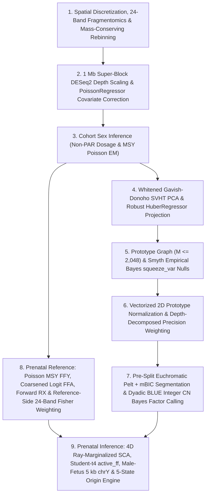

# Mathematical & Machine Learning Methodology

This document specifies the mathematical formulations, statistical models, machine learning algorithms, numerical solvers, statistical assumptions, and constant provenance implemented across `ccnv`.

## Provenance Taxonomy

Every constant, threshold, and model hyperparameter in `ccnv` is classified into one of four provenance tiers:

- **Tier 1 (Statistical & Mathematical Theory)**: Derived analytically from probability distributions, asymptotic statistical efficiency, or numerical analysis (e.g., Gaussian quantile functions, Bessel's correction, Huber M-estimation efficiency, Student-$t_4$ IRLS forecast fusion, erfc Gaussian mixture ray marginalization).
- **Tier 2 (Published Literature & Reference Methodology)**: Adopted from peer-reviewed bioinformatics algorithms, primarily within-sample reference normalization (Straver et al., 2014; Raman et al., 2019a), DESeq2 median-of-ratios (Anders & Huber, 2010; Love et al., 2014), SeqFF (Kim et al., 2015), PREFACE (Raman et al., 2019b), limma Empirical Bayes (Smyth, 2004), Gavish-Donoho SVHT (Gavish & Donoho, 2014), Stouffer precision pooling (Stouffer et al., 1949; Whitlock, 2005), and calibrated PELT change-point detection (Killick et al., 2012; Zhang & Siegmund, 2007).
- **Tier 3 (Genomic Biology & Assembly Coordinates)**: Grounded in human cytogenetics, chromosome structure, or reference genome coordinates (e.g., pseudoautosomal boundaries, heterochromatic satellite blocks, centromeric gaps, and fetal-maternal cell-free DNA stoichiometry).
- **Tier 4 (Empirical Engineering & Numerical Guardrails)**: Tuned for floating-point stability, solver convergence, memory bounding, or outlier clamping across whole-genome sequencing of any coverage.

---

## 1. Alignment Filtering, Coordinate Geometry, and Mass-Conserving Rebinning

### 1.1 Mathematical Formulation

For a contig of length $L \in \mathbb{Z}_{\gt 0}$ and target bin width $w \in \mathbb{Z}_{\gt 0}$ (`src/ccnv/features/binning.py:bin_intervals`), the contig is partitioned into $N = \lceil L / w \rceil = \lfloor (L + w - 1) / w \rfloor$ contiguous 0-based half-open intervals $[s_i, e_i)$ for $i \in \lbrace 0, \dots, N - 1 \rbrace$:

$$
s_i = i \cdot w, \quad e_i = \min((i + 1) w, L)
$$

Alignment extraction (`ccnv._core:scan_alignment_bins`, `src/ccnv/extract.py`) streams records once per target contig via compiled Rust noodles readers and distinguishes paired-end from single-end templates:

- **Properly paired & upstream-mate deduplicated templates (`TLEN > 0`, `TLEN == 0`)**: Reads with negative template length (`TLEN < 0`) are skipped, as are second-in-pair mates with `TLEN == 0` when both mates are mapped (`!is_mate_unmapped && is_last_segment && !is_first_segment`) to prevent double-counting. Paired reads with `TLEN > 0` are assigned to the nucleosome dyad midpoint coordinate $p = \min(L - 1, \text{start} + \lfloor \text{TLEN} / 2 \rfloor)$ with bin index $i = \lfloor p / w \rfloor$ and accumulate all seven channels in $O(R)$ time: total fragment count (`count: uint32`), paired fragment count (`paired_count: uint32`), insert length sum (`frag_len_sum: uint64`), short fragment count ($[80, 150]\text{ bp}$, `short_frag_count: uint32`), cleavage endpoint hits (`endpoint_count: uint32` at $\text{start}$ and $\min(L - 1, \text{start} + \text{TLEN} - 1)$), fragment GC fraction sum (`frag_gc_sum: float32`), and 24 fixed-edge piecewise-uniform (variable-width: 20 bp, 10 bp, 50 bp, and 201 bp) fragment length bands spanning $[30, 601)\text{ bp}$ (`frag_bands: list<uint32>[24]`), alongside sample-level $5'$ 4-mer end motifs and 1-bp length histograms (`ccnv.fragmentomics`). Kept paired reads with `TLEN == 0` fall through to single-read coordinate binning (`count`, `endpoint_count`, `frag_gc_sum`, and $5'$ 4-mers without `TLEN`-derived fragmentomic channels). Note that per-bin `short_frag_count` spans $[80, 150]\text{ bp}$, whereas prenatal segment `frag_short_ratio` sums the first 10 bands of `frag_bands` covering $[30, 150)\text{ bp}$.
- **Single-end alignments**: Assigned via `ccnv._core:scan_alignment_bins` by 0-based leftmost coordinate $p = \text{start}_0 \in [0, L)$ (or optional $5'$ offset shift when `se_fragment_length > 0`), recording `count`, `endpoint_count`, `frag_gc_sum`, and $5'$ 4-mer motifs while leaving `paired_count` and `frag_bands` empty (`paired_end = False`).

When reconciling a source partitioning $\lbrace [s_i^{\text{src}}, e_i^{\text{src}}) \rbrace_{i=0}^{N-1}$ with counts $\mathbf{c}^{\text{src}} \in \mathbb{R}_{\ge 0}^N$ against a target partitioning $\lbrace [s_j^{\text{tgt}}, e_j^{\text{tgt}}) \rbrace_{j=0}^{M-1}$ over the same contig length $L = e_{N-1}^{\text{src}} = e_{M-1}^{\text{tgt}}$, proportional interval overlap redistribution defines target counts as:

$$
c_j^{\text{tgt}} = \sum_{i=0}^{N-1} w_{ij} c_i^{\text{src}}, \quad w_{ij} = \frac{\max\left(0, \min(e_i^{\text{src}}, e_j^{\text{tgt}}) - \max(s_i^{\text{src}}, s_j^{\text{tgt}})\right)}{e_i^{\text{src}} - s_i^{\text{src}}}
$$

`ccnv` implements a dual-path rebinning architecture in `src/ccnv/features/rebinning.py:rebin_sample_buffers` and `src/ccnv/features/binning.py:rebin_counts`:

1. **Exact Contained-Interval Coarsening Fast Path (e.g., $5\text{ kb} \to 100\text{ kb}$)**: When $w_{\text{target}} \gt w_{\text{source}}$ and $w_{\text{target}} \equiv 0 \pmod{w_{\text{source}}}$, `rebin_sample_buffers` coarsens `SampleBuffers` directly via vectorized `np.add.reduceat` slices across contig boundaries, aggregating all 7 channels (`count`, `paired_count`, `frag_len_sum`, `short_frag_count`, `endpoint_count`, `frag_gc_sum`, and element-wise summed `frag_bands`) without constructing intermediate Arrow or DataFrame objects.
2. **General Non-Nested Interval Rebinning**: For non-nested coarser grids over `SampleBuffers` (`rebin_sample_buffers`) or arbitrary interval partitions (`src/ccnv/features/binning.py:rebin_counts`), count redistribution executes in $O(N + M)$ time by constructing the piecewise-linear cumulative count function $F^{\text{src}}(x) = \sum_{j: e_j \le x} c_j + c_k \frac{x - s_k}{e_k - s_k}$ at knots $\mathbf{x}^{\text{src}} = (s_0^{\text{src}}, e_0^{\text{src}}, \dots, e_{N-1}^{\text{src}})$, interpolating $F^{\text{src}}$ at target knots $\mathbf{x}^{\text{tgt}}$ via `np.interp`, and taking non-negative first differences `np.maximum(np.diff(F), 0.0)`. Upsampling a sample sketch to a finer bin width raises `BinCompatibilityError`. Because individual fragment coordinates cannot be recovered across split source intervals, non-nested sample rebinning zeroes fragmentomic channels, clears `ccnv.fragmentomics` metadata, and emits a warning when fragmentomic data was present.

General interval count redistribution (`rebin_counts`, `rebin_counts_matrix`) preserves fractional `float64` mass conservation ($\sum_m c_m^{\text{tgt}} = \sum_j c_j^{\text{src}}$), whereas canonical `.ccnv` Parquet files and raw `SampleBuffers` persist `count` as `uint32` (`SAMPLE_SCHEMA 2.0.0`, while Fisher-weighted sample buffers promote `count` to `float64`).

### 1.2 Statistical Assumptions & Failure Modes

- **Piecewise-Uniform Intra-Bin Density**: Linear interpolation of $F^{\text{src}}(x)$ assumes reads are distributed uniformly within each source bin $[s_i^{\text{src}}, e_i^{\text{src}})$. This holds without approximation when coarsening nested integer multiples ($5\text{ kb} \to 100\text{ kb}$) and introduces smoothing only across non-nested grids.
- **Spatial Point Process**: Representing paired-end fragments by their dyad midpoint (and single-end reads by their 0-based `start` coordinate or optional $5'$-shifted offset) models templates as a spatial point process, preventing mate double-counting across bin boundaries.
- **Identical Reference Assembly**: Rebinning requires matching contig lengths ($e_{N-1}^{\text{src}} = e_{M-1}^{\text{tgt}} = L$); mismatched intervals or layouts raise `InvalidInputError`, `BinCompatibilityError`, `PredictError`, or `ReferenceError`.

### 1.3 Model & Function Selection Rationale

- **Cumulative Knot Interpolation vs. Dense Overlap Matrix**: At $5\text{ kb}$ resolution on human `chr1` ($N \approx 50{,}000$ bins), a dense matrix $\mathbf{W}$ requires $2.5 \times 10^9$ floats ($\approx 20\text{ GB}$ RAM). Cumulative knot interpolation (`np.cumsum` + `np.interp` + `np.diff`) computes identical values in $\lt 1\text{ MB}$ and $O(N + M)$ operations while conserving total read mass.
- **Float64 In-Memory Conservation**: Preserving continuous `float64` counts during in-memory rebinning avoids systematic integer truncation drift before normalization.

### 1.4 Constants & Hyperparameters

- `DEFAULT_BIN_SIZE = 5000` (`src/ccnv/models/config.py`): Default $5\text{ kb}$ bin width (**Tier 2** / **Tier 4**). Balances bin-level Poisson counting noise against spatial breakpoint resolution across WGS coverages; coarsened in memory to $100\text{ kb}$ (`prenatal_bin_size = 100000`) for prenatal autosomal and `chrX` models.
- `min_mapping_quality = 1`, `require_proper_pair = True` (`src/ccnv/models/config.py:ReadFilters`): Default minimum Phred-scaled MAPQ and paired-end proper-pair requirement (**Tier 2**). Excludes multi-mapping reads ($\text{MAPQ} = 0$) and discordant chimeric pairs.

---

## 2. Depth Normalization, Low-Coverage Masking, and Covariate Bias Correction

### 2.1 Mathematical Formulation

#### 2.1.1 1 Mb Super-Block DESeq2 Compositional Depth Scaling

Given a raw counts matrix $\mathbf{C} \in \mathbb{R}_{\ge 0}^{N \times S}$ across $N$ bins (of nominal width $w$) and $S$ cohort samples (`src/ccnv/features/cohort.py:estimate_size_factors`, `src/ccnv/stats/superblocks.py:estimate_superblock_scales`), naive total-sum division projects sample depths onto the simplex $\Delta^{N-1}$, giving it a 0% breakdown point: any whole-chromosome aneuploidy or focal amplification shifts the total sum denominator and distorts diploid bins (Aitchison, 1982; Robinson & Oshlack, 2010).

`ccnv` v2 partitions unmasked bins into contiguous $1\text{ Mb}$ ($\max(1{,}000{,}000, 10 w)$) super-blocks ($G \approx 3{,}000$). Cohort super-block sums $B_{g,s}$ are accumulated via `np.add.reduceat`, producing reference block arithmetic means $\bar{B}_g = \mathrm{mean}_s(B_{g,s})$ (a zero-safe adaptation of the DESeq2 geometric mean reference). Median-of-ratios normalization (Anders & Huber, 2010; Love et al., 2014) is evaluated across positive super-blocks:

$$
s_s = \mathrm{median}_{g: \bar{B}_g \gt 0}\left(\frac{B_{g,s}}{\bar{B}_g}\right)
$$

Factors are centered to unit median $\mathrm{median}(s_s) = 1.0$ while preserving median library depth. During single-sample prediction (`src/ccnv/features/normalization.py:normalize_sample_branch`), test sample counts are scaled over positive super-blocks against the fitted covariate expectation $\hat{t}_{0,i}$ (`estimate_superblock_scales`):

$$
s_{\text{test}} = \mathrm{median}_{g: \sum_{i \in g} C_i \gt 0,\, \sum_{i \in g} \hat{t}_{0,i} \gt 0}\left(\frac{\sum_{i \in g} C_i}{\sum_{i \in g} \hat{t}_{0,i}}\right)
$$

Cohort-level low-coverage masking (`src/ccnv/features/cohort.py:mask_low_coverage_per_contig`) evaluates normalized coverage per contig: for each contig $c$, bins with normalized rate $T_i / a_i \le 0.05 \cdot \mathrm{median}_{j \in c: T_j \gt 0}(T_j / a_j)$ are masked, ensuring haploid or prenatal sex chromosomes (`chrY`) are never inadvertently masked by autosomal medians.

#### 2.1.2 Covariate Masking

When GC content $\mathbf{g} \in [0, 1]^N$, ambiguous base indicator $\mathbf{n}_{\text{mask}} \in \lbrace \text{true}, \text{false} \rbrace^N$, and mappability $\mathbf{m} \in [0, 1]^N$ tracks are provided (`src/ccnv/io/tracks.py`, `src/ccnv/features/covariates.py:mask_covariates`), a bin $b$ is masked if:

1. From FASTA GC extraction (`src/ccnv/io/tracks.py:load_gc_track`), the bin contains zero A/C/G/T/U bases or an ambiguous (`N`) base fraction exceeding $\tau_N = 0.5$:

$$
\frac{n_{\text{total}}(b) - \left(n_{\text{GC}}(b) + n_{\text{AT}}(b)\right)}{n_{\text{total}}(b)} \gt 0.5
$$

2. Its mappability score is non-finite or falls below $\tau_{\text{map}}$ (`min_mappability`, default $0.5$): $m_b \lt \tau_{\text{map}}$.
3. Its GC proportion is non-finite or outside $[0, 1]$ (percentage-scaled tracks in $(1, 100]$ with median $\gt 1.0$ are automatically divided by $100.0$ upon ingestion).

#### 2.1.3 Zero-Inclusive PoissonRegressor Covariate Bias Correction

`ccnv` models non-linear GC, mappability, and paired-end fragmentomic biases using log-link Poisson generalized linear models (`sklearn.linear_model.PoissonRegressor(alpha=1e-4, max_iter=100)`) in `src/ccnv/stats/regression.py:build_exogenous_covariate_basis` and `fit_poisson_covariate_trends`. Each covariate track is included only when it exhibits $\ge 5$ distinct finite usable values and population SD $\gt 10^{-6}$:

- **GC basis**: When bin width satisfies $w \ge 25{,}000\text{ bp}$ (`_GC_QUANTILE_MIN_BIN_SIZE = 25_000`) and finite $200\text{ bp}$ GC quantile histograms $\mathbf{Q} \in \mathbb{R}^{N \times 8}$ from FASTA scanning (`ccnv._core:scan_fasta_gc_quantiles`) are present, standardized columns of the first 7 bands ($\mathbf{Q}_{:, 0:7}$, dropping the redundant 8th simplex column) replace mean-GC splines directly. On finer default grids such as $w = 5{,}000\text{ bp}$ ($w \lt 25{,}000\text{ bp}$), 5-knot cubic quantile B-splines (`degree=3, n_knots=5, include_bias=False`) on mean bin GC $\mathbf{g}$ are used instead.
- **Mappability, fragmentomic, and interaction bases**: Standardized quadratic 4-knot mappability B-splines (`degree=2, n_knots=4`), cubic 4-knot pooled cohort mean `ref_frag_len` and `ref_ep_rate` B-splines (`degree=3, n_knots=4`), and standardized product interactions $z_{\text{GC}} \cdot z_{\text{map}}$ and $z_{\text{GC}} \cdot z_{\text{len}}$ are concatenated column-wise into the exogenous matrix $\mathbf{X}_{\text{cov}} \in \mathbb{R}^{U \times K}$.

For each sample $s$, fitting runs over a deterministic strided subset of up to $65{,}536$ usable bins **including zero-count bins** using scikit-learn's offset-equivalent rate-and-weight parameterization ($y_i = C_{i,s} / w_{i,s}$ with `sample_weight` $= w_{i,s} \cdot \gamma_{i,s}$, where $w_{i,s} = s_s a_i$ in cohort training or $a_i \cdot (\mu_i \text{ if } \mu_i \gt 0 \text{ else } 1)$ at single-sample prediction). Starting from an initial rate $r_0$ anchored below the $95$th quantile of raw rates, outliers undergo upper-only pre-capping at signed Poisson deviance $\tau_0 = 6.0 \max(1.0, \hat{\sigma}_{\text{MAD}}(d))$ followed by up to 2 passes of two-sided deviance Winsorization at $\tau = 3.5 \max(1.0, \hat{\sigma}_{\text{MAD}}(d))$ (solving $u \ln u - u + 1 = \tau^2/(2\mu)$ via Newton–Raphson) paired with inverse-square deviance damping $\gamma_{i,s} = (\tau / |d_i|)^2$ on outliers:

$$
\min_{\beta_0, \boldsymbol{\beta}} \sum_{i} \gamma_{i,s} \left(w_{i,s} \exp(\beta_0 + \mathbf{x}_i^{\top}\boldsymbol{\beta}) - \tilde{C}_{i,s} (\beta_0 + \mathbf{x}_i^{\top}\boldsymbol{\beta})\right) + \frac{\alpha}{2} \Vert\boldsymbol{\beta}\Vert_2^2
$$

Linear predictors are clipped to $[-20.0, 20.0]$ before exponentiation via batched BLAS `gemm`, producing `float32` multiplicative expectations $\hat{t}_{i,s} = \max\left(w_{i,s} \exp\left(\mathrm{clip}(\hat{\beta}_0 + \mathbf{x}_i^{\top}\hat{\boldsymbol{\beta}}, -20, 20)\right), 10^{-30}\right)$ without any `[0.20, 5.0]` clamp.

### 2.2 Statistical Assumptions & Failure Modes

- **50% Breakdown Bound**: Median-of-ratios scaling and median relative depth assume at least 50% of unmasked bins are copy-neutral, keeping size factors invariant under whole-chromosome aneuploidies (Anders & Huber, 2010; Robinson & Oshlack, 2010).
- **Per-Contig Coverage Independence**: Evaluating low-coverage masking per contig preserves low-depth chromosomes such as haploid `chrY` in germline males or cell-free `chrY` in prenatal plasma.
- **Poisson Dispersion for Low Counts**: Poisson GLMs handle zero-count bins naturally without requiring artificial pseudocount offsets, ensuring numerical stability down to $0.1\times$ sequencing depth.

### 2.3 Model & Function Selection Rationale

- **DESeq2 Super-Blocks vs. Single-Bin Ratios**: Aggregating into $1\text{ Mb}$ super-blocks stabilizes ratio medians against single-bin zero counts at low sequencing depths while preserving high breakdown bounds.
- **PoissonRegressor vs. Gaussian WLS**: The log-link Poisson model guarantees strictly positive multiplicative predictions $\hat{t}_i \gt 0$ across all bins and naturally handles discrete counts.

### 2.4 Constants & Hyperparameters

- `_MAX_N_FRACTION = 0.5` (`src/ccnv/io/tracks.py`): Maximum ambiguous base fraction (**Tier 3** / **Tier 4**). Masks assembly gap bins where $\gt 50$% of bases are `N`.
- `DEFAULT_MIN_MAPPABILITY = 0.5` (`src/ccnv/models/config.py`): Default mappability threshold (**Tier 2** / **Tier 3**). Requires at least 50% uniquely mappable $k$-mers per bin.
- `_MASK_FRACTION = 0.05` (`src/ccnv/features/cohort.py`): Low-coverage bin cutoff at 5% of positive median contig coverage (**Tier 2** / **Tier 4**).
- `_GC_QUANTILE_MIN_BIN_SIZE = 25_000`, `_POISSON_ALPHA = 1e-4`, `_POISSON_MAX_ITER = 100`, `_POISSON_PRECAP_Z = 6.0`, `_POISSON_WINSOR_Z = 3.5`, `_POISSON_EXP_CLIP = 20.0` (`src/ccnv/stats/regression.py`): Bin-width threshold for $200\text{ bp}$ GC quantiles, L2 regularization penalty (**Tier 1**), IRLS iteration budget, two-stage deviance Winsorization cutoffs, and exponential predictor safety clip (**Tier 4**).

---

## 3. Cohort Sex Inference: 2D Non-PAR Dosage & MSY Poisson EM

### 3.1 Mathematical Formulation

#### Germline Mode: 2D Non-PAR/XTR Mappable Dosage Separation (`src/ccnv/features/sex.py:infer_germline_sex_2d`)

For each cohort sample, normalized dosage across unmasked PAR1/PAR2/XTR-excluded `chrX` ($d_X$) and `chrY` ($d_Y$) bins (`par_xtr_mask`) is evaluated against autosomal exposure-adjusted depth. Core female ($d_X \approx 2.0, d_Y \approx 0.0$) and male ($d_X \approx 1.0, d_Y \approx 1.0$) clusters are separated in 2D ploidy space with a $4.5\sigma$ MAD ellipse quarantine gating sex-chromosome aneuploid outliers (`XO`, `XXY`, `XXX`, `XYY`). When samplesheet labels are provided, the inferred cutoff is calibrated on non-quarantined controls and stored for subsequent prediction.

#### Prenatal Mode: MSY Poisson EM Mixture (`src/ccnv/stats/prenatal_math.py:fit_msy_sex_mixture`)

In maternal plasma, cell-free `chrY` dosage scales with fetal fraction ($f \in [0.02, 0.30]$). Prior to sex labeling, `fit_prenatal_models` selects bins in the male-specific region of the Y chromosome (MSY) with `mappability >= 0.80` whose 25th-percentile sample rate satisfies $q_{0.25}(C_{b,\cdot}/E_{b,\cdot}) \le 0.15$ (falling back to `mappability >= 0.50` or all `chrY` bins if empty). A 2-component depth-aware Poisson mixture model is fitted via EM (with up to 50 iterations and convergence tolerance $10^{-6}$, followed by a final E-step recomputing `p_male` and log-likelihood $\ell_2$ at the final M-step parameters), requiring $\Delta\mathrm{BIC}_{2 \text{ vs } 1} \gt 6.0$, $\hat{\delta}_{\text{male}} \gt 0.01$, and $0.05 \le \hat{\pi}_{\text{male}} \le 0.95$ to declare bimodality, with an open quarantine interval $p_{\text{male}} \in (0.02, 0.98)$ isolating ambiguous samples.

---

## 4. Between-Sample Latent Bias Removal: Whitened SVHT PCA & HuberRegressor Projection

### 4.1 Mathematical Formulation

#### 4.1.1 Variance-Whitened SVHT PCA

For each usable bin $i$, `fit_whitened_pca` (`src/ccnv/stats/pca.py`) first estimates an outlier-clipped bin capture rate $\mu_i \in [10^{-4}, 10^4]$ across two $3\sigma$-inlier passes relative to $E_{0,i,s} = s_s \hat{t}_{i,s} \mu_i$ (`pca_mean`). Variance-whitened log residuals over usable bins and cohort samples are evaluated, clipped twice to $\pm 3.0$ around the row mean (`_WINSOR_Z_CLIP = 3.0`), and centered:

$$
Z_{i,s}^{\text{raw}} = \ln\left(\frac{C_{i,s} + 0.5}{s_s \hat{t}_{i,s} \mu_i + 0.5}\right) \sqrt{s_s \hat{t}_{i,s} \mu_i + 0.5}
$$

When $S \le U$, symmetric eigendecomposition (`scipy.linalg.eigh`) decomposes the chunk-accumulated $S \times S$ sample Gram matrix $\mathbf{G}_{\text{sym}} = \frac{1}{2}(\tilde{\mathbf{Z}}^{\top}\tilde{\mathbf{Z}} + \tilde{\mathbf{Z}}\tilde{\mathbf{Z}}^{\top})$ (matching singular values $s_k = \sqrt{\lambda_k}$); when $S \gt U$, direct thin SVD decomposes $\tilde{\mathbf{Z}}$. Excluding the structural row-centering zero mode reduces effective sample rank to $S_{\text{eff}} = \max(0, S - 1)$. Optimal rank $P$ is determined via Gavish-Donoho SVHT (Gavish & Donoho, 2014) for unknown noise variance, with sign canonicalization (`svd_flip`):

$$
\beta = \frac{\min(S_{\text{eff}}, U)}{\max(S_{\text{eff}}, U)}, \qquad \omega(\beta) = 0.56\beta^3 - 0.95\beta^2 + 1.82\beta + 1.43, \qquad \tau_{\text{SVHT}} = \omega(\beta)\mathrm{median}_{k}(s_k)
$$

$$
P = \mathrm{clip}\left(\vert \lbrace k : s_k \gt \max(\tau_{\text{SVHT}}, 10^{-12}) \rbrace \vert, \quad 0, \quad \min(P_{\max}(S), S - 2, U - 1)\right)
$$

with automatic default cap $P_{\max}(S) = \min(60, \max(5, \lfloor S / 5 \rfloor))$ unless overridden via `--pca-components`.

#### 4.1.2 Single-Sample Robust PCA Projection via HuberRegressor

During single-sample prediction (`src/ccnv/stats/pca.py:project_huber_pca_wave`, `src/ccnv/features/normalization.py:normalize_sample_branch`), variance-weighted log residuals $y_{\text{fit}, i} = \ln\left(\frac{C_i + 0.5}{e_{0,i} + 0.5}\right)\sqrt{e_{0,i} + 0.5}$ (where $e_{0,i} = s_{\text{test}} \hat{t}_i \mu_i$) are projected onto reference loadings $\mathbf{V}_P$ (after spectral rank reduction filtering eigenvalues $\gt 10^{-8}\max(\lambda_{\max}, 1)$) via L2-regularized Huber M-estimation (`HuberRegressor(fit_intercept=False, alpha=1e-4, epsilon=1.35, max_iter=200)`). Reconstructing across unmasked bins unwhitens by $\sqrt{e_{0,i} + 0.5}$ and clamps the log-wave at `LOG_WAVE_CLIP = 4.0`:

$$
\hat{\lambda}_i = e_{0,i} \exp\left(\mathrm{clip}\left(\frac{\mathbf{V}_{P, i}^{\top} \hat{\mathbf{c}}}{\sqrt{e_{0,i} + 0.5}}, \; -4.0, \; 4.0\right)\right) \gt 0
$$

---

## 5. Prototype Graph ($M \le 2{,}048$) & Depth-Decomposed Empirical Bayes Null Modeling

### 5.1 Mathematical Formulation

#### 5.1.1 Prototype Graph Construction

Rather than storing all pairwise nearest neighbors across hundreds of thousands of bins, `ccnv` builds a compact Prototype Graph (`src/ccnv/stats/neighbors.py:build_whitened_subspace_features`, `fit_prototype_graph`). Usable bins are embedded into standardized signal-subspace coordinates weighting each unit-norm bin loading $\mathbf{V}_{P, p}$ by $\sqrt{U} \sqrt{\max(0, s_p^2 - \hat{\sigma}_{\text{MP}}^2)/\max(s_1^2, 10^{-12})}$ (or $\ln \mu_i$ when $P = 0$) alongside standardized exogenous covariates (`gc`, `mappability`, and when present, `ref_frag_len` and `ref_ep_rate`).

Bins are partitioned globally in signal space into $M = \min(2048, U, \max(8, \lfloor U / 64 \rfloor))$ prototypes using `sklearn.cluster.MiniBatchKMeans(n_clusters=M, random_state=0, batch_size=min(8192, max(256, U)))`. For each bin $i$, `fit_prototype_graph` queries the $k=4$ nearest global prototypes $\lbrace \pi_{i,1}, \dots, \pi_{i,4} \rbrace$ via `scipy.spatial.KDTree` with normalized soft inverse-distance weights:

$$
w_{i,r} = \frac{(d_{i,r} + 10^{-6})^{-1}}{\sum_{m=1}^4 (d_{i,m} + 10^{-6})^{-1}}
$$

Strict leave-one-contig-out (LOCO) donor exclusion is enforced subsequently during baseline evaluation (`evaluate_loco_prototype_baseline` and `compute_loco_prototype_support`): for each prototype centroid, donor ratios on contig $c$ are evaluated against the weighted median over prototype members located strictly on contigs $c' \ne c$ (falling back to global off-contig median or leave-self-out median on degenerate single-contig inputs).

#### 5.1.2 Depth-Decomposed Empirical Bayes Biological Overdispersion

Over all $S$ cohort samples, `calibrate_prototype_dispersion` computes LOCO prototype baselines $b_{i,s}$ (`(c+0.5)/(lam+0.5)` medians calibrated per sample to unit median) and exact Jensen-debiased $\log_2$ residuals (`exact_poisson_log2_jensen_bias` $J_{\log_2}(\lambda_{\text{eff},i,s})$):

$$
R_{i,s} = \log_2\left(\frac{C_{i,s} + 0.5}{\hat{\lambda}_{i,s} b_{i,s} + 0.5}\right) - J_{\log_2}(\hat{\lambda}_{i,s} b_{i,s})
$$

Total cohort variance is estimated in variance-stabilizing Anscombe $3/8$ space (`_winsorized_anscombe_mean_and_var` at $\pm 3.5 \max(\hat{\sigma}_{\text{shot}, i, s}^{(A)}, \hat{\sigma}_{\text{MAD}})$ using persisted per-(bin, sample) expected depths $\lambda_{\text{eff}, i, s} = \hat{\lambda}_{i,s} b_{i,s}$ where $\hat{\sigma}_{\text{shot}, i, s}^{(A)} = \sqrt{\max(0.25 \kappa_{\text{frag}, i}, \; \kappa_{\text{frag}, i} \frac{(\lambda_{\text{eff}, i, s} + 0.5)^2}{\lambda_{\text{eff}, i, s} + 0.375} V_{\ln}(\lambda_{\text{eff}, i, s}))}$ prevents ultra-low-depth zero-count bins from collapsing MAD scales, with degrees of freedom $d_{\text{EB}} = \max(1, S - 1 - P)$, converting back to $\log_2$ ratios prior to SSE accumulation) and deflated by the Kish LOCO prototype variance inflation factor $F_{\text{LOCO}, i} = 1 + \frac{\pi}{2 K_{\text{eff}, i}}$, yielding $v_{\text{tot}, i} = \widehat{\mathrm{Var}}_s^{\text{win}}(R_{i,s}) / F_{\text{LOCO}, i}$. Shot-noise variance uses the **exact discrete Poisson log-variance** table `exact_poisson_log_variance` ($V_{\ln}(\lambda) = \mathrm{Var}(\ln(\mathrm{Pois}(\lambda) + 0.5))$) evaluated across the exact per-(bin, sample) expected counts $\hat{\lambda}_{i,s} b_{i,s}$ and scaled by the compound-Poisson dispersion factor $\kappa_{\text{frag}, i}$:

$$
v_{\text{shot}, i} = \frac{\kappa_{\text{frag}, i}}{(\ln 2)^2} \frac{1}{S}\sum_{s=1}^S V_{\ln}(\hat{\lambda}_{i,s} b_{i,s}), \qquad \phi_0 = \max\left(0, \; (\ln 2)^2 \mathrm{median}_{i \in \mathcal{V}}(v_{\text{tot}, i} - v_{\text{shot}, i})\right)
$$

Setting total prior variance $s_{0,i}^2 = \max(v_{\text{shot}, i} + \phi_0 / (\ln 2)^2, 10^{-12})$, Smyth's Empirical Bayes shrinkage (`squeeze_var`, Smyth, 2004) moderates the **dimensionless variance ratio** $v_{\text{tot}, i} / s_{0,i}^2$ with $\mathrm{df} = d_{\text{EB}}$ into posterior ratios $w_{\text{post}, i}$, persisting the moderated biological overdispersion in natural-$\log^2$ units (`REFERENCE_SCHEMA 2.0.0`, column `bio_dispersion`):

$$
\tilde{\phi}_i = (\ln 2)^2 \max\left(0, \; s_{0,i}^2 w_{\text{post}, i} - v_{\text{shot}, i}\right)
$$

---

## 6. Iterative Within-Sample Normalization & Synthesized Precision Weighting

### 6.1 Mathematical Formulation

During single-sample prediction (`src/ccnv/features/normalization.py:normalize_sample_branch`), per-bin prototype baselines $\hat{b}_i$ are evaluated via leave-one-chromosome-out (LOCO) weighted medians across $k = 4$ global nearest off-contig prototypes and recentered across eligible bins via the Half-Sample Mode whenever at least $20$ unmasked bins and $8$ calibrated donors are available. Up to `mask_repeats` ($3$) iterative outlier-masking passes partition unmasked bins into contiguous blocks of size $\min(100, \max(4, \lfloor U / 16 \rfloor))$ (for $U \ge 16$), exclude any block whose standardized sum exceeds $\vert Z_{\text{block}} \vert \gt 3.5$, and refit the sample's `HuberRegressor` (`alpha = 1e-4`, `epsilon = 1.35`) PCA wave projection exclusively over surviving neutral blocks. Raw LOCO $\log_2$ ratios undergo final HSM biweight mode recentering $\hat{\Delta}_{\text{HSM}}$ across contiguous blocks of size $\min(50, \max(12, \lfloor U / 48 \rfloor))$, setting $\tilde{r}_i = r_{i,\text{raw}} - \hat{\Delta}_{\text{HSM}}$ and effective expected counts $\hat{\lambda}_{\text{eff}, i} = \hat{\lambda}_i \hat{b}_i \cdot 2^{\hat{\Delta}_{\text{HSM}}}$.

Single-sample variance $\sigma_{i,\text{test}}^2$ synthesizes empirical Bayes compound-Poisson fragment dispersion $\tilde{\kappa}_{\text{CP}, i} = \frac{C_i \kappa_{\text{frag}, i} + 10 \kappa_{\text{prior}}}{C_i + 10}$ (`shrink_kish_kappa`, where weighted bin $\kappa_{\text{frag}, i} = \frac{\sum_{j \in i} w_j^2}{\sum_{j \in i} w_j} \gt 0$), exact discrete Poisson log-variance $\mathrm{Var}_{\text{Pois}}(\ln(C_i + 0.5))$, reference biological overdispersion $\tilde{\phi}_i$, Kish LOCO median variance inflation $(1 + \frac{\pi}{2 K_{\text{eff}, i}})$, and adjacent-pair MAD variance scaling $\hat{\tau}_{\text{sample}} \in [0.7, 2.5]$ (`estimate_adjacent_dispersion_tau`):

$$
\sigma_{i,\text{test}}^2 = \hat{\tau}_{\text{sample}}^2 \left[ \frac{\tilde{\kappa}_{\text{CP}, i} \mathrm{Var}_{\text{Pois}}(\ln(C_i + 0.5)) + \tilde{\phi}_i}{(\ln 2)^2} \right] \left(1 + \frac{\pi}{2 K_{\text{eff}, i}}\right)
$$

Bin Z-scores subtract reference-calibrated bin location $\mu_{0, i}$ (`null_mean`) via $Z_i = (\tilde{r}_i - \mu_{0, i}) / \sigma_{i,\text{test}}$. Inverse-variance precision weights are $p_i = \sigma_{i,\text{test}}^{-2}$ for cohort references, while flat FASTA references further modulate weights by prototype-distance quality factors $\mathrm{clip}(d_{\text{med}} / \max(d_i, d_{\text{med}} / 20), 0.05, 20.0)$.

---

## 7. Pre-Split Euchromatic Pelt Segmentation, Dyadic BLUE Scoring, and Integer CN Bayes Factors

### 7.1 Mathematical Formulation

#### 7.1.1 Calibrated Pelt Change-Point Optimization with mBIC Penalty

Contigs are pre-split at unmapped euchromatic gaps $\gt 2\text{ Mb}$ into independent arm blocks. Within each block, change-point detection runs via `ruptures.Pelt(custom_cost=WeightedL2Cost(), min_size=2, jump=1)` (dispatching to C-compiled `ruptures.KernelCPD(kernel="linear")` when weights are uniform and `jump=1`) with calibrated modified BIC (mBIC) penalty (Zhang & Siegmund, 2007; Killick et al., 2012):

$$
\beta_c = \gamma \cdot 2 \max(\hat{\kappa}_c, 1) \ln(\max(U_{\text{block}}, 3))
$$

where $\hat{\kappa}_c$ is the contig-level 1-bin variance inflation estimated via `estimate_dyadic_inflation(..., scales=(1,))` and $\gamma$ is the user penalty multiplier (`--penalty`, default `1.0`).

#### 7.1.2 Post-Pelt Step-Detrended Dyadic Multi-Scale BLUE Segment Scoring

Before estimating multi-scale spatial autocorrelation, any segment with $n_k \ge 2$ and cumulative shift $|\sum_{i \in S_k} Z_i| \ge 5.0 \sqrt{n_k}$ has its segment mean subtracted from bin Z-scores so true CNVs do not inflate null noise estimates. Monotonic dyadic variance inflation $\hat{\kappa}_c(L)$ is then estimated across dyadic scales $L \in \{1, 4, 16, 64, 256, 1024\}$ on Winsorized $[-2.5, 2.5]$ residual Z-scores and log-interpolated to segment length $N_S$. For standard inverse-variance segments (`poisson_pooled = False`), the Gauss-Markov Best Linear Unbiased Estimator (BLUE) Z-score and segment log-ratio variance include shared baseline calibration variance $\sigma_{\text{base}, \log_2}^2$:

$$
\sigma_S^2 = \frac{\hat{\kappa}_c(N_S)}{\sum_{i \in S} p_i} + \sigma_{\text{base}, \log_2}^2, \qquad Z_{\text{BLUE}}(S) = \frac{\sum_{i \in S} \sqrt{p_i} \tilde{Z}_i}{\sigma_S \sum_{i \in S} p_i}
$$

When raw counts and baseline expectations are pooled (`poisson_pooled = True`, used for prenatal male-fetus $5\text{ kb}$ `chrY`), segment ratios $R_S$ and variance inflation $V_{\text{inf}} = \max(1, \frac{\sum_{i \in S} w_{0,i}}{\sum_{i \in S} p_i})$ use exact discrete Poisson moments over summed counts $C_S$, expected neutral baseline $\hat{\lambda}_S$, and maternal background $E_{\text{bg}, S}$, yielding exact Jacobian-propagated $\sigma_S^2$ and count-space $Z_{\text{BLUE}}$:

$$
\sigma_S^2 = \frac{\hat{\kappa}_c(N_S) V_{\text{inf}} \mathrm{Var}_{\text{Pois}}(\ln(C_S + 0.5))}{(\ln 2)^2} + \left(\frac{\hat{\lambda}_S}{\hat{\lambda}_S + 0.5}\right)^2 \sigma_{\text{base}, \log_2}^2
$$

$$
Z_{\text{BLUE}}(S) = \frac{C_S - \hat{\lambda}_S}{\sqrt{\hat{\kappa}_c(N_S) V_{\text{inf}} \max(\hat{\lambda}_S, 0.25) + \left((\hat{\lambda}_S - E_{\text{bg}, S})\ln 2\right)^2 \sigma_{\text{base}, \log_2}^2}}
$$

#### 7.1.3 Discrete Integer Copy-Number Bayes Factors

Discrete integer Bayes factors evaluate whenever `mode == "germline"` or `baseline_ploidy == 1` (omitted for diploid `prenatal` autosomal segments, which pass to the continuous 5-state prenatal origin engine in Section 9.4). Germline event calling requires $|Z_{\text{BLUE}}| \ge z_{\text{threshold}}$, BH-FDR $q \le 0.05$, and log-Bayes factor $\ln \mathrm{BF}_{CN \ne CN_0} \gt 2.0$ over diploid states $CN \in \{0, 1, 3, 4\}$ ($CN_0 = 2$) or haploid male states $CN \in \{0, 2, 3\}$ ($CN_0 = 1$ on `male_sex` and prenatal male-fetus `prenatal_ffy`). Given observed counts $C_S$, expected neutral baseline $\hat{\lambda}_S$, maternal background $E_{\text{bg}, S}$, floored segment variance $\sigma_{\text{eval}}^2 = \max(\sigma_S^2, 10^{-4})$, and compound-Poisson effective cluster deflation $K_{\text{eff}} = \max(1, \kappa_S)$ (where $\kappa_S = \hat{\kappa}_c(N_S) V_{\text{inf}}$ under pooled counts and $\kappa_S = \hat{\kappa}_c(N_S)$ otherwise), effective independent trial counts $(C_{\text{eff}}, \hat{\lambda}_{\text{eff}}, E_{\text{bg, eff}}) = (C_S, \hat{\lambda}_S, E_{\text{bg}, S}) / K_{\text{eff}}$ and cluster-adjusted overdispersion $\alpha_S = \max(0, (\ln 2)^2 \sigma_{\text{eval}}^2 - K_{\text{eff}} \hat{\lambda}_S^{-1})$ parameterize the Negative-Binomial likelihood ratio (reducing smoothly to Poisson when $\alpha_S \le 10^{-12}$, and falling back to Gaussian $\log_2$-ratios only when raw counts are absent):

$$
\ln \mathrm{BF}_{CN} = \ln P_{\text{NB}}\left(C_{\text{eff}} \mid \mu_{\text{eff}, CN}, \alpha_S\right) - \ln P_{\text{NB}}\left(C_{\text{eff}} \mid \hat{\lambda}_{\text{eff}}, \alpha_S\right), \qquad \mu_{\text{eff}, CN} = \frac{\mu_{CN}}{K_{\text{eff}}}
$$

For diploid and zero-background haploid segments, $\mu_{CN} = \max(10^{-3}, \frac{CN}{CN_0}\hat{\lambda}_S)$ (with homozygous $CN=0$ using $0.01 \hat{\lambda}_S$ background expectation); when maternal background $E_{\text{bg}, S} \gt 0$ is present on haploid male `chrY`, $\mu_0 = \max(E_{\text{bg}, S}, 0.01 \hat{\lambda}_S)$ and $\mu_k = E_{\text{bg}, S} + k(\hat{\lambda}_S - E_{\text{bg}, S})$. Evaluating a single discrete count likelihood avoids double-counting evidence between $C_S$ and $R_S$ and resolves homozygous deletions ($CN=0$) down to $0.1\times$ sequencing depth.

---

## 8. Prenatal Multi-Resolution Fetal Fraction & Reference-Side 24-Band Fisher Weighting

In `--mode prenatal`, reference construction separates male vs. female-fetus controls via `fit_msy_sex_mixture` (whose final E-step recomputes posteriors consistently from the converged M-step mixture weights, mean rates, and variances, defining `yfrac_threshold` above female controls) and calibrates four fetal fraction estimators alongside deconvolved fragment length densities.

### 8.1 Closed-Form Poisson MSY `FFY` with Autosomal Exposure Calibration

For each $5\text{ kb}$ bin $b$ on `chrY`, normalized GC multipliers $g_b = \max(\text{gc}_b, 10^{-4}) / \mathrm{median}(\text{gc})$ retain valid zero-GC intervals (`gc >= 0`), and neutral autosomal-scaled diploid exposure $e_b = r_{\text{auto}, 5\text{k}} a_b m_b g_b^{\hat{\beta}_{\text{GC}}}$ uses a per-sample autosomal GC exponent $\hat{\beta}_{\text{GC}} \in [-3, 3]$ fit by zero-inclusive (`c >= 0`) 12-step damped 1D Newton-Raphson exact Poisson profile MLE on centered log-GC predictors (`fit_sample_gc_exponent`). Clean male-specific Y (MSY) bins satisfy $\text{mappability} \ge 0.80$ and Empirical Bayes rate-centered female background $\lambda_{\text{bg}, b} \le 0.05$, while extreme ampliconic arrays ($\eta_b = 2^{\text{null\_mean}_b} \gt 3.5$ or non-finite relative male yield) are masked during `prenatal_ffy` fitting. Female background $\lambda_{\text{bg}, b} = (\hat{\lambda}_{\text{bg, prior}} + \sum_{s \in F} C_{b,s}) / (1.0 + \sum_{s \in F} e_{b,s})$ shrinks toward the pooled female baseline $\hat{\lambda}_{\text{bg, prior}} = \max(\sum_{s \in F, b} C_{b,s} / \max(\sum_{s \in F, b} e_{b,s}, 1.0), 10^{-4})$, and origin-constrained inverted regression $\kappa_{\text{cal}} = (\sum_s f_{\text{target}, s}^2) / (\sum_s \hat{f}_{\text{raw}, s} f_{\text{target}, s})$ calibrates `ffy_slope` free of classical errors-in-variables attenuation bias (`fit_poisson_msy_ffy`). Over clean MSY bins, male fetal fraction is estimated via closed-form Poisson MLE with analytical depth-propagated standard error:

$$
\hat{f}_{\text{FFY}} = \kappa_{\text{cal}} \frac{2\left(\sum_{b \in \text{MSY}} C_b - \sum_{b \in \text{MSY}} e_b \lambda_{\text{bg}, b}\right)}{\sum_{b \in \text{MSY}} e_b}, \qquad \sigma_{\text{FFY}} = \kappa_{\text{cal}} \frac{2\sqrt{\max\left(\sum_{b \in \text{MSY}} C_b, 1\right)}}{\sum_{b \in \text{MSY}} e_b}
$$

### 8.2 Forward-Calibrated $R_X$ Baseline Regression (`FFX`) & Nested-CV `FFA` Error

Using covariate-normalized non-PAR `chrX` ratio-of-sums $R_X$ (`compute_covariate_chrx_ratio`, falling back to zero-inclusive Haldane $+0.5$ Jensen-debiased $100\text{ kb}$ ratios from `compute_100k_profiles` when covariates are unavailable), forward regression (`fit_forward_ffx_model`) regresses $R_X$ against known `XX` ($f=0$) and `XY` ($f=\hat{f}_{\text{FFY}}$) control samples, establishing intercept $\hat{\alpha}_0$ and slope $\hat{\alpha}_1$ so $\hat{f}_{\text{FFX}} = 2(\hat{\alpha}_0 - R_X)/\hat{\alpha}_1$ when $\hat{\alpha}_1 \lt 0$. Autosomal `FFA` trains final convex logit-link `RidgeCV`/`ElasticNetCV` weights on the full cohort while evaluating calibration residual standard error $\sigma_{\text{FFA}}$ strictly out-of-fold via nested 5-fold `KFold` cross-validation refitting `pca_irlba_numpy` inside each fold (`fit_prenatal_models`).

### 8.3 Reference-Side 24-Band Fisher Read Weighting & `FF_size` Ensemble

Maternal fragment density $\hat{p}_M(L)$ is obtained from female controls (or autosomal profiles) and fetal density $\hat{p}_F(L)$ by `deconvolve_fetal_maternal_densities`: empirical `chrY` fetal spectra scale female Y-background by total autosomal read counts ($\sum_{\text{male}} N_{\text{auto}} / \max(\sum_{\text{female}} N_{\text{auto}}, 1)$), incorporate unlabeled male controls (`~isfinite(ff)`) when Y signal exceeds background (`y_anchor_males`), initialize $\hat{p}_F^{(0)} = 0.5(\hat{p}_{F,\text{auto}} + \hat{p}_{Y,\text{anchor}})$ when Y anchor counts exceed $100$, and enforce equal-mass `chrY` M-step stabilization across eligible males. Reference-side Fisher read weights are collapsed onto the $24$ variable-width fragment bands ($[30, 600]\text{ bp}$), clipped to $[0.25, 3.0]$, and normalized by scalar bisection `alpha_star` ($\sum_{b=1}^{24} p_{M, b} w_b^{\ast} = 1$) so neutral maternal depth remains strictly conserved (`compute_band_fisher_weights`):

$$
w_b^{\ast} = \mathrm{clip}\left(\alpha^{\ast} \frac{p_{F, b}}{f_0 p_{F, b} + (1 - f_0) p_{M, b}}, \quad 0.25, \quad 3.0\right)
$$

Under Fisher read weighting, true fetal fraction $f$ maps cleanly via first moments $\mu_F = \sum_b p_{F,b} w_b^{\ast}$ and $\mu_M = \sum_b p_{M,b} w_b^{\ast} = 1$:

$$
f_{\text{eff}}^{(w)}(f) = \frac{f \mu_F}{(1 - f)\mu_M + f \mu_F}
$$

Separately, a 36-feature standardized logit-link ensemble (`RidgeCV`/`ElasticNetCV`) predicts `FF_size` from size-aligned 24-band fractions, short-fragment ratio ($[80, 150]\text{ bp}$), $5'$-end motif summary, and regularized empirical log-likelihood ratio ($x_{28}$, with raw fragment count floored at `1.0`).

---

## 9. Prenatal Single-Sample Inference: 4D Ray-Marginalized SCA, Student-$t_4$ Fusion, Twin Stoichiometry, Male-Fetus `chrY` Normalization & 5-State Origin Engine

### 9.1 4D erfc Ray-Marginalized SCA Classifier

Sex chromosome aneuploidies (`XX`, `XY`, `XO`, `XXX`, `XXY`, `XYY`, `DISCORDANT_MIXED`) are classified via closed-form erfc Gaussian mixture ray marginalization across observed components of the 4D feature vector $(\Delta_X^{\text{trimmed}}, \hat{f}_{\text{FFY}}, \hat{f}_{\text{FFA}}, \hat{f}_{\text{size}})$ paired with fetal-sex clinical prior maps (`_FEMALE_SCA_PRIORS` when `fetal_sex == "F"`, `_MALE_SCA_PRIORS` when `fetal_sex == "M"`) and a `chrX` fragment-origin log-likelihood gate (`chrx_llr_fetal`). Female-fetus samples pass `ffy=None` so absent/background Y measurements omit the Y dimension rather than biasing toward zero (`_evaluate_sca_and_active_ff`). Each ray marginal likelihood includes the 1D Euclidean Hausdorff arc-length Jacobian $+\ln \max(\lVert \mathbf{a}_k \rVert_2, 10^{-12})$ over ray parameterization $\mathbf{y} = \mathbf{a}_k f$, and when an explicit zero boundary `ffy == 0.0` coincides with a zero-Y ray ($a_{k, Y} = 0$), the $\chi^2_{0.999}$ compatibility test decrements effective degrees of freedom by 1 (`classify_sca_ray_4d`).

### 9.2 Precision-Weighted Student-$t_4$ IRLS Active FF Fusion & 2-Fetus Twin Stoichiometry (`classify_twin_pregnancy`)

Concordant estimators are fused into $(\hat{f}_{\text{active}}, \sigma_{f_{\text{active}}})$ over up to `max_iter = 25` iterative reweighted least squares (IRLS) steps under a Student-$t_4$ heavy-tailed likelihood (observation variance floor $10^{-4}$ and output standard-error floor $0.005$), taking final uncertainty conservatively as $\max(\sigma_{\text{Birge}}, \sigma_{\text{curv}})$ where the Birge ratio scales dispersion $\sigma_{\text{Birge}} = \max(1, \sqrt{\chi_w^2 / \max(n - 1, 1)}) \sigma_w$ and observed Student-$t_4$ Fisher curvature $\mathcal{I}_{\text{obs}} = \sum_i \sigma_i^{-2} (1 - r_i^2/\nu) / (1 + r_i^2/\nu)^2$ sets $\sigma_{\text{curv}} = \mathcal{I}_{\text{obs}}^{-1/2}$ when $\mathcal{I}_{\text{obs}} \gt 0.25 \sum_i w_i$. When autosomal `FFA` weights are strongly shrunk ($\lVert \mathbf{w}_{\text{olm}} \rVert_2 \lt 0.10$) and an orthogonal fetal-fraction channel ($\hat{f}_{\text{size}}$ or male $\hat{f}_{\text{FFY}}$) is available, `effective_ffa_sigma` inflates $\sigma_{\text{FFA}}$ to $\max(\sigma_{\text{FFA}}, 0.25\sqrt{0.10 / \max(\lVert \mathbf{w}_{\text{olm}} \rVert_2, 0.01)}, 0.005)$ so intercept-dominated `FFA` predictions do not distort fusion.

Alongside singleton SCA calls, `classify_twin_pregnancy` evaluates 2-fetus twin stoichiometry across sex-pair states `FF` ($f_Y = 0$, $\Delta_X \approx 0$), `FM` ($f_Y = f_M \approx \frac{1}{2} F_{\text{total}}$, $\Delta_X \approx -\frac{1}{2} f_M$), and `MM` ($f_Y = f_{M,1} + f_{M,2} = F_{\text{total}}$, $\Delta_X \approx 0$). On the male-positive branch under autosomal/size support $F_{\text{auto}}$, opposite-sex `FM` mixes a midpoint Gaussian (75% weight, SD $\sqrt{\sigma_Y^2 + (0.5\sigma_{\text{auto}})^2 + (0.12 F_{\text{auto}})^2}$) and an exchange-symmetric uniform $[0.15 F_{\text{auto}}, 0.85 F_{\text{auto}}]$ component (25% weight, width $0.70 F_{\text{auto}}$) against concordant `MM` ($\mathcal{N}(F_{\text{auto}}, \sigma_Y^2 + \sigma_{\text{auto}}^2)$), using $55/45$ `FM`/`MM` priors under `--twins` and $25/75$ priors in automatic detection (requiring `p_fm > 0.80`, `chrX` concordance, and $0.25 F_{\text{auto}} \le \hat{f}_{\text{FFY}} \lt F_{\text{auto}}$). On the female-fetus (`fetal_sex == "F"`) branch, `classify_twin_pregnancy` evaluates a unified Gaussian Y-upper-bound plus `chrX` log-likelihood model across `FF` ($r=0$), discrete weighted `FM` grid $(0.15, 0.30, 0.50, 0.70, 0.85)$, and `MM` ($r=1$) using $\mathrm{expit}(\ell_{\text{FM}} - \ell_{\text{MM}})$ to apportion residual male-carrying posterior mass. When resolved as `("F", "M")` twin with `DISCORDANT_MIXED` 4D SCA call, SCA re-evaluates in 2D $(\Delta_X, \hat{f}_{\text{FFY}})$ under `_MALE_SCA_PRIORS`, while `active_ff` tracks total fetal fraction $F_{\text{total}} = f_M + f_F$ with `male_ff = hat_ffy` and `female_ff = F_total - male_ff`.

### 9.3 Male-Fetus 5 kb `chrY` Normalization (`normalize_prenatal_chry`)

Because maternal plasma carries zero constitutional `chrY` copies, normalizing a male-fetus prenatal sample against a fixed-FF `male_sex` prototype branch would center $\log_2 R$ away from zero whenever sample fetal fraction differs from the cohort average, whereas female-fetus (`fetal_sex == "F"`, separated via `yfrac_threshold`) plasma carries only spurious background reads and omits `chrY` (`normalize_prenatal_chry` returns `None`). Over `clean_msy_bins` intersected with unmasked `prenatal_ffy` rows, `predict.run` computes autosomal-scaled diploid exposure $e_b = r_{\text{auto}, 5\text{k}} a_b m_b g_b^{\hat{\beta}_{\text{GC}}} \gt 0$ and Empirical Bayes per-bin MSY relative yield $\eta_b = 2^{\text{null\_mean}_b}$. To prevent `FFY` self-cancellation on `47,XYY` or large partial MSY deletions/duplications (`del(Y)`, `idic(Y)`), `resolve_chry_anchor_ff` sets the 1-copy MSY anchor $f$ from `male_ff` in `FM` twins (bounded by `active_ff` and overridden by intact $80\text{ kb}$ MSY blocks or LOCO off-`chrY` fusion whenever `FFY` diverges). When Fisher band weights (`kappa_frag`) are attached, background scaling uses $s_{\text{bg}} = \frac{\mu_M}{(1 - f_{\text{tot}})\mu_M + f_{\text{tot}}\mu_F}$ and $f \to f_{\text{eff}}^{(w)}$ (with $f_{\text{tot}} = \text{active\_ff}$ in `FM` twins and $f$ otherwise); unweighted samples use $s_{\text{bg}} = 1$:

$$
\hat{\lambda}_b = e_b \left(s_{\text{bg}} \max(\lambda_{\text{bg}, b}, 0) + \eta_b \frac{f}{2 \kappa_{\text{cal}}}\right)
$$

Per-bin $\log_2$ ratios apply exact discrete Poisson Jensen bias correction (`exact_poisson_log2_jensen_bias`), while pooled Pelt segments evaluate sufficient-statistic pooled segment ratios $R_S$ in Section 7.1.2 so `47,XYY` centers at $\log_2 R \approx +1.0$ (flagged `SCA_DISCORDANT`) and focal MSY deletions shift strongly negative even at low-pass depths:

$$
r_b = \log_2\left(\frac{C_b + 0.5}{\hat{\lambda}_b + 0.5}\right) - \mathrm{bias}_{\text{Jensen}}(\hat{\lambda}_b)
$$

Per-bin variance combines shot noise $\sigma_{\text{shot, base}, b}^2 = \tilde{\kappa}_{\text{CP}, b} \mathrm{Var}_{\text{Pois}}(\ln(C_b + 0.5)) / (\ln 2)^2$ (with shrunk compound-Poisson dispersion $\tilde{\kappa}_{\text{CP}, b} \gt 0$), `prenatal_ffy` Empirical Bayes biological overdispersion (`bio_dispersion`), adjacent-bin MAD dispersion guard $\hat{\tau}_Y \in [1.0, 2.5]$, and lower-tail exact Poisson deviance inflation via `apply_lower_tail_deviance_floor`, flooring only shot-noise SD $\sigma_{\text{shot}, b} = \max(\hat{\tau}_Y \sigma_{\text{shot, base}, b}, \; \hat{\tau}_Y \sqrt{\tilde{\kappa}_{\text{CP}, b}} |r_b| / \sqrt{D_{\text{Pois}}(C_b; \hat{\lambda}_b)})$ when $C_b \lt \hat{\lambda}_b$ before combining orthogonally in quadrature $\sigma_{0, b} = \sqrt{(\hat{\tau}_Y \sigma_{\text{bio}, b})^2 + \sigma_{\text{shot}, b}^2}$ (floored at $10^{-12}$ in variance) for Pelt breakpoint detection, while segment BLUE scoring propagates baseline calibration uncertainty $\sigma_{\text{base}, \log_2}^2 = (\sigma_f / (\max(f, 0.02)\ln 2))^2$ alongside step-detrended dyadic inflation and haploid ($CN_0 = 1$) cluster-adjusted Negative-Binomial Bayes factor calling ($\ln \mathrm{BF}_{CN \ne 1} \gt 2.0$).

### 9.4 5-State Self-Referenced Coupled Depth + Dirichlet-Multinomial Origin Engine

Autosomal (and `chrX`) segments are evaluated across 5 biological origin states via 16-node Gauss-Legendre quadrature coupling continuous copy-number depth (with exact Möbius derivative $\frac{df_{\text{dep}}}{df_{\text{bio}}} = \frac{f_{\text{dep}}(1 - f_{\text{dep}})}{\max(f_{\text{bio}}(1 - f_{\text{bio}}), 10^{-6})}$ propagating Fisher-weighted depth uncertainty) and self-referenced 24-band Dirichlet-Multinomial fragment length likelihoods (`classify_segment_origin_5state`, using sample sizing-shift aligned reference densities `align_histogram(p_ref, -sizing_shift_bp)` collapsed to 24 bands):

1. `FETAL_CONSTITUTIONAL`: Pure fetal heterozygous gain/loss ($CN_{\text{fet}} \in \{1, 3\}$, maternal $CN_{\text{mat}} = 2$), evaluated via normalized discrete marginalization $\mathrm{logsumexp}(\ell_{F_k}) - \ln K$ across both concordant-twin $F_{\text{total}}$ and single-fetus candidate fractions when `twin_min_ff` is set in twin pregnancies.
2. `PLACENTAL_MOSAIC`: Confined placental mosaicism ($0 \lt f_{\text{mosaic}} \lt f_{\text{active}}$), bracketing its peak over a 17-point joint depth + Dirichlet-Multinomial grid (`_integrate_mosaic_state` when segment band counts exceed zero) and integrated uniformly over $[m_{\text{low}}, m_{\text{high}}]$ with normalized log-prior $-\ln(m_{\text{high}} - m_{\text{low}})$ in `mosaic_ff` space (plus shared twin occupancy penalty $-\ln K$ matching `FETAL_CONSTITUTIONAL`).
3. `MATERNAL_UNINHERITED`: Maternal constitutional gain/loss not transmitted to the fetus ($CN_{\text{mat}} \in \{1, 3\}$, $CN_{\text{fet}} = 2$).
4. `MATERNAL_AND_FETAL_INHERITED`: Shared maternal and fetal constitutional alteration ($CN_{\text{mat}} = CN_{\text{fet}} \in \{1, 3\}$).
5. `MATERNAL_MOSAIC`: Maternal somatic or clonal mosaicism ($0 \lt m_{\text{mat}} \lt 1$) integrated identically via the 17-point joint depth + Dirichlet-Multinomial peak scan with normalized uniform log-prior $-\ln(m_{\text{high}} - m_{\text{low}})$.

Segments whose maximum posterior probability falls below $0.80$ are labeled `INDETERMINATE` (neutral segments retain `None`), whole-`chrY` imbalance requires `whole_y_call >= 0.75` for chromosome-level annotation, and twin analytical limits of detection (`lod_ff_35mb`, `lod_ff_3mb`) are scaled and capped to `[0.0, 1.0]` before serialization in `<prefix>_qc.json`.

---

## 10. Reference Quality Control (`ref-qc`) Statistical Thresholds

`src/ccnv/qc/reference.py` audits reference branches over unmasked valid prototypes $\mathcal{V}$, normalizing prototype `mean_distance` by $\sqrt{\max(P + C, 1)}$ before verifying distance dispersions, low-prototype rates (`p_low`), usable `chrY` bin fractions, and prenatal model summaries.

Verdict escalation follows severity ordering $\texttt{PASS} (0) \lt \texttt{WARN} (1) \lt \texttt{FAIL} (2)$:

- **Autosomal & Female Sex Branches**: `FAIL` if $\vert\mathcal{V}\vert = 0$ or $\sigma_{\bar{d}} \gt 10.0$; `WARN` if $\sigma_{\bar{d}} \gt 2.0$, outlier bins exceed $1.0$%, or low-prototype bins exceed $p_{\text{low}} \gt 0.005$.
- **Male Sex Branch**: `FAIL` if $\vert\mathcal{V}\vert = 0$, $\mu_{\bar{d}} \gt 10.0$, usable `chrY` bins $\lt 20.0$% (including $0$%), or `chrY` $\mu_{\bar{d}} \gt 100.0$; `WARN` if $\mu_{\bar{d}} \gt 2.0$, $p_{\text{out}} \gt 1.0$%, $p_{\text{low}} \gt 0.005$, usable `chrY` bins $\lt 50.0$%, or `chrY` $\mu_{\bar{d}} \gt 5.0$.
- **Prenatal Reference Summary**: Records `usable_autosomal_bins` (`prenatal_autosomal`), `informative_ffy_bins` (`prenatal_ffy`), `yfrac_threshold`, and `female_chrx_ratio_std` under the top-level `prenatal` QC key.
- **Flat FASTA Reference**: Escalates overall verdict to `WARN` because empirical cohort noise models and sex branches are absent.

---

## 11. Master Registry of Constants & Methodological Scope

### 11.1 Master Registry of Constants & Hyperparameters

| Constant / Parameter | Value | Source Location | Tier | Mathematical / Biological Rationale |
| :--- | :--- | :--- | :--- | :--- |
| `DEFAULT_BIN_SIZE` | `5000` bp | `src/ccnv/models/config.py` | Tier 2 / Tier 4 | Default WGS bin width balancing Poisson count noise vs. spatial resolution |
| `prenatal_bin_size` | `100000` bp | `src/ccnv/models/config.py` | Tier 2 | 20x coarsened resolution for `FFA` and `FFX` |
| `min_mapping_quality` | `1` | `src/ccnv/models/config.py` | Tier 2 | Excludes multi-mapping reads ($\text{MAPQ}=0$) |
| `DEFAULT_MIN_MAPPABILITY` | `0.5` | `src/ccnv/models/config.py` | Tier 2 / Tier 3 | Requires $\ge 50$% uniquely mappable $k$-mers per bin |
| `_MAX_N_FRACTION` | `0.5` | `src/ccnv/io/tracks.py` | Tier 3 / Tier 4 | Masks bins with $\gt 50$% ambiguous reference bases (`N`) |
| `_MASK_FRACTION` | `0.05` | `src/ccnv/features/cohort.py` | Tier 2 / Tier 4 | Masks bins with $\le 5$% of positive median contig coverage |
| `_GC_QUANTILE_MIN_BIN_SIZE` | `25,000` bp | `src/ccnv/stats/regression.py` | Tier 2 / Tier 4 | Switches exon/bin regression from B-spline to 200 bp GC quantile + interaction basis |
| `PoissonRegressor` `alpha` | `1e-4` | `src/ccnv/stats/regression.py` | Tier 1 | L2 penalty for zero-inclusive log-link Poisson covariate regression |
| `_POISSON_PRECAP_Z` / `_POISSON_WINSOR_Z` | `6.0` / `3.5` (2 passes) | `src/ccnv/stats/regression.py` | Tier 1 / Tier 4 | Two-stage Anscombe and deviance residual winsorization bounds in GLM fitting |
| `HuberRegressor` `epsilon` / `alpha` | `1.35` / `1e-4` | `src/ccnv/stats/pca.py` | Tier 1 | 95% Gaussian asymptotic efficiency with mild L2 regularization |
| `LOG_WAVE_CLIP` | `4.0` | `src/ccnv/stats/pca.py` | Tier 4 | Caps projected natural-log PCA technical wave ($\exp(\pm 4)$) |
| `_POISSON_EXP_CLIP` | `[-20.0, 20.0]` | `src/ccnv/stats/regression.py` | Tier 4 | Natural-log linear predictor clamp in `PoissonRegressor` without multiplicative ratio bounds |
| `min_cohort_size` | `10` | `src/ccnv/models/config.py` | Tier 2 / Tier 4 | Minimum control samples required to fit reference PCA and prototype graphs |
| `min_sex_group_size` | `5` | `src/ccnv/models/config.py` | Tier 2 / Tier 4 | Minimum samples per sex required to build `female_sex` / `male_sex` branches |
| SVHT coefficients | `(0.56, -0.95, 1.82, 1.43)` | `src/ccnv/stats/pca.py` | Tier 2 | Gavish-Donoho optimal singular value hard threshold polynomial |
| `pca_components` | `None` (cap `60`) | `src/ccnv/models/config.py` | Tier 2 / Tier 4 | Optional hard cap on principal components per branch (dynamic SVHT when `None`) |
| `NUM_PROTOTYPES_PER_BIN` ($k$) | `4` | `src/ccnv/models/schemas.py` | Tier 2 / Tier 4 | Nearest off-contig global prototypes stored per bin in Prototype Graph |
| `prototype_count` ($M$) | `min(2048, U, max(8, U // 64))` | `src/ccnv/stats/neighbors.py` | Tier 4 | MiniBatch K-Means prototype count bounding reference graph memory |
| `squeeze_var` `d0` bounds | `[1e-8, 1e8]`, cap `1e6` | `src/ccnv/stats/neighbors.py` | Tier 4 | Root-finding bounds for Smyth Empirical Bayes log-variance shrinkage |
| `_TAU_MIN` / `_TAU_MAX` | `[0.7, 2.5]` (`[1.0, 2.5]` `chrY`) | `src/ccnv/features/normalization.py` | Tier 4 | Empirical adjacent-pair MAD variance scaling bounds |
| Flat-FASTA distance weight clamp | `[0.05, 20.0]` | `src/ccnv/features/normalization.py` | Tier 4 | Clamps flat-FASTA inverse-distance weights to bounded dynamic range |
| `penalty` ($\gamma$) | `1.0` | `src/ccnv/models/config.py` | Tier 2 / Tier 4 | Breakpoint penalty multiplier for mBIC in `ruptures.Pelt` |
| `DEFAULT_MAX_BLACKLIST_GAP` | `2,000,000` bp | `src/ccnv/stats/segmentation.py` | Tier 3 | Splits segments across unmapped centromeres and heterochromatic gaps $\gt 2\text{ Mb}$ |
| `z_threshold` | `3.0` | `src/ccnv/models/config.py` | Tier 1 / Tier 2 | Default segment calling threshold ($\vert Z_{\text{BLUE}} \vert \ge 3.0$) |
| `ln_bf_threshold` | `2.0` | `src/ccnv/stats/segmentation.py` | Tier 1 | Discrete integer copy-number Bayes factor threshold ($\ln \mathrm{BF} \gt 2.0$, variance floor `1e-4`) |
| MSY mappability / bg gates | `>= 0.80` / `<= 0.05` | `src/ccnv/stats/prenatal_math.py` | Tier 3 / Tier 4 | Clean male-specific `chrY` bin selection criteria |
| `effective_ffa_sigma` threshold | `0.10` (`norm < 0.10`) | `src/ccnv/stats/prenatal_math.py` | Tier 2 | Inflates `FFA` sigma when L2 norm of `olm_weights` collapses |
| `classify_twin_pregnancy` auto `FM` gate | `0.80` (`[0.15, 0.85]` uniform) | `src/ccnv/stats/prenatal_math.py` | Tier 2 | Minimum auto-detection `FM` twin posterior paired with exchange-symmetric `[0.15, 0.85]` prior mix, `chrX` concordance, and `FFY` ratio check |
| `FRAG_MIN_LEN` / `FRAG_MAX_LEN` | `30` / `600` bp | `src/ccnv/stats/fragmentomics.py` | Tier 2 / Tier 3 | Physical cell-free DNA insert size bounds (571 1 bp bins, 24 variable bands) |
| Fisher weight clip & $f_0$ | `[0.25, 3.0]`, $f_0 = 0.08$ | `src/ccnv/stats/fragmentomics.py` | Tier 1 / Tier 4 | Depth-conserving fragment length score weight bounds (`sum p_M * w* = 1`) |
| `origin_posterior_threshold` / `whole_y_call` | `0.80` / `0.75` | `src/ccnv/features/prenatal_origin.py` | Tier 1 | Posterior gate for 5-state origin call and whole-`chrY` imbalance threshold |
| `min_fetal_fraction_warning` | `0.04` | `src/ccnv/models/config.py` | Tier 2 / Tier 3 | Clinical 4% lower limit of fetal fraction warning threshold |

### 11.2 Methodological Assumptions & Known Statistical Limitations

1. **Exchangeable Residual Assumption in Empirical Bayes Variance Shrinkage**: `squeeze_var` treats unmasked bins as conditionally independent identically distributed variance draws given $s_0^2$, ignoring short-range spatial correlation when estimating global prior degrees of freedom $d_0$; post-segmentation dyadic $\hat{\kappa}_c(N_S)$ compensates at segment inference scale.
2. **Working-Independence PELT Cost**: `WeightedL2Cost` optimizes marginal bin-wise weighted least squares rather than an autoregressive covariance likelihood, relying on the post-PELT step-detrended dyadic BLUE inflation $\hat{\kappa}_c(N_S)$ to control family-wise false-positive segment Z-scores under local wave residuals.
3. **Homoscedastic Variance-Stabilizing Winsorization in Poisson Covariate GLMs**: `PoissonRegressor` models conditional mean multiplicatively on a log link while winsorizing Pearson/deviance residuals assuming canonical Poisson dispersion rather than fitting joint Negative-Binomial GLM shape parameters per bin.
4. **Twin vs. Maternal/Fetal Heterogeneity Identifiability**: In twin gestations where two fetuses carry discordant subchromosomal events at dissimilar individual fractions $f_1 \ne f_2$, continuous depth stoichiometry alone cannot separate low-level fetal trisomy from confined placental mosaicism (`PLACENTAL_MOSAIC`), making fragmentomic likelihood separation via `frag_llr_size` dependent on sufficient fragment count and accurate `sizing_shift_bp` calibration.
5. **Single-End Extract Resolution**: Samples extracted exclusively from single-end alignments lack insert sizes ($L$) and $5'$ paired dyads, bypassing fragmentomic dispersion weighting ($\tilde{\kappa}_{\text{CP}} = 1$), `FF_size`, Fisher read weighting, and 24-band fragment-length likelihood terms in prenatal origin calling.
6. **Non-Nested Rebinning Channel Loss**: Coarsening or converting between incompatible bin grids (such as $100\text{ kb} \to 120\text{ kb}$) redistributes depth `count` via linear cumulative interpolation while zeroing fragmentomics channels and dropping `ccnv.fragmentomics` metadata, disabling size-based prenatal inference until re-extracted from BAM/CRAM.
7. **Deterministic Control-Cohort Calibration Scope**: Within-sample LOCO normalization and prenatal `FFY`/`FFX`/`FF_size` calibration reflect biases shared with the reference panel (`min_cohort_size >= 10`); batch-specific pre-analytical shear shifts outside trained quantiles rely on test-time `HuberRegressor` PCA wave projection and `sizing_shift_bp` reference alignment.

---

## 12. Complete Academic & Library Reference Bibliography

### 12.1 Peer-Reviewed Scientific References

1. **Aitchison, J. (1982).** The statistical analysis of compositional data. *Journal of the Royal Statistical Society: Series B (Methodological)*, 44(2), 139–160. https://doi.org/10.1111/j.2517-6161.1982.tb01195.x
2. **Aitken, A. C. (1935).** IV. On Least Squares and Linear Combinations of Observations. *Proceedings of the Royal Society of Edinburgh*, 55, 42–48. https://doi.org/10.1017/S0370164600014346
3. **Anders, S., & Huber, W. (2010).** Differential expression analysis for sequence count data. *Genome Biology*, 11(10), R106. https://doi.org/10.1186/gb-2010-11-10-r106
4. **Anscombe, F. J. (1948).** The transformation of Poisson, binomial and negative-binomial data. *Biometrika*, 35(3/4), 246–254. https://doi.org/10.1093/biomet/35.3-4.246
5. **Bates, J. M., & Granger, C. W. J. (1969).** The combination of forecasts. *Operational Research Quarterly*, 20(4), 451–468. https://doi.org/10.1057/jors.1969.103
6. **Benjamini, Y., & Speed, T. P. (2012).** Summarizing and correcting the GC content bias in high-throughput sequencing. *Nucleic Acids Research*, 40(10), e72. https://doi.org/10.1093/nar/gks001
7. **Bentley, J. L. (1975).** Multidimensional binary search trees used for associative searching. *Communications of the ACM*, 18(9), 509–517. https://doi.org/10.1145/361002.361007
8. **Beyer, K., Goldstein, J., Ramakrishnan, R., & Shaft, U. (1999).** When is "nearest neighbor" meaningful? In *Database Theory: ICDT'99* (pp. 217–235). Springer. https://doi.org/10.1007/3-540-49257-7_15
9. **Bianchi, D. W., Parsa, S., Bhatt, S., Halks-Miller, M., Chung, K., Sehnert, A. J., & Trent, R. J. (2015).** Fetal sex chromosome testing by maternal plasma DNA sequencing: clinical laboratory experience and biology. *Obstetrics & Gynecology*, 125(2), 375–382. https://doi.org/10.1097/AOG.0000000000000637
10. **Candès, E. J., Li, X., Ma, Y., & Wright, J. (2011).** Robust principal component analysis? *Journal of the ACM*, 58(3), Article 11. https://doi.org/10.1145/1970392.1970395
11. **de Boor, C. (1978).** *A Practical Guide to Splines*. Springer-Verlag. https://doi.org/10.1007/978-1-4612-6333-3
12. **Diskin, S. J., Li, M., Hou, C., Yang, S., Glessner, J., Hakonarson, H., Bucan, M., Maris, J. M., & Wang, K. (2008).** Adjustment of genomic waves in signal intensities from whole-genome SNP genotyping platforms. *Nucleic Acids Research*, 36(19), e126. https://doi.org/10.1093/nar/gkn556
13. **Gavish, M., & Donoho, D. L. (2014).** The optimal hard threshold for singular values is $4/\sqrt{3}$. *IEEE Transactions on Information Theory*, 60(8), 5040–5053. https://doi.org/10.1109/TIT.2014.2323359
14. **Golub, G. H., Heath, M., & Wahba, G. (1979).** Generalized cross-validation as a method for choosing a good ridge parameter. *Technometrics*, 21(2), 215–223. https://doi.org/10.1080/00401706.1979.10489751
15. **Hastie, T., & Tibshirani, R. (1990).** *Generalized Additive Models*. Chapman & Hall/CRC. https://doi.org/10.1201/9780203743829
16. **Huber, P. J. (1964).** Robust estimation of a location parameter. *The Annals of Mathematical Statistics*, 35(1), 73–101. https://doi.org/10.1214/aoms/1177703732
17. **Huber, P. J. (1981).** *Robust Statistics*. John Wiley & Sons. https://doi.org/10.1002/0471725250
18. **Hudecova, I., Sahota, D., Heung, M. M., Jin, Y., Lee, W. S., Leung, T. Y., Lo, Y. M. D., & Chiu, R. W. (2014).** Maternal plasma fetal DNA fractions in pregnancies with low and high risks for fetal chromosomal aneuploidies. *PLOS ONE*, 9(2), e88484. https://doi.org/10.1371/journal.pone.0088484
19. **Killick, R., Fearnhead, P., & Eckley, I. A. (2012).** Optimal detection of changepoints with a linear computational cost. *Journal of the American Statistical Association*, 107(500), 1590–1598. https://doi.org/10.1080/01621459.2012.737745
20. **Kim, S. K., Hannum, G., Geis, J., Tynan, J., Hogg, G., Zhao, C., Jensen, T. J., & Ehrich, M. (2015).** Determination of fetal DNA fraction from the plasma of pregnant women using sequence read counts. *Prenatal Diagnosis*, 35(8), 810–815. https://doi.org/10.1002/pd.4615
21. **Lipták, T. (1958).** On the combination of independent tests. *Magyar Tudományos Akadémia Matematikai Kutató Intézetének Közleményei*, 3, 171–197.
22. **Lo, Y. M. D., Chan, K. C. A., Sun, H., Chen, E. Z., Jiang, P., Lun, F. M. F., Zheng, Y. W., Leung, T. Y., Lau, T. K., Cantor, C. R., & Chiu, R. W. (2010).** Maternal plasma DNA sequencing reveals genome-wide genetic and mutational profiles of the fetus. *Science Translational Medicine*, 2(61), 61ra91. https://doi.org/10.1126/scitranslmed.3001720
23. **Love, M. I., Huber, W., & Anders, S. (2014).** Moderated estimation of fold change and dispersion for RNA-seq data with DESeq2. *Genome Biology*, 15(12), 550. https://doi.org/10.1186/s13059-014-0550-8
24. **Maneewongvatana, S., & Mount, D. M. (1999).** Analysis of approximate nearest neighbor searching with clustered point sets. *Data Structures, Near Neighbor Searches, and Methodology: Fifth and Sixth DIMACS Implementation Challenges*, 59, 105–123.
25. **Marchenko, V. A., & Pastur, L. A. (1967).** Distribution of eigenvalues for some sets of random matrices. *Mathematics of the USSR-Sbornik*, 1(4), 457–483. https://doi.org/10.1070/SM1967v001n04ABEH001994
26. **Mazloom, A. R., Džakula, Ž., Oeth, P., Wang, H., Jensen, T., Tynan, J., McCullough, R., Saldivar, J. S., Ehrich, M., van den Boom, D., Bombard, A., & Deciu, C. (2013).** Noninvasive prenatal detection of sex chromosomal aneuploidies by sequencing circulating cell-free DNA from maternal plasma. *Prenatal Diagnosis*, 33(6), 591–597. https://doi.org/10.1002/pd.4127
27. **Nilsen, G., Liestøl, K., Van Loo, P., Vollan, H. K. M., Eide, M. B., Rueda, O. M., Chin, S. F., Russell, R., Baumbusch, L. O., Caldas, C., Børresen-Dale, A. L., & Lingjærde, O. C. (2012).** Copynumber: Efficient PCA and segmentation of copy number data. *BMC Genomics*, 13, 591. https://doi.org/10.1186/1471-2164-13-591
28. **Olshen, A. B., Venkatraman, E. S., Lucito, R., & Wigler, M. (2004).** Circular binary segmentation for the analysis of array-based DNA copy number data. *Biostatistics*, 5(4), 557–572. https://doi.org/10.1093/biostatistics/kxh008
29. **Owen, A. B. (2007).** A robust hybrid of lasso and ridge with the elastic net. *The Annals of Applied Statistics*, 1(1), 18–44. https://doi.org/10.1214/07-AOAS104
30. **Raman, L., Dheedene, A., De Smet, M., Van Dorpe, J., & Menten, B. (2019a).** WisecondorX: improved copy number detection for routine shallow whole-genome sequencing. *Nucleic Acids Research*, 47(4), 1605–1614. https://doi.org/10.1093/nar/gky1263
31. **Raman, L., Baetens, M., De Smet, M., Dheedene, A., Van Dorpe, J., & Menten, B. (2019b).** PREFACE: in silico pipeline for accurate cell-free fetal DNA fraction prediction. *Genetics in Medicine*, 21(10), 2371–2379. https://doi.org/10.1038/s41436-019-0497-5
32. **Rice, J. (1984).** Bandwidth choice for nonparametric regression. *The Annals of Statistics*, 12(4), 1215–1230. https://doi.org/10.1214/aos/1176346788
33. **Robinson, M. D., & Oshlack, A. (2010).** A scaling normalization method for differential expression analysis of RNA-seq data. *Genome Biology*, 11(3), R25. https://doi.org/10.1186/gb-2010-11-3-r25
34. **Rosset, S., Zhu, J., & Hastie, T. (2004).** Boosting as a regularized path to a maximum margin classifier. *Journal of Machine Learning Research*, 5, 941–973.
35. **Skaletsky, H., Kuroda-Kawaguchi, T., Minx, P. J., Cordum, H. S., Hillier, L., Brown, L. G., Repping, S., Pyntikova, T., Ali, J., Bieri, T., Chinwalla, A., Delehaunty, A., Delehaunty, K., Du, H., Fewell, G., Fulton, L., Fulton, R., Graves, T., Kuo, D. E., ... Page, D. C. (2003).** The male-specific region of the human Y chromosome is a mosaic of discrete sequence classes. *Nature*, 423(6942), 825–837. https://doi.org/10.1038/nature01722
36. **Smyth, G. K. (2004).** Linear models and empirical Bayes methods for assessing differential expression in microarray experiments. *Statistical Applications in Genetics and Molecular Biology*, 3(1), Article 3. https://doi.org/10.2202/1544-6115.1027
37. **Stouffer, S. A., Suchman, E. A., DeVinney, L. C., Star, S. A., & Williams, R. M. Jr. (1949).** *The American Soldier: Adjustment During Army Life* (Vol. 1). Princeton University Press.
38. **Straver, R., Sistermans, E. A., Holstege, H., Visser, A., Oudejans, C. B. M., & Reinders, M. J. T. (2014).** WISECONDOR: detection of fetal aberrations from shallow sequencing maternal plasma based on a within-sample comparison scheme. *Nucleic Acids Research*, 42(5), e31. https://doi.org/10.1093/nar/gkt1253
39. **Straver, R., Oudejans, C. B., Sistermans, E. A., & Reinders, M. J. (2016).** Calculating the fetal fraction for noninvasive prenatal testing based on genome-wide nucleosome profiles. *Prenatal Diagnosis*, 36(7), 614–621. https://doi.org/10.1002/pd.4816
40. **Truong, C., Oudre, L., & Vayatis, N. (2020).** Selective review of offline change point detection methods. *Signal Processing*, 167, 107299. https://doi.org/10.1016/j.sigpro.2019.107299
41. **Whitlock, M. C. (2005).** Combining probability from independent tests: the weighted Z-method is superior to Fisher's approach. *Journal of Evolutionary Biology*, 18(5), 1368–1373. https://doi.org/10.1111/j.1420-9101.2005.00917.x
42. **Wood, S. N. (2017).** *Generalized Additive Models: An Introduction with R* (2nd ed.). Chapman and Hall/CRC. https://doi.org/10.1201/9781315370279
43. **Zhang, N. R., & Siegmund, D. O. (2007).** A modified Bayes information criterion with applications to the analysis of comparative genomic hybridization data. *Biometrics*, 63(1), 22–32. https://doi.org/10.1111/j.1541-0420.2006.00662.x
44. **Zou, H., & Hastie, T. (2005).** Regularization and variable selection via the elastic net. *Journal of the Royal Statistical Society: Series B (Statistical Methodology)*, 67(2), 301–320. https://doi.org/10.1111/j.1467-9868.2005.00503.x

### 12.2 Python Library & Algorithmic Documentation

- **Polars DataFrames & Expressions**: [Polars Official Documentation](https://docs.pola.rs/), covering [`read_csv`](https://docs.pola.rs/api/python/stable/reference/api/polars.read_csv.html), [`DataFrame.with_columns`](https://docs.pola.rs/api/python/stable/reference/dataframe/api/polars.DataFrame.with_columns.html), and [`DataFrame.write_csv`](https://docs.pola.rs/api/python/stable/reference/dataframe/api/polars.DataFrame.write_csv.html).
- **SciPy Linear Algebra, Spatial, Signal, & Image Kernels**: [`scipy.linalg.svd`](https://docs.scipy.org/doc/scipy/reference/generated/scipy.linalg.svd.html), [`scipy.linalg.eigh`](https://docs.scipy.org/doc/scipy/reference/generated/scipy.linalg.eigh.html), [`scipy.spatial.KDTree`](https://docs.scipy.org/doc/scipy/reference/generated/scipy.spatial.KDTree.html) (multi-threaded spatial nearest neighbor queries), [`scipy.ndimage.gaussian_filter1d`](https://docs.scipy.org/doc/scipy/reference/generated/scipy.ndimage.gaussian_filter1d.html), and [`scipy.signal.detrend`](https://docs.scipy.org/doc/scipy/reference/generated/scipy.signal.detrend.html).
- **SciPy Special, Optimization, & Statistical Functions**: [`scipy.special.digamma`](https://docs.scipy.org/doc/scipy/reference/generated/scipy.special.digamma.html), [`scipy.special.polygamma`](https://docs.scipy.org/doc/scipy/reference/generated/scipy.special.polygamma.html), [`scipy.special.gammaln`](https://docs.scipy.org/doc/scipy/reference/generated/scipy.special.gammaln.html), [`scipy.special.erf`](https://docs.scipy.org/doc/scipy/reference/generated/scipy.special.erf.html), [`scipy.special.erfc`](https://docs.scipy.org/doc/scipy/reference/generated/scipy.special.erfc.html), [`scipy.special.log_ndtr`](https://docs.scipy.org/doc/scipy/reference/generated/scipy.special.log_ndtr.html), [`scipy.special.logit`](https://docs.scipy.org/doc/scipy/reference/generated/scipy.special.logit.html), [`scipy.special.expit`](https://docs.scipy.org/doc/scipy/reference/generated/scipy.special.expit.html), [`scipy.optimize.brentq`](https://docs.scipy.org/doc/scipy/reference/generated/scipy.optimize.brentq.html), [`scipy.optimize.minimize_scalar`](https://docs.scipy.org/doc/scipy/reference/generated/scipy.optimize.minimize_scalar.html), [`scipy.stats.poisson`](https://docs.scipy.org/doc/scipy/reference/generated/scipy.stats.poisson.html), and [`scipy.stats.chi2`](https://docs.scipy.org/doc/scipy/reference/generated/scipy.stats.chi2.html).
- **Scikit-Learn Estimators & Model Selection**: [`sklearn.linear_model.HuberRegressor`](https://scikit-learn.org/stable/modules/generated/sklearn.linear_model.HuberRegressor.html), [`sklearn.linear_model.PoissonRegressor`](https://scikit-learn.org/stable/modules/generated/sklearn.linear_model.PoissonRegressor.html), [`sklearn.linear_model.ElasticNetCV`](https://scikit-learn.org/stable/modules/generated/sklearn.linear_model.ElasticNetCV.html), [`sklearn.linear_model.RidgeCV`](https://scikit-learn.org/stable/modules/generated/sklearn.linear_model.RidgeCV.html), [`sklearn.preprocessing.SplineTransformer`](https://scikit-learn.org/stable/modules/generated/sklearn.preprocessing.SplineTransformer.html), [`sklearn.decomposition.PCA`](https://scikit-learn.org/stable/modules/generated/sklearn.decomposition.PCA.html), [`sklearn.cluster.MiniBatchKMeans`](https://scikit-learn.org/stable/modules/generated/sklearn.cluster.MiniBatchKMeans.html), [`sklearn.model_selection.KFold`](https://scikit-learn.org/stable/modules/generated/sklearn.model_selection.KFold.html), and [`sklearn.utils.extmath.svd_flip`](https://scikit-learn.org/stable/modules/generated/sklearn.utils.extmath.svd_flip.html).
- **Ruptures Change-Point Solvers**: [`ruptures.Pelt`](https://centre-borelli.github.io/ruptures-docs/user-guide/detection/pelt/) and [`ruptures.KernelCPD`](https://centre-borelli.github.io/ruptures-docs/user-guide/detection/kernelcpd/).
