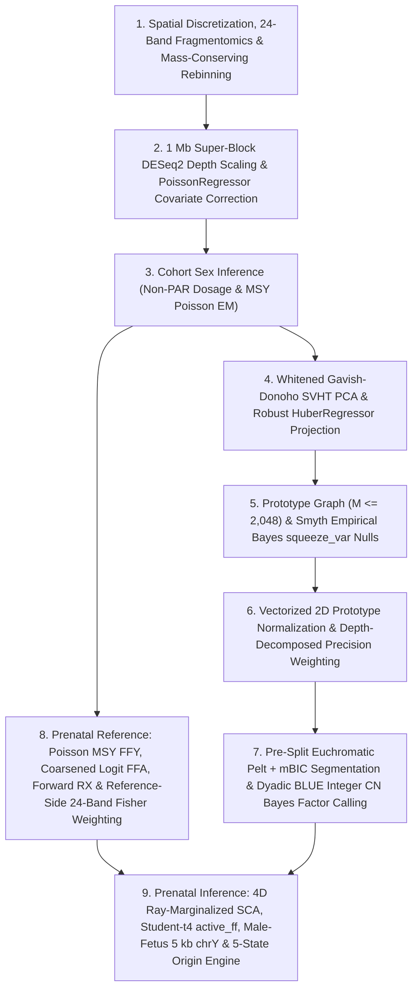

# Mathematical & Machine Learning Methodology

This document specifies the mathematical formulations, statistical models, machine learning algorithms, numerical solvers, statistical assumptions, and constant provenance implemented across `ccnv`.

## Provenance Taxonomy

Every constant, threshold, and model hyperparameter in `ccnv` is classified into one of four provenance tiers:

- **Tier 1 (Statistical & Mathematical Theory)**: Derived analytically from probability distributions, asymptotic statistical efficiency, or numerical analysis (e.g., Gaussian quantile functions, Bessel's correction, Huber M-estimation efficiency, Student-$t_4$ IRLS forecast fusion, erfc Gaussian mixture ray marginalization).
- **Tier 2 (Published Literature & Reference Methodology)**: Adopted from peer-reviewed bioinformatics algorithms, primarily within-sample reference normalization (Straver et al., 2014; Raman et al., 2019a), DESeq2 median-of-ratios (Anders & Huber, 2010; Love et al., 2014), SeqFF (Kim et al., 2015), PREFACE (Raman et al., 2019b), limma Empirical Bayes (Smyth, 2004), Gavish-Donoho SVHT (Gavish & Donoho, 2014), Stouffer precision pooling (Stouffer et al., 1949; Whitlock, 2005), and calibrated PELT change-point detection (Killick et al., 2012; Zhang & Siegmund, 2007).
- **Tier 3 (Genomic Biology & Assembly Coordinates)**: Grounded in human cytogenetics, chromosome structure, or reference genome coordinates (e.g., pseudoautosomal boundaries, heterochromatic satellite blocks, centromeric gaps, and fetal-maternal cell-free DNA stoichiometry).
- **Tier 4 (Empirical Engineering & Numerical Guardrails)**: Tuned for floating-point stability, solver convergence, memory bounding, or outlier clamping across whole-genome sequencing of any coverage.

---

## 1. Alignment Filtering, Coordinate Geometry, and Mass-Conserving Rebinning

### 1.1 Mathematical Formulation

For a contig of length $L \in \mathbb{Z}_{\gt 0}$ and target bin size $B \in \mathbb{Z}_{\gt 0}$ (`src/ccnv/features/binning.py:bin_intervals`), the contig is partitioned into $N = \lceil L / B \rceil = \lfloor (L + B - 1) / B \rfloor$ contiguous 0-based half-open intervals $[s_i, e_i)$ for $i \in \lbrace 0, \dots, N - 1 \rbrace$:

$$
s_i = i \cdot B, \quad e_i = \min((i + 1) B, L)
$$

Alignment extraction (`ccnv._core:scan_alignment_bins`, `src/ccnv/extract.py`) streams records once per target contig via compiled Rust noodles readers and distinguishes paired-end from single-end templates:

- **Properly paired templates (`TLEN > 0`)**: Deduplicated to the upstream mate (`read.template_length > 0`) and assigned to the nucleosome dyad midpoint coordinate $p = \min(L - 1, \text{start} + \lfloor \text{TLEN} / 2 \rfloor)$ with bin index $i = \lfloor p / B \rfloor$. Seven per-bin channels are accumulated in $O(R)$ time: total fragment count (`count: uint32`), paired fragment count (`paired_count: uint32`), insert length sum (`frag_len_sum: uint64`), short fragment count ($[80, 150]\text{ bp}$, `short_frag_count: uint32`), cleavage endpoint hits (`endpoint_count: uint32` at $\text{start}$ and $\min(L - 1, \text{start} + \text{TLEN} - 1)$), fragment GC fraction sum (`frag_gc_sum: float32`), and 24 fixed-width fragment length bands spanning $[30, 600]\text{ bp}$ (`frag_bands: list<uint32>[24]`), alongside sample-level $5'$ 4-mer end motifs and 1-bp length histograms (`ccnv.fragmentomics`).
- **Single-end alignments**: Assigned by leftmost 0-based reference coordinate $p = \text{start} \in [0, L)$ (`src/ccnv/features/binning.py:bin_counts`), recording `count`, `endpoint_count`, `frag_gc_sum`, and $5'$ 4-mer motifs while leaving `paired_count` and `frag_bands` empty (`paired_end = False`).

When reconciling a source partitioning $\lbrace [s_i^{\text{src}}, e_i^{\text{src}}) \rbrace_{i=0}^{N-1}$ with counts $\mathbf{c}^{\text{src}} \in \mathbb{R}_{\ge 0}^N$ against a target partitioning $\lbrace [s_j^{\text{tgt}}, e_j^{\text{tgt}}) \rbrace_{j=0}^{M-1}$ over the same contig length $L = e_{N-1}^{\text{src}} = e_{M-1}^{\text{tgt}}$, proportional interval overlap redistribution defines target counts as:

$$
c_j^{\text{tgt}} = \sum_{i=0}^{N-1} w_{ij} c_i^{\text{src}}, \quad w_{ij} = \frac{\max\left(0, \min(e_i^{\text{src}}, e_j^{\text{tgt}}) - \max(s_i^{\text{src}}, s_j^{\text{tgt}})\right)}{e_i^{\text{src}} - s_i^{\text{src}}}
$$

`ccnv` implements a dual-path rebinning architecture in `src/ccnv/features/rebinning.py:rebin_sample_buffers` and `src/ccnv/features/binning.py:rebin_counts`:

1. **Exact Contained-Interval Coarsening Fast Path (e.g., $5\text{ kb} \to 100\text{ kb}$)**: When $w_{\text{target}} \gt w_{\text{source}}$ and $w_{\text{target}} \equiv 0 \pmod{w_{\text{source}}}$, `rebin_sample_buffers` coarsens `SampleBuffers` directly via vectorized `np.add.reduceat` slices across contig boundaries, aggregating all 7 channels (`count`, `paired_count`, `frag_len_sum`, `short_frag_count`, `endpoint_count`, `frag_gc_sum`, and element-wise summed `frag_bands`) without constructing intermediate Arrow or DataFrame objects.
2. **General Non-Nested Interval Rebinning**: For non-nested coarser grids over `SampleBuffers` (`rebin_sample_buffers`) or arbitrary interval partitions (`src/ccnv/features/binning.py:rebin_counts`), count redistribution executes in $O(N + M)$ time by constructing the piecewise-linear cumulative count function $F^{\text{src}}(x) = \sum_{j: e_j \le x} c_j + c_k \frac{x - s_k}{e_k - s_k}$ at knots $\mathbf{x}^{\text{src}} = (s_0^{\text{src}}, e_0^{\text{src}}, \dots, e_{N-1}^{\text{src}})$, interpolating $F^{\text{src}}$ at target knots $\mathbf{x}^{\text{tgt}}$ via `np.interp`, and taking non-negative first differences (falling back to two-pointer interval overlap scanning `_redistribute_by_overlap` in `rebin_counts` if source bins contain gaps). Upsampling a sample sketch to a finer bin width raises `BinCompatibilityError`. Because individual fragment coordinates cannot be recovered across split source intervals, non-nested sample rebinning zeroes fragmentomic channels, clears `ccnv.fragmentomics` metadata, and emits a warning when fragmentomic data was present.

General interval count redistribution (`rebin_counts`, `rebin_counts_matrix`) preserves fractional `float64` mass conservation ($\sum_m c_m^{\text{tgt}} = \sum_j c_j^{\text{src}}$), whereas canonical `.ccnv` Parquet files and `SampleBuffers` persist raw `count` as `uint32` (`SAMPLE_SCHEMA 2.0.0`).

### 1.2 Statistical Assumptions & Failure Modes

- **Piecewise-Uniform Intra-Bin Density**: Linear interpolation of $F^{\text{src}}(x)$ assumes reads are distributed uniformly within each source bin $[s_i^{\text{src}}, e_i^{\text{src}})$. This holds without approximation when coarsening nested integer multiples ($5\text{ kb} \to 100\text{ kb}$) and introduces smoothing only across non-nested grids.
- **Spatial Point Process**: Representing paired-end fragments by their dyad midpoint (and single-end reads by their $5'$ start) models templates as a spatial point process, preventing mate double-counting across bin boundaries.
- **Identical Reference Assembly**: Rebinning requires matching contig lengths ($e_{N-1}^{\text{src}} = e_{M-1}^{\text{tgt}} = L$); mismatched reference builds raise a `ValueError` or `ReferenceError`.

### 1.3 Model & Function Selection Rationale

- **Cumulative Knot Interpolation vs. Dense Overlap Matrix**: At $5\text{ kb}$ resolution on human `chr1` ($N \approx 50{,}000$ bins), a dense matrix $\mathbf{W}$ requires $2.5 \times 10^9$ floats ($\approx 20\text{ GB}$ RAM). Cumulative knot interpolation (`np.cumsum` + `np.interp` + `np.diff`) computes identical values in $\lt 1\text{ MB}$ and $O(N + M)$ operations while conserving total read mass.
- **Float64 In-Memory Conservation**: Preserving continuous `float64` counts during in-memory rebinning avoids systematic integer truncation drift before normalization.

### 1.4 Constants & Hyperparameters

- `DEFAULT_BIN_SIZE = 5000` (`src/ccnv/models/config.py`): Default $5\text{ kb}$ bin width (**Tier 2** / **Tier 4**). Balances bin-level Poisson counting noise against spatial breakpoint resolution across WGS coverages; coarsened in memory to $100\text{ kb}$ (`prenatal_bin_size = 100000`) for prenatal autosomal and `chrX` models.
- `min_mapping_quality = 1`, `require_proper_pair = True` (`src/ccnv/models/config.py:ReadFilters`): Default minimum Phred-scaled MAPQ and paired-end proper-pair requirement (**Tier 2**). Excludes multi-mapping reads ($\text{MAPQ} = 0$) and discordant chimeric pairs.

---

## 2. Depth Normalization, Low-Coverage Masking, and Covariate Bias Correction

### 2.1 Mathematical Formulation

#### 2.1.1 1 Mb Super-Block DESeq2 Compositional Depth Scaling

Given a raw counts matrix $\mathbf{C} \in \mathbb{R}_{\ge 0}^{B \times S}$ across $B$ bins and $S$ cohort samples (`src/ccnv/features/cohort.py:estimate_size_factors`, `src/ccnv/stats/superblocks.py:estimate_superblock_scales`), naive total-sum division projects sample depths onto the simplex $\Delta^{B-1}$, giving it a 0% breakdown point: any whole-chromosome aneuploidy or focal amplification shifts the total sum denominator and distorts diploid bins (Aitchison, 1982; Robinson & Oshlack, 2010).

`ccnv` v2 partitions unmasked bins into contiguous $1\text{ Mb}$ ($\max(1{,}000{,}000, 10 B)$) super-blocks ($G \approx 3{,}000$). Cohort super-block sums $B_{g,s}$ are accumulated via `np.add.reduceat`, producing reference block means $\bar{B}_g = \mathrm{mean}_s(B_{g,s})$. DESeq2 median-of-ratios normalization (Anders & Huber, 2010; Love et al., 2014) is evaluated across positive super-blocks:

$$
s_s = \mathrm{median}_{g: \bar{B}_g \gt 0}\left(\frac{B_{g,s}}{\bar{B}_g}\right)
$$

Factors are centered to unit median $\mathrm{median}(s_s) = 1.0$ while preserving median library depth. During single-sample prediction (`src/ccnv/features/normalization.py:normalize_sample_branch`), test sample counts are scaled over super-blocks against the reference expected baseline:

$$
s_{\text{test}} = \mathrm{median}_{g: \bar{\mu}_g \gt 0}\left(\frac{\sum_{i \in g} C_i}{\sum_{i \in g} \hat{\mu}_{0,i}}\right)
$$

Cohort-level low-coverage masking (`src/ccnv/features/cohort.py:mask_low_coverage_per_contig`) evaluates normalized coverage per contig: for each contig $c$, bins with normalized rate $T_i / a_i \le 0.05 \cdot \mathrm{median}_{j \in c: T_j \gt 0}(T_j / a_j)$ are masked, ensuring haploid or prenatal sex chromosomes (`chrY`) are never inadvertently masked by autosomal medians.

#### 2.1.2 Covariate Masking

When GC content $\mathbf{g} \in [0, 1]^B$, ambiguous base indicator $\mathbf{n}_{\text{mask}} \in \lbrace \text{true}, \text{false} \rbrace^B$, and mappability $\mathbf{m} \in [0, 1]^B$ tracks are provided (`src/ccnv/io/tracks.py`, `src/ccnv/features/covariates.py:mask_covariates`), a bin $b$ is masked if:

1. From FASTA GC extraction (`src/ccnv/io/tracks.py:load_gc_track`), the bin contains zero A/C/G/T/U bases or an ambiguous (`N`) base fraction exceeding $\tau_N = 0.5$:

$$
\frac{n_{\text{total}}(b) - \left(n_{\text{GC}}(b) + n_{\text{AT}}(b)\right)}{n_{\text{total}}(b)} \gt 0.5
$$

2. Its mappability score is non-finite or falls below $\tau_{\text{map}}$ (`min_mappability`, default $0.5$): $m_b \lt \tau_{\text{map}}$.
3. Its GC proportion is non-finite or outside $[0, 1]$ (percentage-scaled tracks in $(1, 100]$ with median $\gt 1.0$ are automatically divided by $100.0$ upon ingestion).

#### 2.1.3 Zero-Inclusive PoissonRegressor Covariate Bias Correction

`ccnv` models non-linear GC, mappability, and paired-end fragmentomic biases using log-link Poisson generalized linear models (`sklearn.linear_model.PoissonRegressor(alpha=1e-4, max_iter=100)`) in `src/ccnv/stats/regression.py:fit_poisson_covariate_trends`. When $B \ge 25{,}000$ and $200\text{ bp}$ GC quantile histograms $\mathbf{Q} \in \mathbb{R}^{B \times 8}$ are available from FASTA scanning (`ccnv._core:scan_fasta_gc_quantiles`), $\mathbf{Q}$ forms the GC basis directly; otherwise, quantile B-splines $\mathcal{B}_{\text{GC}}^{(k=5, d=3)}(\mathbf{g})$ are fitted. Together with mappability splines $\mathcal{B}_{\text{map}}^{(k=4, d=2)}(\mathbf{m})$ and cohort reference fragmentomics (`ref_frag_len`, `ref_ep_rate`), the exogenous basis $\mathbf{X}_{\text{cov}}$ avoids endogenous single-sample count feedback.

The model is fitted over a deterministic strided grid of up to $65{,}536$ usable bins **including zero-count bins**, winsorizing CNV-amplified outliers above $\mathrm{median} + 3.5 \times \text{MAD}$ across 2 passes:

$$
\min_{\boldsymbol{\beta}} \sum_{i} \left(a_i \exp(\mathbf{x}_i^{\top}\boldsymbol{\beta}) - C_i \mathbf{x}_i^{\top}\boldsymbol{\beta}\right) + \alpha \Vert\boldsymbol{\beta}\Vert_2^2
$$

Multiplicative trend $\hat{t}_i = a_i \exp(\mathbf{x}_i^{\top}\hat{\boldsymbol{\beta}}) \gt 0$ is predicted across all bins via batched BLAS `gemm`, normalized by its median, and clamped to $[0.20, 5.0]$.

### 2.2 Statistical Assumptions & Failure Modes

- **50% Breakdown Bound**: DESeq2 median-of-ratios scaling and median relative depth assume at least 50% of unmasked bins are copy-neutral, keeping size factors invariant under whole-chromosome aneuploidies (Anders & Huber, 2010; Robinson & Oshlack, 2010).
- **Per-Contig Coverage Independence**: Evaluating low-coverage masking per contig preserves low-depth chromosomes such as haploid `chrY` in germline males or cell-free `chrY` in prenatal plasma.
- **Poisson Dispersion for Low Counts**: Poisson GLMs handle zero-count bins naturally without requiring artificial pseudocount offsets, ensuring numerical stability down to $0.1\times$ sequencing depth.

### 2.3 Model & Function Selection Rationale

- **DESeq2 Super-Blocks vs. Single-Bin Ratios**: Aggregating into $1\text{ Mb}$ super-blocks stabilizes ratio medians against single-bin zero counts at low sequencing depths while preserving high breakdown bounds.
- **PoissonRegressor vs. Gaussian WLS**: The log-link Poisson model guarantees strictly positive multiplicative predictions $\hat{t}_i \gt 0$ across all bins and naturally handles discrete counts.

### 2.4 Constants & Hyperparameters

- `_MAX_N_FRACTION = 0.5` (`src/ccnv/io/tracks.py`): Maximum ambiguous base fraction (**Tier 3** / **Tier 4**). Masks assembly gap bins where $\gt 50$% of bases are `N`.
- `DEFAULT_MIN_MAPPABILITY = 0.5` (`src/ccnv/models/config.py`): Default mappability threshold (**Tier 2** / **Tier 3**). Requires at least 50% uniquely mappable $k$-mers per bin.
- `_MASK_FRACTION = 0.05` (`src/ccnv/features/cohort.py`): Low-coverage bin cutoff at 5% of positive median contig coverage (**Tier 2** / **Tier 4**).
- `PoissonRegressor` `alpha = 1e-4`, `max_iter = 100` (`src/ccnv/stats/regression.py`): L2 regularization parameter (**Tier 1**).
- Multiplicative trend clamp `[0.20, 5.0]` (`src/ccnv/stats/regression.py`): Bounds covariate trend adjustments to at most $5\times$ (**Tier 4**).

---

## 3. Cohort Sex Inference: 2D Non-PAR Dosage & MSY Poisson EM

### 3.1 Mathematical Formulation

#### Germline Mode: 2D Non-PAR/XTR Mappable Dosage Separation (`src/ccnv/features/sex.py:infer_germline_sex_2d`)

For each cohort sample, normalized dosage across unmasked PAR1/PAR2/XTR-excluded `chrX` ($d_X$) and `chrY` ($d_Y$) bins (`par_xtr_mask`) is evaluated against autosomal exposure-adjusted depth. Core female ($d_X \approx 2.0, d_Y \approx 0.0$) and male ($d_X \approx 1.0, d_Y \approx 1.0$) clusters are separated in 2D ploidy space with a $4.5\sigma$ MAD ellipse quarantine gating sex-chromosome aneuploid outliers (`XO`, `XXY`, `XXX`, `XYY`). When samplesheet labels are provided, the inferred cutoff is calibrated on non-quarantined controls and stored for subsequent prediction.

#### Prenatal Mode: MSY Poisson EM Mixture (`src/ccnv/stats/prenatal_math.py:fit_msy_sex_mixture`)

In maternal plasma, cell-free `chrY` dosage scales with fetal fraction ($f \in [0.02, 0.30]$). Bins in the male-specific region of the Y chromosome (MSY) with mappability $\ge 0.80$ and female background rate $\le 0.05$ are selected. A 2-component depth-aware Poisson mixture model is fitted via EM, gated by $\Delta\mathrm{BIC}_{2 \text{ vs } 1} \gt 6.0$, with a quarantine region $p_{\text{male}} \in [0.02, 0.98]$ identifying ambiguous samples.

---

## 4. Between-Sample Latent Bias Removal: Whitened SVHT PCA & HuberRegressor Projection

### 4.1 Mathematical Formulation

#### 4.1.1 Variance-Whitened SVHT PCA

Let $Z_{i,s}$ denote variance-whitened log residuals over usable bins and cohort samples:

$$
Z_{i,s} = \frac{\ln\left(\frac{C_{i,s} + 0.5}{s_s \hat{t}_{i,s} + 0.5}\right)}{\sqrt{\frac{1}{s_s \hat{t}_{i,s} + 0.5}}}
$$

Residuals are winsorized at $|Z_{i,s}| \gt 3.0$ across 2 passes. SVD decomposes the centered Gram matrix $\tilde{\mathbf{X}} = \mathbf{U} \boldsymbol{\Sigma} \mathbf{V}^{\top}$. The optimal rank $P$ is determined via Gavish-Donoho SVHT (Gavish & Donoho, 2014) for unknown noise variance:

$$
\beta = \frac{\min(S, U)}{\max(S, U)}, \qquad \omega(\beta) = 0.56\beta^3 - 0.95\beta^2 + 1.82\beta + 1.43, \qquad \tau_{\text{SVHT}} = \omega(\beta)\mathrm{median}_{k}(s_k)
$$

$$
P = \mathrm{clip}\left(\vert \lbrace k : s_k \gt \tau_{\text{SVHT}} \rbrace \vert, \quad 0, \quad \min(P_{\max}(S), S - 2, U - 1)\right)
$$

with $P_{\max}(S) = \min(60, \max(5, \lfloor S / 5 \rfloor))$.

#### 4.1.2 Single-Sample Robust PCA Projection via HuberRegressor

During single-sample prediction (`src/ccnv/stats/pca.py:project_huber_pca_wave`, `src/ccnv/features/normalization.py:normalize_sample_branch`), variance-weighted log residuals are projected onto reference loadings $\mathbf{V}_P$ via unpenalized Huber M-estimation (`HuberRegressor(fit_intercept=False, alpha=0.0, epsilon=1.35)`), reconstructing expected baseline $\hat{\lambda}_i = s_{\text{test}} \hat{t}_i \mu_i \exp(\mathbf{V}_{P, i}^{\top} \hat{\mathbf{c}}) \gt 0$.

---

## 5. Prototype Graph ($M \le 2{,}048$) & Depth-Decomposed Empirical Bayes Null Modeling

### 5.1 Mathematical Formulation

#### 5.1.1 Prototype Graph Construction

Rather than storing all pairwise nearest neighbors across hundreds of thousands of bins, `ccnv` builds a compact Prototype Graph (`src/ccnv/stats/neighbors.py:fit_prototype_graph`). Usable bins are embedded into standardized signal-subspace coordinates weighting each principal component by excess signal $\sqrt{\max(0, \sigma_p^2 - \hat{\sigma}_{\text{MP}}^2)/\sigma_1^2}$ alongside standardized GC and mappability.

Bins are partitioned into $M = \min(2048, U_u, \max(8, \lfloor U_u / 64 \rfloor))$ prototypes using `sklearn.cluster.MiniBatchKMeans(n_clusters=M, random_state=0, batch_size=min(8192, max(256, U_u)))`. For each bin $i$, $k=4$ nearest off-contig prototypes $\lbrace \pi_{i,1}, \dots, \pi_{i,4} \rbrace$ are queried via `scipy.spatial.KDTree` with soft inverse-distance weights:

$$
w_{i,r} = \frac{(d_{i,r} + 10^{-6})^{-1}}{\sum_{m=1}^4 (d_{i,m} + 10^{-6})^{-1}}
$$

#### 5.1.2 Depth-Decomposed Empirical Bayes Biological Overdispersion

Over all $S$ cohort samples, leave-one-contig-out prototype medians are evaluated over regularized log-ratios $R_{i,s} = \log_2((C_{i,s} + 0.5)/(\hat{\lambda}_{i,s} b_{i,s} + 0.5))$. Total cohort variance decomposes into Poisson counting shot noise and biological/technical overdispersion:

$$
v_{\text{shot}, i} = \frac{1}{(\ln 2)^2} \frac{1}{S}\sum_{s=1}^S \frac{1}{\hat{\lambda}_{i,s} + 0.5}, \qquad s_{i,\text{bio}}^2 = \max\left(0, \mathrm{Var}_s(R_{i,s}) - v_{\text{shot}, i}\right)
$$

Smyth's Empirical Bayes shrinkage (`squeeze_var`, Smyth, 2004) shrinks $s_{i,\text{bio}}^2$ toward common prior $s_0^2$, persisting the moderated biological overdispersion $\tilde{\phi}_i \ge 0$ in `REFERENCE_SCHEMA 2.0.0` as `bio_dispersion`.

---

## 6. Iterative Within-Sample Normalization & Synthesized Precision Weighting

### 6.1 Mathematical Formulation

During single-sample prediction (`src/ccnv/features/normalization.py:normalize_sample_branch`), test sample log-ratios $r_i$ are computed against weighted prototype medians. Coarse $100$-bin blocks with $|Z_{\text{block}}| \gt 3.5$ are masked to prevent aneuploid contigs from distorting the within-sample reference.

Single-sample standard errors $\sigma_{i,\text{test}}$ are synthesized from the test sample's own depth and the reference biological overdispersion:

$$
\sigma_{i,\text{test}}^2 = \hat{\tau}_{\text{sample}}^2 \left[ \frac{\kappa_{\text{frag}}}{(\ln 2)^2 (\hat{\lambda}_i + 0.5)} + \frac{\tilde{\phi}_i}{(\ln 2)^2} \right] \left(1 + \frac{\pi}{2 K_{\text{eff}, i}}\right)
$$

Bin precision weights are $p_i = \sigma_{i,\text{test}}^{-2}$ for cohort references (while flat FASTA distance weights are bounded to $[0.05, 20.0]$).

---

## 7. Pre-Split Euchromatic Pelt Segmentation, Dyadic BLUE Scoring, and Integer CN Bayes Factors

### 7.1 Mathematical Formulation

#### 7.1.1 Calibrated Pelt Change-Point Optimization with mBIC Penalty

Contigs are pre-split at euchromatic gaps $\gt 2\text{ Mb}$ into independent arm blocks. Within each block, change-point detection runs via `ruptures.Pelt(custom_cost=WeightedL2Cost(), min_size=2, jump=1)` with calibrated modified BIC (mBIC) penalty (Zhang & Siegmund, 2007; Killick et al., 2012):

$$
\beta_c = \gamma \cdot 2 \hat{\kappa}_c \ln(\max(U_{\text{block}}, 3))
$$

where $\hat{\kappa}_c$ is the contig variance inflation factor and $\gamma$ is the user penalty multiplier (`--penalty`, default `1.0`).

#### 7.1.2 Dyadic Multi-Scale BLUE Segment Scoring

For each segment $S$ of length $N_S$, the Gauss-Markov Best Linear Unbiased Estimator (BLUE) Z-score combines bin Z-scores with dyadic variance inflation $\hat{\kappa}_c(N_S)$ across dyadic scales $L \in \{1, 4, 16, 64, 256, 1024\}$:

$$
Z_{\text{BLUE}}(S) = \frac{\sum_{i \in S} \sqrt{p_i} \tilde{Z}_i}{\sqrt{\hat{\kappa}_c(N_S) \sum_{i \in S} p_i}}
$$

#### 7.1.3 Discrete Integer Copy-Number Bayes Factors

In germline mode, event calling requires $|Z_{\text{BLUE}}| \ge z_{\text{threshold}}$, BH-FDR $q \le 0.05$, and discrete integer copy-state log-Bayes factor $\ln \mathrm{BF}_{CN \ne CN_0} \gt 2.0$ over diploid states $CN \in \{0, 1, 2, 3, 4+\}$ ($CN_0 = 2$) or haploid male sex-chromosome states $CN \in \{0, 1, 2, 3+\}$ ($CN_0 = 1$ on `male_sex` and prenatal male-fetus `prenatal_ffy`). When segment observed counts $C_S$ and expected neutral baseline $\hat{\lambda}_S$ are available, $\ln \mathrm{BF}_{CN}$ evaluates the Negative-Binomial count log-likelihood ratio with segment overdispersion $\alpha_S = \max(0, (\ln 2)^2 \sigma_S^2 - \hat{\lambda}_S^{-1})$ (reducing smoothly to the exact Poisson log-likelihood ratio when $\alpha_S = 0$, and falling back to a Gaussian $\log_2$-ratio log-likelihood ratio only when raw counts are absent):

$$
\ln \mathrm{BF}_{CN} = \ln P_{\text{NB}}\left(C_S \mid \mu_k = \frac{CN}{CN_0}\hat{\lambda}_S, \alpha_S\right) - \ln P_{\text{NB}}\left(C_S \mid \mu_0 = \hat{\lambda}_S, \alpha_S\right)
$$

Evaluating a single discrete count likelihood avoids double-counting evidence between $C_S$ and $\hat{r}_S$. For homozygous deletions ($CN=0$), counts drop toward zero over the segment ($C_S \approx 0$), yielding decisive log-Bayes factors ($\ln \mathrm{BF}_0 \approx \hat{\lambda}_S$ in the Poisson limit) that detect focal and broad homozygous deletions down to $0.1\times$ sequencing depth.

---

## 8. Prenatal Multi-Resolution Fetal Fraction & Reference-Side 24-Band Fisher Weighting

In `--mode prenatal`, reference construction calibrates four fetal fraction estimators alongside deconvolved fragment length densities.

### 8.1 Closed-Form Poisson MSY `FFY` with Analytical Standard Error

Over clean MSY bins ($\text{mappability} \ge 0.80$, female background $\le 0.05$), male fetal fraction is estimated via closed-form Poisson MLE with analytical depth-propagated standard error:

$$
\hat{f}_{\text{FFY}} = \frac{\sum_{b \in \text{MSY}} C_b - \hat{\lambda}_{\text{bg}} \sum_{b} E_b}{0.5 \sum_{b} E_b}, \qquad \sigma_{\text{FFY}} = \frac{\sqrt{\sum_{b} C_b}}{0.5 \sum_{b} E_b}
$$

### 8.2 Forward-Calibrated $R_X$ Baseline Regression

Ratio-of-sums $R_X$ on diploid-normalized non-PAR `chrX` is regressed forward across `XX` controls ($f=0$) and `XY` controls ($f=\hat{f}_{\text{FFY}}$), establishing the exact baseline $\hat{\alpha}_0$ and slope $\hat{\beta}_X$.

### 8.3 Reference-Side 24-Band Fisher Read Weighting

Rather than scaling reference baselines during prediction, fixed 24-band Fisher read weights $w^{\ast}_{0.08}(L)$ are applied to prenatal reference cohorts during reference construction:

$$
w^{\ast}(L) = \mathrm{clip}\left(\alpha^{\ast} \frac{\hat{p}_F(L)}{f_0 \hat{p}_F(L) + (1 - f_0)\hat{p}_M(L)}, \quad 0.25, \quad 3.0\right)
$$

Effective fetal fraction under weighting maps via exact transformation:

$$
f_{\text{eff}}^{(w)}(f) = \frac{f \mu_F}{(1 - f)\mu_M + f \mu_F}
$$

---

## 9. Prenatal Single-Sample Inference: 4D Ray-Marginalized SCA, Student-$t_4$ Fusion, Male-Fetus `chrY` Normalization & 5-State Origin Engine

### 9.1 4D erfc Ray-Marginalized SCA Classifier

Sex chromosome aneuploidies (`XX`, `XY`, `XO`, `XXX`, `XXY`, `XYY`, `DISCORDANT_MIXED`) are classified via closed-form erfc Gaussian mixture ray marginalization across the 4D feature vector $(\Delta_X^{\text{trimmed}}, \hat{f}_{\text{FFY}}, \hat{f}_{\text{FFA}}, \hat{f}_{\text{size}})$ paired with a `chrX` fragment-origin likelihood gate.

### 9.2 Precision-Weighted Student-$t_4$ IRLS Active FF Fusion & 2-Fetus Twin Stoichiometry (`classify_twin_pregnancy`)

Concordant estimators are fused into $(\hat{f}_{\text{active}}, \sigma_{f_{\text{active}}})$ via iterative reweighted least squares (IRLS) under a Student-$t_4$ heavy-tailed likelihood, bounding outlier contamination while achieving optimal precision. When autosomal PCA regression weights are heavily shrunk ($\lVert \mathbf{w}_{\text{olm}} \rVert_2 \lt 0.10$) and an orthogonal fetal-fraction channel ($\hat{f}_{\text{size}}$ or male $\hat{f}_{\text{FFY}}$) is available, `effective_ffa_sigma` inflates $\sigma_{\text{FFA}}$ so degenerate intercept-heavy `FFA` predictions do not pull Student-$t_4$ fusion away from informative channels. Alongside singleton SCA classification, `classify_twin_pregnancy` evaluates 2-fetus twin stoichiometry across sex-pair states `FF` ($f_Y = 0$), `FM` ($f_Y = f_M \approx \frac{1}{2} F_{\text{total}}$, $\Delta_X \approx -\frac{1}{2} f_M$), and `MM` ($f_Y = f_{M,1} + f_{M,2} = F_{\text{total}}$), resolving `gestation` (`"singleton"` or `"twin"`), `fetal_sexes`, `male_ff`, `female_ff`, and `twin_probability` under both `--twins` (known twin gestation) and default auto-detection mode. In resolved `("F", "M")` twins, `active_ff` tracks total fetal fraction $F_{\text{total}} = f_M + f_F$, while `resolve_chry_anchor_ff` sets the $5\text{ kb}$ `chrY` 1-copy MSY base anchor to `male_ff` (bounded by `active_ff` and overridden by intact-arm $80\text{ kb}$ MSY blocks when `sca.call == "XY"` and `chrY` sub-blocks diverge), and `classify_segment_origin_5state` / `annotate_prenatal_origin_and_lod` evaluate `FETAL_CONSTITUTIONAL` and analytical LoD thresholds across both concordant-twin ($F_{\text{total}}$) and single-fetus ($f_1, f_2$) hypotheses.

### 9.3 Male-Fetus 5 kb `chrY` Normalization (`normalize_prenatal_chry`)

Because maternal plasma carries zero constitutional `chrY` copies, normalizing a male-fetus prenatal sample against a fixed-FF `male_sex` prototype branch would center $\log_2 R$ away from zero whenever sample fetal fraction differs from the cohort average, whereas female-fetus (`fetal_sex == "F"`, separated via a female-background-anchored `yfrac_threshold`) plasma carries only spurious background mapping and omits `chrY` (`normalize_prenatal_chry` returns `None`). Because clean MSY `chrY` reads are already predominantly fetal and `prenatal_ffy` is fit on unweighted $5\text{ kb}$ counts, `predict.run` evaluates `normalize_prenatal_chry` on unweighted `raw_sample` counts over `clean_msy_bins` intersected with unmasked reference rows and positive autosomal-scaled diploid exposure $e_b = r_{\text{auto}, 5\text{k}} a_b m_b g_b^{\hat{\beta}_{\text{GC}}} \gt 0$, where $\hat{\beta}_{\text{GC}} \in [-3, 3]$ is fit per sample on autosomal $5\text{ kb}$ bins (`fit_sample_gc_exponent`) and $\eta_b = 2^{\text{null\_mean}_b}$ captures Empirical Bayes per-bin male MSY relative yield (masking extreme $\gt 3.5\times$ ampliconic repeat arrays during reference training). To prevent `FFY` self-cancellation on low-FF `47,XYY` or large partial `chrY` deletions/duplications (`del(Y)`, `idic(Y)`), `resolve_chry_anchor_ff` compares `FFY` against the LOCO off-`chrY` Student-$t_4$ fused fetal fraction $(\hat{f}_{\text{off}}, \sigma_{\text{off}})$ (`FFA`, `FF_size`, `FFX`) and $80\text{ kb}$ MSY sub-blocks, anchoring to intact-arm or off-`chrY` $f$ whenever `FFY` diverges ($s_{\text{bg}} = 1$ unweighted, or $\frac{\mu_M}{(1 - f)\mu_M + f\mu_F}$ with $f \to \text{effective\_ff}$ when `kappa_frag` is attached):

$$
\hat{\lambda}_b = e_b \left(s_{\text{bg}} \max(\lambda_{\text{bg}, b}, 0) + \eta_b \frac{f}{2 \kappa_{\text{cal}}}\right)
$$

Per-bin $\log_2$ ratios apply exact discrete Poisson Jensen bias correction (`exact_poisson_log2_jensen_bias`), while Pelt segments on `prenatal_ffy` evaluate sufficient-statistic pooled segment ratios $R_S = \log_2\left(\frac{C_S + 0.5}{\hat{\lambda}_S + 0.5}\right) - \mathrm{bias}_{\text{Jensen}}(\hat{\lambda}_S)$ so `47,XYY` segments center at $\log_2 R \approx +1.0$ (flagged `SCA_DISCORDANT`) and focal MSY deletions shift strongly negative even at low-pass NIPT depths ($\hat{\lambda}_b \ll 1$, where single-bin `+0.5` pseudocounts visually attenuate individual $5\text{ kb}$ bin dots):

$$
r_b = \log_2\left(\frac{C_b + 0.5}{\hat{\lambda}_b + 0.5}\right) - \mathrm{bias}_{\text{Jensen}}(\hat{\lambda}_b)
$$

Per-bin shot-noise variance $\sigma_{0, b}^2 = \max(\tilde{\kappa}_{\text{frag}, b} \mathrm{Var}_{\text{Pois}}(\ln(C_b + 0.5)) / (\ln 2)^2, 10^{-12})$ incorporates shrunk Kish design inflation $\tilde{\kappa}_{\text{frag}, b} \ge 1$ and adjacent-bin MAD guard $\hat{\tau}_Y \in [1.0, 2.5]$ for Pelt breakpoint detection, while segment BLUE scoring propagates shared fetal-fraction calibration variance $\sigma_{\text{base}, \log_2}^2 = (\sigma_f / (\max(f, 0.02)\ln 2))^2$ alongside step-detrended dyadic inflation $\hat{\kappa}_c(N_S)$ and discrete haploid ($CN_0 = 1$, $CN \in \{0, 1, 2, 3+\}$ above maternal background $E_{\text{bg}, S}$) Negative-Binomial Bayes factor calling ($\ln \mathrm{BF}_{CN \ne 1} \gt 2.0$).

### 9.4 5-State Self-Referenced Coupled Depth + Dirichlet-Multinomial Origin Engine

Segment biological origin is classified across 5 biological states via 16-node Gauss-Legendre quadrature coupling continuous copy-number depth and self-referenced 24-band Dirichlet-Multinomial fragment length likelihoods:

1. `FETAL_CONSTITUTIONAL`: Pure fetal heterozygous gain/loss ($CN_{\text{fet}} \in \{1, 3\}$, maternal diploid $CN_{\text{mat}} = 2$).
2. `PLACENTAL_MOSAIC`: Confined placental mosaicism with sub-fetal stoichiometric ratio ($0 \lt f_{\text{mosaic}} \lt f_{\text{active}}$).
3. `MATERNAL_UNINHERITED`: Maternal constitutional gain/loss not transmitted to the fetus ($CN_{\text{mat}} \in \{1, 3\}$, $CN_{\text{fet}} = 2$).
4. `MATERNAL_AND_FETAL_INHERITED`: Shared maternal and fetal constitutional alteration ($CN_{\text{mat}} = CN_{\text{fet}} \in \{1, 3\}$).
5. `MATERNAL_MOSAIC`: Maternal somatic or clonal mosaicism ($0 \lt m_{\text{mat}} \lt 1$) across plasma templates.

Segments whose maximum posterior probability falls below $0.80$ are labeled `INDETERMINATE` (neutral segments retain `None`). Quality control payloads report analytical limits of detection `lod_ff_35mb` and `lod_ff_3mb` alongside `origin_summary` in `<prefix>_qc.json`.

---

## 10. Reference Quality Control (`ref-qc`) Statistical Thresholds

`src/ccnv/qc/reference.py` audits reference branches over unmasked valid prototypes $\mathcal{V}$, normalizing prototype `mean_distance` by $\sqrt{\max(P + C, 1)}$ before verifying distance dispersions, low-prototype rates (`p_low`), usable `chrY` bin fractions, and prenatal model summaries.

Verdict escalation follows severity ordering $\texttt{PASS} (0) \lt \texttt{WARN} (1) \lt \texttt{FAIL} (2)$:

- **Autosomal & Female Sex Branches**: `FAIL` if $\vert\mathcal{V}\vert = 0$ or $\sigma_{\bar{d}} \gt 10.0$; `WARN` if $\sigma_{\bar{d}} \gt 2.0$, outlier bins exceed $1.0$%, or low-prototype bins exceed $p_{\text{low}} \gt 0.005$.
- **Male Sex Branch**: `FAIL` if $\vert\mathcal{V}\vert = 0$, $\mu_{\bar{d}} \gt 10.0$, usable `chrY` bins $\lt 20.0$% (including $0$%), or `chrY` $\mu_{\bar{d}} \gt 100.0$; `WARN` if $\mu_{\bar{d}} \gt 2.0$, $p_{\text{out}} \gt 1.0$%, $p_{\text{low}} \gt 0.005$, usable `chrY` bins $\lt 50.0$%, or `chrY` $\mu_{\bar{d}} \gt 5.0$.
- **Flat FASTA Reference**: Escalates overall verdict to `WARN` because empirical cohort noise models and sex branches are absent.

---

## 11. Master Registry of Constants & Hyperparameters

| Constant / Parameter | Value | Source Location | Tier | Mathematical / Biological Rationale |
| :--- | :--- | :--- | :--- | :--- |
| `DEFAULT_BIN_SIZE` | `5000` bp | `src/ccnv/models/config.py` | Tier 2 / Tier 4 | Default WGS bin width balancing Poisson count noise vs. spatial resolution |
| `prenatal_bin_size` | `100000` bp | `src/ccnv/models/config.py` | Tier 2 | 20x coarsened resolution for `FFA` and `FFX` |
| `min_mapping_quality` | `1` | `src/ccnv/models/config.py` | Tier 2 | Excludes multi-mapping reads ($\text{MAPQ}=0$) |
| `DEFAULT_MIN_MAPPABILITY` | `0.5` | `src/ccnv/models/config.py` | Tier 2 / Tier 3 | Requires $\ge 50$% uniquely mappable $k$-mers per bin |
| `_MAX_N_FRACTION` | `0.5` | `src/ccnv/io/tracks.py` | Tier 3 / Tier 4 | Masks bins with $\gt 50$% ambiguous reference bases (`N`) |
| `_MASK_FRACTION` | `0.05` | `src/ccnv/features/cohort.py` | Tier 2 / Tier 4 | Masks bins with $\le 5$% of positive median contig coverage |
| `PoissonRegressor` `alpha` | `1e-4` | `src/ccnv/stats/regression.py` | Tier 1 | L2 penalty for zero-inclusive log-link Poisson covariate regression |
| `HuberRegressor` `epsilon` | `1.35` | `src/ccnv/stats/pca.py` | Tier 1 | 95% Gaussian asymptotic efficiency in M-estimation |
| Trend clamp | `[0.20, 5.0]` | `src/ccnv/stats/regression.py` | Tier 4 | Bounds multiplicative covariate correction to at most $5\times$ |
| `min_cohort_size` | `10` | `src/ccnv/models/config.py` | Tier 2 / Tier 4 | Minimum control samples required to fit reference PCA and prototype graphs |
| `min_sex_group_size` | `5` | `src/ccnv/models/config.py` | Tier 2 / Tier 4 | Minimum samples per sex required to build `female_sex` / `male_sex` branches |
| SVHT coefficients | `(0.56, -0.95, 1.82, 1.43)` | `src/ccnv/stats/pca.py` | Tier 2 | Gavish-Donoho optimal singular value hard threshold polynomial |
| `pca_components` | `None` (cap `60`) | `src/ccnv/models/config.py` | Tier 2 / Tier 4 | Optional hard cap on principal components per branch (dynamic SVHT when `None`) |
| `NUM_PROTOTYPES_PER_BIN` ($k$) | `4` | `src/ccnv/models/schemas.py` | Tier 2 / Tier 4 | Nearest off-contig reference prototypes stored per bin in Prototype Graph |
| `prototype_count` ($M$) | `min(2048, U, max(8, U // 64))` | `src/ccnv/stats/neighbors.py` | Tier 4 | MiniBatch K-Means prototype count bounding reference graph memory |
| `squeeze_var` `d0` bounds | `[1e-8, 1e8]`, cap `1e6` | `src/ccnv/stats/neighbors.py` | Tier 4 | Root-finding bounds for Smyth Empirical Bayes log-variance shrinkage |
| Flat-FASTA distance weight clamp | `[0.05, 20.0]` | `src/ccnv/features/normalization.py` | Tier 4 | Clamps flat-FASTA inverse-distance weights to bounded dynamic range |
| `penalty` ($\gamma$) | `1.0` | `src/ccnv/models/config.py` | Tier 2 / Tier 4 | Breakpoint penalty multiplier for mBIC in `ruptures.Pelt` |
| `DEFAULT_MAX_BLACKLIST_GAP` | `2,000,000` bp | `src/ccnv/stats/segmentation.py` | Tier 3 | Splits segments across unmapped centromeres and heterochromatic gaps $\gt 2\text{ Mb}$ |
| `z_threshold` | `3.0` | `src/ccnv/models/config.py` | Tier 1 / Tier 2 | Default segment calling threshold ($\vert Z_{\text{BLUE}} \vert \ge 3.0$) |
| `ln_bf_threshold` | `2.0` | `src/ccnv/stats/segmentation.py` | Tier 1 | Discrete integer copy-number Bayes factor threshold ($\ln \mathrm{BF} \gt 2.0$) |
| MSY mappability / bg gates | `>= 0.80` / `<= 0.05` | `src/ccnv/stats/prenatal_math.py` | Tier 3 / Tier 4 | Clean male-specific `chrY` bin selection criteria |
| `FRAG_MIN_LEN` / `FRAG_MAX_LEN` | `30` / `600` bp | `src/ccnv/stats/fragmentomics.py` | Tier 2 / Tier 3 | Physical cell-free DNA insert size bounds |
| Fisher weight clip & $f_0$ | `[0.25, 3.0]`, $f_0 = 0.08$ | `src/ccnv/stats/fragmentomics.py` | Tier 1 / Tier 4 | Depth-conserving fragment length score weight bounds |
| `origin_posterior_threshold` | `0.80` | `src/ccnv/features/prenatal_origin.py` | Tier 1 | Minimum posterior probability for 5-state origin assignment |
| `min_fetal_fraction_warning` | `0.04` | `src/ccnv/models/config.py` | Tier 2 / Tier 3 | Clinical 4% lower limit of fetal fraction warning threshold |

---

## 12. Complete Academic & Library Reference Bibliography

### 12.1 Peer-Reviewed Scientific References

1. **Aitchison, J. (1982).** The statistical analysis of compositional data. *Journal of the Royal Statistical Society: Series B (Methodological)*, 44(2), 139–160. https://doi.org/10.1111/j.2517-6161.1982.tb01195.x
2. **Aitken, A. C. (1935).** IV. On Least Squares and Linear Combinations of Observations. *Proceedings of the Royal Society of Edinburgh*, 55, 42–48. https://doi.org/10.1017/S0370164600014346
3. **Anders, S., & Huber, W. (2010).** Differential expression analysis for sequence count data. *Genome Biology*, 11(10), R106. https://doi.org/10.1186/gb-2010-11-10-r106
4. **Bates, J. M., & Granger, C. W. J. (1969).** The combination of forecasts. *Operational Research Quarterly*, 20(4), 451–468. https://doi.org/10.1057/jors.1969.103
5. **Benjamini, Y., & Speed, T. P. (2012).** Summarizing and correcting the GC content bias in high-throughput sequencing. *Nucleic Acids Research*, 40(10), e72. https://doi.org/10.1093/nar/gks001
6. **Bentley, J. L. (1975).** Multidimensional binary search trees used for associative searching. *Communications of the ACM*, 18(9), 509–517. https://doi.org/10.1145/361002.361007
7. **Beyer, K., Goldstein, J., Ramakrishnan, R., & Shaft, U. (1999).** When is "nearest neighbor" meaningful? In *Database Theory: ICDT'99* (pp. 217–235). Springer. https://doi.org/10.1007/3-540-49257-7_15
8. **Bianchi, D. W., Parsa, S., Bhatt, S., Halks-Miller, M., Chung, K., Sehnert, A. J., & Trent, R. J. (2015).** Fetal sex chromosome testing by maternal plasma DNA sequencing: clinical laboratory experience and biology. *Obstetrics & Gynecology*, 125(2), 375–382. https://doi.org/10.1097/AOG.0000000000000637
9. **Candès, E. J., Li, X., Ma, Y., & Wright, J. (2011).** Robust principal component analysis? *Journal of the ACM*, 58(3), Article 11. https://doi.org/10.1145/1970392.1970395
10. **de Boor, C. (1978).** *A Practical Guide to Splines*. Springer-Verlag. https://doi.org/10.1007/978-1-4612-6333-3
11. **Diskin, S. J., Li, M., Hou, C., Yang, S., Glessner, J., Hakonarson, H., Bucan, M., Maris, J. M., & Wang, K. (2008).** Adjustment of genomic waves in signal intensities from whole-genome SNP genotyping platforms. *Nucleic Acids Research*, 36(19), e126. https://doi.org/10.1093/nar/gkn556
12. **Gavish, M., & Donoho, D. L. (2014).** The optimal hard threshold for singular values is $4/\sqrt{3}$. *IEEE Transactions on Information Theory*, 60(8), 5040–5053. https://doi.org/10.1109/TIT.2014.2323359
13. **Golub, G. H., Heath, M., & Wahba, G. (1979).** Generalized cross-validation as a method for choosing a good ridge parameter. *Technometrics*, 21(2), 215–223. https://doi.org/10.1080/00401706.1979.10489751
14. **Hastie, T., & Tibshirani, R. (1990).** *Generalized Additive Models*. Chapman & Hall/CRC. https://doi.org/10.1201/9780203743829
15. **Huber, P. J. (1964).** Robust estimation of a location parameter. *The Annals of Mathematical Statistics*, 35(1), 73–101. https://doi.org/10.1214/aoms/1177703732
16. **Huber, P. J. (1981).** *Robust Statistics*. John Wiley & Sons. https://doi.org/10.1002/0471725250
17. **Hudecova, I., Sahota, D., Heung, M. M., Jin, Y., Lee, W. S., Leung, T. Y., Lo, Y. M. D., & Chiu, R. W. (2014).** Maternal plasma fetal DNA fractions in pregnancies with low and high risks for fetal chromosomal aneuploidies. *PLOS ONE*, 9(2), e88484. https://doi.org/10.1371/journal.pone.0088484
18. **Killick, R., Fearnhead, P., & Eckley, I. A. (2012).** Optimal detection of changepoints with a linear computational cost. *Journal of the American Statistical Association*, 107(500), 1590–1598. https://doi.org/10.1080/01621459.2012.737745
19. **Kim, S. K., Hannum, G., Geis, J., Tynan, J., Hogg, G., Zhao, C., Jensen, T. J., & Ehrich, M. (2015).** Determination of fetal DNA fraction from the plasma of pregnant women using sequence read counts. *Prenatal Diagnosis*, 35(8), 810–815. https://doi.org/10.1002/pd.4615
20. **Lipták, T. (1958).** On the combination of independent tests. *Magyar Tudományos Akadémia Matematikai Kutató Intézetének Közleményei*, 3, 171–197.
21. **Lo, Y. M. D., Chan, K. C. A., Sun, H., Chen, E. Z., Jiang, P., Lun, F. M. F., Zheng, Y. W., Leung, T. Y., Lau, T. K., Cantor, C. R., & Chiu, R. W. (2010).** Maternal plasma DNA sequencing reveals genome-wide genetic and mutational profiles of the fetus. *Science Translational Medicine*, 2(61), 61ra91. https://doi.org/10.1126/scitranslmed.3001720
22. **Love, M. I., Huber, W., & Anders, S. (2014).** Moderated estimation of fold change and dispersion for RNA-seq data with DESeq2. *Genome Biology*, 15(12), 550. https://doi.org/10.1186/s13059-014-0550-8
23. **Maneewongvatana, S., & Mount, D. M. (1999).** Analysis of approximate nearest neighbor searching with clustered point sets. *Data Structures, Near Neighbor Searches, and Methodology: Fifth and Sixth DIMACS Implementation Challenges*, 59, 105–123.
24. **Marchenko, V. A., & Pastur, L. A. (1967).** Distribution of eigenvalues for some sets of random matrices. *Mathematics of the USSR-Sbornik*, 1(4), 457–483. https://doi.org/10.1070/SM1967v001n04ABEH001994
25. **Mazloom, A. R., Džakula, Ž., Oeth, P., Wang, H., Jensen, T., Tynan, J., McCullough, R., Saldivar, J. S., Ehrich, M., van den Boom, D., Bombard, A., & Deciu, C. (2013).** Noninvasive prenatal detection of sex chromosomal aneuploidies by sequencing circulating cell-free DNA from maternal plasma. *Prenatal Diagnosis*, 33(6), 591–597. https://doi.org/10.1002/pd.4127
26. **Newey, W. K., & West, K. D. (1987).** A simple, positive semi-definite, heteroskedasticity and autocorrelation consistent covariance matrix. *Econometrica*, 55(3), 703–708. https://doi.org/10.2307/1913610
27. **Nilsen, G., Liestøl, K., Van Loo, P., Vollan, H. K. M., Eide, M. B., Rueda, O. M., Chin, S. F., Russell, R., Baumbusch, L. O., Caldas, C., Børresen-Dale, A. L., & Lingjærde, O. C. (2012).** Copynumber: Efficient PCA and segmentation of copy number data. *BMC Genomics*, 13, 591. https://doi.org/10.1186/1471-2164-13-591
28. **Olshen, A. B., Venkatraman, E. S., Lucito, R., & Wigler, M. (2004).** Circular binary segmentation for the analysis of array-based DNA copy number data. *Biostatistics*, 5(4), 557–572. https://doi.org/10.1093/biostatistics/kxh008
29. **Owen, A. B. (2007).** A robust hybrid of lasso and ridge with the elastic net. *The Annals of Applied Statistics*, 1(1), 18–44. https://doi.org/10.1214/07-AOAS104
30. **Raman, L., Dheedene, A., De Smet, M., Van Dorpe, J., & Menten, B. (2019a).** WisecondorX: improved copy number detection for routine shallow whole-genome sequencing. *Nucleic Acids Research*, 47(4), 1605–1614. https://doi.org/10.1093/nar/gky1263
31. **Raman, L., Baetens, M., De Smet, M., Dheedene, A., Van Dorpe, J., & Menten, B. (2019b).** PREFACE: in silico pipeline for accurate cell-free fetal DNA fraction prediction. *Genetics in Medicine*, 21(10), 2371–2379. https://doi.org/10.1038/s41436-019-0497-5
32. **Robinson, M. D., & Oshlack, A. (2010).** A scaling normalization method for differential expression analysis of RNA-seq data. *Genome Biology*, 11(3), R25. https://doi.org/10.1186/gb-2010-11-3-r25
33. **Rosset, S., Zhu, J., & Hastie, T. (2004).** Boosting as a regularized path to a maximum margin classifier. *Journal of Machine Learning Research*, 5, 941–973.
34. **Skaletsky, H., Kuroda-Kawaguchi, T., Minx, P. J., Cordum, H. S., Hillier, L., Brown, L. G., Repping, S., Pyntikova, T., Ali, J., Bieri, T., Chinwalla, A., Delehaunty, A., Delehaunty, K., Du, H., Fewell, G., Fulton, L., Fulton, R., Graves, T., Kuo, D. E., ... Page, D. C. (2003).** The male-specific region of the human Y chromosome is a mosaic of discrete sequence classes. *Nature*, 423(6942), 825–837. https://doi.org/10.1038/nature01722
35. **Smyth, G. K. (2004).** Linear models and empirical Bayes methods for assessing differential expression in microarray experiments. *Statistical Applications in Genetics and Molecular Biology*, 3(1), Article 3. https://doi.org/10.2202/1544-6115.1027
36. **Stouffer, S. A., Suchman, E. A., DeVinney, L. C., Star, S. A., & Williams, R. M. Jr. (1949).** *The American Soldier: Adjustment During Army Life* (Vol. 1). Princeton University Press.
37. **Straver, R., Sistermans, E. A., Holstege, H., Visser, A., Oudejans, C. B. M., & Reinders, M. J. T. (2014).** WISECONDOR: detection of fetal aberrations from shallow sequencing maternal plasma based on a within-sample comparison scheme. *Nucleic Acids Research*, 42(5), e31. https://doi.org/10.1093/nar/gkt1253
38. **Straver, R., Oudejans, C. B., Sistermans, E. A., & Reinders, M. J. (2016).** Calculating the fetal fraction for noninvasive prenatal testing based on genome-wide nucleosome profiles. *Prenatal Diagnosis*, 36(7), 614–621. https://doi.org/10.1002/pd.4816
39. **Truong, C., Oudre, L., & Vayatis, N. (2020).** Selective review of offline change point detection methods. *Signal Processing*, 167, 107299. https://doi.org/10.1016/j.sigpro.2019.107299
40. **Whitlock, M. C. (2005).** Combining probability from independent tests: the weighted Z-method is superior to Fisher's approach. *Journal of Evolutionary Biology*, 18(5), 1368–1373. https://doi.org/10.1111/j.1420-9101.2005.00917.x
41. **Wood, S. N. (2017).** *Generalized Additive Models: An Introduction with R* (2nd ed.). Chapman and Hall/CRC. https://doi.org/10.1201/9781315370279
42. **Zhang, N. R., & Siegmund, D. O. (2007).** A modified Bayes information criterion with applications to the analysis of comparative genomic hybridization data. *Biometrics*, 63(1), 22–32. https://doi.org/10.1111/j.1541-0420.2006.00662.x
43. **Zou, H., & Hastie, T. (2005).** Regularization and variable selection via the elastic net. *Journal of the Royal Statistical Society: Series B (Statistical Methodology)*, 67(2), 301–320. https://doi.org/10.1111/j.1467-9868.2005.00503.x

### 12.2 Python Library & Algorithmic Documentation

- **Polars DataFrames & Expressions**: [Polars Official Documentation](https://docs.pola.rs/), covering [`read_csv`](https://docs.pola.rs/api/python/stable/reference/api/polars.read_csv.html), [`DataFrame.with_columns`](https://docs.pola.rs/api/python/stable/reference/dataframe/api/polars.DataFrame.with_columns.html), and [`DataFrame.write_csv`](https://docs.pola.rs/api/python/stable/reference/dataframe/api/polars.DataFrame.write_csv.html).
- **SciPy Linear Algebra, Spatial, Signal, & Image Kernels**: [`scipy.linalg.svd`](https://docs.scipy.org/doc/scipy/reference/generated/scipy.linalg.svd.html), [`scipy.linalg.eigh`](https://docs.scipy.org/doc/scipy/reference/generated/scipy.linalg.eigh.html), [`scipy.spatial.KDTree`](https://docs.scipy.org/doc/scipy/reference/generated/scipy.spatial.KDTree.html) (multi-threaded spatial nearest neighbor queries), [`scipy.ndimage.gaussian_filter1d`](https://docs.scipy.org/doc/scipy/reference/generated/scipy.ndimage.gaussian_filter1d.html), and [`scipy.signal.detrend`](https://docs.scipy.org/doc/scipy/reference/generated/scipy.signal.detrend.html).
- **SciPy Special, Optimization, & Statistical Functions**: [`scipy.special.digamma`](https://docs.scipy.org/doc/scipy/reference/generated/scipy.special.digamma.html), [`scipy.special.polygamma`](https://docs.scipy.org/doc/scipy/reference/generated/scipy.special.polygamma.html), [`scipy.special.gammaln`](https://docs.scipy.org/doc/scipy/reference/generated/scipy.special.gammaln.html), [`scipy.special.erf`](https://docs.scipy.org/doc/scipy/reference/generated/scipy.special.erf.html), [`scipy.special.erfc`](https://docs.scipy.org/doc/scipy/reference/generated/scipy.special.erfc.html), [`scipy.special.log_ndtr`](https://docs.scipy.org/doc/scipy/reference/generated/scipy.special.log_ndtr.html), [`scipy.special.logit`](https://docs.scipy.org/doc/scipy/reference/generated/scipy.special.logit.html), [`scipy.special.expit`](https://docs.scipy.org/doc/scipy/reference/generated/scipy.special.expit.html), [`scipy.optimize.brentq`](https://docs.scipy.org/doc/scipy/reference/generated/scipy.optimize.brentq.html), [`scipy.optimize.minimize_scalar`](https://docs.scipy.org/doc/scipy/reference/generated/scipy.optimize.minimize_scalar.html), [`scipy.stats.poisson`](https://docs.scipy.org/doc/scipy/reference/generated/scipy.stats.poisson.html), and [`scipy.stats.chi2`](https://docs.scipy.org/doc/scipy/reference/generated/scipy.stats.chi2.html).
- **Scikit-Learn Estimators & Model Selection**: [`sklearn.linear_model.HuberRegressor`](https://scikit-learn.org/stable/modules/generated/sklearn.linear_model.HuberRegressor.html), [`sklearn.linear_model.PoissonRegressor`](https://scikit-learn.org/stable/modules/generated/sklearn.linear_model.PoissonRegressor.html), [`sklearn.linear_model.ElasticNetCV`](https://scikit-learn.org/stable/modules/generated/sklearn.linear_model.ElasticNetCV.html), [`sklearn.linear_model.RidgeCV`](https://scikit-learn.org/stable/modules/generated/sklearn.linear_model.RidgeCV.html), [`sklearn.preprocessing.SplineTransformer`](https://scikit-learn.org/stable/modules/generated/sklearn.preprocessing.SplineTransformer.html), [`sklearn.decomposition.PCA`](https://scikit-learn.org/stable/modules/generated/sklearn.decomposition.PCA.html), [`sklearn.cluster.MiniBatchKMeans`](https://scikit-learn.org/stable/modules/generated/sklearn.cluster.MiniBatchKMeans.html), [`sklearn.model_selection.KFold`](https://scikit-learn.org/stable/modules/generated/sklearn.model_selection.KFold.html), and [`sklearn.utils.extmath.svd_flip`](https://scikit-learn.org/stable/modules/generated/sklearn.utils.extmath.svd_flip.html).
- **Ruptures Change-Point Solvers**: [`ruptures.Pelt`](https://centre-borelli.github.io/ruptures-docs/user-guide/detection/pelt/) and [`ruptures.KernelCPD`](https://centre-borelli.github.io/ruptures-docs/user-guide/detection/kernelcpd/).
