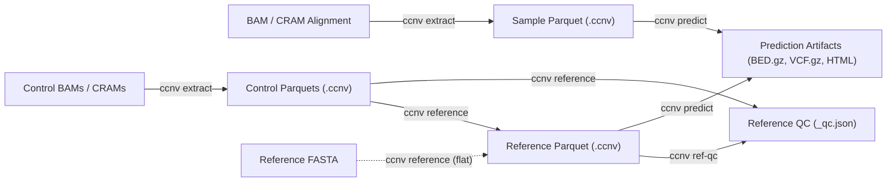
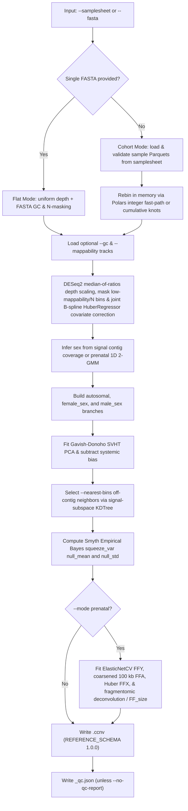
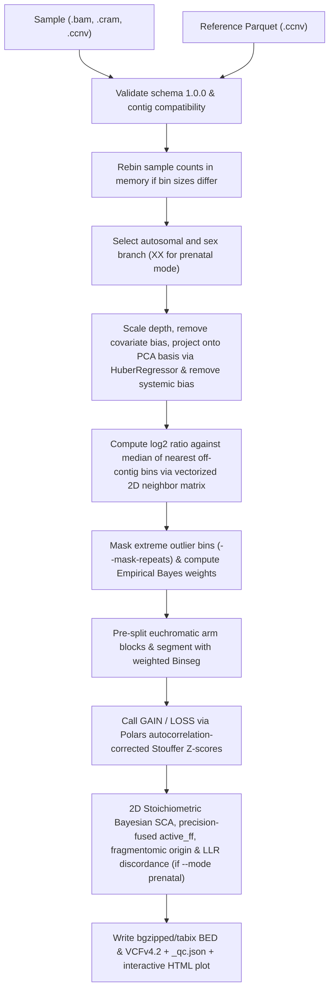

# Pipeline Architecture

`ccnv` executes copy-number variation (CNV) analysis across four stages: [`extract`](#1-extract) (bins alignments into sample Parquet), [`reference`](#2-reference) (builds cohort or flat FASTA reference models), [`ref-qc`](#3-ref-qc) (audits reference quality), and [`predict`](#4-predict) (normalizes coverage, segments with weighted change-point solvers, and calls aberrations).

## Coordinate & Storage Contracts

- **0-Based Half-Open Coordinates**: All internal bins, segments, and BED outputs use `[start, end)` intervals. VCFv4.2 outputs use 1-based coordinates per the VCF specification.
- **Header-Authoritative Layouts**: Contig names, ordering, and exact lengths are taken from the BAM/CRAM or FASTA header without assuming a 24-chromosome human karyotype.
- **Canonical Filtering**: By default, canonical chromosomes (`1`–`22`, `X`, `Y`) are retained and mitochondrial, decoy, unplaced, and ALT contigs are skipped. Pass `--all-contigs` to include all header contigs.
- **Schema `1.0.0` Parquet Artifacts**: Sample and reference `.ccnv` files are Zstandard-compressed Apache Arrow Parquet tables validated against schema version `1.0.0` before computation.

## 1. `extract`

Streams alignments per contig, filters reads in deterministic precedence order, bins read starts (or paired-end dyad midpoints) with `numpy.bincount`, and writes `<prefix>.ccnv`. For paired-end libraries, also captures fragment length distributions ($30$–$600\text{ bp}$), $5'$ 4-mer motif codes, fragment GC content, and endpoint counts, serializing cohort fragmentomics under `ccnv.fragmentomics` Parquet metadata. Effective read counters (`effective_reads_examined`, `effective_reads_kept`, `autosomal_reads_kept`, `sex_reads_kept`) record metrics strictly across binned target contigs.

- **Read Filter Precedence**: Reads are checked in order: `filter_unmapped`, `filter_no_start`, `filter_secondary`, `filter_supplementary`, `filter_duplicate`, `filter_improper_pair`, `filter_mapq`. The first failing check increments its QC counter and drops the read.
- **Thread Budget**: `--threads` splits CPU cores across contig worker processes and per-handle HTSlib decompression threads (`workers * decode_threads <= threads`).
- **Schema**: Columns `contig: string`, `start: int64`, `end: int64`, `count: float64` (or `uint64` in extracted samples), `fragment_lengths: list<uint16>`, `endpoint_count: uint32`, `frag_gc_sum: float32`, plus JSON metadata (`bin_size`, `contig_lengths`, `qc`, `filters`, `ccnv.fragmentomics`).

## 2. `reference`

Constructs an autosomal and optional sex-chromosome background model from a cohort samplesheet (`--samplesheet`) or a flat uniform-depth reference from a FASTA file (`--fasta`). Cohort control samples must share a homogeneous library layout (all paired-end or all single-end); mixed cohorts are rejected with an error. Supports `--mode germline | prenatal` (default `germline`). In prenatal mode, fits non-negative `ElasticNetCV` `FFY` (5 kb chrY), coarsens in memory to 100 kb for convex logit-link `RidgeCV`/`ElasticNetCV` ensemble `FFA` and robust Huber `FFX`, deconvolves fetal and maternal fragment length densities $\hat{p}_F(L)$ and $\hat{p}_M(L)$, trains a multi-modal regularized `FF_size` ensemble (mode-aligned length bands, $10.4\text{ bp}$ helical Fourier cleavage power, 256-dim $5'$ 4-mer motifs), and persists `prenatal_autosomal` and `prenatal_ffy` branches alongside `ccnv.prenatal` metadata.

- **In-Memory Rebinning**: Control samples extracted at a finer or coarser resolution are rebinned to `--bin-size` via mass-conserving geometric overlap when contig lengths match, utilizing a Rust-parallelized Polars integer-multiple fast path across all 4 sample channels (`count`, `fragment_lengths`, `endpoint_count`, `frag_gc_sum`) when coarsening.
- **Covariate Masking & Bias Removal**: Optional `--mappability` BigWig and `--gc` tracks mask bins with mappability below `--min-mappability` (default `0.5`) or `>50%` `N` bases. Depth is scaled via DESeq2 median-of-ratios size factors (Anders & Huber, 2010), and a joint natural cubic B-spline basis with GC, mappability, mean fragment length, and endpoint ratio covariates is fitted per sample via `HuberRegressor` ($\epsilon = 1.35$) to divide out multiplicative bias before PCA.
- **Between- & Within-Sample Modeling**: Singular Value Hard Thresholding (Gavish & Donoho, 2014) automatically determines the optimal PCA rank $P$, separating systemic technical batch effects from Marchenko-Pastur bulk noise. Each bin is embedded into an $\mathbb{R}^{P+4}$ signal subspace (spanning PCA loadings, GC, mappability, mean fragment length, and endpoint ratio) and queried via C-compiled `scipy.spatial.KDTree` to select the `--nearest-bins` off-contig reference partners in $`O(U \log U)`$ time. Degrees-of-freedom-corrected residuals are moderated using Smyth (2004) Empirical Bayes variance shrinkage (`squeeze_var`) to parameterize per-bin `null_mean` and `null_std`.
- **Schema**: Columns `branch`, `contig`, `start`, `end`, `masked`, `gc`, `mappability`, `pca_mean`, `pca_loadings`, `nearest_ref_indices` (`DELTA_BINARY_PACKED`), `mean_distance`, `null_mean`, and `null_std`. Branches include `autosomal`, `female_sex`, `male_sex`, `prenatal_autosomal`, and `prenatal_ffy`.

## 3. `ref-qc`

Evaluates reference usability from nearest-neighbor distance distributions, masked bin fractions, and sex-signal contig coverage, writing `<prefix>_qc.json` and emitting a summary verdict (`PASS`, `WARN`, `FAIL`) to `stderr`.

- **Autosomal / Female Branches**: `FAIL` if no unmasked bins exist or `std_of_means > 10.0`; `WARN` if `std_of_means > 2.0`, outlier bins exceed `1.0%`, or bins have fewer than `min_ref_bins` neighbors.
- **Male Branch**: Also checks the sex-signal contig (`FAIL` if usable bins `< 20%` or mean distance `> 100.0`; `WARN` if usable bins `< 50%` or mean distance `> 5.0`).
- **Flat FASTA Reference**: Emits `WARN` noting that empirical cohort noise models and sex branches are absent.

## 4. `predict`

Projects a sample onto the reference model, normalizes coverage against within-sample off-contig reference bins, segments per contig using pre-split euchromatic change-point detection, and calls `GAIN`/`LOSS` events. Supports input directly as `.bam`, `.cram` (with `--fasta`), or `.parquet`/`.ccnv`. Supports `--mode germline | prenatal` (default `germline`). In prenatal mode, applies depth-conserving Fisher-optimal fragment length read weights $w^{*}(L)$, normalizes `chrX` against the diploid `XX` (`female_sex`) reference branch, computes `FFY`, `FFX`, `FFA`, and multi-modal `FF_size`, classifies sex chromosome aneuploidies (`XX`, `XY`, `XO`, `XXX`, `XXY`, `XYY`, `DISCORDANT_MIXED`), selects precision-fused `active_ff`, annotates segments with expected ratios, implied fetal fractions, discordance flags, short fragment ratios (`frag_short_ratio`), fragment length log-likelihood ratios (`frag_llr_size`), and fragmentomic origin calls (`origin_call`), and writes `<prefix>_qc.json`.

- **Precision Weighting & Segmentation**: During single-sample prediction, counts are projected onto reference PCA loadings via robust Huber M-estimation (`HuberRegressor`, $`\epsilon = 1.35`$), preventing CNV-carrying chromosomes from distorting the diploid baseline. Within-sample references are refined through vectorized 2D neighbor-matrix median evaluations across $`M`$ iterations (default 3), masking outlier bins with $`\vert Z_i \vert \ge 2.326347874`$. Each usable bin receives an Empirical Bayes inverse-variance precision weight $`w_i = \mathrm{clip}(s_0^2 / \tilde{\sigma}_{\text{null}, i}^2, 0.05, 20.0)`$ proportional to the Gaussian log-likelihood (or $`1/\bar{d}_i`$ for flat FASTA references). Contigs are pre-split at masked gaps $`\gt 2\text{ Mb}`$ into contiguous euchromatic arm blocks before change-point optimization using weighted `Binseg` (`ruptures.Binseg` with `WeightedL2Cost`, while `segment_genome` also supports C-compiled `KernelCPD` and `Pelt`). Segments are called using Polars-native Stouffer precision Z-scores with Newey-West AR(1) spatial autocorrelation correction, scaling sensitivity with $`\sqrt{N}`$ while preventing false-positive inflation from local genomic waves. In `--mode prenatal`, the 2D stoichiometric Gaussian Bayes classifier classifies sex chromosome aneuploidies with a Mahalanobis $`\chi^2`$ gate, independent estimators (`FFY`, `FFA`, `FFX`, `FF_size`) are combined via precision fusion for `active_ff`, and segment discordance and biological origin are scored via fetal-fraction-parameterized log-likelihood ratios ($`\mathrm{LLR}_{\text{fetal}}`$ and $`\mathrm{LLR}_{\text{size}}`$).
- **Outputs**: Writes natural-sorted, bgzip-compressed, tabix-indexed `.bed.gz` and `.vcf.gz` files (`_bins`, `_segments`, `_calls`), prediction quality control report `<prefix>_qc.json`, and an interactive Plotly genome profile `<prefix>_plot.html` (with optional cytoband ideogram track via `--cytobands`, prenatal status badge displaying `FF (Y/A/X/Size)`, origin tooltips, and `#9333ea` discordant traces in prenatal mode). In prenatal mode, `_segments.bed.gz` and `_calls.bed.gz` include extra columns `expected_ratio`, `implied_ff`, `discordant`, `discordance_reason`, `frag_short_ratio`, `frag_llr_size`, and `origin_call`, and `_segments.vcf.gz` annotates corresponding `INFO` tags (`DISCORDANT`, `DISC_REASON`, `FRAG_SHORT_R`, `FRAG_LLR`, `ORIGIN`). Quality control output `<prefix>_qc.json` reports sample fragmentomic metrics (`chromatosome_mode_bp`, `core_shoulder_bp`, `sizing_shift_bp`, `dinucleosome_fraction`, `high_mw_fraction`, `helical_10bp_amplitude`, `motif_diversity_score`) with a warning for high maternal leukocyte DNA.
