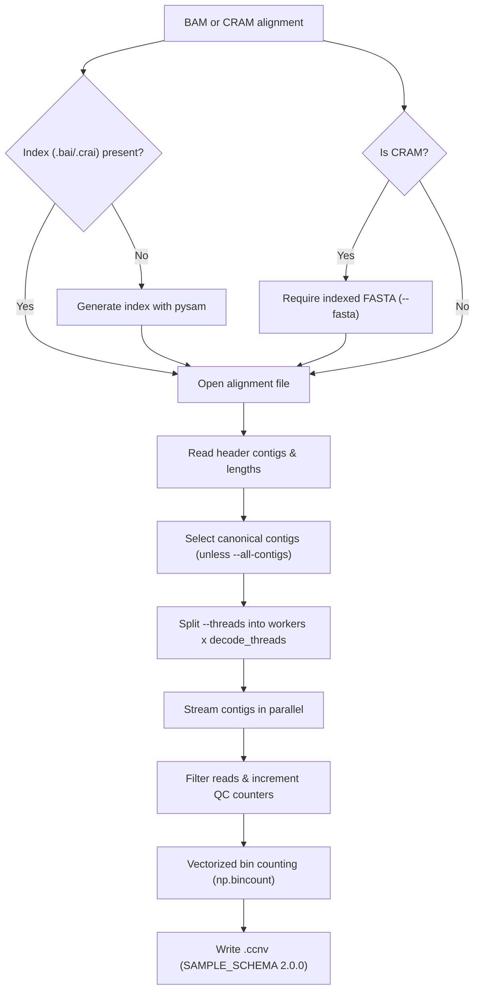
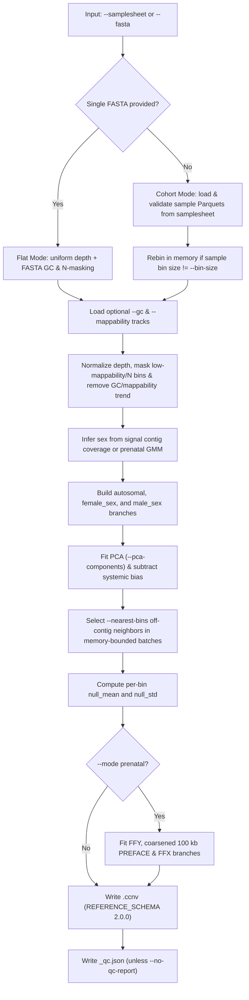

# Pipeline Architecture

`ccnv` executes copy-number variation (CNV) analysis across four stages: [`extract`](#1-extract) (bins alignments into sample Parquet), [`reference`](#2-reference) (builds cohort or flat FASTA reference models), [`ref-qc`](#3-ref-qc) (audits reference quality), and [`predict`](#4-predict) (normalizes coverage, segments with weighted Binary Segmentation, and calls aberrations).

```mermaid
flowchart LR
    A["BAM / CRAM Alignment"] -->|ccnv extract| B["Sample Parquet (<sample>.ccnv)"]
    C["Control BAMs / CRAMs"] -->|ccnv extract| D["Control Parquets (<ctrl>.ccnv)"]
    D -->|ccnv reference| E["Reference Parquet (<reference>.ccnv)"]
    D -->|ccnv reference| H["Reference QC (<reference>_qc.json)"]
    F["Reference FASTA"] -.->|ccnv reference (flat)| E
    E -->|ccnv ref-qc| H
    B -->|ccnv predict| G["Prediction Artifacts (BED.gz, VCF.gz, HTML)"]
    E -->|ccnv predict| G
```

## Coordinate & Storage Contracts

- **0-Based Half-Open Coordinates**: All internal bins, segments, and BED outputs use `[start, end)` intervals. VCFv4.2 outputs use 1-based coordinates per the VCF specification.
- **Header-Authoritative Layouts**: Contig names, ordering, and exact lengths are taken from the BAM/CRAM or FASTA header without assuming a 24-chromosome human karyotype.
- **Canonical Filtering**: By default, canonical chromosomes (`1`–`22`, `X`, `Y`) are retained and mitochondrial, decoy, unplaced, and ALT contigs are skipped. Pass `--all-contigs` to include all header contigs.
- **Schema `2.0.0` Parquet Artifacts**: Sample and reference `.ccnv` files are Zstandard-compressed Apache Arrow Parquet tables validated against schema version `2.0.0` before computation.

## 1. `extract`

Streams alignments per contig, filters reads in deterministic precedence order, bins read starts with `numpy.bincount`, and writes `<prefix>.ccnv`. Effective read counters (`effective_reads_examined`, `effective_reads_kept`, `autosomal_reads_kept`, `sex_reads_kept`) record metrics strictly across binned target contigs.



- **Read Filter Precedence**: Reads are checked in order: `filter_unmapped`, `filter_no_start`, `filter_secondary`, `filter_supplementary`, `filter_duplicate`, `filter_improper_pair`, `filter_mapq`. The first failing check increments its QC counter and drops the read.
- **Thread Budget**: `--threads` splits CPU cores across contig worker processes and per-handle HTSlib decompression threads (`workers * decode_threads <= threads`).
- **Schema**: Columns `contig: string`, `start: int64`, `end: int64`, `count: uint64`, plus JSON metadata (`bin_size`, `contig_lengths`, `qc`, `filters`).

## 2. `reference`

Constructs an autosomal and optional sex-chromosome background model from a cohort samplesheet (`--samplesheet`) or a flat uniform-depth reference from a FASTA file (`--fasta`). Supports `--mode germline | prenatal` (default `germline`). In prenatal mode, also fits pure NumPy/SciPy `FFY` (5 kb chrY), coarsens in memory to 100 kb for `PREFACE` (unscaled PCA + Sigmoid MLP/OLM) and `FFX` (Huber RLM), and persists `prenatal_autosomal` and `prenatal_ffy` branches alongside `ccnv.prenatal` metadata.



- **In-Memory Rebinning**: Control samples extracted at a finer or coarser resolution are rebinned to `--bin-size` via mass-conserving geometric overlap when contig lengths match.
- **Covariate Masking & Bias Removal**: Optional `--mappability` BigWig (where k-mer length should roughly match average sequencing read length) and `--gc` (FASTA, BigWig, or BED/TSV; derived automatically from the input FASTA in flat mode) tracks mask bins with mappability below `--min-mappability` (default `0.5`) or `>50%` `N` bases, and fit a per-sample Huber-weighted polynomial trend on unmasked bins to divide out multiplicative GC wave and mappability bias before PCA.
- **Sex Inference & Branches**: Coverage on `--sex-signal-contig` (`chrY`/`Y`) separates female and male controls automatically (or via `--sex-cutoff` in germline mode, or via 1D 2-GMM and samplesheet labels in prenatal mode). The `autosomal` branch models autosomes across all controls; `female_sex` and `male_sex` model sex contigs for each group when at least `--min-sex-group-size` samples are present.
- **Between- & Within-Sample Modeling**: PCA captures cohort-wide technical bias (such as residual GC wave and batch effects). Residual profiles (or standardized `(GC, mappability)` feature vectors in flat mode when covariates are present) are compared across contigs via batched BLAS matrix multiplication to select the `--nearest-bins` off-contig reference neighbors and estimate `null_mean` and `null_std` per bin.
- **Schema**: Columns `branch`, `contig`, `start`, `end`, `masked`, `gc`, `mappability`, `pca_mean`, `pca_loadings`, `nearest_ref_indices` (`DELTA_BINARY_PACKED`), `mean_distance`, `null_mean`, and `null_std`. Branches include `autosomal`, `female_sex`, `male_sex`, `prenatal_autosomal`, and `prenatal_ffy`.

## 3. `ref-qc`

Evaluates reference usability from nearest-neighbor distance distributions, masked bin fractions, and sex-signal contig coverage, writing `<prefix>_qc.json` and emitting a summary verdict (`PASS`, `WARN`, `FAIL`) to `stderr`.

- **Autosomal / Female Branches**: `FAIL` if no unmasked bins exist or `std_of_means > 10.0`; `WARN` if `std_of_means > 2.0`, outlier bins exceed `1.0%`, or bins have fewer than `min_ref_bins` neighbors.
- **Male Branch**: Also checks the sex-signal contig (`FAIL` if usable bins `< 20%` or mean distance `> 100.0`; `WARN` if usable bins `< 50%` or mean distance `> 5.0`).
- **Flat FASTA Reference**: Emits `WARN` noting that empirical cohort noise models and sex branches are absent.

## 4. `predict`

Projects a sample onto the reference model, normalizes coverage against within-sample off-contig reference bins, segments per contig using weighted Binary Segmentation, and calls `GAIN`/`LOSS` events. Supports `--mode germline | prenatal` (default `germline`). In prenatal mode, normalizes `chrX` against the diploid `XX` (`female_sex`) reference branch, computes `FFY`, `FFX`, and `PREFACE`, classifies sex chromosome aneuploidies (`XX`, `XY`, `XO`, `XXX`, `XXY`, `XYY`, `DISCORDANT_MIXED`), selects `active_ff`, annotates segments with expected ratios and discordance flags, and writes `<prefix>_qc.json`.


- **Precision Weighting & Segmentation**: Each bin receives weight $w_i = 1 / \bar{d}_i$ inversely proportional to its mean Euclidean distance to surviving off-contig reference neighbors (with fallback $1.0$), while Z-scores use the reference null standard deviation $\sigma_{\text{null}, i}$. `ruptures.Binseg` minimizes weighted residual sum-of-squares (`WeightedL2Cost`) with breakpoint penalty `--penalty`, splitting segments across masked gaps larger than `--max-blacklist-gap` (default 2 Mb). See [Mathematical & ML Methodology](methodology.md) for full derivations.
- **Outputs**: Writes natural-sorted, bgzip-compressed, tabix-indexed `.bed.gz` and `.vcf.gz` files (`_bins`, `_segments`, `_calls`), prediction quality control report `<prefix>_qc.json`, and an interactive Plotly genome profile `<prefix>_plot.html` (with optional cytoband ideogram track via `--cytobands`, prenatal status badge, and `#9333ea` discordant traces in prenatal mode).
