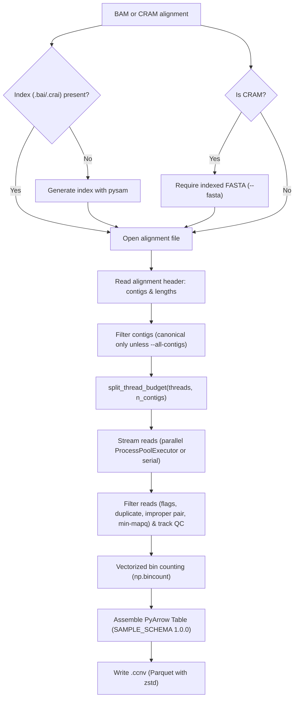
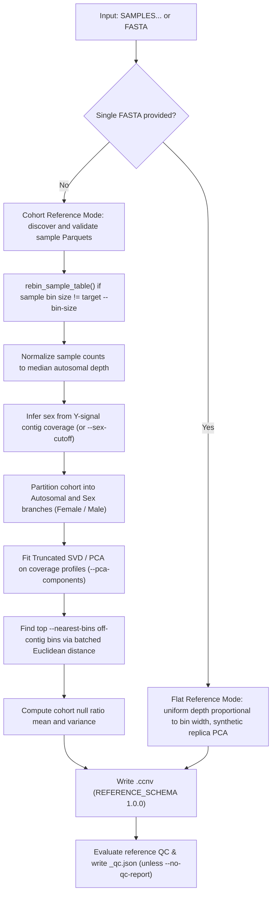
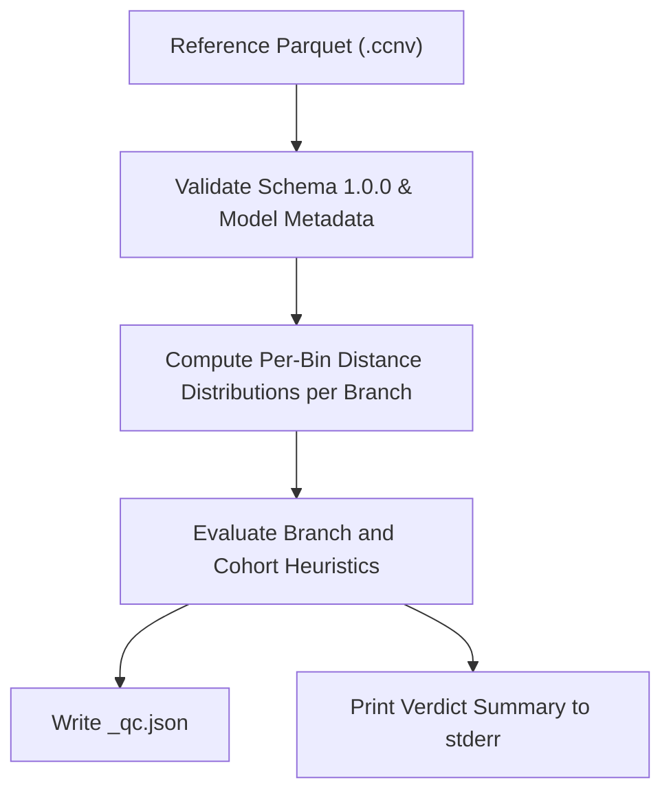
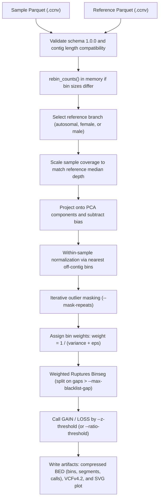

# Pipeline Architecture & Subcommands

Copynumber-CNV (`ccnv`) is a copy number variation analysis tool designed for whole-genome sequencing data. It re-engineers and modernizes the algorithms from WISECONDOR and WisecondorX with versioned Apache Arrow/Parquet storage (`1.0.0`), organism-agnostic coordinate contracts, and deterministic multi-core execution.

The pipeline comprises four subcommands: [`convert`](#1-convert) (transforms raw BAM/CRAM alignments into binned count profiles), [`reference`](#2-reference) (builds background models from cohort controls or reference FASTA), [`ref-qc`](#3-ref-qc) (evaluates reference usability and quality metrics), and [`predict`](#4-predict) (normalizes sample against reference, segments with weighted Binseg, and calls CNVs).

```mermaid
flowchart LR
    A["BAM / CRAM Alignment"] -->|ccnv convert| B["Sample Parquet (<sample>.ccnv)"]
    C["Control BAMs / CRAMs"] -->|ccnv convert| D["Control Parquets (<ctrl>.ccnv)"]
    D -->|ccnv reference| E["Reference Parquet (<reference>.ccnv)"]
    D -->|ccnv reference| H["Reference QC (<reference>_qc.json)"]
    F["Reference FASTA"] -.->|ccnv reference (flat)| E
    E -->|ccnv ref-qc| H
    B -->|ccnv predict| G["Prediction Artifacts (BED, Parquet, SVG)"]
    E -->|ccnv predict| G
```

## Coordinate & Storage Contracts

- **0-Based Half-Open Coordinates:** All bin intervals, segment boundaries, and BED outputs strictly adhere to `[start, end)` half-open conventions.
- **Header-Authoritative Layouts:** Contig identifiers, ordering, and lengths are derived directly from alignment headers or FASTA headers. No fixed 24-chromosome human layout is assumed.
- **Canonical vs All-Contigs:** By default, standard autosomes (1-22) and allosomes (X, Y) are binned, while unplaced scaffolds, decoys, and mitochondrial sequences are skipped. Pass `--all-contigs` to retain every contig.
- **Versioned Parquet Format:** Files are persisted as Apache Arrow tables compressed with Zstandard (`zstd`), with embedded schema version (`1.0.0`), genome metadata, and execution QC counters.

## 1. convert

The `convert` subcommand streams alignment records from a BAM or CRAM file, applies quality and alignment flag filters, aggregates kept reads into fixed-width genomic bins, tracks deterministic quality control counters, and outputs a canonical sample Parquet file (`<prefix>.ccnv`).



1. **Preflight & Indexing:** If a BAM or CRAM file lacks an index (`.bai` or `.crai`), `convert` automatically generates one using `pysam`. CRAM conversions require an indexed reference FASTA via `--fasta`.
2. **Contig Layout Selection:** Header reference sequences are inspected. Unless `--all-contigs` is passed, non-canonical contigs (mitochondrial, decoy, unplaced, ALT contigs) are excluded from processing.
3. **Thread Budget Allocation:** `--threads` defines a total CPU budget. `split_thread_budget` splits this into concurrent contig worker processes (`workers`) and per-handle HTSlib decode threads (`decode_threads`), ensuring `workers * decode_threads <= threads`. When budget is 1 or only 1 contig is present, processing stays in-process.
4. **Read Filtering Precedence:** Reads are evaluated in strict priority order (`filter_unmapped`, `filter_no_start`, `filter_secondary`, `filter_supplementary`, `filter_duplicate`, `filter_improper_pair`, `filter_mapq`); the first failing criterion increments its corresponding QC counter and discards the read.
5. **Interval Binning:** Contig coordinates are partitioned into contiguous intervals of width `--bin-size` (default: 5,000 bp). Final bins on a contig may be shorter than `--bin-size`. Kept read start positions are binned using vector operations (`np.bincount`).
6. **Artifact Output:** Writes `<prefix>.ccnv` containing four columns: `contig: string`, `start: int64`, `end: int64`, and `count: uint64`. Embedded Arrow metadata stores contig lengths, bin size, source file path, and all aggregated QC counters.

## 2. reference

The `reference` subcommand constructs a background reference model from cohort control sample Parquets, or builds an idealized, uniform-depth reference model directly from a FASTA file when no control cohort is available.



1. **Cohort Discovery & Validation:** Input paths are traversed recursively for sample Parquets (`.ccnv`). All samples must share the exact same contig ordering and contig lengths.
2. **On-the-Fly Rebinning:** If sample Parquets were converted at a bin size different from the reference's `--bin-size`, `rebin_sample_table` coarsens or refines count arrays in memory using exact geometric overlap, conserving total count mass.
3. **Depth Normalization:** Total count across all autosomal bins is calculated per sample. Sample counts are scaled to median autosomal depth to correct for variable library sequencing depth.
4. **Sex Contig Inference:** Coverage on `--sex-signal-contig` (default: `chrY` or `Y`) relative to total depth is evaluated across the cohort. If samples separate into two distinct clusters separated by a coverage gap, a boundary cutoff is automatically placed; alternatively, an explicit `--sex-cutoff` can be supplied. Samples with signal above the cutoff are assigned male; those below are assigned female.
5. **PCA Decomposition:** For each branch (autosomal and sex-specific), coverage profiles are centered and decomposed using Truncated SVD / PCA into `--pca-components` (default: 5) to capture cohort-wide systemic variability (e.g., GC content curves, batch effects).
6. **Nearest Off-Contig Reference Bins:** For each target bin, pairwise Euclidean distances are computed against all candidate bins located on *different* contigs. Distances are calculated in chunked batches bounded by `--max-batch-memory-mb` (default: 256 MiB). The `--nearest-bins` (default: 300) with smallest Euclidean distance are recorded as that bin's reference set.
7. **Flat Reference Construction:** When passed a FASTA file and no samples, `reference` creates a uniform model directly from FASTA contig lengths. Expected bin depths are set strictly proportional to bin width. Synthetic replica profiles populate PCA loadings and nearest-bin models, allowing `predict` to execute without a control cohort.
8. **Reference Quality Control:** Evaluates nearest-neighbor distance distributions across each branch, checks masked bin rates, sex inference separation, and flags distance distribution outliers. Produces a machine-readable report `<prefix>_qc.json` with an overall usability verdict (`PASS`, `WARN`, `FAIL`) and prints a concise summary to stderr.

## 3. ref-qc

The `ref-qc` subcommand evaluates quality control metrics on an existing reference file post-creation.



1. **Model Validation:** Verifies that the table conforms to `REFERENCE_SCHEMA` version `1.0.0` and decodes stored metadata (parameters, cohort size, sex inference results).
2. **Nearest-Bin Distance Statistics:** For each unmasked bin across each branch, computes mean and maximum nearest-neighbor distance and count of references.
3. **Outlier Detection:** Computes branch mean-of-means and standard deviation of bin distance means. Bins with mean distance exceeding `mean + 3.0 * std` are flagged as outlier bins.
4. **Branch Usability Verdicts:**
   - **Autosomal / Female branches:** Flags `FAIL` if unmasked bins are absent or `std_of_means > 10.0`. Flags `WARN` if `std_of_means > 2.0`, `outlier_pct > 1.0%`, or bins have fewer than `min_ref_bins` neighbors.
   - **Male branch:** In addition to general distance checks, evaluates the sex-signal contig (e.g., `chrY`). Flags `FAIL` if usable signal-contig bins drop below 20% or mean distance exceeds 100.0. Flags `WARN` if usable bins drop below 50% or mean distance exceeds 5.0.
   - **Flat FASTA reference:** Flags `WARN` with an explanatory message indicating that the flat reference lacks empirical cohort noise models and sex branches, but is synthetically valid.
5. **Output Delivery:** Writes `<prefix>_qc.json` containing complete metrics and emits a one-line summary to `stderr`. Exit code remains 0 when reference QC completes successfully.

## 4. predict

The `predict` subcommand normalizes a test sample against the reference model, subtracts systematic biases via eigenspace projection and within-sample reference bin matching, performs change-point segmentation using weighted Binary Segmentation (Binseg), and calls copy-number gains and losses.



1. **Rebinning to Reference Coordinates:** If the input sample was binned at a resolution differing from the reference model, sample counts are rebinned in memory using 1D mass-conserving interpolation (`rebin_counts`). The reference Parquet file is never modified.
2. **Sex Branch Selection:** If `--sex autosomal` is passed (the default), `predict` checks whether the reference model includes sex-specific branches. If present, the sample's coverage fraction on the reference signal contig is measured to select the appropriate branch (`female` or `male`).
3. **PCA Projection & Bias Removal:** Sample bin coverage is centered against reference mean coverage and projected onto the reference principal component loadings. The projected component signal is subtracted, eliminating shared systematic biases (such as GC-content dependency and batch-level sequencing fluctuations).
4. **Within-Sample Reference Normalization:** For each target bin, expected coverage is calculated from the sample's own coverage across the pre-selected `--nearest-bins` on other contigs. The ratio of observed to expected coverage and the corresponding z-score are calculated against the reference null distribution.
5. **Iterative Outlier Masking:** Extreme ratio outliers can distort neighboring bins during change-point detection. The pipeline runs `--mask-repeats` (default: 3) iterations of masking bins exceeding extreme deviation thresholds before segmenting.
6. **Weighted Ruptures Binseg:** Segmentation is performed per contig using Binary Segmentation (`ruptures.Binseg`) with a customized weighted L2 cost model (`WeightedL2Cost`). Each bin's squared error contribution is weighted inversely by its reference variance. Uninformative masked gaps exceeding `--max-blacklist-gap` (default: 2,000,000 bp) prevent segmentation from bridging across centromeres or unmappable heterochromatin.
7. **Event Calling:** Segments are classified as `GAIN` or `LOSS` if the absolute z-score exceeds `--z-threshold` (default: 3.0), or if `--ratio-threshold` is set, when the absolute log2 ratio exceeds that threshold.
8. **Output Deliverables:** Writes bgzip-compressed and tabix-indexed BED tables (`<prefix>_bins.bed.gz`, `<prefix>_segments.bed.gz`, `<prefix>_calls.bed.gz`), VCFv4.2 tables (`<prefix>_bins.vcf.gz`, `<prefix>_segments.vcf.gz`, `<prefix>_calls.vcf.gz`, toggleable via `--vcf / --no-vcf`), and `<prefix>_plot.svg` (unless `--no-plot` is set). BED coordinates are 0-based half-open, with contig names from the sample genome.
