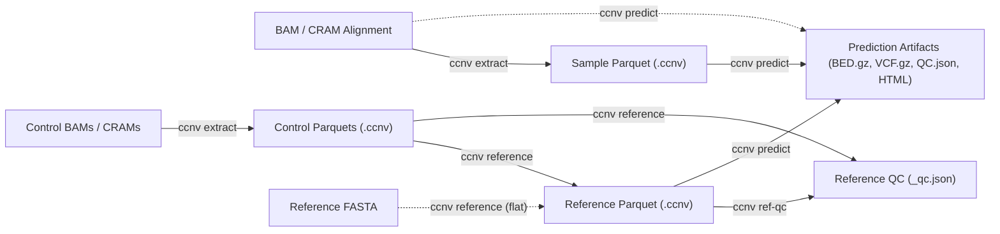
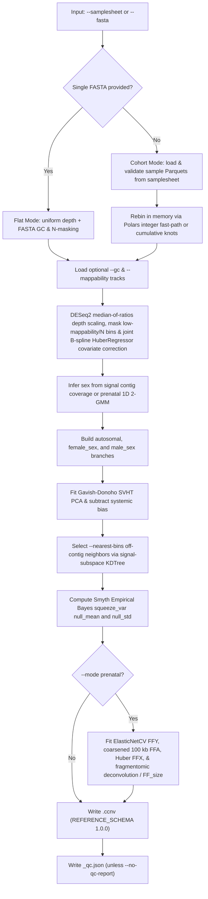
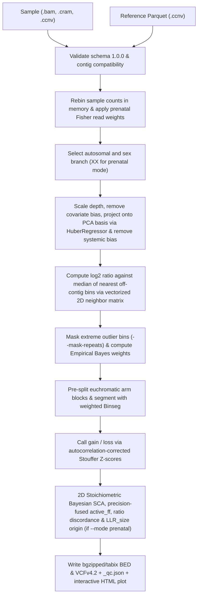

# Pipeline Architecture

`ccnv` executes copy-number variation (CNV) analysis across four stages: [`extract`](#1-extract) (bins alignments into sample Parquet), [`reference`](#2-reference) (builds cohort or flat FASTA reference models), [`ref-qc`](#3-ref-qc) (audits reference quality), and [`predict`](#4-predict) (normalizes coverage, segments with weighted change-point solvers, and calls aberrations).

## Coordinate & Storage Contracts

- **0-Based Half-Open Coordinates**: All internal bins, segments, and BED outputs use `[start, end)` intervals. VCFv4.2 outputs use 1-based coordinates per the VCF specification.
- **Header-Authoritative Layouts**: Contig names, ordering, and exact lengths are taken from the BAM/CRAM or FASTA header without assuming a 24-chromosome human karyotype.
- **Canonical Filtering**: By default, canonical chromosomes (`1` to `22`, `X`, `Y`) are retained and mitochondrial, decoy, random, unplaced, ALT, and EBV contigs are skipped. Pass `--all-contigs` to include all header contigs.
- **Schema `1.0.0` Parquet Artifacts**: Sample and reference `.ccnv` files are Zstandard-compressed Apache Arrow Parquet tables validated against schema version `1.0.0` before computation.

## 1. `extract`

Streams alignments per contig, filters reads in deterministic precedence order, bins paired-end proper pairs by dyad midpoint (`TLEN > 0`) or single-end reads by 0-based `reference_start` with `numpy.bincount`, and writes `<prefix>.ccnv`. Populates per-bin `fragment_lengths` (`30` to `600 bp` for paired-end inserts; empty for single-end), `endpoint_count`, and `frag_gc_sum` columns, and serializes sample-level size landmarks, 571-bin fragment length histograms, and 256-element 5' 4-mer end-motif counts under `ccnv.fragmentomics` Parquet metadata. Effective read counters (`effective_reads_examined`, `effective_reads_kept`, `autosomal_reads_kept`, `sex_reads_kept`) record metrics strictly across binned target contigs.

- **Read Filter Precedence**: Reads are checked in order: `filter_unmapped`, `filter_no_start`, `filter_secondary`, `filter_supplementary`, `filter_duplicate`, `filter_improper_pair`, `filter_mapq`. The first failing check increments its QC counter and drops the read.
- **Thread Budget**: `--threads` splits CPU cores across contig worker processes and per-handle HTSlib decompression threads (`workers * decode_threads <= threads`).
- **Schema**: Columns `contig: string`, `start: int64`, `end: int64`, `count: uint64`, `fragment_lengths: list<uint16>`, `endpoint_count: uint32`, `frag_gc_sum: float32`, plus JSON-encoded `ccnv.*` metadata (`ccnv.artifact_kind`, `ccnv.schema_version`, `ccnv.coordinate_system`, `ccnv.bin_size`, `ccnv.contig_lengths`, `ccnv.source_identity`, `ccnv.reference_identity`, `ccnv.qc`, `ccnv.filters`, `ccnv.fragmentomics`).

## 2. `reference`

Constructs an autosomal and optional sex-chromosome background model from a cohort samplesheet (`--samplesheet`) or a flat uniform-depth reference from a FASTA file (`--fasta`). Cohort control samples must share a homogeneous library layout (all paired-end or all single-end); mixed cohorts are rejected with an error. Supports `--mode germline | prenatal` (default `germline`). In prenatal mode, fits non-negative `ElasticNetCV` `FFY` (5 kb `chrY`), coarsens autosomal and `chrX` counts in memory to 100 kb (`--prenatal-binsize`) for convex logit-link `RidgeCV`/`ElasticNetCV` ensemble `FFA` and robust Huber `FFX`, deconvolves fetal and maternal fragment length densities $\hat{p}_F(L)$ and $\hat{p}_M(L)$, trains a 36-feature standardized logit-link `FF_size` ensemble (mode-aligned 5 bp log-density bands, peak ratios, $10.4\text{ bp}$ helical DFT amplitude, Motif Diversity Score, and DNase1L3 cleavage 4-mers), and persists `prenatal_autosomal` and `prenatal_ffy` branches alongside `ccnv.prenatal` metadata.

- **In-Memory Rebinning**: Control samples extracted at a finer or coarser resolution are rebinned to `--bin-size` when contig lengths match. Coarsening across nested integer-multiple grids runs a Rust-parallelized Polars fast path across all 4 sample channels (`count`, `fragment_lengths`, `endpoint_count`, `frag_gc_sum`); refining or non-nested grids redistribute `count` via mass-conserving cumulative knot interpolation while zeroing the 3 fragmentomic columns and stripping `ccnv.fragmentomics` metadata.
- **Covariate Masking & Bias Removal**: Optional `--mappability` BigWig and `--gc` tracks mask bins with mappability below `--min-mappability` (default `0.5`) or `> 50%` `N` bases. Depth is scaled via DESeq2 median-of-ratios size factors (Anders & Huber, 2010), and a joint quantile B-spline basis with GC, mappability, mean fragment length, and endpoint ratio covariates (plus standardized interaction terms) is fitted per sample on linear median-normalized depth via `HuberRegressor` ($\epsilon = 1.35$) to divide out multiplicative bias before PCA.
- **Between- & Within-Sample Modeling**: Singular Value Hard Thresholding (Gavish & Donoho, 2014) automatically determines the optimal PCA rank $P$, separating systemic technical batch effects from Marchenko-Pastur bulk noise. Each unmasked bin is embedded into an $\mathbb{R}^{P+C}$ signal subspace ($C \in \lbrace 0, \dots, 4 \rbrace$ active covariates spanning GC, mappability, mean fragment length, and endpoint ratio) and queried via C-compiled `scipy.spatial.KDTree` to select `--nearest-bins` off-contig reference partners in $O(U \log U)$ time. Degrees-of-freedom-corrected residuals are moderated using Smyth (2004) Empirical Bayes variance shrinkage (`squeeze_var`) to parameterize per-bin `null_mean` and `null_std`.
- **Schema**: Columns `branch`, `contig`, `start`, `end`, `masked`, `gc`, `mappability`, `pca_mean`, `pca_loadings`, `nearest_ref_indices` (`DELTA_BINARY_PACKED`), `mean_distance`, `null_mean`, and `null_std`. Branches include `autosomal`, `female_sex`, `male_sex`, `prenatal_autosomal`, and `prenatal_ffy`.

## 3. `ref-qc`

Evaluates reference usability from nearest-neighbor distance distributions, masked bin fractions, and sex-signal contig coverage, writing `<prefix>_qc.json` and emitting a summary verdict (`PASS`, `WARN`, `FAIL`) to `stderr`.

- **Autosomal / Female Branches**: `FAIL` if no unmasked bins exist or `std_of_means > 10.0`; `WARN` if `std_of_means > 2.0`, outlier bins exceed `1.0%`, or bins have fewer than `min_ref_bins` neighbors.
- **Male Branch**: Evaluates `mean_of_means > 10.0` (`FAIL`) or `mean_of_means > 2.0` (`WARN`) instead of `std_of_means` (accommodating bimodal `chrX`/`chrY` distance distributions), alongside `n_unmasked == 0` (`FAIL`), outlier/neighbor count warnings, and sex-signal contig checks (`FAIL` if usable unmasked bins `< 20%` or mean distance `> 100.0`; `WARN` if usable unmasked bins `< 50%` or mean distance `> 5.0`).
- **Prenatal Summary**: For `--mode prenatal` references, audits and records `usable_autosomal_bins`, `informative_ffy_bins`, `yfrac_threshold`, and `female_chrx_ratio_std`.
- **Flat FASTA Reference**: Escalates verdict to at least `WARN` noting that empirical cohort noise models and sex branches are absent.

## 4. `predict`

Projects a sample onto the reference model, normalizes coverage against within-sample off-contig reference bins, segments per contig using pre-split euchromatic change-point detection, and calls `gain`/`loss` events. Accepts `.bam`, `.cram` (with `--fasta`), or `.parquet`/`.ccnv` sample inputs. Supports `--mode germline | prenatal` (default `germline`). In prenatal mode, evaluates `FFY`, `FFX`, `FFA`, and `FF_size` on unweighted counts, applies depth-conserving Fisher-optimal fragment length read weights $w^{\ast}(L)$ while calibrating the reference `pca_mean` diploid baseline, normalizes `chrX` against the diploid `XX` (`female_sex`) reference branch, classifies sex chromosome aneuploidies (`XX`, `XY`, `XO`, `XXX`, `XXY`, `XYY`, `DISCORDANT_MIXED`), selects precision-fused `active_ff`, annotates segments with expected ratios, implied fetal fractions, discordance flags, short fragment ratios (`frag_short_ratio`), fragment length log-likelihood ratios (`frag_llr_size`), and fragmentomic origin calls (`origin_call`), and writes `<prefix>_qc.json`.

- **Precision Weighting & Segmentation**: During single-sample prediction, counts are projected onto reference PCA loadings via robust Huber M-estimation (`HuberRegressor`, $\epsilon = 1.35$, $\alpha = 0.0$), preventing CNV-carrying chromosomes from distorting the diploid baseline. Within-sample references are refined through vectorized 2D neighbor-matrix median evaluations across $M$ iterations (default 3), masking outlier bins with $\vert Z_i \vert \ge 2.326347874$. Each usable bin receives an Empirical Bayes inverse-variance precision weight $w_i = \mathrm{clip}(\hat{s}_0^2 / \tilde{\sigma}_{\text{null}, i}^2, 0.05, 20.0)$ proportional to the Gaussian log-likelihood (or $1/\bar{d}_i$ when $\tilde{\sigma}_{\text{null}, i} = 0$, such as flat FASTA references). Contigs are pre-split at masked gaps $\gt 2\text{ Mb}$ into contiguous euchromatic arm blocks before change-point optimization using weighted `Binseg` (`ruptures.Binseg` with `WeightedL2Cost`; `segment_genome` also supports weighted `Pelt`, using unweighted C-compiled `KernelCPD` when block weights are uniform). Segments are called using Polars Stouffer precision Z-scores with NumPy diploid-clipped AR(1) spatial autocorrelation correction, scaling sensitivity with $\sqrt{N}$ while preventing false-positive inflation from local genomic waves. In `--mode prenatal`, the 2D stoichiometric Gaussian Bayes classifier classifies sex chromosome aneuploidies with a Mahalanobis $\chi^2$ gate, concordant estimators (`FFY`, `FFA`, `FFX`, `FF_size`) are combined via Bates-Granger precision fusion for `active_ff`, segment discordance (`SCA_DISCORDANT`, `SUB_FETAL_RATIO`, `SUPER_FETAL_RATIO`) is evaluated via stoichiometric ratio and implied-FF consistency rules, and biological origin is scored via fragment-length mixture log-likelihood ratio ($\mathrm{LLR}_{\text{size}}$).
- **Outputs**: Writes natural-sorted, bgzip-compressed, tabix-indexed `.bed.gz` and `.vcf.gz` files (`_bins`, `_segments`, `_calls`), prediction quality control report `<prefix>_qc.json`, and an interactive Plotly genome profile `<prefix>_plot.html` (with optional cytoband ideogram track via `--cytobands`, prenatal status badge displaying `FF (Y/A/X/Size)`, origin tooltips, and `#9333ea` discordant traces in prenatal mode). In prenatal mode, `_segments.bed.gz` and `_calls.bed.gz` include extra columns `expected_ratio`, `implied_ff`, `discordant`, `discordance_reason`, `frag_short_ratio`, `frag_llr_size`, and `origin_call`, and both `_segments.vcf.gz` and `_calls.vcf.gz` emit `INFO` tags (`DISCORDANT`, `DISC_REASON`, `FRAG_SHORT_R`, `FRAG_LLR`, `ORIGIN`), `FORMAT` fields (`EXP_LOG2R`, `IMPLIED_FF`), and header metadata (`##fetalSex`, `##fetalFraction`, `##scaCall`). Quality control output `<prefix>_qc.json` reports sample fragmentomic metrics (`paired_end`, `total_paired_fragments`, `chromatosome_mode_bp`, `core_shoulder_bp`, `sizing_shift_bp`, `self_referenced_peak_ratio`, `dinucleosome_fraction`, `high_mw_fraction`, `helical_10bp_amplitude`, `motif_diversity_score`) with `WARN_HIGH_LEUKOCYTE_DNA` when `high_mw_fraction > 0.05`.
