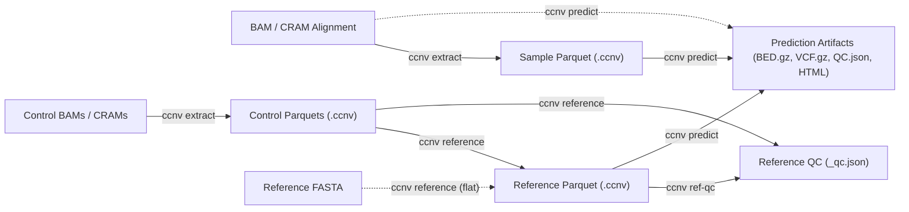
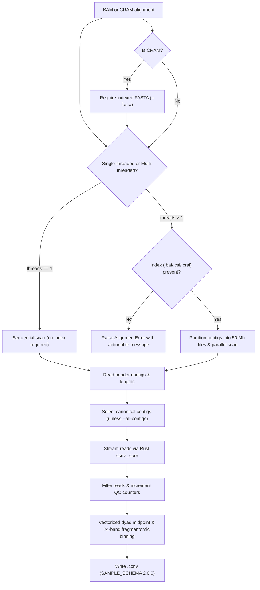
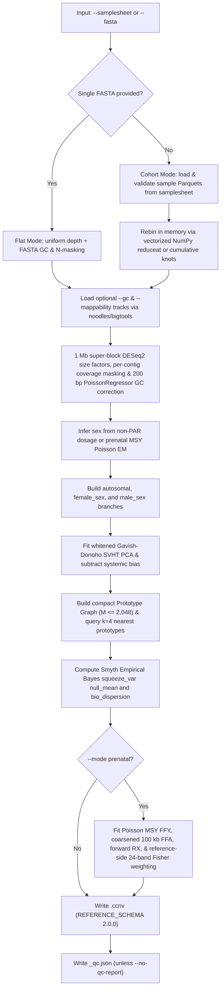
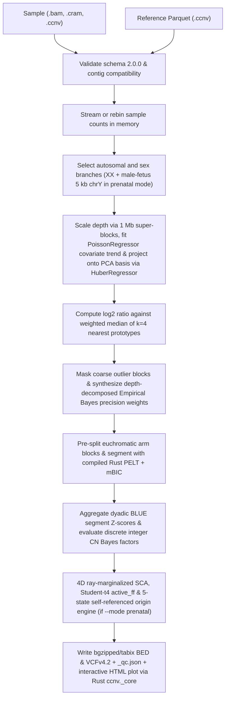

# Pipeline Architecture

`ccnv` executes copy-number variation (CNV) analysis across four stages: [`extract`](#1-extract) (bins alignments into sample Parquet sketches), [`reference`](#2-reference) (builds cohort or flat FASTA reference models), [`ref-qc`](#3-ref-qc) (audits reference quality), and [`predict`](#4-predict) (normalizes coverage against prototype graphs, segments with compiled Rust PELT change-point solvers, and calls copy-number aberrations).

## Coordinate & Storage Contracts

- **0-Based Half-Open Coordinates**: All internal bins, segments, and BED outputs use `[start, end)` intervals. VCFv4.2 outputs use 1-based coordinates per the VCF specification.
- **Header-Authoritative Layouts**: Contig names, ordering, and exact lengths are taken directly from the BAM/CRAM or FASTA header without assuming a 24-chromosome human karyotype.
- **Canonical Filtering**: By default, canonical chromosomes (`1` to `22`, `X`, `Y`) are retained and mitochondrial, decoy, random, unplaced, ALT, and EBV contigs are skipped. Pass `--all-contigs` to include all header contigs.
- **Schema `2.0.0` Parquet Artifacts**: Sample and reference `.ccnv` files are Zstandard-compressed Apache Arrow Parquet tables validated against schema version `2.0.0` before computation.

## 1. `extract`

Streams alignments per contig via the compiled Rust `ccnv._core` scanner (`noodles-bam` and `noodles-cram`), filters reads in deterministic precedence order, bins paired-end proper pairs by dyad midpoint (`TLEN > 0`) or single-end and deduplicated `TLEN == 0` reads by 0-based `reference_start`, and writes `<prefix>.ccnv`. Populates per-bin `count`, `paired_count`, `frag_len_sum`, `short_frag_count` ($[80, 150]\text{ bp}$), `endpoint_count`, `frag_gc_sum`, and 24 fixed-edge piecewise-uniform (variable-width: 20 bp, 10 bp, 50 bp, and 201 bp) fragment length bands `frag_bands`, alongside sample-level size landmarks, 571-bin length histograms, and 256-element 5' 4-mer end-motif counts under `ccnv.fragmentomics` Parquet metadata. Effective read counters (`effective_reads_examined`, `effective_reads_kept`, `autosomal_reads_kept`, `sex_reads_kept`) record metrics strictly across binned target contigs.

- **Read Filter Precedence**: Reads are checked in order: `filter_unmapped`, `filter_no_start`, `filter_secondary`, `filter_supplementary`, `filter_duplicate`, `filter_improper_pair`, `filter_mapq`. The first failing check increments its QC counter and drops the read.
- **Thread Budget**: `-t/--threads` splits CPU cores across contig streaming and decompression tasks. Single-threaded extraction streams sequentially without requiring an index; multi-threaded extraction partitions contigs into bin-aligned $50\text{ Mb}$ tiles scheduled across worker threads using `.bai`/`.csi`/`.crai` indexes.
- **Schema**: Coordinate-free per-bin columns `count: uint32`, `paired_count: uint32`, `frag_len_sum: uint64`, `short_frag_count: uint32`, `endpoint_count: uint32`, `frag_gc_sum: float32`, and `frag_bands: list<uint32>[24]`, with bin coordinates reconstructed implicitly from `ccnv.contig_order`, `ccnv.contig_lengths`, and `ccnv.bin_size`, alongside JSON-encoded `ccnv.*` metadata (`ccnv.artifact_kind`, `ccnv.schema_version`, `ccnv.coordinate_system`, `ccnv.qc`, `ccnv.filters`, `ccnv.fragmentomics`).

## 2. `reference`

Constructs an autosomal and optional sex-chromosome background model from a cohort samplesheet (`--samplesheet`) or a flat uniform-depth reference from a FASTA file (`--fasta`). Cohort control samples must share a homogeneous library layout (all paired-end or all single-end); mixed cohorts are rejected with an error. Supports `--mode germline | prenatal` (default `germline`). In prenatal mode, fits closed-form Poisson MSY `FFY` (5 kb `chrY`), coarsens autosomal and `chrX` counts in memory to 100 kb (`--prenatal-binsize`) for convex logit-link `RidgeCV`/`ElasticNetCV` ensemble `FFA` and forward-calibrated $R_X$ baseline regression, deconvolves fetal and maternal fragment length densities $\hat{p}_F(L)$ and $\hat{p}_M(L)$, applies reference-side 24-band Fisher read weighting $w^{\ast}_{0.08}$, trains a 36-feature standardized logit-link `FF_size` ensemble, and persists `prenatal_autosomal` and `prenatal_ffy` branches alongside `ccnv.prenatal` metadata.

- **In-Memory Rebinning**: Control samples extracted at a finer resolution are coarsened to `--bin-size` when contig lengths match (upsampling finer than sample bin size is rejected with `BinCompatibilityError`). Coarsening across nested integer-multiple grids runs a vectorized `np.add.reduceat` fast path across all 7 channels; non-nested coarser grids redistribute `count` via mass-conserving cumulative knot interpolation while zeroing fragmentomic channels and stripping `ccnv.fragmentomics` metadata.
- **Covariate Masking & Bias Removal**: Optional `--mappability` BigWig and `--gc` tracks mask bins with mappability below `--min-mappability` (default `0.5`) or `> 50%` `N` bases. Depth is scaled via DESeq2 median-of-ratios size factors over $1\text{ Mb}$ super-blocks. Multiplicative bias is normalized via Poisson regression on an exogenous basis incorporating $200\text{ bp}$ GC quantile histograms, mappability B-splines, and cohort fragmentomic covariates.
- **Between- & Within-Sample Modeling**: Singular Value Hard Thresholding (Gavish & Donoho, 2014) on variance-whitened residuals automatically determines the optimal PCA rank $P$, separating systemic technical batch effects from Marchenko-Pastur bulk noise. Each unmasked bin is mapped to $k=4$ nearest prototypes from an $M \le 2{,}048$ MiniBatch K-Means Prototype Graph with soft inverse-distance weights. Degrees-of-freedom-corrected residuals are moderated using Smyth (2004) Empirical Bayes variance shrinkage (`squeeze_var`) to parameterize per-bin `null_mean` and depth-decomposed `bio_dispersion`.
- **Schema**: 17 columns `branch`, `contig`, `start`, `end`, `masked`, `gc`, `mappability`, `gc_quantiles: fixed_size_list<float32, 8>`, `ref_frag_len`, `ref_ep_rate`, `pca_mean`, `pca_loadings`, `proto_ids: fixed_size_list<uint16, 4>`, `proto_weights: fixed_size_list<float16, 4>`, `mean_distance`, `null_mean`, and `bio_dispersion`. Branches include `autosomal`, `female_sex`, `male_sex`, `prenatal_autosomal`, and `prenatal_ffy`.

## 3. `ref-qc`

Evaluates reference usability from dimension-normalized prototype distance distributions (dividing `mean_distance` by $\sqrt{\max(P + C, 1)}$), masked bin fractions, and sex-signal contig coverage, writing `<prefix>_qc.json` and emitting a summary verdict (`PASS`, `WARN`, `FAIL`) to `stderr`.

- **Autosomal / Female Branches**: `FAIL` if no unmasked bins exist or `std_of_means > 10.0`; `WARN` if `std_of_means > 2.0`, outlier bins exceed `1.0%`, or low-prototype bins (`p_low > 0.005`) exceed `0.5%`.
- **Male Branch**: Evaluates `mean_of_means > 10.0` (`FAIL`) or `mean_of_means > 2.0` (`WARN`) instead of `std_of_means` (accommodating bimodal `chrX`/`chrY` distance distributions), alongside `n_unmasked == 0` (`FAIL`), outlier and low-prototype warnings (`p_low > 0.005`), and sex-signal contig checks (`FAIL` if unmasked `chrY` bins `< 5%`, usable unmasked `chrY` bins `< 20%` — including `0%` — or normalized mean distance `> 100.0`; `WARN` if usable unmasked bins `< 50%` or normalized mean distance `> 5.0`).
- **Prenatal Summary**: For `--mode prenatal` references, audits and records `usable_autosomal_bins`, `informative_ffy_bins`, `yfrac_threshold`, and `female_chrx_ratio_std`.
- **Flat FASTA Reference**: Escalates verdict to at least `WARN` noting that empirical cohort noise models and sex branches are absent.

## 4. `predict`

Projects a sample onto the reference model, normalizes coverage against within-sample prototype reference bins, segments per contig using calibrated Pelt change-point detection with mBIC penalty, scores segments via dyadic BLUE precision aggregation, and calls discrete copy-number events via integer copy-number Bayes factors ($CN \in \{0, 1, 2, 3, 4+\}$). Accepts `.bam`, `.cram` (with `--fasta`), or `.parquet`/`.ccnv` sample inputs. Supports `--mode germline | prenatal` (default `germline`) and optional `--twins` for known twin gestations. In prenatal mode, evaluates `FFY`, `FFX`, `FFA` (with degenerate $\lVert \mathbf{w}_{\text{olm}} \rVert_2$ variance scaling via `effective_ffa_sigma`), and `FF_size`, normalizes `chrX` against the diploid `XX` (`female_sex`) reference branch, classifies sex chromosome aneuploidies (`XX`, `XY`, `XO`, `XXX`, `XXY`, `XYY`, `DISCORDANT_MIXED`) via a 4D erfc ray-marginalized Gaussian mixture classifier alongside 2-fetus twin stoichiometry (`FF`, `FM`, `MM`, `twin_probability`, `male_ff`, `female_ff`) via `classify_twin_pregnancy` (recording both `sca` and `twin` in `<prefix>_qc.json`), selects Student-$t_4$ IRLS precision-fused `active_ff`, normalizes male-fetus (`fetal_sex == "M"`) $5\text{ kb}$ clean MSY `chrY` bins from `prenatal_ffy` against an FF-calibrated 1-copy Poisson baseline via `normalize_prenatal_chry` (anchoring to `male_ff` bounded by `active_ff`, or intact-arm $80\text{ kb}$ MSY blocks when sub-blocks diverge, in `("F", "M")` twins and omitting `chrY` for female fetuses `fetal_sex == "F"`), annotates segments with expected ratios, implied fetal fractions, discordance flags, and classifies biological origin via a 5-state self-referenced coupled depth + Dirichlet-Multinomial origin engine (`FETAL_CONSTITUTIONAL`, `PLACENTAL_MOSAIC`, `MATERNAL_UNINHERITED`, `MATERNAL_AND_FETAL_INHERITED`, `MATERNAL_MOSAIC`, with `INDETERMINATE` when max posterior $\lt 0.80$, calibrated to single-fetus and concordant-twin fetal fractions when `gestation == "twin"`).

- **Precision Weighting & Segmentation**: During single-sample prediction, counts are projected onto reference PCA loadings via robust Huber M-estimation (`HuberRegressor`, $\epsilon = 1.35$, $\alpha = 10^{-4}$), preventing CNV-carrying chromosomes from distorting the diploid baseline. Within-sample references are evaluated against $k=4$ nearest prototypes from the reference Prototype Graph. Usable bins receive Empirical Bayes precision weights synthesized from exact discrete Poisson shot noise (`exact_poisson_log_variance`), shrunk compound-Poisson dispersion $\tilde{\kappa}_{\text{frag}, i}$, and depth-decomposed biological overdispersion: $\sigma_{i,\text{test}}^2 = \hat{\tau}_{\text{sample}}^2 \left[ \frac{\tilde{\kappa}_{\text{frag}, i} V_{\ln}(\hat{\lambda}_i)}{(\ln 2)^2} + \frac{\tilde{\phi}_i}{(\ln 2)^2} \right] \left(1 + \frac{\pi}{2 K_{\text{eff}, i}}\right)$. Contigs are pre-split at masked gaps $\gt 2\text{ Mb}$ into contiguous euchromatic arm blocks before change-point optimization using the compiled Rust PELT kernel `ccnv._core.pelt_weighted_l2` with mBIC penalty $\beta_c = \gamma \cdot 2 \hat{\kappa}_c \ln(\max(U_{\text{block}}, 3))$. Segments are scored using Gauss-Markov Best Linear Unbiased Estimator (BLUE) Z-scores $Z_{\text{BLUE}}(S) = \frac{\sum_{i \in S} \sqrt{p_i} \tilde{Z}_i}{\sqrt{\hat{\kappa}_c(N_S) \sum_{i \in S} p_i}}$ with step-detrended dyadic multi-scale variance inflation $\hat{\kappa}_c(L)$. Germline and haploid `prenatal_ffy` calling require discrete integer copy-state log-Bayes factors $\ln \mathrm{BF}_{CN \ne CN_0} \gt 2.0$ over $CN \in \{0, 1, 2, 3, 4+\}$ ($CN_0 = 2$) or $CN \in \{0, 1, 2, 3+\}$ ($CN_0 = 1$), distinguishing homozygous deletions ($CN=0$) down to $0.1\times$ sequencing depth (diploid prenatal branches skip integer CN Bayes factors). In `--mode prenatal`, the 4D erfc ray-marginalized SCA classifier determines sex chromosome karyotypes, `classify_twin_pregnancy` evaluates 2-fetus `FF`/`FM`/`MM` twin stoichiometry, Student-$t_4$ IRLS fuses concordant estimators into `active_ff`, male-fetus (`fetal_sex == "M"`) unweighted $5\text{ kb}$ clean MSY `chrY` bins from `prenatal_ffy` are anchored via `resolve_chry_anchor_ff` (selecting `male_ff` in `FM` twins or LOCO off-`chrY`/intact-arm guards) and normalized against the FF-calibrated 1-copy Poisson baseline $\hat{\lambda}_b = e_b\left(s_{\text{bg}}\lambda_{\text{bg}, b} + \eta_b\frac{f_{\text{eff}}}{2\kappa_{\text{cal}}}\right)$ for `poisson_pooled` haploid segmentation and calling ($CN_0 = 1$), segment discordance is identified, and biological origin is determined via the 5-state coupled depth + Dirichlet-Multinomial origin engine (aligning 571-bin reference densities to sample `sizing_shift_bp`).
- **Outputs**: Writes natural-sorted, bgzip-compressed, `.tbi`/`.csi`-indexed `.bed.gz` and `.vcf.gz` files (`_bins`, `_segments`, `_calls`) using single-pass Rust `ccnv._core` writers (`noodles-bgzf` and `noodles-tabix`/`noodles-csi`), prediction quality control report `<prefix>_qc.json`, and an interactive Plotly genome profile `<prefix>_plot.html` (with cytoband ideogram track auto-populated from bundled GRCh38 cytobands when canonical contig lengths match `hg38` or overridden via `--cytobands`, prenatal status badge displaying `FF (Y/A/X/Size)` alongside resolved twin sex pair and `Twin FF (M/F)` when detected, male-fetus `chrY` track when `fetal_sex == "M"` and omitted when `fetal_sex == "F"`, fetal fraction reference lines, origin tooltips, and `#9333ea` discordant traces in prenatal mode; see [Visualization Overview](visualization.md)). In prenatal mode (including `prenatal_ffy` `chrY` records when `fetal_sex == "M"`), `_segments.bed.gz` and `_calls.bed.gz` include extra columns `expected_ratio`, `implied_ff`, `discordant`, `discordance_reason`, `frag_short_ratio`, `frag_llr_size`, and `origin_call`, and both `_segments.vcf.gz` and `_calls.vcf.gz` emit `INFO` tags (`DISCORDANT`, `DISC_REASON`, `FRAG_SHORT_R`, `FRAG_LLR`, `ORIGIN`, `MOSAIC_FRAC`), `FORMAT` fields (`EXP_LOG2R`, `IMPLIED_FF`), and header metadata (`##fetalSex`, `##fetalFraction`, `##scaCall`). Quality control output `<prefix>_qc.json` reports predicted sample `sex`, `lambda_gc`, sample fragmentomic metrics (`paired_end`, `total_paired_fragments`, `chromatosome_mode_bp`, `core_shoulder_bp`, `sizing_shift_bp`, `self_referenced_peak_ratio`, `dinucleosome_fraction`, `high_mw_fraction`, `helical_10bp_amplitude`, `motif_diversity_score`) with `WARN_HIGH_LEUKOCYTE_DNA` when `high_mw_fraction > 0.05`, and prenatal `sca`, `twin`, `gestation`, `fetal_sexes`, `male_ff`, `female_ff`, `twin_confidence`, `origin_summary`, `lod_ff_35mb`, and `lod_ff_3mb`.
