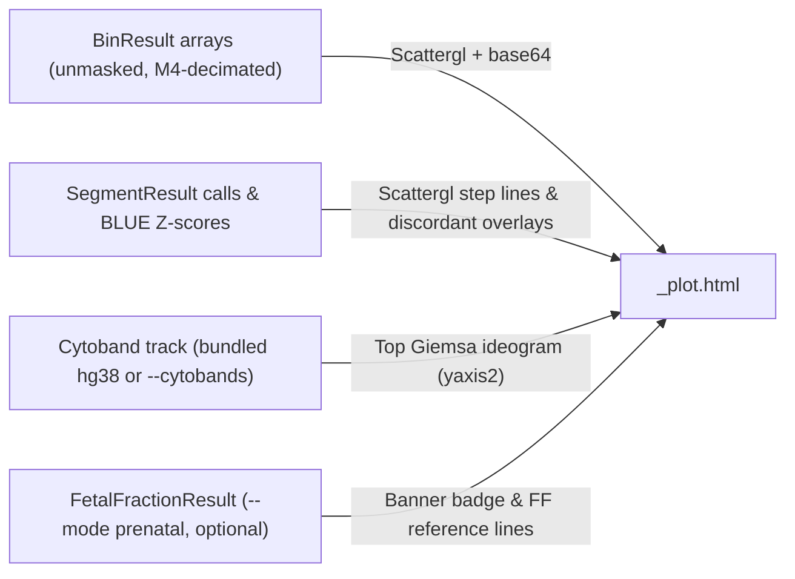

# Visualization Overview

`ccnv predict` generates a self-contained, interactive WebGL/SVG genome copy-number profile at `<prefix>_plot.html` (enabled by default via `--plot`, disabled with `--no-plot`, and enriched with cytogenetic bands automatically on GRCh38/`hg38` samples or via `--cytobands`). Rendered by `render_genome_plot` ([API Reference](api.md)) using Plotly.js (`2.35.2`), the viewer embeds sample coordinates, copy-number signals, segment calls, and optional prenatal metrics as base64-encoded binary arrays inside the HTML file so it can be opened offline in any modern browser.

---

## 1. What Is Visualized

### 1.1 Multi-Chromosome Axis & Alternating Contig Canvas

Modeled contigs present across bins and segments (falling back to cytoband contigs only when both bins and segments are empty, filtered to positive length in `contig_lengths`) are arranged left-to-right in natural sort order (`natural_sort_key`, e.g., `chr1`–`chr22`, `chrX`, `chrY`, or organism-specific header contigs). Each contig occupies its proportional physical length across a unified $[0, \text{totalLen}]$ horizontal axis with $45^{\circ}$-angled contig names centered on each chromosome, alternating white (`#ffffff`) and pale slate (`#f8fafc`) background bands on odd-indexed contigs, and crisp $1\text{ px}$ `#e2e8f0` vertical chromosome boundaries.

Sex-chromosome axis behavior follows the modeled prediction branches: `chrX` is plotted across germline female (`female_sex`), germline male (`male_sex`), and prenatal (`female_sex` diploid `XX` baseline) modes; `chrY` is plotted in germline male (`male_sex`) and prenatal male-fetus (`fetal_sex == "M"`, normalized on `prenatal_ffy` against a $5\text{ kb}$ FF-calibrated 1-copy MSY baseline where euploid `XY` centers at $\log_2 R = 0$, sufficient-statistic `47,XYY` segment ratios shift to $\approx +1.0$ with a purple `SCA_DISCORDANT` highlight, and focal MSY deletions shift negative, while individual $5\text{ kb}$ bin dots reflect `+0.5` pseudocount regularization at low-pass depth), and omitted when unmodeled (germline female or prenatal `fetal_sex == "F"`).

### 1.2 $\log_2$ Ratio Scale & Extreme Value Clamping

The vertical axis plots normalized copy-number $\log_2$ ratios ($\log_2 R$) across a fixed viewport range of $[-2.5, +2.5]$ (`fixedrange: true`) with a solid `#64748b` neutral reference line at $\log_2 R = 0.0$ and `#f1f5f9` horizontal grid lines. Any bin or segment whose true $\log_2 R$ falls below $-2.5$ (such as deep homozygous deletions) or above $+2.5$ (such as high-copy amplifications) is visually clamped to the $\pm 2.5$ boundary so extreme events remain visible on the canvas while hover tooltips continue to report the exact unclamped values.

### 1.3 Bin Cloud & Outlier-Preserving M4 Decimation

Every unmasked bin (`masked == False` and finite `ratio`) is plotted at its genomic midpoint $\text{offset}_c + \frac{1}{2}(\text{start}_i + \text{end}_i)$ across three WebGL `scattergl` layers (**Neutral**, **Gain**, and **Loss**). Because whole-genome $5\text{ kb}$ profiles exceed $600{,}000$ bins, `decimate_bins_m4` compacts any profile larger than `max_plot_bins` (default `48,000`) by partitioning the horizontal coordinate axis into $\lfloor \text{max\_plot\_bins} / 4 \rfloor = 12{,}000$ equal-width buckets, keeping the four M4 visual-envelope points per bucket (`first`, `argmin`, `argmax`, `last`), and unconditionally retaining all outlier bins with $\vert z_i \vert \ge \min(3.0, z_{\text{threshold}})$ (or $\ge 3.0$ when $z_{\text{threshold}} \le 0$). This preserves exact visual extrema and every candidate focal call while keeping HTML file size and WebGL frame times responsive.

### 1.4 Segment Tracks & Initial vs. Live Threshold Calling

Contiguous change-point segments from `SegmentResult` are drawn on the WebGL `scattergl` layer after all bin traces so horizontal step lines spanning exact $[\text{offset}_c + \text{start}, \text{offset}_c + \text{end}]$ interval coordinates at their segment $\log_2 R$ render in the top layer above bin dots:

- **Initial Render (Backend Calls)**: When the toolbar thresholds match the run's configured `z_threshold` and `ratio_threshold`, non-discordant segments render using the exact backend calls stored in `segment_calls` (reflecting dyadic BLUE Z-scores, BH-FDR $q \le 0.05$, and discrete integer copy-number Bayes factors $\ln \mathrm{BF} \gt 2.0$ in germline mode, as detailed in [Mathematical Methodology](methodology.md)).
- **Interactive Recalculation**: Adjusting `|Z| >=` or `|Log2R| >=` in the top toolbar triggers a `100 ms` debounced client-side reclassification of both bin markers and non-discordant segments using **Gain** ($\vert Z \vert \ge z_T$, $\vert \log_2 R \vert \ge r_T$, $\log_2 R \gt 0$, $Z \ge 0$), **Loss** ($\vert Z \vert \ge z_T$, $\vert \log_2 R \vert \ge r_T$, $\log_2 R \lt 0$, $Z \le 0$), or **Neutral** otherwise.

### 1.5 Prenatal Mode Overlays (`--mode prenatal`)

When rendered from a prenatal run (`prenatal_result` present), the viewer adds three cell-free DNA diagnostic layers:

- **Prenatal Status Banner**: Displays inferred `Fetal Sex`, fused `Active FF` (with winning estimator source), individual fetal fraction readouts `FF (Y/A/X/Size)`, and 4D sex-chromosome aneuploidy classification `SCA`.
- **Expected Fetal Fraction Reference Lines**: Draws two horizontal dashed purple (`#9333ea`) guidelines ($y_{+}$ and $y_{-}$, defined below) across all diploid maternal+fetal chromosomes (`chr1`–`chr22` and `chrX`, stopping before haploid `chrY`) showing the expected $\log_2$ ratio shifts for pure fetal heterozygous trisomy ($CN_{\text{fet}} = 3$) and monosomy ($CN_{\text{fet}} = 1$) computed from `effective_ff` ($f_{\text{eff}}$, or `active_ff` when unweighted).
- **High-Contrast Discordant Segment Track**: Segments flagged `discordant == True` (`SCA_DISCORDANT`, `SUB_FETAL_RATIO`, or `SUPER_FETAL_RATIO`, e.g., maternal constitutional/mosaic events or confined placental mosaicism) override standard Gain/Loss/Neutral coloring and render as thick (`6.0 px`) purple lines capped with diamond endpoint markers (`◆`), bringing discordant stoichiometry and biological origin predictions (`origin_call`) into immediate focus.

$$
y_{+} = \log_2\left(1 + \frac{1}{2} f_{\text{eff}}\right), \qquad y_{-} = \log_2\left(\max\left(10^{-4}, 1 - \frac{1}{2} f_{\text{eff}}\right)\right)
$$

### 1.6 Cytoband Ideogram Track (Bundled GRCh38 & `--cytobands`)

When canonical chromosome names (`chr1`–`chr22`, `chrX`, `chrY` or `1`–`22`, `X`, `Y`) match exact GRCh38 (`hg38`) base-pair lengths without conflicting canonical contigs (or when a custom track is supplied via `--cytobands`), and at least one cytoband overlaps the modeled plot contigs, the viewer allocates the top 8% of the canvas (`yaxis2`, domain `[0.92, 1.00]`) above the copy-number panel (`yaxis`, domain `[0.00, 0.90]`) to a synchronized cytogenetic band strip labeled `Band` scoped strictly to modeled plot contigs. Each cytoband draws as a colored rectangle (`y0 = 0.15` to `y1 = 0.85`) colored by Giemsa stain intensity, with invisible midpoint hover targets revealing band coordinates and stain codes.

---

## 2. Interactive Controls, Navigation & Hover Tooltips

The top control bar and Plotly WebGL canvas provide fast exploratory inspection without re-running `ccnv predict`:

- **Genomic Coordinate & Cytoband Search (`Go`)**: Accepts contig names (`chr21` or `21`), intervals (`chr21:13.1m-46.7m`, supporting commas and `k`/`kb`/`m`/`mb` suffixes), single positions (`chr21:15m`, which zooms to a $100\text{ kb}$ window), or cytoband names (`21q22.11`, `chr21q22`) whenever cytobands are active (bundled `hg38` or `--cytobands`). Pressing `Enter` or clicking `Go` zooms the x-axis directly; `Whole Genome` resets to `[0, totalLen]`.
- **Threshold Filters (`|Z| >=` and `|Log2R| >=`)**: Live numeric controls that re-bin and re-color neutral, gain, and loss clouds and segments after `100 ms` without resetting your current horizontal zoom window.
- **Bin Hover Card**: Hovering over any `scattergl` bin dot opens a dark floating tooltip displaying `<contig>:<start>-<end>` alongside unclamped `Log2R` (3 decimals) and `Z` (2 decimals).
- **Segment & Cytoband Hover Text**: Hovering over a segment line reports `<contig>:<start>-<end> (<N> bins)`, `Segment Log2R | Z`, and in prenatal mode appends `Short Frag` percentage, `LLR_size`, `origin_call` (or `Origin: <call>`), and discordant diagnostics (`Discordant: <reason>`, `Expected`, and `Implied FF`). Hovering over the top `Band` strip reports `<contig><band> (<start>-<end>, <stain>)`.

---

## 3. Legend of Icons, Traces, Badges & Color Coding

### 3.1 Plot Traces, Markers & Canvas Reference Lines

| Swatch / Symbol | Element | Color & Hex | Size / Width | Meaning |
| :--- | :--- | :--- | :--- | :--- |
|  /  | Gain Bin Dot / Header Legend Dot | Rose `#e11d48` (plot), Crimson `#c43c39` (header) | `4.5 px` dot (`0.85` opacity) / `9 px` dot | Unmasked bin exceeding $\vert Z \vert$ and $\vert \log_2 R \vert$ thresholds with $\log_2 R \gt 0$ and $Z \ge 0$ |
|  | Gain Segment Line | Crimson `#c43c39` | `3 px` solid line | Segment classified as copy-number `gain` |
|  /  | Loss Bin Dot / Header Legend Dot | Emerald `#16a34a` (plot), Forest `#3c8c5a` (header) | `4.5 px` dot (`0.85` opacity) / `9 px` dot | Unmasked bin exceeding $\vert Z \vert$ and $\vert \log_2 R \vert$ thresholds with $\log_2 R \lt 0$ and $Z \le 0$ |
|  | Loss Segment Line | Forest `#3c8c5a` | `3 px` solid line | Segment classified as copy-number `loss` |
|  /  | Neutral Bin Dot / Header Legend Dot | Cool Gray `#94a3b8` (plot), Slate `#64748b` (header) | `3.5 px` dot (`0.7` opacity) / `9 px` dot | Unmasked bin not meeting active Gain/Loss call thresholds |
|  | Neutral Segment Line | Charcoal `#1e293b` | `2.2 px` solid line | Copy-neutral segment |
| ◆━━◆ | Prenatal Discordant Segment (line + diamonds) | Purple `#9333ea` (`9 px` header dot, `7 px` diamond) | `6.0 px` solid line + `7 px` `diamond` markers | Prenatal segment whose depth conflicts with fetal stoichiometry (`SCA_DISCORDANT`, `SUB_FETAL_RATIO`, `SUPER_FETAL_RATIO`) |
|  | Prenatal Expected FF Lines (dashed) | Purple `#9333ea` | `1.5 px` dashed horizontal lines | Expected $\log_2 R$ for heterozygous fetal gain $y_{+}$ and loss $y_{-}$ at `effective_ff` |
|  | Zero Baseline & Contig Grid | Slate `#64748b` (zero), Pale `#f1f5f9` (grid) | `1 px` horizontal | Diploid neutral reference ($\log_2 R = 0.0$) and y-axis grid lines |
|  | Alternating Contig Shading & Dividers | Tint `#f8fafc` (odd) / `#ffffff` (even), border `#e2e8f0` | `1 px` vertical line | Visual separation between adjacent chromosomes across genome |

### 3.2 Prenatal Status Banner Badges, Tooltips & UI Alerts

| Swatch / Preview | UI Element | Colors (Background / Border / Text) | Trigger Condition |
| :--- | :--- | :--- | :--- |
| EUPLOID | Default Prenatal Badge (`.badge`) | `#f1f5f9` / `#cbd5e1` / `#334155` | Prenatal mode active with euploid `SCA` call and adequate fetal fraction ($\ge 4$%) |
| LOW FF | Warning Prenatal Badge (`.badge-warn`) | `#fffbeb` / `#fde68a` / `#b45309` | Euploid `SCA` call paired with `low_ff_warning == True` (low active fetal fraction) |
| SCA ALERT | Alert Prenatal Badge (`.badge-alert`) | `#fef2f2` / `#fecaca` / `#dc2626` | Non-euploid `SCA` call (`is_aneuploid == True`, e.g., `XO`, `XXX`, `XXY`, `XYY`, `DISCORDANT_MIXED`) |
| Region not found | Search Error Notice (`#search-err`) | Transparent / none / `#dc2626` | Entered contig, interval, or cytoband string cannot be matched |
| chr1:0-5,000 | Bin Hover Tooltip (`#bin-tooltip`) | `rgba(15, 23, 42, 0.92)` / none / `#f8fafc` | Cursor hovering over any bin marker in the WebGL scatter plot |

### 3.3 Cytoband Ideogram Giemsa Stain Colors (`--cytobands`)

| Swatch | Stain Key | Hex Color | Cytogenetic Feature |
| :--- | :--- | :--- | :--- |
|  | `gneg` | `#ffffff` | Giemsa-negative euchromatic R-band (gene-rich light band) |
|  | `gpos25` | `#d9d9d9` | Weakly Giemsa-positive G-band ($25$% intensity) |
|  | `gpos33` | `#bfbfbf` | Low-to-moderate Giemsa-positive G-band ($33$% intensity) |
|  | `gpos50` | `#969696` | Medium Giemsa-positive G-band ($50$% intensity) |
|  | `gpos66` | `#737373` | Medium-dark Giemsa-positive G-band ($66$% intensity) |
|  | `gpos75` | `#525252` | Dark Giemsa-positive G-band ($75$% intensity) |
|  | `gpos100` | `#1e293b` | Darkest Giemsa-positive heterochromatic G-band ($100$% intensity) |
|  | `acen` | `#dc2626` | Centromeric region (primary constriction) |
|  | `gvar` | `#cbd5e1` | Variable constitutive heterochromatic region |
|  | `stalk` | `#94a3b8` | Acrocentric short-arm satellite stalk (`chr13`, `chr14`, `chr15`, `chr21`, `chr22`) |
|  | Other / unrecognized | `#e2e8f0` | Fallback fill when a cytoband record uses a non-standard stain label; all bands carry a `0.5 px` `#64748b` outline |

### 3.4 Toolbar Buttons & Plotly Modebar Icons

| Icon / Control | Component | Label | Action |
| :--- | :--- | :--- | :--- |
| `[chr21:13.1m-46.7m...]` + `Go` | Top Header Bar | Coordinate Search | Zooms horizontally to matching chromosome, coordinate span, `100 kb` locus, or cytoband |
| `Whole Genome` | Top Header Bar | Reset Range | Clears the coordinate input and restores `[0, totalLen]` |
| $\vert Z \vert \ge$ / $\vert\text{Log2R}\vert \ge$ | Top Header Bar | Live Call Thresholds | Debounced (`100 ms`) reclassification of neutral, gain, and loss bins and segments |
| Camera | Plotly Modebar | Download plot as PNG | Exports the current zoomed viewport as a static PNG image |
| Magnifying glass | Plotly Modebar | Zoom | Box-drag horizontal zoom along the genome axis (`yaxis` stays locked to `[-2.5, 2.5]`) |
| Four-way arrows | Plotly Modebar | Pan *(default active)* | Click-and-drag horizontal panning across chromosomes; mouse wheel zooms horizontally (`scrollZoom: true`) |
| `+` / `-` | Plotly Modebar | Zoom in / Zoom out | Step-wise horizontal zoom centered on the current viewport |
| Expand corners | Plotly Modebar | Autoscale | Fits the horizontal axis tightly to active trace bounds |
| House | Plotly Modebar | Reset axes | Restores initial Plotly viewport ranges (Note: the Plotly logo badge is hidden via `displaylogo: false`) |

!!! tip
    Hovering directly over any chromosome band rectangle near the top `Band` strip reveals its exact cytoband name (for example `chr21q22.11`), base-pair coordinates, and stain code, even while zoomed out to the whole genome.
