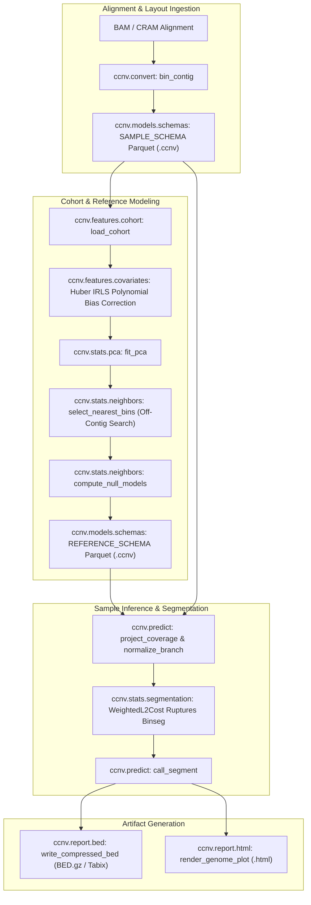

# `ccnv`

## Overview

The `ccnv` package implements an organism-agnostic, pure-Python bioinformatics framework for copy-number variation (CNV) detection in shallow whole-genome sequencing (sWGS) data. Drawing statistical inspiration from WISECONDOR and WisecondorX, the architecture formalizes a complete data transformation lifecycle spanning alignment streaming, robust Huber iteratively reweighted least squares (IRLS) covariate bias correction, principal component projection, off-contig nearest-neighbor reference modeling, weighted binary segmentation, and tabix-indexed reporting.

### Algorithmic Foundations

#### 1. Binned Read Counting and Coordinate Contracts
Alignments are processed contig-by-contig with single-pass coordinate streaming using `pysam.AlignmentFile`. Reads failing quality criteria (unmapped, secondary, supplementary, duplicate, vendor failed, or below `--min-mapq`) are excluded. The genomic continuum is partitioned into 0-based half-open intervals $[s_i, e_i)$ of width $B$ (default $5\,000\text{ bp}$), where the terminal bin is truncated to contig length $L$. Read start coordinates are aggregated into a 1D unsigned 64-bit integer array. Rebinning from source coordinates to target reference coordinates computes proportional bin overlap weights:
$$w_{ij} = \frac{\max(0, \min(e_i^{\text{src}}, e_j^{\text{tgt}}) - \max(s_i^{\text{src}}, s_j^{\text{tgt}}))}{e_i^{\text{src}} - s_i^{\text{src}}}$$
and projects counts via matrix vector products, clamping negative floating-point residuals to zero.

#### 2. Robust Huber IRLS Covariate Normalization
Sequencing coverage exhibits non-linear dependencies on local GC content and mappability. Bins with valid bases $\le 0$, ambiguous base fraction $N > 0.5$, or mappability below $\tau_{\text{map}}$ (default $0.5$) are masked. For usable bins, standardized covariate values $z$ are clamped to $[-2.5, 2.5]$. A polynomial basis $\mathbf{X}$ is constructed (degree 3 for GC content, degree 2 for mappability). The system computes multiplicative bias trends through a 3-iteration Huber Iteratively Reweighted Least Squares (IRLS) algorithm minimizing the objective:
$$\sum_{i} \rho_{\delta}(y_i - \mathbf{x}_i^T \boldsymbol{\beta}), \quad \rho_{\delta}(r) = \begin{cases} \frac{1}{2} r^2 & \text{if } |r| \le \delta \\ \delta |r| - \frac{1}{2} \delta^2 & \text{if } |r| > \delta \end{cases}$$
with tuning threshold $\delta = \max(2.5 \cdot \sigma_{\text{MAD}}, 0.08)$ and Huber weight floor $0.05$. The evaluated trend is bounded to $[0.20, 5.0]$ and divided out of per-sample bin counts. Corrected bin totals are rescaled per sample to preserve the original aggregate depth of usable bins.

#### 3. Deterministic PCA and Off-Contig Nearest-Bin Modeling
Per-sample normalized coverage is assembled across cohort samples. Bins exhibiting total normalized coverage $\le 5\%$ of the positive median bin depth are flagged as low-coverage and masked. Centered unscaled Singular Value Decomposition fits $P$ components (default 5) across the samples-by-bins matrix and divides out reconstructed systemic bias. For each target bin $i$, an empirical reference set of $k$ bins (default 300) is determined. To eliminate local correlation artifacts from regional copy-number alterations, candidate bins located on the same contig as $i$ are strictly excluded ($d_{ij}^2 = \infty$). Neighbor squared Euclidean distances are evaluated in PCA-corrected coverage space (or standardized covariate space in flat FASTA mode):
$$d_{ij}^2 = \sum_{s=1}^S (\mathbf{v}_{is} - \mathbf{v}_{js})^2$$
The $k$ smallest squared Euclidean distance candidates are identified via `argpartition` and mergesort, then filtered by a 3-pass iterative $3\sigma$ distance cutoff to store each bin's surviving mean Euclidean distance $\bar{d}_i$. For each bin, an empirical null distribution model is parameterized using up to 100 control cohort samples. The null log2 ratio relative to the median of its $k$ neighbors is evaluated per sample:
$$R_{s, i} = \log_2 \left( \frac{y_{s, i}}{\text{median}_{j \in \mathcal{N}_i}(y_{s, j})} \right)$$
yielding empirical bin-specific null expectations $\mu_i = \text{mean}(R_{\cdot, i})$ and sample standard deviations $\sigma_i = \text{std}(R_{\cdot, i}, \text{ddof}=1)$.

#### 4. Iterative Within-Sample Reference Filtering
During single-sample prediction, sample counts are projected onto the reference PCA basis via least squares to divide out systemic bias. To protect the reference against CNV contamination present in the test sample itself, an iterative within-sample filtering protocol is executed over $M$ passes (default 3). Bins with non-positive corrected coverage or extreme Z-scores ($|Z_i| \ge 2.326347874$, corresponding to the 99th percentile of a standard normal distribution) are temporarily masked. The within-sample expected depth is recomputed from the median of surviving reference bins. Target bins with fewer than $\tau_{\text{ref}}$ usable neighbors (default 3 in `predict`, 150 in `ref-qc`) are marked as unusable.

#### 5. Weighted Binary Segmentation and Change-Point Detection
Genome-wide segmentation formulates copy-number boundary detection as a penalized change-point optimization problem over weighted log2 ratio observations $y_i = \log_2(\text{depth}_i / \text{expected}_i)$ with weights $w_i = 1 / \bar{d}_i$ (inverse mean Euclidean neighbor distance). The system employs a custom `WeightedL2Cost` inside Ruptures Binary Segmentation (`binseg`) or Pruned Exact Linear Time (`pelt`):
$$\mathcal{L}(\mathcal{T}) = \sum_{m=1}^{M+1} \mathrm{cost}(t_{m-1}, t_m) + \beta M$$
where the segment cost evaluates the weighted sum of squared errors from the weighted segment mean:
$$\mathrm{cost}(s, e) = \sum_{i=s}^{e-1} w_i (y_i - \bar{y}_{w})^2, \quad \bar{y}_{w} = \frac{\sum_{i=s}^{e-1} w_i y_i}{\sum_{i=s}^{e-1} w_i}$$
Contiguous tracts of unmapped or masked bins exceeding $\Delta_{\text{max}}$ base pairs (default $2\,000\,000\text{ bp}$) enforce segment boundaries to prevent spurious interpolations across centromeres or heterochromatic gaps. Candidate segments are classified as copy-number gains or losses when $|\bar{Z}| > Z_{\text{thresh}}$ (default 3.0) or when $|\bar{y}_w| > r_{\text{thresh}}$ if `--ratio-threshold` is supplied.

## Interface

### Subpackages & Contracts

- `features`: [features/README.md](./features/README.md) - Feature extraction, dynamic rebinning, cohort normalization, covariate bias correction, and prenatal inference models.
- `io`: [io/README.md](./io/README.md) - External format ingestion (BAM/CRAM, BigWig, FASTA), samplesheet validation, and Parquet storage.
- `models`: [models/README.md](./models/README.md) - Domain representations, configuration models, result structures, Arrow schemas (2.0.0), and exception types.
- `qc`: [qc/README.md](./qc/README.md) - Quality control accounting, reference model auditing, usability verdicts, and JSON metrics reporting.
- `report`: [report/README.md](./report/README.md) - Downstream bgzipped/tabix BED/VCF serialization and interactive Plotly HTML visualization.
- `stats`: [stats/README.md](./stats/README.md) - Stateless numerical kernels, truncated PCA, off-contig nearest-neighbor search, and weighted change-point segmentation.

### Package Symbols

- `[src/ccnv/cli.py:app]`: Primary Typer CLI application hosting `convert`, `reference`, `ref-qc`, and `predict` entry points.
- `[src/ccnv/convert.py:run]`: Ingests BAM/CRAM files, filters reads, performs multi-process binned counting, and writes sample Parquet.
- `[src/ccnv/features/cohort.py:rebin_sample_table]`: Dynamically rebins sample tables in memory across compatible contig coordinate layouts.
- `[src/ccnv/io/parquet.py:load_cohort]`: Discovers, validates, and loads multiple control sample Parquet files.
- `[src/ccnv/features/cohort.py:cohort_from_fasta]`: Synthesizes an artificial flat uniform-depth cohort from FASTA sequence lengths.
- `[src/ccnv/io/tracks.py:load_gc_track]`: Extracts and validates GC content proportions from FASTA, BigWig, or BED/TSV files.
- `[src/ccnv/io/tracks.py:load_mappability_track]`: Loads per-bin mappability scores from BigWig tracks.
- `[src/ccnv/features/covariates.py:correct_covariate_bias]`: Normalizes GC and mappability biases using 3-iteration Huber IRLS polynomial regression.
- `[src/ccnv/reference.py:run]`: Coordinates cohort loading, depth normalization, PCA decomposition, nearest-bin pairing, and reference Parquet creation.
- `[src/ccnv/ref_qc.py:run]`: Audits reference model Parquet tables and emits quality verdicts (`PASS`, `WARN`, `FAIL`).
- `[src/ccnv/stats/neighbors.py:select_nearest_bins]`: Parallel batched off-contig nearest-neighbor search in PCA/covariate space.
- `[src/ccnv/stats/neighbors.py:compute_null_models]`: Calculates per-bin null log2 ratio means and standard deviations across cohort controls.
- `[src/ccnv/qc/reference.py:run_reference_qc_on_table]`: Evaluates reference quality metrics and issues usability verdicts (`PASS`, `WARN`, `FAIL`).
- `[src/ccnv/predict.py:run]`: Coordinates single-sample normalization, PCA projection, Ruptures segmentation, calling, and reporting.
- `[src/ccnv/stats/segmentation.py:WeightedL2Cost]`: Custom Ruptures `BaseCost` computing weighted SSE for change-point detection.
- `[src/ccnv/stats/segmentation.py:segment_contig]`: Segments an individual contig across blacklisted gap boundaries.
- `[src/ccnv/report/__init__.py:write_outputs]`: Serializes tabix-indexed bgzipped BED and VCF tables for bins, segments, and calls.
- `[src/ccnv/report/html.py:render_genome_plot]`: Compiles interactive self-contained Plotly HTML visualizations using Jinja2 templates.
- `[src/ccnv/models/schemas.py:validate_table]`: Validates Arrow schemas and metadata against versioned contracts.
- `[src/ccnv/models/config.py:ConvertConfig]`, `[src/ccnv/models/config.py:ReferenceConfig]`, `[src/ccnv/models/config.py:PredictConfig]`: Strongly-typed configuration containers.
- `[src/ccnv/models/results.py:BinResult]`, `[src/ccnv/models/results.py:SegmentResult]`, `[src/ccnv/models/results.py:PredictionOutputs]`: Common result dataclasses.

## Invariants

- `[src/ccnv/models/schemas.py:validate_table]`: All tables must strictly conform to `SAMPLE_SCHEMA` or `REFERENCE_SCHEMA` under Arrow schema version `2.0.0` with `0-based-half-open` intervals.
- `[src/ccnv/models/schemas.py:validate_metadata]`: Metadata requires non-empty `contig_lengths` mapping identifiers to positive integers; row coordinates must satisfy $0 \le \text{start} < \text{end} \le \text{length}$.
- `[src/ccnv/features/cohort.py:validate_cohort]`: Input cohort samples must share identical contig layouts, identical contig lengths, and matching bin coordinates.
- `[src/ccnv/features/covariates.py:validate_min_mappability]`: Minimum mappability must be a finite floating-point value in $[0.0, 1.0]$.
- `[src/ccnv/stats/neighbors.py:select_nearest_bins]`: Nearest-bin search explicitly enforces infinite distance ($d_{ii} = \infty$) for all bins on the same contig to guarantee off-contig selection.
- `[src/ccnv/stats/neighbors.py:compute_null_models]`: Null distribution sampling is bounded to at most 100 cohort samples; non-finite standard deviations are coerced to 0.0.
- `[src/ccnv/stats/segmentation.py:WeightedL2Cost.fit]`: Signal values and weights must have identical lengths; non-finite values or negative weights are zeroed.
- `[src/ccnv/stats/segmentation.py:_validate_inputs]`: Bins must be sorted, non-overlapping ($\text{start}_{i+1} \ge \text{end}_i$), with finite positive penalty and $\text{jump} \ge 1$.
- `[src/ccnv/predict.py:normalize_branch]`: Retains only bins satisfying $|Z_i| < 2.326347874$; masks bins possessing fewer than $\tau_{\text{ref}}$ valid reference bins.

## Side Effects

- `[src/ccnv/convert.py:_worker_handle]`: Opens BAM/CRAM handles using `pysam.AlignmentFile` and maintains a per-worker handle cache.
- `[src/ccnv/io/alignments.py:ensure_index]`: Generates BAM (`.bai`) or CRAM (`.crai`) index files on disk via `pysam.index` when missing.
- `[src/ccnv/io/parquet.py:write_sample_parquet]`: Creates target directory hierarchies and writes zstd-compressed Parquet files to disk.
- `[src/ccnv/io/tracks.py:read_fasta_contigs]`: Generates FASTA index files (`.fai`) on disk via `pysam.faidx` when absent.
- `[src/ccnv/stats/neighbors.py:select_nearest_bins]`: Allocates process worker pools via `concurrent.futures.ProcessPoolExecutor` when bin count $> 2\,000$ and threads $> 1$.
- `[src/ccnv/reference.py:run]`: Writes `<prefix>.ccnv` reference Parquet and optionally writes `<prefix>_qc.json` while emitting formatted QC metrics to `sys.stderr`.
- `[src/ccnv/report/__init__.py:write_outputs]`: Writes bgzipped files (`_bins.bed.gz`, `_segments.bed.gz`, `_calls.bed.gz`, optional VCFs) and creates tabix indices (`.tbi`) via `pysam`.
- `[src/ccnv/report/html.py:render_genome_plot]`: Writes standalone HTML visualization `<prefix>_plot.html` to disk.

## Verification

- Run: `pytest`
