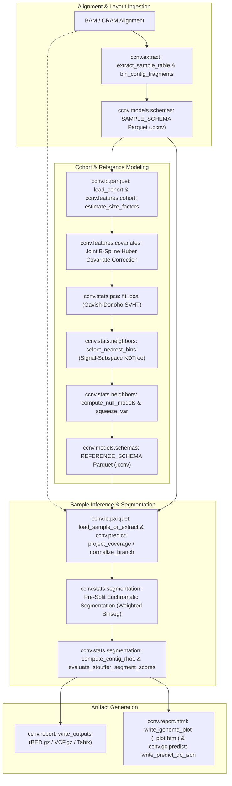

# `ccnv`

## Overview

The `ccnv` package implements an organism-agnostic, pure-Python bioinformatics framework for copy-number variation (CNV) detection in shallow whole-genome sequencing (sWGS) data across germline and cell-free DNA prenatal (NIPT) workflows. Building on published within-sample reference normalization methodology (Straver et al., 2014; Raman et al., 2019), the package spans alignment and fragmentomics extraction, DESeq2 median-of-ratios depth scaling, joint quantile B-spline Huber covariate bias correction, Gavish-Donoho SVHT PCA, signal-subspace `KDTree` off-contig nearest-neighbor modeling, Smyth Empirical Bayes variance shrinkage, pre-split euchromatic change-point segmentation, autocorrelation-corrected Stouffer Z-score calling, and tabix-indexed/HTML reporting.

### Algorithmic Foundations

#### 1. Binned Read Counting, Fragmentomics, and Coordinate Contracts

Alignments are processed contig-by-contig with single-pass coordinate streaming using `pysam.AlignmentFile`. Reads failing quality criteria (unmapped, missing reference start, secondary, supplementary, duplicate, improper pair on paired reads when `--require-proper-pair` is active, or below `--min-mapq`) are excluded. Target contigs are partitioned into 0-based half-open intervals ``$`[s_i, e_i)`$`` of width $B$ (default ``$`5{,}000\text{ bp}`$``), truncating the terminal bin to contig length $L$. Properly paired upstream templates (`TLEN > 0`) are binned at their nucleosome dyad midpoint (`start + TLEN // 2`) across four channels (`count: uint64`, clamped `30–600 bp` `fragment_lengths: list<uint16>`, `endpoint_count: uint32`, `frag_gc_sum: float32`) alongside sample-level ``$`5'`$`` 4-mer motifs and 1-bp length histograms (`ccnv.fragmentomics`), while single-end reads bin by ``$`5'`$`` start coordinate. Contained integer-multiple coarsening uses a Polars expression aggregating all four channels, whereas non-nested rebinning uses cumulative count knot interpolation over `float64` counts (clearing fragmentomic channels and `ccnv.fragmentomics` metadata).

#### 2. DESeq2 Median-of-Ratios Scaling & Joint B-Spline Huber Covariate Normalization

Bins with zero A/C/G/T/U bases, ambiguous base fraction ``$`N \gt 0.5`$``, non-finite GC outside ``$`[0, 1]`$``, or mappability below ``$`\tau_{\text{map}}`$`` (default $0.5$) are masked. Cohort samples are normalized using DESeq2 median-of-ratios size factors (Anders & Huber, 2010), providing a 50% breakdown point against whole-chromosome aneuploidies. Over usable bins, `build_joint_covariate_basis` constructs quantile B-splines for GC content (`k=5, d=3`), mappability (`k=4, d=2`), and paired-end mean fragment length and cleavage endpoint ratio (`k=4, d=3`), plus standardized interaction terms (`GC * mappability` and `GC * mean_frag_len`). Linear median-scaled depth trends are fitted per sample via `HuberRegressor` (``$`\epsilon = 1.35, \alpha = 10^{-4}`$``), normalized by median positive trend, clamped to ``$`[0.20, 5.0]`$``, and divided out while preserving total usable sample depth.

#### 3. Gavish-Donoho SVHT PCA and Signal-Subspace Nearest-Bin Modeling

Bins with total normalized cohort depth ``$`\le 5`$``% of the positive median bin sum are masked before centered SVD decomposition, with subspace rank $P$ chosen via Gavish-Donoho Optimal Singular Value Hard Thresholding (SVHT). Each usable bin is embedded into ``$`\mathbf{f}_i \in \mathbb{R}^{P+C}`$`` (``$`\sqrt{U}\mathbf{V}_{P, i}`$`` concatenated with ``$`C \in \lbrace 0, \dots, 4 \rbrace`$`` standardized covariates). Off-contig nearest neighbors are queried per contig via multi-threaded C-compiled `scipy.spatial.KDTree`. Empirical null means and PCA degrees-of-freedom-adjusted variances (``$`d = \max(1, S_{\text{null}} - 1 - P)`$``) are moderated via Smyth (2004) Empirical Bayes shrinkage (`squeeze_var`) over unpruned neighbors before a 3-pass ``$`3\sigma`$`` squared-distance cutoff prunes outlying neighbor pairs.

#### 4. Prenatal Read Weighting, Robust Huber Projection & Within-Sample Normalization

In `--mode prenatal` with paired-end fragmentomics and deconvolved reference densities, `apply_prenatal_fisher_weighting` weights sample coverage via depth-conserving Fisher-optimal fragment length weights ``$`w^{\ast}(L) \in [0.25, 3.0]`$`` and calibrates the reference `pca_mean` diploid baseline accordingly. Sample counts are projected onto reference PCA loadings via unpenalized `HuberRegressor` (``$`\epsilon = 1.35, \alpha = 0.0`$``). Within-sample baselines are refined across $M$ vectorized 2D neighbor-matrix median passes (default $3$), masking bins with ``$`\vert Z_i \vert \ge 2.326347874`$``, and assigning Empirical Bayes inverse-variance weights ``$`w_i = \mathrm{clip}(\hat{s}_0^2 / \tilde{\sigma}_{\text{null}, i}^2, 0.05, 20.0)`$`` (or ``$`1/\bar{d}_i`$`` / `1.0` on flat FASTA references).

#### 5. Pre-Split Euchromatic Segmentation, Stouffer Calling & Prenatal Origin Scoring

Contigs are pre-split at masked gaps ``$`\gt 2\text{ Mb}`$`` into contiguous euchromatic arm blocks before change-point detection via `ruptures.Binseg(custom_cost=WeightedL2Cost())` (with `Pelt` and unweighted `KernelCPD` also supported by `segment_contig`). Segments are scored with Stouffer precision Z-scores adjusted for diploid-clipped (`|Z| <= 2.5`) contig lag-1 autocorrelation (`compute_contig_rho1`, `evaluate_stouffer_segment_scores`). In `--mode prenatal`, `predict_prenatal` evaluates `FFY`, `FFA`, `FFX`, `FF_size`, 2D Bayesian sex chromosome aneuploidies (`classify_sca`), and Bates-Granger fused `active_ff`, while `annotate_prenatal_segments` computes stoichiometric ratio discordance (`SCA_DISCORDANT`, `SUB_FETAL_RATIO`, `SUPER_FETAL_RATIO`) and fragmentomic ``$`\mathrm{LLR}_{\text{size}}`$`` biological origin calls (`FETAL_CONFIRMED`, `MATERNAL_CONFIRMED`, `INDETERMINATE`).

## Interface

### Subpackages & Contracts

- `features`: [features/README.md](./features/README.md) - Binning, dynamic rebinning, DESeq2 cohort normalization, joint B-spline covariate bias correction, fragmentomics feature transforms, and prenatal inference workflows.
- `io`: [io/README.md](./io/README.md) - BAM/CRAM streaming, external track ingestion (FASTA, BigWig, BED/WIG/TSV, cytobands), samplesheet validation, and versioned Parquet I/O.
- `models`: [models/README.md](./models/README.md) - Domain types, configuration containers, result dataclasses, Arrow `1.0.0` schemas, metadata models, and exceptions.
- `qc`: [qc/README.md](./qc/README.md) - Sample read accounting, reference usability auditing (`PASS`/`WARN`/`FAIL`), and JSON QC payload writers.
- `report`: [report/README.md](./report/README.md) - Bgzipped/tabix BED and VCFv4.2 serializers and interactive Plotly HTML genome viewer.
- `stats`: [stats/README.md](./stats/README.md) - Stateless numerical kernels for SVHT PCA, signal-subspace `KDTree` search, `squeeze_var`, B-spline Huber regression, weighted segmentation, prenatal estimators, and fragmentomics math.

### Package Symbols

- [`__init__.py`](./__init__.py): Top-level public API exporting `run_extract`, `run_reference`, `run_reference_qc`, `run_predict`, configuration dataclasses (`ExtractConfig`, `ReferenceConfig`, `ReferenceQCConfig`, `PredictConfig`, `ReadFilters`), stage exceptions (`ExtractError`, `ReferenceError`, `ReferenceQCError`, `PredictError`), and `__version__`.
- [`cli.py:app`](./cli.py): Typer CLI application hosting `extract`, `reference`, `ref-qc`, and `predict`.
- [`extract.py:run`](./extract.py) (`run_extract`): Streams BAM/CRAM alignments across contigs, accumulates 4-channel counts and fragmentomics, and writes sample `.ccnv` Parquet.
- [`reference.py:run`](./reference.py) (`run_reference`): Builds cohort or flat FASTA germline and prenatal reference `.ccnv` Parquet tables and writes `<prefix>_qc.json`.
- [`ref_qc.py:run_reference_qc`](./ref_qc.py): Audits reference `.ccnv` Parquet tables, prints usability verdicts to `stderr`, and writes `<prefix>_qc.json`.
- [`predict.py:run`](./predict.py) (`run_predict`): Executes single-sample normalization, PCA projection, segmentation, calling, prenatal/fragmentomic annotation, BED/VCF/HTML reporting, and `<prefix>_qc.json` serialization.

## Invariants

- [`models/schemas.py:validate_table`](./models/schemas.py): Persisted tables must conform to `SAMPLE_SCHEMA` or `REFERENCE_SCHEMA` under `SCHEMA_VERSION = "1.0.0"` (`SUPPORTED_SCHEMA_VERSIONS = {"1.0.0"}`) with `0-based-half-open` coordinates.
- [`models/schemas.py:validate_metadata`](./models/schemas.py): Metadata requires non-empty `contig_lengths` mapping contig names to positive integers with ``$`0 \le \text{start} \lt \text{end} \le \text{length}`$``.
- [`features/cohort.py:validate_cohort`](./features/cohort.py): Cohort samples must share identical contig order, contig lengths, bin intervals, and homogeneous sequencing pairing (all paired-end or all single-end).
- [`features/covariates.py:validate_min_mappability`](./features/covariates.py): Minimum mappability must be a finite float in ``$`[0.0, 1.0]`$``.
- [`stats/neighbors.py:select_nearest_bins`](./stats/neighbors.py): Queries per-contig leave-one-contig-out `scipy.spatial.KDTree` indices so same-contig bins are never selected.
- [`stats/segmentation.py:segment_contig`](./stats/segmentation.py): Bins must be sorted and non-overlapping (``$`\text{start}_{i+1} \ge \text{end}_i`$``) with finite positive penalty and ``$`\text{jump} \ge 1`$``.
- [`predict.py:normalize_branch`](./predict.py): Masks neighbor candidates with ``$`\vert Z_i \vert \ge 2.326347874`$`` and requires at least `min_reference_bins` surviving neighbors per bin.

## Side Effects

- [`extract.py`](./extract.py) & [`io/alignments.py`](./io/alignments.py): Opens BAM/CRAM handles via `pysam.AlignmentFile`, spawns `ProcessPoolExecutor` contig workers when `threads > 1`, and creates missing `.bai`/`.crai` indices via `pysam.index`.
- [`io/parquet.py`](./io/parquet.py): Spawns `ProcessPoolExecutor` workers during parallel `load_cohort`, extracts temporary sample tables for direct BAM/CRAM prediction (`load_sample_or_extract`), and writes Zstandard-compressed Parquet files.
- [`io/tracks.py:read_fasta_contigs`](./io/tracks.py): Creates missing `.fai` indices via `pysam.faidx`.
- [`reference.py`](./reference.py), [`ref_qc.py`](./ref_qc.py), & [`predict.py`](./predict.py): Write `<prefix>_qc.json` payloads and emit reference QC usability verdicts to `sys.stderr`.
- [`report/__init__.py:write_outputs`](./report/__init__.py) & [`report/html.py:write_genome_plot`](./report/html.py): Write bgzipped/tabix-indexed BED and VCF deliverables and standalone HTML viewer `<prefix>_plot.html` (referencing the Plotly.js CDN).

## Verification

- Run: `pixi run test`
