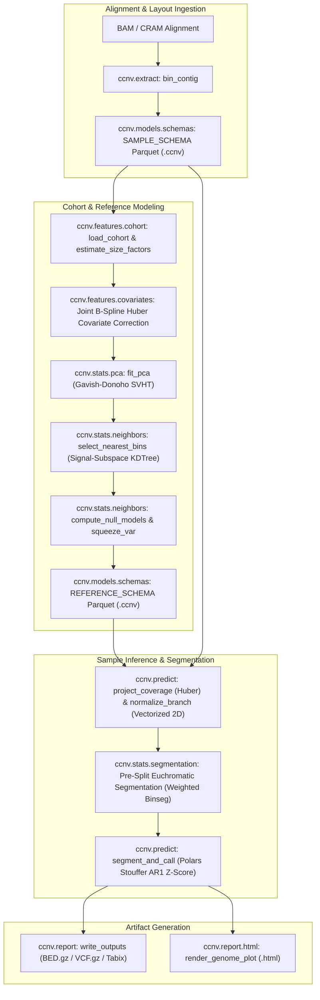

# `ccnv`

## Overview

The `ccnv` package implements an organism-agnostic, pure-Python bioinformatics framework for copy-number variation (CNV) detection in shallow whole-genome sequencing (sWGS) data. Drawing statistical inspiration from WISECONDOR and WisecondorX, the architecture formalizes a complete data transformation lifecycle spanning alignment streaming, DESeq2 median-of-ratios depth scaling, joint B-spline Huber covariate bias correction, Gavish-Donoho SVHT PCA, signal-subspace `KDTree` off-contig nearest-neighbor modeling, Smyth Empirical Bayes variance shrinkage, pre-split euchromatic change-point segmentation, Polars autocorrelation-corrected Stouffer Z-score calling, and tabix-indexed reporting.

### Algorithmic Foundations

#### 1. Binned Read Counting and Coordinate Contracts
Alignments are processed contig-by-contig with single-pass coordinate streaming using `pysam.AlignmentFile`. Reads failing quality criteria (unmapped, secondary, supplementary, duplicate, vendor failed, or below `--min-mapq`) are excluded. The genomic continuum is partitioned into 0-based half-open intervals $[s_i, e_i)$ of width $B$ (default $5\,000\text{ bp}$), where the terminal bin is truncated to contig length $L$. Read start coordinates are aggregated into a 1D unsigned 64-bit integer array. Rebinning across integer-multiple resolutions uses a Rust-parallelized Polars integer fast-path, while non-nested coordinate reconciliation uses piecewise linear cumulative count interpolation, strictly conserving continuous `float64` read totals across grids.

#### 2. DESeq2 Median-of-Ratios Scaling & Joint B-Spline Huber Covariate Normalization
Sequencing coverage exhibits non-linear dependencies on local GC content and mappability. Bins with valid bases $\le 0$, ambiguous base fraction $N \gt 0.5$, or mappability below $\tau_{\text{map}}$ (default $0.5$) are masked. Samples are scaled using DESeq2 median-of-ratios size factors (Anders & Huber, 2010), providing a 50% breakdown point against whole-chromosome aneuploidies. A joint design matrix is constructed combining natural cubic B-splines with quantile knots for GC content, quadratic B-splines for mappability, and an interaction term. Multiplicative biases are estimated per sample via robust Huber M-estimation (`HuberRegressor`, $\epsilon = 1.35, \alpha = 10^{-4}$), clamped to $[0.20, 5.0]$, and divided out while preserving usable total depth.

#### 3. Gavish-Donoho SVHT PCA and Signal-Subspace Nearest-Bin Modeling
Per-sample normalized coverage is assembled across cohort samples. Bins exhibiting total normalized coverage $\le 5$% of the positive median bin depth are flagged as low-coverage and masked. Centered unscaled Singular Value Decomposition decomposes the matrix, with optimal subspace rank $P$ determined via Gavish-Donoho Optimal Singular Value Hard Thresholding (SVHT). Each bin is mapped to a $(P+2)$-dimensional signal subspace $\mathbf{f}_i \in \mathbb{R}^{P+2}$. Off-contig nearest neighbors are identified per contig via multi-threaded C-compiled `scipy.spatial.KDTree` queries, strictly excluding same-contig bins ($d_{ii} = \infty$). Surviving neighbors are pruned via a 3-pass iterative $3\sigma$ distance cutoff. Residual degrees of freedom are corrected for PCA rank ($d = \max(1, S_{\text{null}} - 1 - P)$), and per-bin null variances are moderated using Smyth (2004) Empirical Bayes shrinkage (`squeeze_var`).

#### 4. Robust Huber Projection & Vectorized Within-Sample Normalization
During single-sample prediction, sample counts are projected onto reference PCA loadings via robust Huber M-estimation (`HuberRegressor`, $\epsilon = 1.35$), preventing CNVs from pulling the diploid baseline. Within-sample references are refined through vectorized 2D neighbor-matrix median evaluations across $M$ iterations (default 3), masking outlier bins with $\vert Z_i \vert \ge 2.326347874$. Each usable bin receives an Empirical Bayes inverse moderated variance weight $w_i = \mathrm{clip}(s_0^2 / \tilde{\sigma}_{\text{null}, i}^2, 0.05, 20.0)$ proportional to the Gaussian log-likelihood (or $1/\bar{d}_i$ for flat FASTA references).

#### 5. Pre-Split Euchromatic Segmentation & Polars Autocorrelation-Corrected Stouffer Calling
Chromosomes are pre-split at masked gaps $\gt 2\text{ Mb}$ into contiguous euchromatic arm blocks before change-point optimization, preventing baseline coupling across centromeres. Solvers dispatch to C-compiled `ruptures.KernelCPD(kernel="linear")` for uniform weights, exact `ruptures.Pelt(custom_cost=WeightedL2Cost())` for variable weights, or `ruptures.Binseg(custom_cost=WeightedL2Cost())`. Segments are called using Polars-native Stouffer precision Z-scores with Newey-West AR(1) spatial autocorrelation correction, scaling sensitivity by $\sqrt{N}$ while preventing false-positive inflation from local genomic waves.

## Interface

### Subpackages & Contracts

- `features`: [features/README.md](./features/README.md) - Feature extraction, dynamic rebinning, DESeq2 cohort normalization, joint B-spline covariate bias correction, and prenatal inference models.
- `io`: [io/README.md](./io/README.md) - External format ingestion (BAM/CRAM, BigWig, FASTA), samplesheet validation, and Parquet storage.
- `models`: [models/README.md](./models/README.md) - Domain representations, configuration models, result structures, Arrow schemas (2.0.0), and exception types.
- `qc`: [qc/README.md](./qc/README.md) - Quality control accounting, reference model auditing, usability verdicts, and JSON metrics reporting.
- `report`: [report/README.md](./report/README.md) - Downstream bgzipped/tabix BED/VCF serialization and interactive Plotly HTML visualization.
- `stats`: [stats/README.md](./stats/README.md) - Stateless numerical kernels, Gavish-Donoho SVHT PCA, signal-subspace KDTree search, Smyth Empirical Bayes shrinkage, and weighted change-point segmentation.

### Package Symbols

- `[src/ccnv/cli.py:app]`: Primary Typer CLI application hosting `extract`, `reference`, `ref-qc`, and `predict` entry points.
- `[src/ccnv/extract.py:run]`: Ingests BAM/CRAM files, filters reads, performs multi-process binned counting, and writes sample Parquet.
- `[src/ccnv/features/cohort.py:estimate_size_factors]`: Calculates DESeq2 median-of-ratios library size factors with a 50% breakdown point against aneuploidies.
- `[src/ccnv/features/cohort.py:rebin_sample_table]`: Dynamically rebins sample tables in memory across compatible contig coordinate layouts.
- `[src/ccnv/io/parquet.py:load_cohort]`: Discovers, validates, and loads multiple control sample Parquet files.
- `[src/ccnv/features/cohort.py:cohort_from_fasta]`: Synthesizes an artificial flat uniform-depth cohort from FASTA sequence lengths.
- `[src/ccnv/io/tracks.py:load_gc_track]`: Extracts and validates GC content proportions from FASTA, BigWig, or BED/TSV files.
- `[src/ccnv/io/tracks.py:load_mappability_track]`: Loads per-bin mappability scores from BigWig tracks.
- `[src/ccnv/features/covariates.py:correct_covariate_bias]`: Normalizes GC and mappability biases using joint natural cubic B-spline and Huber M-estimation regression.
- `[src/ccnv/reference.py:run]`: Coordinates cohort loading, depth normalization, PCA decomposition, nearest-bin pairing, and reference Parquet creation.
- `[src/ccnv/ref_qc.py:run_reference_qc]`: Audits reference model Parquet tables and emits quality verdicts (`PASS`, `WARN`, `FAIL`).
- `[src/ccnv/stats/pca.py:optimal_svht_rank]`: Evaluates Gavish-Donoho Optimal Singular Value Hard Thresholding for PCA rank selection.
- `[src/ccnv/stats/neighbors.py:build_signal_space_features]`: Embeds PCA loadings and standardized sequence covariates into low-dimensional signal subspace $\mathbb{R}^{P+2}$.
- `[src/ccnv/stats/neighbors.py:select_nearest_bins]`: Parallel off-contig nearest-neighbor search in signal subspace via C-compiled `scipy.spatial.KDTree`.
- `[src/ccnv/stats/neighbors.py:compute_null_models]`: Calculates per-bin null log2 ratio means and degrees-of-freedom-corrected standard deviations.
- `[src/ccnv/stats/neighbors.py:squeeze_var]`: Result-equivalent Smyth (2004) / Phipson et al. (2016) Empirical Bayes variance shrinkage under inverse-$\chi^2$ prior.
- `[src/ccnv/stats/regression.py:build_joint_covariate_basis]`: Formulates joint natural cubic B-spline and interaction basis matrix for GC and mappability modeling.
- `[src/ccnv/stats/prenatal_math.py:fit_elasticnet_ffy]`: Fits non-negative ElasticNetCV regression across euchromatic `chrY` bins for `FFY` estimation.
- `[src/ccnv/stats/prenatal_math.py:fit_ffa_logit_ensemble]`: Calibrates convex logit-link `RidgeCV` + `ElasticNetCV` ensemble for `FFA` (fetal fraction autosomal) prediction.
- `[src/ccnv/qc/reference.py:run_reference_qc_on_table]`: Evaluates reference quality metrics and issues usability verdicts (`PASS`, `WARN`, `FAIL`).
- `[src/ccnv/predict.py:run]`: Coordinates single-sample normalization, PCA projection, Ruptures segmentation, calling, and reporting.
- `[src/ccnv/stats/segmentation.py:WeightedL2Cost]`: Custom Ruptures `BaseCost` computing weighted SSE for change-point detection in $O(1)$ time.
- `[src/ccnv/stats/segmentation.py:segment_contig]`: Segments an individual contig across euchromatic arm blocks.
- `[src/ccnv/report/__init__.py:write_outputs]`: Serializes tabix-indexed bgzipped BED and VCF tables for bins, segments, and calls.
- `[src/ccnv/report/html.py:render_genome_plot]`: Compiles interactive self-contained Plotly HTML visualizations using Jinja2 templates.
- `[src/ccnv/models/schemas.py:validate_table]`: Validates Arrow schemas and metadata against versioned contracts.
- `[src/ccnv/models/schemas.py:PrenatalModelMetadata]`: Encapsulates serialized prenatal model hyperparameter metadata, estimator coefficients, and standard error bounds.
- `[src/ccnv/models/config.py:ExtractConfig]`, `[src/ccnv/models/config.py:ReferenceConfig]`, `[src/ccnv/models/config.py:PredictConfig]`: Strongly-typed configuration containers.
- `[src/ccnv/models/results.py:BinResult]`, `[src/ccnv/models/results.py:SegmentResult]`, `[src/ccnv/models/results.py:PredictionOutputs]`: Common result dataclasses.

## Invariants

- `[src/ccnv/models/schemas.py:validate_table]`: All tables must strictly conform to `SAMPLE_SCHEMA` or `REFERENCE_SCHEMA` under Arrow schema version `2.0.0` with `0-based-half-open` intervals.
- `[src/ccnv/models/schemas.py:validate_metadata]`: Metadata requires non-empty `contig_lengths` mapping identifiers to positive integers; row coordinates must satisfy $0 \le \text{start} \lt \text{end} \le \text{length}$.
- `[src/ccnv/features/cohort.py:validate_cohort]`: Input cohort samples must share identical contig layouts, identical contig lengths, and matching bin coordinates.
- `[src/ccnv/features/covariates.py:validate_min_mappability]`: Minimum mappability must be a finite floating-point value in $[0.0, 1.0]$.
- `[src/ccnv/stats/neighbors.py:select_nearest_bins]`: Nearest-bin search explicitly queries off-contig bins via leave-one-contig-out `scipy.spatial.KDTree` to strictly prevent intra-contig neighbor selection.
- `[src/ccnv/stats/neighbors.py:compute_null_models]`: Null distribution sampling is bounded to at most 100 cohort samples; residual degrees of freedom are adjusted for PCA rank.
- `[src/ccnv/stats/segmentation.py:WeightedL2Cost]`: Signal values and weights must have identical lengths; non-finite values or negative weights are zeroed.
- `[src/ccnv/stats/segmentation.py:segment_contig]`: Bins must be sorted, non-overlapping ($\text{start}_{i+1} \ge \text{end}_i$), with finite positive penalty and $\text{jump} \ge 1$.
- `[src/ccnv/predict.py:normalize_branch]`: Retains only bins satisfying $\vert Z_i \vert \lt 2.326347874$; masks bins possessing fewer than $\tau_{\text{ref}}$ valid reference bins.

## Side Effects

- `[src/ccnv/extract.py:_worker_handle]`: Opens BAM/CRAM handles using `pysam.AlignmentFile` and maintains a per-worker handle cache.
- `[src/ccnv/io/alignments.py:ensure_index]`: Generates BAM (`.bai`) or CRAM (`.crai`) index files on disk via `pysam.index` when missing.
- `[src/ccnv/io/parquet.py:write_sample_parquet]`: Creates target directory hierarchies and writes zstd-compressed Parquet files to disk.
- `[src/ccnv/io/tracks.py:read_fasta_contigs]`: Generates FASTA index files (`.fai`) on disk via `pysam.faidx` when absent.
- `[src/ccnv/stats/neighbors.py:select_nearest_bins]`: Queries C-compiled `scipy.spatial.KDTree` using multi-threaded execution (`workers=threads`).
- `[src/ccnv/reference.py:run]`: Writes `<prefix>.ccnv` reference Parquet and optionally writes `<prefix>_qc.json` while emitting formatted QC metrics to `sys.stderr`.
- `[src/ccnv/report/__init__.py:write_outputs]`: Writes bgzipped files (`_bins.bed.gz`, `_segments.bed.gz`, `_calls.bed.gz`, optional VCFs) and creates tabix indices (`.tbi`) via `pysam`.
- `[src/ccnv/report/html.py:render_genome_plot]`: Writes standalone HTML visualization `<prefix>_plot.html` to disk.

## Verification

- Run: `pytest`
