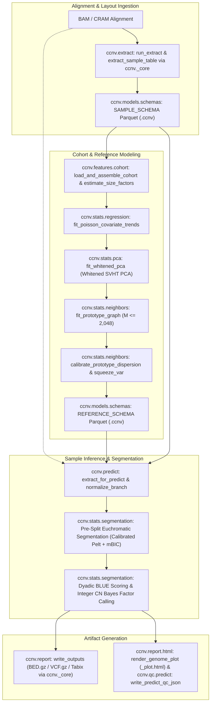

# `ccnv`

## Overview

The `ccnv` package implements an organism-agnostic bioinformatics framework for copy-number variation (CNV) detection in shallow whole-genome sequencing (sWGS) data across germline and cell-free DNA prenatal (NIPT) workflows. Building on published within-sample reference normalization methodology (Straver et al., 2014; Raman et al., 2019), the package spans compiled Rust tile streaming (`ccnv._core`), 24-band fragmentomics extraction, 1 Mb super-block DESeq2 median-of-ratios depth scaling, zero-inclusive `PoissonRegressor` covariate bias correction, variance-whitened Gavish-Donoho SVHT PCA, Prototype Graph ($`M \le 2{,}048`$) off-contig reference modeling, Smyth Empirical Bayes biological overdispersion modeling, pre-split euchromatic change-point segmentation with calibrated `ruptures.Pelt`, dyadic multi-scale BLUE Z-score aggregation, discrete integer copy-number Bayes factor calling, and single-pass tabix-indexed/HTML reporting.

### Algorithmic Foundations

#### 1. Binned Read Counting, 24-Band Fragmentomics, and Coordinate Contracts

Alignments are processed contig-by-contig with high-performance tile streaming using the compiled Rust `ccnv._core` scanner (`noodles-bam` and `noodles-cram`). Reads failing quality criteria (unmapped, missing reference start, secondary, supplementary, duplicate, improper pair on paired reads when `--require-proper-pair` is active, or below `--min-mapq`) are excluded. Target contigs are partitioned into 0-based half-open intervals $`[s_i, e_i)`$ of width $`B`$ (default $`5{,}000\text{ bp}`$), truncating the terminal bin to contig length $`L`$. Properly paired upstream templates (`TLEN > 0`) are binned at their nucleosome dyad midpoint (`start + TLEN // 2`) across seven channels (`count: uint32`, `paired_count: uint32`, `frag_len_sum: uint64`, `short_frag_count: uint32` for $`[80, 150]\text{ bp}`$ inserts, `endpoint_count: uint32`, `frag_gc_sum: float32`, and 24 fixed-width fragment length bands `frag_bands`) alongside sample-level $`5'`$ 4-mer motifs and 1-bp length histograms (`ccnv.fragmentomics`), while single-end reads bin by $`5'`$ start coordinate. Contained integer-multiple coarsening uses a vectorized NumPy `np.add.reduceat` fast path aggregating all channels, whereas non-nested rebinning uses cumulative count knot interpolation over `float64` counts (clearing fragmentomic channels and `ccnv.fragmentomics` metadata).

#### 2. 1 Mb Super-Block DESeq2 Scaling & Zero-Inclusive PoissonRegressor Covariate Normalization

Bins with zero A/C/G/T/U bases, ambiguous base fraction $`N \gt 0.5`$, non-finite GC outside $`[0, 1]`$, or mappability below $`\tau_{\text{map}}`$ (default $`0.5`$) are masked. Cohort samples are normalized using DESeq2 median-of-ratios size factors (Anders & Huber, 2010) over 1 Mb super-blocks ($`G \approx 3{,}000`$), providing a 50% breakdown point against whole-chromosome aneuploidies. Over usable bins, an exogenous covariate basis is constructed from $`200\text{ bp}`$ GC quantile histograms (when available and $`B \ge 25{,}000`$) or quantile B-splines, mappability splines, and cohort fragmentomic reference values. Multiplicative per-sample depth trends are fitted via zero-inclusive `PoissonRegressor` ($`\alpha = 10^{-4}`$), normalized by median positive trend, clamped to $`[0.20, 5.0]`$, and divided out while preserving total usable sample depth.

#### 3. Whitened Gavish-Donoho SVHT PCA and Prototype Graph Modeling

Bins with total normalized cohort depth $`\le 5`$% of the positive median contig coverage are masked before centered SVD decomposition on variance-whitened residuals, with subspace rank $`P`$ chosen via Gavish-Donoho Optimal Singular Value Hard Thresholding (SVHT). Usable bins are embedded into standardized signal subspace coordinates and clustered into $`M = \min(2048, U_u, \max(8, \lfloor U_u / 64 \rfloor))`$ prototypes via `MiniBatchKMeans`. Each bin is mapped to $`k=4`$ nearest off-contig prototypes with soft inverse-distance weights. Empirical null means and depth-decomposed biological overdispersions (separating Poisson shot noise from technical dispersion) are moderated via Smyth (2004) Empirical Bayes shrinkage (`squeeze_var`, `bio_dispersion`).

#### 4. Reference-Side 24-Band Fisher Weighting & Robust Huber Projection

In `--mode prenatal` with paired-end fragmentomics and deconvolved reference densities, reference-side 24-band Fisher read weights $`w^{\ast}_{0.08}(L) \in [0.25, 3.0]`$ are applied during reference construction, avoiding test-time baseline distortions. Sample counts are projected onto reference PCA loadings via unpenalized `HuberRegressor` ($`\epsilon = 1.35, \alpha = 0.0`$). Within-sample baselines are evaluated against $`k=4`$ nearest prototypes from the Prototype Graph, masking coarse outlier blocks with $`\vert Z_{\text{block}} \vert \gt 3.5`$, and synthesizing depth-decomposed Empirical Bayes precision weights.

#### 5. Pre-Split Euchromatic Pelt Segmentation, Dyadic BLUE Scoring & 5-State Origin Engine

Contigs are pre-split at masked gaps $`\gt 2\text{ Mb}`$ into contiguous euchromatic arm blocks before change-point detection via calibrated `ruptures.Pelt(custom_cost=WeightedL2Cost())` with modified BIC (mBIC) penalty. Segments are scored using Gauss-Markov Best Linear Unbiased Estimator (BLUE) Z-scores adjusted for multi-scale dyadic variance inflation. Germline calls are made using discrete integer copy-number Bayes factors ($`\ln \mathrm{BF}_{CN \ne 2} \gt 2.0`$) over $`CN \in \lbrace 0, 1, 2, 3, 4+\rbrace`$, detecting homozygous deletions ($`CN=0`$) down to $`0.1\times`$ sequencing depth. In `--mode prenatal`, `predict_prenatal` evaluates `FFY`, `FFA`, `FFX`, `FF_size`, 4D erfc ray-marginalized SCA calls, Student-$`t_4`$ IRLS fused `active_ff`, and Fisher-weighted `effective_ff`, while annotating segment discordance and classifying biological origin via a 5-state self-referenced coupled depth + Dirichlet-Multinomial origin engine (`FETAL_CONSTITUTIONAL`, `PLACENTAL_MOSAIC`, `MATERNAL_UNINHERITED`, `MATERNAL_AND_FETAL_INHERITED`, `MATERNAL_MOSAIC`, with `INDETERMINATE` when max posterior $`\lt 0.80`$).

## Interface

### Subpackages & Contracts

- `features`: [features/README.md](./features/README.md) - Binning, dynamic rebinning, 1 Mb super-block DESeq2 cohort normalization, covariate masking, sex inference, fragmentomics feature transforms, and prenatal inference workflows.
- `io`: [io/README.md](./io/README.md) - High-performance tile streaming via `ccnv._core`, external track ingestion (FASTA, BigWig, BED/WIG/TSV, cytobands), samplesheet validation, and versioned Parquet I/O.
- `models`: [models/README.md](./models/README.md) - Domain types, configuration containers, result dataclasses, zero-copy `SampleBuffers` and `BranchFitArrays`, Arrow `2.0.0` schemas, metadata models, validation routines, and exceptions.
- `qc`: [qc/README.md](./qc/README.md) - Sample read accounting, reference usability auditing (`PASS`/`WARN`/`FAIL`), and atomic JSON QC payload writers.
- `report`: [report/README.md](./report/README.md) - Single-pass atomic bgzipped/tabix BED and VCFv4.2 serializers via `ccnv._core` and interactive Plotly HTML genome viewer.
- `stats`: [stats/README.md](./stats/README.md) - Stateless numerical kernels for SVHT PCA, Prototype Graph search, `squeeze_var`, Poisson and Huber regression, calibrated Pelt segmentation, BLUE scoring, Bayes factor calling, prenatal estimators, and fragmentomics math.
- `crates/ccnv-core`: Rust extension wrapping `noodles` and `bigtools` for BAM/CRAM scanning, FASTA GC quantile calculation, and single-pass BGZF/tabix/CSI writing.

### Package Symbols

- [`__init__.py`](./__init__.py): Top-level public API exporting `run_extract`, `run_reference`, `run_reference_qc`, `run_predict`, configuration dataclasses (`ExtractConfig`, `ReferenceConfig`, `ReferenceQCConfig`, `PredictConfig`, `ReadFilters`), stage exceptions (`AlignmentError`, `ExtractError`, `ReferenceError`, `ReferenceQCError`, `PredictError`), and `__version__`.
- [`cli.py:app`](./cli.py): Typer CLI application hosting `extract`, `reference`, `ref-qc`, and `predict`.
- [`extract.py:run`](./extract.py) (`run_extract`): Streams BAM/CRAM alignments across contigs, accumulates 7-channel counts and fragmentomics, and writes sample `.ccnv` Parquet.
- [`reference.py:run`](./reference.py) (`run_reference`): Builds cohort or flat FASTA germline and prenatal reference `.ccnv` Parquet tables and writes `<prefix>_qc.json`.
- [`ref_qc.py:run_reference_qc`](./ref_qc.py): Audits reference `.ccnv` Parquet tables, prints usability verdicts to `stderr`, and writes `<prefix>_qc.json`.
- [`predict.py:run`](./predict.py) (`run_predict`): Executes single-sample normalization, PCA projection, calibrated Pelt segmentation, BLUE scoring, Bayes factor calling, prenatal/fragmentomic annotation, BED/VCF/HTML reporting, and `<prefix>_qc.json` serialization.

## Invariants

- [`models/validation.py:validate_sample_table`](./models/validation.py), [`validate_reference_table`](./models/validation.py), & [`validate_schema`](./models/validation.py): Persisted tables must conform to `SAMPLE_SCHEMA` or `REFERENCE_SCHEMA` under `SCHEMA_VERSION = "2.0.0"` (`SUPPORTED_SCHEMA_VERSIONS = {"2.0.0"}`) with `0-based-half-open` coordinates.
- [`models/validation.py:validate_metadata`](./models/validation.py): Metadata requires non-empty `contig_lengths` mapping contig names to positive integers with $`0 \le \text{start} \lt \text{end} \le \text{length}`$.
- [`features/cohort.py:validate_cohort`](./features/cohort.py): Cohort samples must share identical contig order, contig lengths, bin intervals, and homogeneous sequencing pairing (all paired-end or all single-end).
- [`features/covariates.py:validate_min_mappability`](./features/covariates.py): Minimum mappability must be a finite float in $`[0.0, 1.0]`$.
- [`stats/neighbors.py:fit_prototype_graph`](./stats/neighbors.py): Builds Prototype Graph using leave-one-contig-out prototype selection so same-contig prototypes are never assigned.
- [`stats/segmentation.py:segment_contig`](./stats/segmentation.py): Bins must be sorted and non-overlapping ($`\text{start}_{i+1} \ge \text{end}_i`$) with finite positive penalty and $`\text{jump} \ge 1`$.
- [`features/normalization.py:normalize_branch`](./features/normalization.py): Requires at least `min_reference_bins` surviving prototype references per bin.

## Side Effects

- [`extract.py`](./extract.py) & [`io/alignments.py`](./io/alignments.py): Stream BAM/CRAM handles via compiled Rust `ccnv._core`.
- [`features/cohort.py:load_and_assemble_cohort`](./features/cohort.py) & [`io/parquet.py`](./io/parquet.py): Spawn worker threads during parallel cohort streaming (spilling to temporary `np.memmap` files above `max_batch_memory_mb`) and write Zstandard-compressed Parquet files.
- [`reference.py`](./reference.py), [`ref_qc.py`](./ref_qc.py), & [`predict.py`](./predict.py): Atomically write `<prefix>_qc.json` payloads via [`qc/sample.py:write_qc_json`](./qc/sample.py) and emit reference QC usability verdicts to `sys.stderr`.
- [`report/__init__.py:write_outputs`](./report/__init__.py) & [`report/html.py:render_genome_plot`](./report/html.py): Atomically write single-pass bgzipped/tabix-indexed BED and VCF deliverables via `ccnv._core` and standalone HTML viewer `<prefix>_plot.html`.

## Verification

- Run: `pixi run test`
